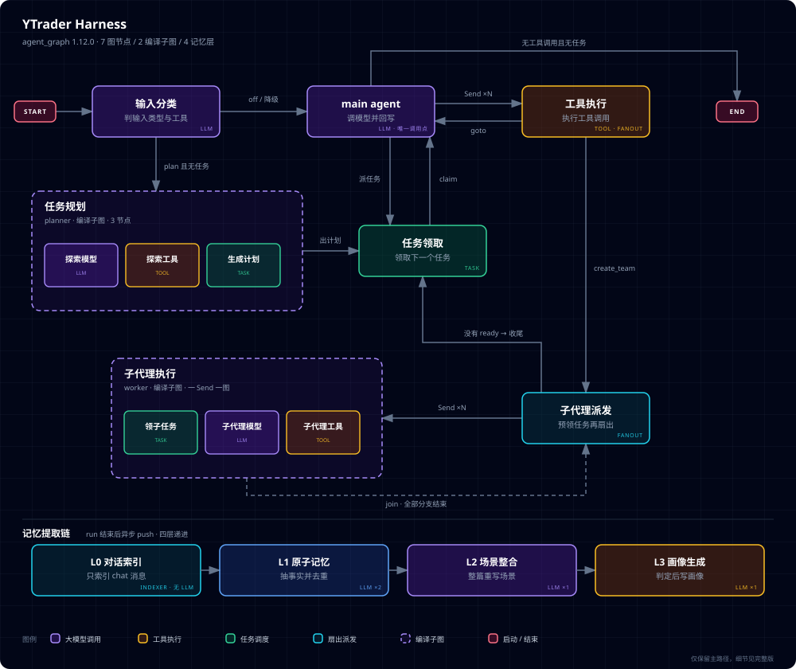

# YTraderHarness

> **YTraderHarness** 是一个**面向生产**的 Agent 运行时。它把「模型怎么选、上下文怎么拼、工具怎么放行、审批怎么落地、记忆怎么提炼」从散落在 prompt 与 if-else 里的隐性约定，变成**显式配置 + 显式失败**的数据。
>
> 大多数 Agent 框架把「能跑通一次对话」当作终点，这个项目把**跑通之后的事**当作起点 —— 改一个工具给模型看的说明要不要发版、给某个工具换前置校验要不要重启、模型漏配会不会静默降级、审批记录重启后还在不在、流式输出里混进模型的私有标记会不会原样发给用户。
>
> 这些问题的共同答案是同一条立场：
>
> ***静默失败是最贵的失败。*** 宁可显式炸，也不要悄悄跳过。

`Python 3.14` · `FastAPI 0.141` · `LangGraph 1.2` · `PostgreSQL + pgvector` · `Redis Stream` · `Milvus` · `Elasticsearch` · `Neo4j`

---

## 📚 Quick Links

| 入口 | 关键数字 | 什么时候看 |
|---|---|---|
| 🚀 [`README_STARTUP.md`](README_STARTUP.md) **启动与配置** | 15 份运行时配置 / 21 份契约 | 第一次跑起来、启动失败排障 |
| 📄 [`README_DOCUMENT.md`](README_DOCUMENT.md) **文档与 RAG** | 11→16 个节点 / 4 段读取 | 摄入流水线、多路召回、加组件 |
| 📊 [`README_EVAL.md`](README_EVAL.md) **检索评测** | 9 张表 / 12 个端点 | 评召回、看金标死在哪一段 |
| 🧠 [`README_CONTEXT.md`](README_CONTEXT.md) **上下文装配** | 13 段 / 14 个处理器 | 流水线段序、处理器的边界 |
| 🤖 [`README_MODEL.md`](README_MODEL.md) **模型选择** | 6 段目录 / 10 个角色 / 14 条绑定 | 配模型、解析不出来时查什么 |
| 🛠️ [`README_TOOL.md`](README_TOOL.md) **工具与审批** | 9 个内置处理器 / 6 张表 | 处理器链、HITL、运行时改链 |
| 💾 [`README_MEMORY.md`](README_MEMORY.md) **四层记忆** | 4 层 / 10 张表 / 只有 L1 不可重建 | L0–L3 分工、什么时候提炼 |
| 🗺️ [`README_PLAN.md`](README_PLAN.md) **计划模式** | 1 个子图 / 3 个节点 | 请求怎么变成一张 DAG |
| 👥 [`README_SUB_AGENT.md`](README_SUB_AGENT.md) **子代理** | 1 个 worker 子图 / 3 个节点 | worker 怎么派发、任务板怎么防重复 |
| ⚠️ [`todolist`](todolist) **已知缺口** | 按子系统分 10 节 | 缺什么、什么时候会骗到你 —— **只在这一处维护** |

---

## 🚀 Quick Start

### 1. 依赖矩阵

| 依赖 | 必需 | 缺了会怎样 |
|---|---|---|
| PostgreSQL（pgvector） | ✅ | **起不来** —— `postgre.yaml` 与 `checkpointer.yaml` 都是 `required: true` |
| Redis | ✅ | SSE 事件流与子代理任务板不可用 |
| Milvus / Elasticsearch | 可选 | 对应检索路进 `degraded_routes`，其余照常 |
| Neo4j | 可选 | 已接为 DataSource，但**尚未被业务消费** |

### 2. 启动

```bash
# ⚠️ 用 .venv 里的 python，不要用裸 python
#    （裸 python 是旧 anaconda，SQLAlchemy 太老，直接 ImportError）
.venv/Scripts/python.exe run_server.py              # 默认 localhost:8080
.venv/Scripts/python.exe run_server.py --port 8081

# ⚠️ 不要用 `uvicorn app.main:app`
#    psycopg 需要 SelectorEventLoop，而 uvicorn 0.36+ 会忽略 asyncio policy
```

### 3. 自检

```bash
.venv/Scripts/python.exe -m app.agent.spec_check     # 契约自检（当前覆盖 document 域）
.venv/Scripts/python.exe -m app.agent.tool_smoke     # 工具发现 + 注册表一致
.venv/Scripts/python.exe -m app.agent.prompt_smoke   # 提示词目录（含 1 条已知过期断言）
```

### 4. 重置数据

```bash
.venv/Scripts/python.exe reset_data.py
```

> 所有 `/api/v1` 业务接口都要鉴权，无 token 一律 **401**
> （`tests/api/test_auth_enforcement.py` 遍历 `protected_router` 守着这件事）。
> `/docs` 与 `/openapi.json` 不挂在这棵树上，因此**对匿名访问者可见** —— 这是有意识的决定。

---

### 5. 架构总览



一张图看全三件事：**主图**（`builder → agent → tools`，含 planner 分支与 `subagent_dispatch` 扇出）、
**两张编译子图**（`planner` 做规划、`subagent_worker` 执行单个已 claim 的任务，都不是独立注册的图）、
以及**不在任何图里**的**记忆提取链**（run 结束后异步 push，L0 → L1 → L2 → L3 逐层递进）。

> 图里标了 `LLM` 的节点是**真正调模型**的地方 —— 主图里只有 `builder`（分类）与 `agent`（推理）两处；
> 记忆链另有 **4 次**调用（L1 抽取 + 去重各 1 次、L2 整合 1 次、L3 画像 1 次），L0 只建索引不调模型。
> 凡是没有标 `LLM` 的节点都是纯计算或纯 IO。

### 分层与依赖方向

```
app/common  ←  app/services  ←  app/infra  ←  app/bootstrap  ←  app/main.py
```

箭头指向「被依赖」。**`app/common` 与 `app/infra` 都不允许 import 业务模块** ——
这正是「任务 Handler 的注册点必须在 `app/bootstrap/task.py` 而不在 `app/infra`」的硬理由。

### 目录树

```
app/
├── main.py            # FastAPI app + lifespan（组合根，只负责排序）
├── serve.py           # uvicorn 启动（显式 SelectorEventLoop）
├── bootstrap/         # 装配层：auth / event_stream / graph_runtime / pipelines / task
├── api/v1/            # HTTP 路由（契约实现）+ router.py（public / protected 两棵树）
├── agent/             # LLM 运行时（图侧，不做业务持久化）
│   ├── graph/react/   # 父图：builder / agent / tools / task_listener / subagent_dispatch
│   ├── graph/planner/ # 规划子图：planner_llm / planner_tool / task_generator
│   ├── graph/subagent/# worker 子图：task_listener / llm_node / tool_node
│   ├── plan/          # 计划层：契约校验 / A2A 转换 / 任务板 / claim（不 import LangGraph）
│   ├── context/       # ContextBuilder 流水线（13 段 + 14 处理器）
│   ├── model/         # ModelRegistry / resolver / adapters / runtime
│   ├── prompt/        # 节点功能提示词（分类、记忆、摘要、规划）
│   ├── tools/         # 处理器链契约（interceptor / observer / transformer）+ @tool
│   └── event/         # Redis Stream 事件实现（publisher / reader / sse / run_stream）
├── services/          # 业务模块，各自 domain / application / models / repository 分层
│   ├── capability/    # 能力树（工具暴露的分类法）
│   ├── document/      # 摄入流水线 + RAG 检索 + 检索评测
│   ├── file/          # 文件与产物存储
│   ├── memory/        # L0–L3 记忆
│   ├── prompt/        # 职责提示词（业务数据）
│   ├── session/       # session / run / message + ReAct 调度 handler
│   ├── task/          # 异步任务持久化（tasks / outbox）
│   ├── tool/          # 工具定义注册与同步
│   └── user/          # Casdoor 鉴权 + 用户检索
├── infra/             # 共享运行时内核（不 import 业务）
│   ├── graph/         # GraphRegistry / dispatcher / checkpointer / runner
│   ├── datasource/    # DataSource 抽象 + postgres / redis / es / milvus / neo4j
│   ├── task/          # 任务 worker / dispatcher / outbox / retry
│   └── agent/         # 工具执行器 + 暴露 + 链折叠
├── common/            # 共享内核：工厂、模型、鉴权、schema、任务协议
└── config/            # 运行时配置（15 份 yaml）
```

### 四个图身份、两个注册图

都在 `app/bootstrap/pipelines.py` 装配，注册进同一个 `GraphRegistry`，由同一个
`InProcessGraphDispatcher` 运行（一个 asyncio 队列 + 一个串行 worker；每个 run spawn 子任务，
**因此取消针对的是 run，不是 worker**）。

| 图 | `GRAPH_NAME` | 版本 | 形态 |
|---|---|---|---|
| 文档摄入管线 | `document_ingestion_pipeline` | `1.0.0` | **独立注册** |
| Agent ReAct | `agent_react` | **`1.12.0`** | **独立注册**，父图 |
| ↳ Planner | `agent_planner` | `0.1.0` | `build_planner_graph().compile()` 作为节点 `planner` |
| ↳ Sub-Agent worker | `agent_subagent` | `0.1.0` | `build_subagent_graph().compile()` 作为节点 `subagent_worker` |

> ⚠️ 子图的 `GRAPH_NAME`（`agent_planner` / `agent_subagent`）目前**只做声明与再导出**，
> 没有任何运行期消费者 —— 只有 `agent_react` 与 `document_ingestion_pipeline` 进了
> `GraphDefinition(name=...)`。子图的运行期观测靠**节点 id**（`node_span`），不是图名。
>
> 子图 `compile()` **不带 checkpointer**（继承父图的），`interrupt` 由父 Pregel 循环管理。
> 代价是子图输出会按**同名 channel** 合并回父 state —— 已用 `input_schema` / `output_schema` 隔掉。

### Agent ReAct 图（`agent_react` v1.12.0）

```
START → builder
builder --(分类判要规划)--> tools            # 合成一条 enter_plan_mode 调用，与模型自己调用同一条路径
builder --(plan 且没有任务 / 任务全完成)--> planner
builder --(其余)--------> agent

planner --> task_listener --> agent         # YTRADER_PLAN_STOP_AFTER_PLANNER=1 时 planner -> END
agent --(有 tool_calls)--> tools ×N         # 一个 tool_call 一个 Send 分支
agent --(无 tool_calls，还有任务)--> task_listener
agent --(无 tool_calls，没有任务)--> END
tools --(Command.goto)--> agent | planner | subagent_dispatch

subagent_dispatch --(预 claim，Send ×N)--> subagent_worker ×N
subagent_worker   --(join)--------------> subagent_dispatch   # 下一波
subagent_dispatch --(没有 ready task)----> task_listener      # 收尾
```

| 节点 | 职责 | 用哪类模型 |
|---|---|---|
| `builder` | 输入分类 + **能力选择 → 工具集**（每 run 一次） | 快模型（`CLASSIFICATION`） |
| `agent` | 主循环 | 推理模型（`REASONING`） |
| `planner` | **编译子图**：ReAct 探索 → 严格 JSON 的 `PlanDraft` → A2A 任务 | 推理（`agent_type=planner`） |
| `tools` | 扇出：每个 tool_call 一个分支，各自过处理器链 | — |
| `task_listener` | 完成上一个任务 → claim 下一个；全终态时触发**汇总回合** | — |
| `subagent_dispatch` | 从任务板**预 claim** 最多 `subagent_workers` 个 ready task，动态 `Send` 扇出 | — |
| `subagent_worker` | **编译子图**：一个分支执行一个已 claim 的任务 | 推理（`agent_type=subagent`） |

> **为什么扇出成「一个 tool_call 一个分支」**：HITL 的 resume 语义依赖它 ——
> 一分支一个中断，审批账本跳过时才不会让后面的中断错位。

### 一次对话的完整链路

```
POST /sessions/{id}/runs
  → 存消息、建 run 记录（session 域）
  → InProcessGraphDispatcher.dispatch()（入队 → 子任务）
  → builder 节点：从 DB 现读能力候选 → 一次分类 LLM 调用 → capability_needs → tool_keys
       └─ 判要规划 → 合成一条 enter_plan_mode 调用 → tools 节点 → 图跳到 planner
  → planner 子图（可选）：ReAct 探索 → task_generator 产出 A2A 任务
       └─ 只发 plan.published 事件 + 写父图 state；不发布任务板
  → task_listener：claim 第一个 ready task（或发现 ≥2 个 ready 时先问 main agent 要不要开团队）
  → agent 节点：ContextBuilder 跑 13 段流水线
       → 拼出一条 SystemMessage（各处理器 section 按序注入）
       → ModelResolver：「(agent_type, model_role, attributes)」→ profile
       → ModelRuntime：候选链 / 重试 / 超时 / fallback
       → 流式产出 → leaked_tool_call 字符流闸 → 事件发布
  → 有 tool_calls？ → tools 扇出 → 处理器链（auth → approval[可能 interrupt] → cache → 真正调）
       └─ create_team 审批通过 → 发布任务板 → subagent_dispatch 预 claim → Send ×N
  → 全部任务终态 → task_listener 起汇总回合（结果从任务板 artifact 取，不取 worker transcript）
  → 事件经 Redis Stream → SSE 下发；遇审批主动关流（前端自行 resume 后重开）
```

---

## 🧩 五个核心能力

### 一、工具定义与拦截器链**运行时**可改

**主张：改工具给模型看的说明、换它的前置/后置处理器、调它们的顺序 —— 都不发版、不重启。**

| 维度 | 能不能运行时改 | 端点 |
|---|---|---|
| 说明文本（工具级 + 逐参数 `description_override`） | ✅ **下一次模型调用生效**（每次 build context 现读，无缓存） | `PUT /tools/{tool_id}/documentation` |
| `input_schema` 的类型 / 必填 / 默认 | ❌ 归代码所有 | — |
| 处理器链的增删改排 | ✅ 每次工具调用都从 DB 重读链（`ToolExecutor._load_chain`） | `/tools/{tool_id}/processors` |
| 新建一个**处理器实现** | ❌ 处理器目录是只读的，需要发版 | — |

**9 个内置处理器**（按反射从 `app.agent.tools.processor` 自动发现）：
`approval_interceptor` · `auth_interceptor` · `cache_interceptor` · `execution_guard_interceptor` ·
`timeout_interceptor` · `retry_interceptor` · `privacy_transformer` · `event_observer` · `metrics_observer`

**洋葱折叠**：`compile_chain` 从链尾往头递归包，最内层是真正调 service 方法的 `_base_call`。
`BEFORE` 在外层（可直接短路整条链）、`AFTER` 在内层（可改 `outcome`）、`AROUND` 占两行（进入 + 无操作退出）、
`ASYNC` 观察者用 `create_task` 甩出去**不 await**（监控不阻塞工具调用）。

**写入即校验**：未知 `processor_key` → 404；hook 不支持 / 执行模式不支持 / AROUND+ASYNC / 洋葱区间交叉 / 重排 id 不全 → 409；
`config` 不过 `config_model` → 400。**三层防护**：应用层校验 → DB `CHECK` 约束 → 执行期 `build_chain._validate`。

> 洋葱嵌套用**栈式校验**（`validate_onion`）保证区间正确嵌套而非交叉 ——
> 交叉意味着 AROUND 的进入与退出挂到了不同层，折叠出的调用顺序不是你想的那个。

📖 细节 → [`README_TOOL.md`](README_TOOL.md)

### 二、工具级监控

**主张：每一次工具调用都能回答「跑了没、成功没、花了多久、因为什么失败、是不是重复调用」。**

| 层 | 载体 | 持久性 |
|---|---|---|
| 进程内实时 | `ToolEventBus`（`STARTED`/`SUCCEEDED`/`FAILED`/`DENIED`）+ `ToolMetricsRegistry`（按 tool_key 计数与时长） | 重启清零 |
| 落库权威记录 | `tool_execution` 表（`param_hash` + 唯一约束 + `INSERT ... ON CONFLICT` 原子抢占） | 持久 |

> ⚠️ `DENIED` 与 `FAILED` 是**两件事**：`DENIED` = 工具**根本没跑**（被 auth / approval 短路），
> `FAILED` = 跑了但报错。指标里 `denied` **单独计数、不计入 `errors`** —— 否则「审批拒绝」会污染错误率。

**这张表就是幂等的基础**：唯一约束 `(session_id, run_id, tool_key, param_hash)` +
一条 `INSERT ... ON CONFLICT DO UPDATE WHERE status IN retryable` 原子抢占。
重放与并发重复调用交给数据库，应用层不做「先查后写」那种有竞态的判断。

> ⚠️ 当前边界：**实时诊断能力强，历史可查询能力弱** —— 指标没有查询接口、没有 Prometheus 导出、
> `tool_execution` 没有 API 读、没有 reaper。详见 [`todolist`](todolist)。

### 三、渐进式工具暴露：按树型业务分类现算

**主张：不给模型看全部工具。每一轮运行开始时，按业务分类现算一遍它该看哪些。**

```
用户输入
  └─ builder 节点（每个 run 只跑一次）
       ├─ 从 DB 现读活跃能力候选集  CapabilityService.list_capabilities(is_active=True)
       │    └─ 读不到 → 降级为空集 + 记录 note（不炸）
       ├─ 一次 LLM 调用（agent_type="react" + ModelRole.CLASSIFICATION）
       │    └─ 候选集渲染进提示词：每行 "code：name —— description"
       ├─ 产出 capability_needs（限制在候选集内，未知落 other）
       └─ tool_keys = 这些能力 code 映射到的工具
  └─ 写入 context_policy.tool_keys（随 checkpoint 持久化）
```

两个必须分清的粒度：

| | 何时算 | 运维改数据的生效点 |
|---|---|---|
| **key 集合** `context_policy.tool_keys` | **每 run 一次**（builder 只跑一次，图里没有回边） | **下一次 run** —— 当前 run 已快照 |
| **可绑定工具对象** | **每次模型调用**重算（INITIAL 与每次 CONTINUATION 各一次） | 立即 |

**「可见 == 可执行」是构造出来的，不是靠约定**：可见侧（`CapabilityProcessor` → `RegistryToolExposureSource.resolve`）
与执行侧（tools 节点 `_wrap_tool_call`）调用**同一个纯函数 `select_specs`，传同一份 `tool_keys`**。

> ⚠️ 两条边界：① 「在集合里」≠「一定会执行」（下游还有 fail-closed 的目录解析、幂等抢占、处理器链拒绝）；
> ② `wire_name` 是多对一的（`a_b.c` 与 `a.b_c` 都换成 `a_b_c`），碰撞时有 **WARNING**，不是静默选择。
>
> ⚠️ 树形结构用于**组织**，门禁本身是**平**的：`is_active` 不递归到子树，工具查找按 `code IN (...)` 精确匹配。
> **想停掉一整块，得逐个节点停用。**

📖 细节 → [`README_TOOL.md`](README_TOOL.md) · [`README_CONTEXT.md`](README_CONTEXT.md)

### 四、RAG 流水线：全链条可配置、可拓展

**主张：从文件到可检索索引的每一个环节都是「注册表 + 配置选实现」，换实现不动调用方，加组件不碰中心清单。**

| 链路 | 方向 | 载体 | 入口 |
|---|---|---|---|
| **写入（ingestion）** | 文件 → 清洗文本 → chunk → 向量 → 索引 | LangGraph 状态图（11 个 spec 节点，编译后 16 个） | `DocumentService.create/update/reprocess` |
| **读取（retrieve）** | 查询 → 多路召回 → 融合 → 过滤 → 精排 → 裁剪 | 普通 async 服务方法 | `POST /documents/retrieve` |

**配置是数据库行，不是代码** —— `DTD → Processor / Retrieval → Binding`：

| 层 | 表 | 关键字段 |
|---|---|---|
| 类型定义 | `document_type_definition` | `type_key`（唯一不可变）、`analysis_mode`、融合策略、精排策略 |
| 处理链 | `document_processor_definition` | `file_extension`、`loader_name`/`config`、`processor_name`/`config` |
| 检索链 | `document_retrieval_definition` | `retrieval_type`、`chunker_name`/`config`、`retriever_name`/`config`、`storage_backend` |
| 绑定 | `document_processor_retrieval_binding` | 配置层的 N:N |
| 物理落点 | `document_index_binding` | 把物理索引名与配置解耦 |

**「可拓展」：加一个组件是放手即用** —— 没有装饰器，没有中心注册清单，靠 `leaf_subclasses()` **反射发现**：

1. 新建一个类，继承对应角色基类
2. 设 `name`（全局唯一、永不复用的 key）
3. **可选**：声明 `config_model`（pydantic）—— `get_config_schema()` 自动产出 JSON Schema，**前端表单因此自动生成**
4. 放进该角色的目录。**完成。**

**两道硬错误闸守着「静默二选一」**：

| 冲突 | 结果 | 为什么必须炸 |
|---|---|---|
| 两个实现用了同一个 key | `ValueError` | 字典推导会让后者**静默覆盖**前者，症状是「某能力凭空消失」 |
| 两个 embedder 是同一个 `output_kind` | `ValueError` | 写查只按形态选 embedder，「返回第一个」等于按模块名排序静默二选一 —— 而不同模型的向量空间不可比，混用**不报错**，只让召回率下降 |

**失败语义：该炸的炸，该降级的降级，但绝不静默** —— 能力/后端查不到 → `CapabilityNotFound`；
后端故障/超时 → 该路进 `degraded_routes`，其余照常；DTD 缺失/未激活 → **404（整请求）**。
> `degraded_routes == []` 意味着**所有路都参与了**。这是一条很好用的断言。

📖 细节 → [`README_DOCUMENT.md`](README_DOCUMENT.md) · 评测 → [`README_EVAL.md`](README_EVAL.md)

### 五、规划与多代理：先把活拆成 DAG，再决定谁来干

**主张：复杂请求先变成「可调度的任务图」，再按「能并行就并行」决定用主 agent 顺序跑、还是开子代理团队。**

这两件事是**分开的两层**，混在一起就没法排查：

| 层 | 做什么 | 谁负责 | 手册 |
|---|---|---|---|
| **规划** | 把请求拆成带依赖的 A2A 任务，写进 state | `planner` 子图（`agent_planner`） | [`README_PLAN.md`](README_PLAN.md) |
| **执行** | claim 任务、跑任务、回写结果 | 主 `agent`（顺序）或 `subagent_worker` 子图（并行） | [`README_SUB_AGENT.md`](README_SUB_AGENT.md) |

**计划就是一张 DAG**：模型只输出 `PlanDraft`（`id` + `message` + `metadata{skill_key, blocked_by, block_policy, capabilities}`），
**执行态字段一个都不写** —— 模型写它们只会制造第二份真相。

```
PlanDraft  ──validate_plan()──▶  Kahn 拓扑排序  ──to_a2a_tasks()──▶  A2A Task
             DAG / 体积 / id 格式               id = <plan_id>:<local_id>
             自依赖 / 悬空依赖 / 环              blocked_by ↔ blocked 正反边
```

校验是**拒绝制**，不是裁剪制：`message` 或 `metadata` 超过 **64 KiB**、有环、引用不存在的依赖 → 整份计划作废
（`PlanValidationError`）。只有「`skill_key` 不在目录里」这类才降级成 `plan.notes` 里的 warning。

**三条并发正确性保证**：

| 保证 | 做法 | 不这么做 |
|---|---|---|
| **谁跑哪个任务是确定的** | 父图 `subagent_dispatch` 先 CAS 预 claim，再按 `Send` 分发 | 多个 worker 各自读板抢同一批 ready，重复执行 |
| **任务板是执行态权威** | Redis（TTL 7 天，按 `plan_id` 索引）；graph state 只是投影 | `Send` payload 取代 state，worker 根本看不到父图 `tasks` |
| **结果只走任务板** | worker 写 `artifacts` + `result_summary`；父图在全部终态后起一次**汇总回合** | worker transcript 串进主对话，多 worker 并发写 `messages` |

**fail-closed 是默认姿态**：没有 Redis 任务板 → `subagent_dispatch` **不派发**，退回主 agent 顺序执行；
读板失败 → 直接抛错让整轮 failed，不假装「没有 ready task」。

---

## ⚙️ 配置速查

### 两类 yaml，性质完全不同

| | 运行时配置 | 契约规格 |
|---|---|---|
| 位置 | `app/config/**` | `app/services/**/*.yaml` |
| 数量 | **15**（顶层 9 + `datasource/` 6） | **21** |
| 启动加载 | **会**（解析 + 校验） | **不会**，一个字节都不读 |
| 改错后果 | 起不来 / 行为不对 | 不影响运行 |
| 热加载 | **无** —— 改完必须重启 | — |

> 真正做请求/响应校验的是 Python 里的 DTO。yaml 是「唯一事实来源」的**声明**，
> 只有开发期的 `app/agent/spec_check.py` 会解析它。

### 运行时配置一览

| 文件 | 管什么 | 一句话记住 |
|---|---|---|
| [`casdoor.yaml`](./app/config/casdoor.yaml) | JWT 校验、OAuth 登录、管理员门禁 | `APP_ENV=prod` + `enabled: false` = **硬拒绝启动** |
| [`event_stream.yaml`](./app/config/event_stream.yaml) | SSE 链路的全部节流参数 | `maxlen` 与 `ttl` 管**两件不同的事，两个都要** |
| [`llm.yaml`](./app/config/llm.yaml) | **怎么建客户端**（provider / base_url / key） | 三家都 OpenAI 兼容，`base_url` 必须带 `/v1` |
| [`model.yaml`](./app/config/model.yaml) | **选哪个模型**（六段目录 + 绑定） | `bindings` 刻意**没有通配兜底** |
| [`datasource/*.yaml`](./app/config/datasource/) | 6 个数据源 | `postgre` 与 `checkpointer` 是 `required: true`；加数据源不用改代码 |

### 最容易踩的四条

1. **`checkpointer.yaml` 的 `store` 段不是装饰** —— 它是 HITL 审批账本的持久化后端。**不传 `store`，账本退化成重启即丢的内存版**，症状是「已经批准过的工具重启后又问一遍」。
2. **单位陷阱**：`checkpointer.yaml` 的 `default_ttl_minutes` 是**分钟**，而审批拦截器那份配置的 TTL 是**秒**。
3. **数据源 yaml 顶层 `type` 拼错会被静默跳过**（loader 已从 `raise` 放宽为 skip + warning）—— 启动日志里的 warning 是**唯一线索**。
4. **两个跨文件不变量**：`block_ms` 必须远小于 `socket_timeout`；`max_active_run_streams` 必须严格小于 `stream_max_connections`。

> ⚠️ 仓库里有一批**注释失真**：`llm.yaml` / `event_stream.yaml` 的开头注释描述的是**配置收敛到
> `app/config/` 之前**的布局，照它们找文件会找不到。**以实际文件位置为准。**

---

## 🧪 验证与冒烟

不连外部依赖也能跑的那部分，是改代码后最快的信心来源。

| 命令 | 覆盖 |
|---|---|
| `-m app.agent.spec_check` | 契约一致性（document 域） |
| `-m app.agent.tool_smoke` | 工具发现、`tool_key` 推导、处理器注册表 |
| `-m app.agent.tool_processor_smoke` | 处理器链折叠与洋葱校验 |
| `-m app.agent.prompt_smoke` | 提示词目录装配（**含 1 条已知过期断言**） |
| `-m app.agent.retrieve_smoke` | 检索编排（不连 DB、不连 ES） |
| `-m app.agent.pipeline_smoke` | 摄入流水线拓扑（`stub-run` 子命令**已失效**，见 [`todolist`](todolist)） |
| `-m app.agent.agent_smoke` | Agent 图装配与路由纯函数 |
| `-m app.services.memory.memory_smoke` | 记忆 L0–L3 链路 |
| `-m app.services.document.retrieval_eval_smoke` | 检索评测 9 张表与 12 个端点 |

```bash
# 全部用 .venv 里的 python
.venv/Scripts/python.exe -m app.agent.tool_smoke
.venv/Scripts/python.exe -m pytest        # 单元测试（pytest.ini 已配好）
```

---

## 🧭 推荐阅读顺序

九份手册都按「事实 + 可验证断言」写，**没有一份是设计愿景**。缺口不在这里 —— 在 [`todolist`](todolist)。

1. **本文的「五个核心能力」** → 拿到它和别的 harness 的差异面
2. **[`README_STARTUP.md`](README_STARTUP.md)** → 把它跑起来，知道配置在哪
3. **挑一个你关心的子系统手册**，先读它的「阅读地图」—— 那节直接告诉你该看哪个文件
4. 再回到代码，从 `app/main.py` 的 lifespan 往下走 —— 它是组合根，每一步的位置都有注释解释理由

> 只想看**规划 / 多代理**：直接读 [`README_PLAN.md`](README_PLAN.md) 与 [`README_SUB_AGENT.md`](README_SUB_AGENT.md)，
> 两份都自带端到端时序与失败矩阵。

---

## 🤝 文档约定

- **README 只写「怎么用、怎么读」**；「还差什么、什么时候会骗到你」统一写在 [`todolist`](todolist) 的 B 部分，按子系统分节，带 `❌ / ⚠️ / 📌 / 📝` 状态图例。
- **每份手册开头都有「阅读地图」**：一张 `文件 → 职责` 的表。找东西先看它，别从头读。
- **注释密集是刻意的**，而且大量注释在解释「为什么」，包括「为什么不是另一种写法」。
  这不是装饰 —— 它是这个项目最主要的交付物之一。
- **新增业务路由必须注册到 `protected_router`**，没有机制强制这一点，靠「照着邻居写」+ `tests/api/test_auth_enforcement.py`。
