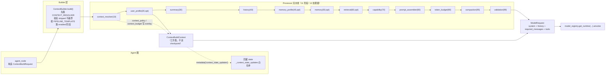
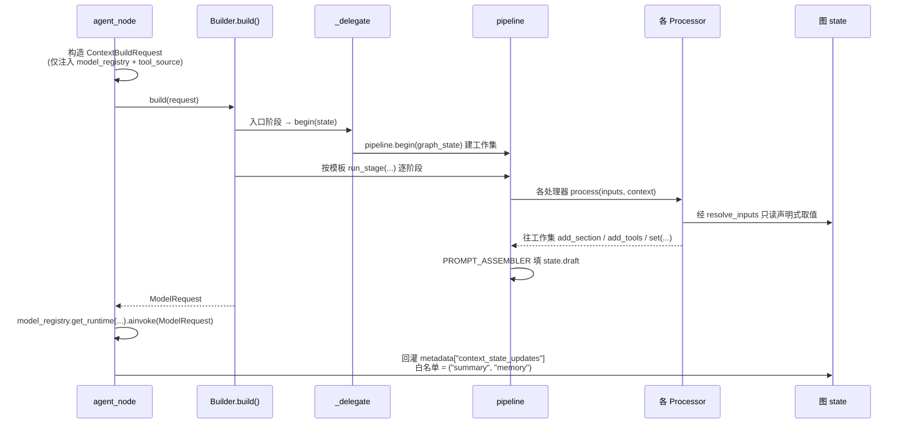

# CONTEXT_README.MD — Context 子系统

> YTraderAgent · Context 子系统事实手册
> 覆盖范围：`app/agent/context/`（builder 构建器 + processor 处理器流水线）、`app/common/context/enum.py`（枚举定义处）、`app/services/context/context_builder.yaml`（契约）。
> 本文回答一个问题：**"把图状态组装成给模型看的 messages" 这件事，在这份代码里是怎么发生的。**

---

## 0. TL;DR

| 问题 | 一句话答案 |
|---|---|
| Context 是什么？ | 不是记忆、不是知识库。它是**装配层**：把散落在图 state 里的东西（历史、摘要、记忆、工具）拼成一条 `ModelRequest` |
| 谁触发它？ | Agent 图的 LLM 节点（`agent_node` / `agent_builder_node`），每次要调模型前调一次 `builder.build()` |
| 流水线有几段？ | **11 个 `StageId`**，顺序由 `PIPELINE_TEMPLATE` 显式写死，import 期用断言锁住 |
| 有几个处理器？ | **12 个**（`MEMORY_RETRIEVER` 阶段上挂了 2 个） |
| 有几套 Builder？ | 声明 6 种 `ContextBuilderType`，**实现 2 种**：`agent_invoke`（生产主路径，11 阶段）与 `classifier`（窄输入，3 阶段） |
| 处理器能改对话吗？ | **不能**。处理器只能"声明式读图状态" + 往工作集里加 section/tools/history；回写图 state 走 `context_state_updates` 白名单，**只有 `summary` 与 `memory` 两个键** |
| 注入段最终在哪？ | 全部进**一条** `SystemMessage`（`system_prompt` 之后，按处理器顺序），`## {label}` 由 `system_message()` 统一包，段落正文里不带 `##` |
| token 怎么数？ | 默认 `HeuristicTokenCounter`（`chars/3.0` + 每消息 4 开销），**不联网、不用 tiktoken** |
| 最大的缺口？ | `ProfileSource` / `KnowledgeSource` / `MemorySource` 三个端口**全仓零实现**，且 ReAct 只注入 `model_registry + tool_source` |

---

## 1. 阅读地图

```
app/common/context/enum.py     ← StageId / ContextBuilderType / StageKind 的定义处

app/agent/context/
├── registry.py                ← found_builders（反射发现实现）/ create_context_builder
├── updater.py                 ← ContextUpdater —— ⚠️ 仅 Protocol，无实现
├── builder/
│   ├── base.py                ← ContextBuilder 抽象 + 11 个 _stage_* 方法 + build()（约 880 行）
│   ├── contracts.py           ← PIPELINE_TEMPLATE / LLM_INVOCATION_STAGES / ContextBuildRequest
│   ├── agent_invoke.py        ← 生产主路径 Builder（ProcessorContextBuilder 的桥）
│   └── classifier.py          ← 分类器专用窄 Builder
└── processor/
    ├── pipeline.py            ← 流水线编排 / begin / run_stage / _phase（约 800 行）
    ├── context.py             ← ContextBuildContext（工作集）+ ProcessorExecution + ContextSnapshot
    ├── spec.py                ← ContextProcessorSpec（inputs 绑定 / when 门控 / optional）
    ├── base.py                ← ContextProcessor 基类（唯一抽象方法 process）
    ├── state.py               ← resolve_inputs / resolve_state_path（dot-path）
    ├── values.py              ← ContextSection
    ├── policy.py              ← ContextPolicy + ContextPolicyResolver
    ├── turns.py               ← 轮次/窗口/摘要节奏的纯函数数学
    ├── budget.py              ← TokenBudget + TokenCounter + HeuristicTokenCounter
    ├── summarization.py       ← SummaryCompactor（**全仓唯一在上下文构建中调 LLM 之处**）
    ├── dependencies.py        ← ContextDependencies（model_registry / tool_source / *_source）
    ├── messages.py / history.py / errors.py
    └── processors/            ← 12 个处理器实现
```

---

## 2. 全貌



**一句话架构**：Builder 是**脊梁**（决定跑哪些阶段、从哪里读状态），Processor 是**零件**（每段只管往工作集里加一块内容），流水线把零件串成 `ModelRequest`。

---

## 3. 枚举（`app/common/context/enum.py`）

### 3.1 `ContextBuilderType`（`:40-73`）—— 6 个取值

```
agent_invoke / planner / classifier / compaction / memory / sub_agent
```

**实现状态**：只有 `agent_invoke` 与 `classifier` 有实现（§7）。其余 4 个只有 type 基类（`base.py:789-877`），`create_context_builder` 会抛 `NotFoundError`。

### 3.2 `StageId`（`:130-176`）—— 11 个取值，顺序即流水线顺序

| # | StageId | 语义 |
|---|---|---|
| 1 | `CONTEXT_RESOLVER` | **入口**：解析策略与预算，决定后续哪些阶段被跳过 |
| 2 | `PROFILE_LOADER` | 加载用户档案 |
| 3 | `SUMMARY_LOADER` | 加载/生成对话摘要 |
| 4 | `HISTORY_SELECTOR` | 选择历史窗口 |
| 5 | `MEMORY_RETRIEVER` | 召回记忆 |
| 6 | `KNOWLEDGE_RETRIEVER` | 召回外部知识 |
| 7 | `CAPABILITY_LOADER` | 装配给模型看的工具 |
| 8 | `PROMPT_ASSEMBLER` | **出口**：组装 `ModelRequest` |
| 9 | `TOKEN_BUDGETER` | 实测占用、必要时裁历史 |
| 10 | `CONTEXT_COMPACTOR` | 压掉窗口与摘要的重叠 |
| 11 | `CONTEXT_VALIDATOR` | 终闸校验 |

`StageId` 的具体语义说明在 `enum.py:147-164`。

### 3.3 其它枚举

| 枚举 | 取值 | 备注 |
|---|---|---|
| `ContextBuilderStatus` | `active` / `disabled` | 目录用 |
| `BuilderExecutionMode` | `embedded_model_invocation` / `independent_workflow` / `either` | 描述 Builder 与模型调用的关系 |
| `StageKind` | 8 个 | **仅给前端分组用，运行时完全不读**（`enum.py:179-198`） |

### 3.4 `PIPELINE_TEMPLATE` 与断言

定义在 `builder/contracts.py:91-103`，是**显式写死的字面量元组**（不是 `tuple(StageId)`），内容与上表 1→11 一致。

**import 期** `_assert_template_complete()`（`contracts.py:129-155`）断言：

```python
tuple(StageId) == PIPELINE_TEMPLATE
```

不一致直接抛。**为什么不用 `tuple(StageId)` 自动生成**：那样往枚举里插一项就等于静默改变流水线顺序；写成显式元组，改顺序必须动两处，第二处会被断言抓住。

> ⚠️ 任务书里常见的 `STAGE_SPECS` 这个名字**全仓不存在**。与阶段集合有关的常量是 `LLM_INVOCATION_STAGES`（§5）。

---

## 4. Builder 抽象契约（`builder/base.py`）

### 4.1 没有 `@abstractmethod`

11 个阶段对应 11 个 `_stage_*` 方法，名字映射在 `_STAGE_METHODS`（`base.py:218-230`）。

- **只有 `_stage_context_resolver` 有真实默认实现**；
- 其余 10 个带 `_no_default` 标记（`base.py:122-141`）——想启用哪个阶段就必须覆写哪个。

一个实现必须：

1. 挂到某个 **type 基类**下（`builder_type` 由继承定死，不能自声明）；
2. 声明 `enabled_stages`，可选声明 `required_stages`；
3. 覆写 `enabled_stages` 里带 `_no_default` 的方法。

`__init_subclass__`（`base.py:270-368`）做四道校验：

| 校验 | 违反后果 |
|---|---|
| 直接子类必须定死 `builder_type` | 抛错 |
| `CONTEXT_RESOLVER` 与 `PROMPT_ASSEMBLER` 必须在 | 抛错 |
| `required_stages ⊆ enabled_stages` | 抛错 |
| 声明了但没实现 | `TypeError` |

### 4.2 `build()`（`base.py:415-514`）

```
1. 先单独跑 CONTEXT_RESOLVER
2. 校验 StageResolution.skipped：不越界、不跳过 required（454-480）
3. 按 PIPELINE_TEMPLATE 顺序跑 enabled 阶段（484-496）
4. draft 仍为 None → 报错
```

第 2 步是**安全闸**：`CONTEXT_RESOLVER` 产出的 `skipped` **只能收窄**（`contracts.py:163-191`），不允许它跳过 required 阶段——否则"必跑阶段"就成了可选项。

### 4.3 `inputs` 的 dot-path 绑定

```
根 = ContextBuildContext.state_root()
     = 图 state 快照 ⊕ run.* 派生        （pipeline.py:187 begin）

解析 = resolve_state_path(path)           （processor/state.py:100-153）
       按 "." 切段取值，支持 Mapping 与属性两种；缺失 → 单例 MISSING
     + resolve_inputs(...)                （state.py:156-187）
```

- **必需输入缺失** → `ContextStateError`，构建失败；
- **可选输入缺失** → 以 `None` 交付（`state.py:175-183`）。

`MISSING` 哨兵的存在是为了区分「键不存在」与「键存在但值为 `None`」——这两者对策略判断意义完全不同。

---

## 5. `contracts.py` 的关键契约常量

| 常量 | 位置 | 内容 / 用途 |
|---|---|---|
| `PIPELINE_TEMPLATE` | `:91-103` | 11 阶段固定顺序元组，import 期断言 |
| `LLM_INVOCATION_STAGES` | `:124-126` | `{SUMMARY_LOADER}` —— **唯一自带 LLM 调用的阶段** |
| `StageResolution` | `:163-191` | CONTEXT_RESOLVER 的产出：`skipped`（只能收窄）+ `parameters` |
| `ContextBuildRequest` | `:194-244` | 输入：`builder_type` / `thread_id` / `messages` / `run_id` / `graph_state` / `agent_type` / `model_role` / `dependencies`（后四个带默认） |
| `StagePolicy` | `:247-273` | 单阶段参与关系：`enabled` / `execution_order` / `required` |
| `ContextBuildState` | `:291-343` | 本次工作集：`request` / `resolution` / `artifacts` / `processor_context` / `draft` |

`LLM_INVOCATION_STAGES = {SUMMARY_LOADER}` 是一条**纪律**：除了摘要阶段，流水线里任何地方都不许调模型。有了这个常量，审计"哪里花了 token"只需看一行。

> `required_stages` **不在** `contracts.py` —— 它是每个 Builder 自己的 `ClassVar`（`base.py:206`）。

---

## 6. 从图节点到 `ModelRequest` 的完整链路



逐步（真实名字）：

| # | 动作 | 位置 |
|---|---|---|
| 1 | `agent_node.agent_node` 构造 `ContextBuildRequest`（**只注入 `model_registry` + `tool_source`**） | `agent_node.py:177`，构造处 `:214-236` |
| 2 | `_build_model_request` → `builder.build(request)` | `base.py:415` |
| 3 | `ProcessorContextBuilder._delegate` 入口阶段调 `pipeline.begin(state)` 建工作集；随后 `pipeline.run_stage` | `agent_invoke.py:152-217`；`pipeline.py:214` |
| 4 | 各 Processor 经 `resolve_inputs` 取绑定值、往工作集写内容 | `processor/state.py` |
| 5 | `PROMPT_ASSEMBLER` 填 `state.draft`（即 `ModelRequest`） | `processors/prompt.py` |
| 6 | `agent_node` 拿 `ModelRequest` 调模型 | `agent_node.py` |
| 7 | 回灌：读 `metadata["context_state_updates"]`，**白名单 `_STATE_UPDATE_KEYS = ("summary", "memory")`** | `agent_node.py:664-696`，白名单 `:661` |

**白名单为什么只有两个键**：处理器不许篡改对话。`messages` / `context_result` / `unknown` 一律丢弃——`memory_smoke` 专门验证了这一点。回写面越小，"某轮对话莫名多了一段"这类事故就越不可能。

---

## 7. 有几套 Builder

| BuilderType | 实现类 | 阶段 | `required` | 用途 |
|---|---|---|---|---|
| `AGENT_INVOKE` | `AgentInvokeProcessorContextBuilder`（`agent_invoke.py:277`） | **全部 11 个** | `{CONTEXT_RESOLVER, PROMPT_ASSEMBLER}` | **生产主路径** |
| `CLASSIFIER` | `ClassifierProcessorContextBuilder`（`classifier.py:93`） | 3 个：`{CONTEXT_RESOLVER, HISTORY_SELECTOR, PROMPT_ASSEMBLER}` | 含 `HISTORY_SELECTOR` | 分类器：只要"用户说了什么"，不要记忆/知识/工具 |
| `PLANNER` / `COMPACTION` / `MEMORY` / `SUB_AGENT` | — | — | — | **声明但无实现**（仅 type 基类 `base.py:789-877`） |

两者共用 `ProcessorContextBuilder`（桥），差别只在 `enabled_stages` / `required_stages`。

**`classifier` 的 `HISTORY_SELECTOR` 为什么是 required**（`classifier.py:14-34`）：分类器要判"用户这句话要干什么"，如果把用户原话丢掉，分类就无从依据。所以这个阶段不能省。

### 7.1 启动期 vs 请求期

| 项 | 时机 |
|---|---|
| Builder **实例** | **启动期**经 `create_context_builder` 构造一次（`runtime.py:176-191`），注入 `ReactContext`（`:235-240`） |
| `ReactContext` | **每次运行**由 `context_factory` 新建，但**复用同一 builder 实例** |
| Builder 持有的依赖 | 不挂在 `self` 上 —— 随请求进 `ContextBuildRequest.dependencies` |

代码注释"Builder 实例是共享的，构造期注入无处存放"指的是：`__setattr__` 被封死（`base.py:236`）、注册表零参构造、依赖只能随请求传（`dependencies.py` 注释）。**这不是缺陷，是刻意的**：Builder 实例跨请求共享，把请求级依赖挂上去就会串台。

---

## 8. 12 个处理器（实测 `found_processors()`）

| order | name | stage | optional | 类名 | 文件行号 |
|---|---|---|---|---|---|
| 10 | `context_resolver` | `CONTEXT_RESOLVER` | 否 | `ContextResolveProcessor` | `resolver.py:47` |
| 20 | `user_profile` | `PROFILE_LOADER` | **是** | `UserProfileProcessor` | `profile.py:62` |
| 30 | `summary` | `SUMMARY_LOADER` | 否 | `SummaryProcessor` | `summary.py:72` |
| 40 | `history` | `HISTORY_SELECTOR` | 否 | `HistoryProcessor` | `history.py:59` |
| 45 | `memory_profile` | `MEMORY_RETRIEVER` | **是** | `MemoryProfileProcessor` | `profile.py:146` |
| 50 | `memory` | `MEMORY_RETRIEVER` | **是** | `MemoryProcessor` | `memory.py:122` |
| 60 | `retrieval` | `KNOWLEDGE_RETRIEVER` | **是** | `RetrievalProcessor` | `knowledge.py:36` |
| 70 | `capability` | `CAPABILITY_LOADER` | 否 | `CapabilityProcessor` | `capability.py:40` |
| 80 | `prompt_assembler` | `PROMPT_ASSEMBLER` | 否 | `PromptAssemblerProcessor` | `prompt.py:47` |
| 90 | `token_budget` | `TOKEN_BUDGETER` | 否 | `TokenBudgetProcessor` | `budget.py:48` |
| 95 | `compaction` | `CONTEXT_COMPACTOR` | 否 | `CompactionProcessor` | `compaction.py:65` |
| 99 | `validation` | `CONTEXT_VALIDATOR` | 否 | `ValidationProcessor` | `validation.py:45` |

**必跑 vs 可选**

- `CONTEXT_RESOLVER` 与 `PROMPT_ASSEMBLER` 是 required 阶段（`when=None`，无条件）。`pipeline.py:624-639` 双向校验「gate 与 required 矛盾」会在**启动期**报错。
- `optional=True` 只有 **4 个**：`user_profile` / `memory_profile` / `memory` / `retrieval`。
- 其余 6 个非可选处理器各带 `when=` 门控（条件来自 `context_policy.*`）。

**为什么 `MEMORY_RETRIEVER` 上挂两个（45 在 50 前）**：`memory_profile`(45) 负责 L3 画像段，`memory`(50) 负责其余段；顺序固定是为了让**四段注入的字节顺序稳定**（`profile.py:151-159`）——顺序一变，`context_hash` 就变，缓存与对比会全线失效。

---

## 9. 处理器契约

### 9.1 唯一抽象方法

```python
async def process(inputs, context) -> ContextBuildContext
```

`base.py:149-182`。

### 9.2 一个处理器能做什么

| 能做 | API |
|---|---|
| 加一段注入内容 | `context.add_section(name, label, text, source_ids, token_estimate)` |
| 换历史 | `context.add_history(...)`（**替换式**） |
| 换工具集 | `context.add_tools(...)`（**替换式**） |
| 塞必在消息 | `context.add_required_message(...)` |
| 写 overlay | `context.set(key, value)`（点分路径逐段建 dict） |
| 同步摘要 | `context.set_summary(...)` |
| 记警告 / 用量 | `context.warn(...)` / `context.note_usage(...)` |

`process` 可以就地改 `context` 并返回它（`pipeline.py:338` 接受返回值替换）。

### 9.3 不能做什么（关键边界）

| 不能 | 原因 / 替代 |
|---|---|
| 不能直接持有完整消息列表 | `token_budget` / `compaction` 通过 `replace()` **重建** `context.draft`（`budget.py:160`、`compaction.py:234`） |
| 不能访问完整 Graph State | 只能声明式读 `spec.inputs`（`base.py:169-174`） |
| 没有"短路/中止"专用 API | 抛 `ContextBuildError`（或其子类）即中止 |
| 不能篡改对话消息 | 回写图 state 走 `context_state_updates` 白名单（§6） |

### 9.4 失败语义

| 情形 | 行为 | 位置 |
|---|---|---|
| 非可选处理器失败 | **整个 build 失败** | `pipeline.py:355-424` |
| 可选处理器失败 | 记 `FAILED` + warning，**继续** | 同上 |
| 状态上报 | `ProcessorExecution`（`EXECUTED` / `SKIPPED` / `FAILED` 三态）进 `executions`、进快照 | `context.py:86-129` |
| 异常包装 | 包成 `ContextProcessorError` | `pipeline.py:326-336` |
| `optional` 的语义 | 成功失败都不致命，只降级 | `spec.py:149-152` |

**关于 `degraded`（容易混淆的一点）**：本子系统**没有全局 degraded 标志**。处理器级降级 = 各处理器 `status=FAILED` + `warnings` 累加进 `ContextSnapshot.warnings`（`context.py:190`）。

而 `memory.py` 里的 `_degraded(preview)` 是**另一回事** —— 它是「记忆分层降级」（L0/L1 不可用时的回落），写进 `context_state_updates["memory"]["degraded"]`。两个 degraded 无关，不要互相套用。

---

## 10. `ContextBuildContext`（工作集）

`context.py:334-412`。**这是一次 build 的工作集，不是 Graph State，不进 checkpoint。**

| 成员 | 说明 |
|---|---|
| `add_section(name, label, text, source_ids, token_estimate)` | **空文本不产生 section**（`context.py:454-476`） |
| `add_history` / `add_tools` | **替换式**（不是追加） |
| `add_required_message` | 必在消息 |
| `set(key, value)` | 写 overlay，点分路径逐段建 dict |
| `set_summary` | 同步进 overlay 的 `summary` |
| `warn` / `note_usage` / `record` | 诊断 |
| `section` | `ContextSection(name, label, text, source_ids, token_estimate)`（`values.py`） |

### 10.1 `metadata["context_state_updates"]`

- **谁写**：处理器。**只有 `memory.py:227`（且仅 INITIAL 阶段）**会写。
- **谁读**：`agent_node._context_state_updates`（`agent_node.py:664`），**按白名单落地** —— `memory` 放行；`messages` / `context_result` / `unknown` 丢弃。
- **为什么需要**：守住一条不变式 —— **一次运行只召回记忆一次**，CONTINUATION 阶段复用保活下来的分节。没有这个通道，ReAct 每一轮工具调用后都会重新召回一遍记忆。
- **`summary_dirty` 位**（`context.py:397`）：单独控制摘要是否回写，避免每轮都写同一个值。
- **`from_model_request` 会排除该键**（`context.py:847-857`）—— 否则每一段 SSE 都会带上全量正文。

### 10.2 最终合成

```python
system_message()        # context.py:550-576
    = policy.system_prompt（若有）
    + 各 section 按【插入顺序】拼成 "## {label}\n{text}"
    # 无内容 → 返回 None

assembled_messages()    # context.py:578-615
    = [system] + history + required_messages
    # required_messages 按 message_identity 去重
```

---

## 11. section 与 messages 的关系

| 问题 | 答案 |
|---|---|
| 注入的 section 放在哪 | **全部进一条 `SystemMessage`**，位置在 `system_prompt` 之后 |
| 顺序由什么决定 | 处理器执行顺序（stage / order）。`context_hash` 依赖这个固定顺序（`context.py:642-689`） |
| 同名 section 会去重吗 | **不会**。`_blocks.SECTION_NAME = "memory"` 被记忆四段共用（`_blocks.py:61`），但各自 `label` 不同，故各成一段 `## {label}` |
| 会有两层标题吗 | **不会**。每段 `text` 是纯正文（不带 `##`），只有 `system_message()` 才包一层 `## label` |
| 预算裁剪会裁 section 吗 | **不会**。只裁 history / tools |

**`_blocks.py` 的角色**：记忆四段（`persona` / `scenes` / `conversations` / `facts`）的**共享渲染与注入**，保证「管理端预览」与「主模型实际看到的内容」是同一份排版。`SECTION_NAME` 共用还让快照里的 `memory_ids` 能跨处理器正确聚合（`_blocks.py:24-31`）。

> ⚠️ 一个容易误判的点：`memory_budget` / `profile_budget` / `retrieval_budget` **只参与 `TokenBudget.allocate` 的固定扣减**（用算出 `history_budget`），**没有任何消费方按它们去截断注入段**。也就是说这三个预算是"账面上的预留"，不是"硬上限"。

---

## 12. 预算与压缩

| 文件 | 职责边界 |
|---|---|
| `budget.py`（顶层） | `TokenBudget`（分配公式）+ `TokenCounter` 端口 + `HeuristicTokenCounter`（**默认计数**） |
| `processors/budget.py` | `TokenBudgetProcessor`(90)：组装后**实测** system / tools 占用重算预算；历史超了就**重跑选择器整轮裁**（`budget.py:117`），重建 draft |
| `processors/compaction.py` | `CompactionProcessor`(95)：**纯切片**，把窗口与摘要的重叠压成 0；**不调模型**（`compaction.py:19-45`） |
| `summarization.py` | `SummaryCompactor` 端口 + `ModelRegistrySummaryCompactor` —— **全仓唯一在上下文构建中调 LLM 之处**（`summarization.py:107-184`），由 `summary.py`(30) 触发 |

### 12.1 token 计数

默认 `HeuristicTokenCounter`：`chars / 3.0` + 每消息 4 开销（`budget.py:90-153`）。**不联网、不用 tiktoken**（tiktoken 被预留但未启用）。

"保守估算"是刻意的：宁可多留余量，也不为了精确而引入联网下载词表的启动成本。

### 12.2 超预算时的处理顺序

```
resolver 保守预算
  → summary 生成
    → history 选窗
      → prompt 装配
        → token_budget 实测 + 裁历史
          → compaction 压重叠
            → validation 仍超 → Fatal 失败
```

`validation.py:142-158` 是最后一关：**到了这里还超，就直接失败**，不做进一步降级。因为再降级就等于悄悄丢用户内容。

---

## 13. 上下文策略（`policy.py`）

### 13.1 `ContextPolicy` 真实字段（`policy.py:71-174`）

| 类别 | 字段 |
|---|---|
| 系统提示 | `system_prompt` |
| 轮次窗口 | `min_recent_turns=3`、`max_recent_turns=5`、`max_history_tokens=6000` |
| **9 个开关**（默认全 `True`） | `include_summary` / `include_history` / `include_user_profile` / `include_memory` / `include_retrieved_context` / `include_capabilities` / `enforce_token_budget` / `allow_compaction` / `validate` |
| 注入上限 | `max_memory_items=5`、`max_retrieved_items=5`、`tool_keys=()` |
| 预算 | `max_context_tokens=None`、`max_output_tokens=1024`、`reserve_tokens=512`、`system_budget=1500`、`profile_budget=400`、`memory_budget=500`、`retrieval_budget=1500`、`tool_budget=1200`、`default_context_window=8192` |
| 摘要 | `summary_output_tokens=512` |
| 元信息 | `source` |

**开放键**（**不在 dataclass**，只活在 merged overlay 里）：`context_policy.tool_overrides` / `context_policy.memory_retrieve` / `context_policy.response_format` / `context_policy.model_metadata`。它们被 `capability` / `memory` / `prompt` 处理器**按路径**读取，但 `as_state` 不发出、`from_state` 忽略。

> 这是一处**类型安全与灵活性的取舍**：加字段要改 dataclass + 序列化 + 校验；走 overlay 则一句话就能传。代价是这些键没有类型检查。

### 13.2 策略来源

```
ContextPolicyResolver（端口）            policy.py:369
  → DefaultContextPolicyResolver          policy.py:387
      按 builder_type 给基线（确定性映射，不查网络）
  → 图 state 的 context_policy 覆盖项优先
      merge_policy_state 不做类型转换      policy.py:345-365
```

- **无 DB、无运行期 yaml**。
- `BASELINES` 当前**为空**；只有 `CLASSIFIER` 被硬差异化成"窄输入"（开关全关 + 窗口 0）。
- 6 个 `builder_type` 里有 **4 个**（`planner` / `compaction` / `memory` / `sub_agent`）**目前无实现**，但基线仍声明（`policy.py:397-401`）。
- `merge_policy_state` **不做类型转换**是刻意的：转换会把"传错了类型"变成"悄悄按默认值跑"，而这里宁愿留给后面的 gate 报 `INVALID`。

---

## 14. INITIAL 与 CONTINUATION

### 14.1 `turns.py`：纯函数数学

`split_turns`（按 Human 切轮）/ `covered_turns`（读 cursor）/ `window_limit` / `plan_window` / `TurnWindow`。

核心不变量（`turns.py:243-258`）：

```
u = T − c                      # 未覆盖轮数
should_summarize ⟺ u > limit(T)
limit = min(max, min + T // 10)    # 摘要是"随对话变长而放宽"的节奏
```

### 14.2 `BuildPhase`（`context.py:315-331`）

| 阶段 | 触发 |
|---|---|
| `INITIAL` | 用户**新消息**首次构建 |
| `CONTINUATION` | ReAct 循环 `Tool Result` 之后 |

判定在 `pipeline._phase`（`pipeline.py:725-751`）：**最后一条 `Human` 之后有 `ToolMessage` → CONTINUATION**，否则 INITIAL。

用这个判据而**不是**"state 里有没有 `context_result`"，是为了避免把"同一 thread 的下一轮对话"误判成续轮。

### 14.3 哪些只在 INITIAL 跑

严格说：**没有 stage 被 phase 跳过**。唯一的差别在 `memory.py` 内部：

| 阶段 | 行为 |
|---|---|
| INITIAL | 真召回，并写 `context_state_updates` |
| CONTINUATION | 走 `_replay`，用上次**保活**的分节重注入（`memory.py:181-255`） |

`history` / `summary` 两阶段都跑，靠 summary cursor 自然适配。

---

## 15. 各处理器职责与 `validation`

| 处理器 | 职责 | 位置 |
|---|---|---|
| `validation.py` | **终闸**。校验 ①消息非空 ②当前用户消息在内 ③工具调用/结果成对（`repair_tool_pairs`）④总 token ≤ 窗口−输出−余量。任一失败 = **本轮 Fatal**。可经 `context_policy.validate` 关闭 | `validation.py:84-158` |
| `capability.py` | 暴露工具（**只决定"给模型看哪些"，不管权限、不管执行**）。有 `tool_source` 就按 `tool_keys` 解析，否则用 state 的 `exposed_tools`。`tool_keys` 非空却无 source → 抛 `LookupError`（**接线错误，非 optional**） | `capability.py:83-93` |
| `resolver.py` | **入口**。产出 `context_policy`（基线 ⊕ 覆盖，**不转类型**，留待 gate 报 `INVALID`）+ `context_budget`（按 `ModelRegistry` 窗口或兜底），写进 overlay | `resolver.py` |
| `prompt.py` | **出口**。组装 `ModelRequest`（system + 历史 + 必在消息 + tools），**空则失败** | `prompt.py` |
| `history.py` | 纯窗口选择器。数据仅来自 state 的 `messages` + 摘要 cursor。**已删除** `ConversationSource` / `HistoryRetriever` 两个端口（从未有生产实现；更早的内容归记忆 L0） | `history.py:8-30` |

---

## 16. HTTP 契约（`context_builder.yaml`）

定义了 **3 个只读 GET 端点**：

| 方法 | 路径 | 职责 | yaml 行 |
|---|---|---|---|
| GET | `/context-builders` | 列 builder 类型（query `include_disabled`） | `:45` |
| GET | `/context-builders/{context_builder_type}` | 取完整定义（未知 404） | `:68` |
| GET | `/context-builders/{context_builder_type}/pipeline` | 取流程图导向 | `:102` |

**没有 POST / PUT / DELETE** —— 纯目录 / 可视化契约。

> 🐛 **实测确认：这 3 个端点全部未实现**。全仓 grep `"context-builders"` 只命中注释，且注释一律写着"**将来的** `/context-builders` 目录"（`builder/base.py:393`、`contracts.py:256`、`registry.py:19,188` 等）。`app/api/v1/` 下没有对应模块，`router.py` 里也没有挂载。属明确的 TODO。

---

## 17. 已知缺口、桩、注释失真

### 17.1 最大缺口：三个 source 端口零实现

| 端口 | 定义处 | 实现 |
|---|---|---|
| `ToolExposureSource` | `sources.py` | ✅ `RegistryToolExposureSource`（`app/infra/agent/tool_exposure.py:75`） |
| `ProfileSource` | `sources.py:59` | ❌ **无实现** |
| `KnowledgeSource` | `sources.py:71` | ❌ **无实现** |
| `MemorySource` | `sources.py:90` | ❌ **无实现**（且**根本没人读**） |

`ContextDependencies` 的三个源字段**默认 `None`**（`dependencies.py:84-87`），而 ReAct 构造依赖时**只传 `model_registry` + `tool_source`**（`agent_node.py:214-236`、`agent_builder_node.py:408-425`）。

分两层看后果：

| 处理器 | 后果 |
|---|---|
| `UserProfileProcessor` / `RetrievalProcessor` | 走 `deps.profile_source` / `deps.knowledge_source` 的那个分支是**死路**（恒 `None`），实际靠 state 的 `user_context.profile` / `retrieved_context.items` 兜底 |
| `MemoryProcessor` / `MemoryProfileProcessor` | **根本不读 `deps.memory_source`**，而是直接 `get_service_factory().scope(MemoryQueryService).retrieval_preview(...)`（`profile.py:238`、`memory.py:257+`） |

> 📌 **这是 CONTEXT 侧最明显的架构不一致**：声明了 4 个端口，只有 1 个有实现；`MemorySource` 端口 100% 未被使用 —— 记忆召回走的是**过程式服务调用**而不是依赖注入。这直接影响可测试性（想替换记忆来源必须打桩 `ServiceFactory`，而不是注入一个假端口）。

### 17.2 其它缺口

| 项 | 说明 |
|---|---|
| `ContextUpdater` | 仅 `Protocol`（`updater.py:59-92`），**无实现、无 Noop**；`ReactContext.context_updater` 恒为 `None` |
| Builder 类型 | `PLANNER` / `COMPACTION` / `MEMORY` / `SUB_AGENT` 无实现 |
| `context_builder.yaml` 三端点 | 未接路由（§16） |
| `DefaultContextPolicyResolver.BASELINES` | 为空；4 个 builder_type 无实现（`planner` / `compaction` / `memory` / `sub_agent`） |
| 开放键不在 dataclass | `tool_overrides` / `memory_retrieve` / `response_format` / `model_metadata`（§13.1） |
| `token_counter` | 默认启发式，tiktoken 预留未启用 |
| 已删除的端口 | `history.py` 移除 `ConversationSource` / `HistoryRetriever`；`sources.py:22-33` 移除 `ConversationSource` |
| 嵌套调用 | `nested_invocations` / COMPACTION 自调**仅规格声明**，无代码落地 |
| `STAGE_SPECS` | **全仓不存在**（任务书里的名字不实） |

### 17.3 不是缺陷的设计点

`profile.py:47-59` 的标签**刻意叫"用户档案"而不是"用户画像"** —— 避免与 L3 长期画像（`PERSONA_TITLE`）的 `## 用户画像` 标题撞车。注入段是按 `## {label}` 拼的，标题重名会让模型收到两段同名内容。

---

## 18. 实测验证

全部用 `./.venv/Scripts/python.exe -B -m <module>`（`-B` 阻止写 `.pyc`）。

| 脚本 | 结果 | 覆盖 |
|---|---|---|
| `app.agent.context.processor.memory_smoke` | ✅ 全部通过 | 保活 payload 过了流水线；四段确实进了 system 消息（**各带一个 `##` 标题**）；**system 里没有两层标题**（`## 用户画像` 只出现一次）；`agent_node` 白名单放行 `memory`；放行的那份就是处理器写的那份；白名单丢掉 `messages` / `context_result` / `unknown`（处理器不许篡改对话）；非 `Mapping` 的值也丢掉 |
| `app.agent.agent_smoke` | ✅ 全部通过 | react 图 + builder / agent_builder 节点整体链路：人工说明覆盖按同一批 key 预载并写进 `context_policy`；取覆盖失败**不会**把这一轮标成降级（它是可降级的旁路）；结构化输出解析不了 → 全 `other` 并标降级；分类调用失败**不抛异常**仍走 agent 且 notes 写明原因；没有用户消息时**落一个标记过的空结果**而不是抛异常 |

**两条值得记住的验证细节**：

1. `memory_smoke` 里刻意演示了 **`ServiceFactory` 未装配时会抛 `RuntimeError`**（"它由 lifespan 调用 `build_factories()` 建立"）。这解释了为什么这类脚本要么显式装配一次、要么接受这个异常。
2. `agent_smoke` 全用桩：`NODE_FUNCTIONS` monkey-patch 桩节点、`_FakeRegistry` 假模型、`_FakeBuilder` 假 builder。**不连真模型、不读库，无 API key 也能跑**。

**量化指标口径**：本子系统自身不出指标。可观测的量是 **`context_hash`**（由 section 顺序与内容决定）与 **`TokenBudget` 的估算值**（`HeuristicTokenCounter` 给出，属**估值而非实测**）。真实 token 用量在 Model 侧的 `ModelUsage`。

---

## 19. 设计取舍（读代码时的"为什么"）

1. **工作集 ≠ Graph State**。`ContextBuildContext` 不进 checkpoint。上下文是"这一次调用要用的东西"，不是"会话状态"——混在一起会让 checkpoint 里躺着大量一次性数据。
2. **`PIPELINE_TEMPLATE` 手写而不是 `tuple(StageId)`**。改顺序要动两处，第二处有断言。自动生成会让"往枚举插一项"静默改变生产流水线。
3. **处理器只能声明式读 state**。不能摸完整 Graph State，意味着处理器的行为可以被 `spec.inputs` 完全描述——这既让"这段内容从哪来"可审计，也让处理器难以偷偷改变流水线语义。
4. **回写白名单只有 `summary` / `memory`**。回写面越小，越不可能出现"某轮对话莫名多了一段"。
5. **`skipped` 只能收窄**。`CONTEXT_RESOLVER` 不能跳过 required 阶段，否则"必跑"就成了选项。
6. **除摘要外不许调模型**（`LLM_INVOCATION_STAGES`）。一句话就能回答"上下文构建花了多少 token"。
7. **预算不裁 section，只裁 history / tools**。宁可让历史变短，也不把用户画像/记忆段截半——截半的注入内容比不注入更糟（模型会看到残缺事实）。
8. **超过窗口直接 Fatal**（validation）。不再进一步降级，因为再降级等于悄悄丢用户内容。
9. **`merge_policy_state` 不做类型转换**。转换会把"传错类型"变成"按默认值跑"，而这里宁愿让 gate 报 `INVALID`。
10. **Builder 实例共享、依赖随请求传**。共享实例省构造成本；依赖不挂 `self` 避免跨请求串台。
11. **`CLASSIFIER` 是独立窄 Builder 而不是给主 Builder 加开关**。分类器只要 3 个阶段，用开关表达会让"哪些组合合法"变成 2^11 种可能性；独立 Builder 让合法组合**可枚举**。

---

## 20. 文件索引

| 关注点 | 先读 |
|---|---|
| 枚举定义 | `app/common/context/enum.py` |
| 契约常量 / 模板 | `app/agent/context/builder/contracts.py` |
| Builder 抽象与阶段方法 | `app/agent/context/builder/base.py` |
| 生产 Builder | `app/agent/context/builder/agent_invoke.py`、`classifier.py` |
| Builder 发现 | `app/agent/context/registry.py` |
| 流水线编排 | `app/agent/context/processor/pipeline.py` |
| 工作集 | `app/agent/context/processor/context.py`、`values.py` |
| 处理器契约 | `app/agent/context/processor/{base,spec,state}.py` |
| 策略 | `app/agent/context/processor/policy.py` |
| 轮次数学 | `app/agent/context/processor/turns.py` |
| 预算与压缩 | `app/agent/context/processor/{budget,summarization}.py`、`processors/{budget,compaction}.py` |
| 记忆注入 | `app/agent/context/processor/processors/{memory,profile,_blocks}.py` |
| 依赖注入端口 | `app/agent/context/processor/dependencies.py`、`sources.py` |
| 图集成 | `app/agent/graph/react/{agent_node,agent_builder_node,context}.py` |
| 契约 | `app/services/context/context_builder.yaml`（⚠️ 3 端点未实现） |
| 验证 | `app/agent/context/processor/memory_smoke.py`、`app/agent/agent_smoke.py` |
