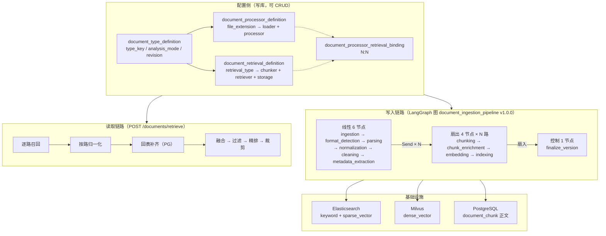
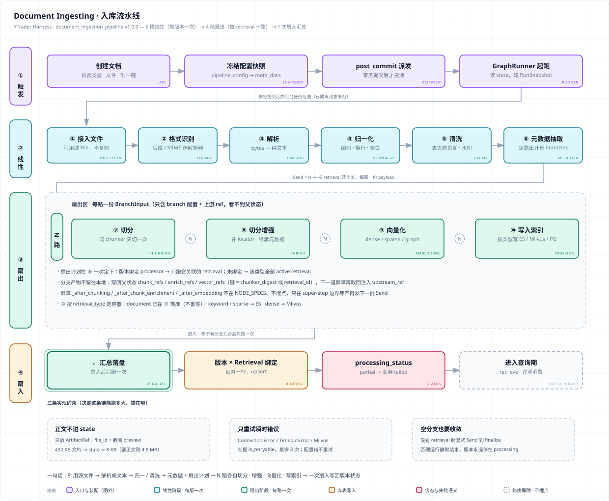

# Document · 文档摄入与 RAG

> `document` 服务把**一个文件**变成**可被多路检索的索引**，并对外提供**一轮检索**的能力。
>
> 两条链路各自独立，但**共用同一份「该用哪个 chunker / embedder / 容器名」的约定** ——
> 这是本子系统最容易出错的地方，因为它出错时**不报错，只表现为「搜不到」或「排序没意义」**。

`2 条链路` · `11→16 个节点` · `DTD → Processor / Retrieval → Binding` · `四段式检索` · `反射发现组件`

---

## 📚 本文结构

- 🎯 **一张表看懂**
- 🏗️ **全貌**
- 📝 **写入链路**
- 🔍 **读取链路**
- 🧱 **加一个组件** —— 放手即用
- 📡 **HTTP 清单**
- 📖 返回 **[主手册](README.md)** · ⚠️ 缺口见 **[todolist](todolist)**

---

## 🎯 一张表看懂

| 问题 | 一句话答案 |
|---|---|
| 这个服务做什么？ | 两条链路：**写入**（文件 → chunk → 索引）与**读取**（查询 → 多路召回 → 融合 → 精排 → 裁剪） |
| 配置在哪？ | **数据库行**，不是代码：`DTD → Processor / Retrieval → Binding` |
| 流水线几步？ | **11 个 spec 节点**，编译后 **16 个**（含 3 个扇出汇合屏障） |
| 哪些环节真的实现了？ | parser（仅 `.txt`/`.md`）、normalize、clean、chunk（3 个）、enrich、embed（2 个可用）、index（ES / Milvus） |
| 哪些没实现？ | `metadata_extraction` 的 `ENRICH_METADATA`、graph 检索、`retrieval_type=document`、`custom` 精排、分层切分 |
| 加一个 chunker 要改什么？ | **只加一个文件** —— 继承基类、设 `name`、放进目录。注册表与 API 自动收录 |
| 检索四段的默认值？ | 融合（RRF，`top_k=50`，`rrf_k=60`）→ 过滤 → 精排（`bge-reranker-v2-m3`）→ 裁剪（`top_k=10`） |
| 失败时炸还是降级？ | **该炸的炸**（`CapabilityNotFound` / DTD 缺失 404），**该降级的降级**（进 `degraded_routes`） |

---

## 🏗️ 全貌



### 阅读地图

| 我想知道… | 读这里 |
|---|---|
| 文档/版本怎么建模 | `models/sqlalchemy/`、`domain/schemas/enum.py` |
| 一个 DTD 怎么决定「用哪个 chunker、写哪个索引」 | `pipeline/selection.py`、`pipeline/nodes/metadata_extraction.py` |
| 流水线有哪几步、怎么扇出 | `pipeline/catalog.py`（节点表）、`pipeline/graph.py`（装配）、`pipeline/fanout.py` |
| 每一步具体干了什么 | `pipeline/nodes/*.py` |
| 检索怎么编排 | `application/document_retrieve_service_impl.py`、`retrieve/processor.py` |
| 融合/精排/裁剪的默认值 | `domain/schemas/retrieve.py` |
| 用了哪些模型、路径在哪 | `const.py` |
| 一次运行留下了哪些记录 | `document_pipeline_run.py`、`document_pipeline_node_run.py` |

---
## 📝 Code Architecture


## 📝 写入链路

每个节点按**角色**查注册表选实现：

| # | 节点 | 角色 | 已注册实现 |
|---|---|---|---|
| 2 | `parsing` | `LOADER` | `TEXT_TXT_COMMON_PARSER`（**唯一**，`.txt` / `.md`） |
| 3 | `normalization` | `NORMALIZE` | `TEXT_TXT_COMMON_NORMALIZER`（**13 步**，可逐项开关，幂等，**从不删内容**） |
| 4 | `cleaning` | `CLEAN` | `TEXT_TXT_COMMON_CLEANER`（**7 类规则**，**会删行**） |
| 5 | `metadata_extraction` | `ENRICH_METADATA` | ⚠️ **无实现**（passthrough） |
| 6 | `chunking` | `CHUNK` | **3 个**：递归分块（512/64，中文优先分隔符）/ 不分块 / GraphRAG 分块（1200/100） |
| 7 | `chunk_enrichment` | `CHUNK_ENRICH` | `TEXT_COMMON_CHUNK_ENRICHMENT` |
| 8 | `embedding` | `EMBED`（按 `output_kind` 选） | **3 个**：BGE-small-zh 稠密(512) / 词法稀疏(20 万维词表) / 图抽取（⚠️ `NotImplementedError`） |
| 9 | `indexing` | `IndexBackend` | `Elasticsearch` / `Milvus`（**仅在注入了客户端时注册**） |

> **归一与清洗有严格的边界**：归一化是**等价变换**（只动控制字符与空白，从不删内容），
> 清洗**会删行**。把两者混为一谈，会让「内容莫名少了」无从定位。

### 扇出与收敛

`metadata_extraction` 产出**分支计划**（一个 DTD 下可以有多个 retrieval），后续 4 个节点按分支 `Send × N`。

**收敛规则**：同一 chunker 的多个分支只切**一次**（按 `chunker_digest` 识别身份），
避免同一份文本被切两遍。

### 观测

| 表 | 记什么 |
|---|---|
| `document_pipeline_run` | 运行级（状态、触发源、`topology_fingerprint`） |
| `document_pipeline_node_run` | 节点级（每个分支一行） |

> `topology_fingerprint`（sha256）让历史运行**按冻结拓扑渲染** —— 前端不写死节点列表，
> 拓扑变了旧运行也不会画错。CI 用 goldens 比对它。

---

## 🔍 读取链路

`POST /documents/retrieve`，四段式，优先级 **请求参数 > DTD 配置 > 类默认值**：

| 段 | 配置来源 | 默认 |
|---|---|---|
| **融合** | DTD `fusion_strategy` | 开启，RRF，`top_k=50`，`rrf_k=60` |
| **过滤** | 类默认（无 DTD 列） | 开启，无分数阈值 |
| **精排** | DTD `rerank_strategy` | 开启；本地 cross-encoder `BAAI/bge-reranker-v2-m3`（50 候选 × 512 字符，进程内） |
| **裁剪** | 类默认（无 DTD 列） | `top_k=10` |

**多路召回**：`retrieval_type` → 容器名，查询向量按 `dense_vector` / `sparse_vector` 映射到 embedder。
**写查必须同一个模型** —— 不同模型的向量空间不可比，混用**不报错**，只让召回率下降。

> 内容**从不存进索引**，召回后再从 PostgreSQL 回填。

### 容器名是契约，且只有一份

`pipeline/containers.py` 是 `retrieval_type → 物理容器名` 的**唯一副本**，写入期与查询期共用。

> **为什么硬编码而不让用户配**：查询期必须**一次查到全部文档**。允许每个类型/版本各配一个容器，
> 查询就要跨 N 个容器做 federation 再融合 —— 而用户配错的表现是「**检索搜不到**」，不是报错。
> 名字逐条写出来而不用 f-string 拼，也是为了让人一眼看出**这是个契约**（改了等于全量重建 + 数据迁移）。

### 失败语义

| 炸 | 降级（但必须记录） |
|---|---|
| 能力/后端查不到 → `CapabilityNotFound`（继承 `LookupError`，**不是 400**） | 后端故障 / 超时 / 未实现 → 该路进 **`degraded_routes`**，其余路照常 |
| 能力 key 冲突、同形态多 embedder → `ValueError` | `llm`/`custom` 精排 → 直通 + WARNING |
| DTD 缺失/未激活 → **404**（整请求，不是跳过） | 精排模型加载失败 → 退化为原序 + WARNING |
| `retrieval_config` 键写错 → **422** | 指名了但 DTD 没有的检索类型 → **静默筛除**（刻意的「筛选」语义，**不进** `degraded_routes`） |

> `degraded_routes == []` 意味着**所有路都参与了**。这是一条很好用的断言。

---

## 🧱 加一个组件

**没有装饰器，没有中心注册清单。** 靠**反射发现**：

- `import_package_modules(*CAPABILITY_PACKAGES)` 先 import 角色包下所有模块（`__subclasses__()` 只看得到已 import 的类）
- `leaf_subclasses(RoleBase, skip_abstract=True)` 深度优先收集**叶子子类**

**加一个 chunker / parser / embedder / cleaner / normalizer / enricher**：

1. 新建一个类，继承对应角色基类
2. 设 `name`（全局唯一、永不复用的 key）
3. **可选**：声明 `config_model`（pydantic）—— `get_config_schema()` 自动产出 `model_json_schema()`，**前端表单因此自动生成**
4. 放进该角色的目录。**完成。**

注册表、能力目录接口（`GET /document-processor-capabilities`）、目录 API **全部自动收录**。

> **唯一需要碰中心清单的情况**：新增一个**角色**（而不是角色下的实现）时，把新角色包名追加进 `CAPABILITY_PACKAGES`。

### 两道硬错误闸

| 冲突 | 结果 | 为什么必须炸 |
|---|---|---|
| 两个实现用了同一个 key | **`ValueError`** | 字典推导会让后者**静默覆盖**前者，症状是「某能力凭空消失」 |
| 两个 embedder 是同一个 `output_kind` | **`ValueError`** | 写查只按形态选 embedder，「返回第一个」等于按模块名排序静默二选一 |

检索侧同理：加 `Fusioner` 子类（设 `fusioner_type`）或 `Reranker` 子类（设 `reranker_types`）。
但 **Filter 与 Cutter 必须保持单一实现** —— 多于一个直接抛 `RetrieveStageNotFound`。

---

## 📡 HTTP 清单

| 组 | 端点 |
|---|---|
| **Document** | `POST /documents`、`GET /documents`、`GET /documents/{id}`、`PATCH`、`DELETE`、`POST /documents/{id}/reprocess` |
| **版本与 chunk** | `/documents/{id}/versions`、`/document-versions/{id}`、`/document-chunks` |
| **定义（配置侧）** | `/document-type-definitions`、`/document-processors`、`/document-retrievals`、bindings |
| **流水线运行** | `/pipeline-runs`、`/pipeline-runs/{id}`、节点行 |
| **检索 / QA** | `POST /documents/retrieve`、`/qa-datasets` |
| **能力目录** | `GET /document-processor-capabilities`、`GET /processor-capabilities` |
| **评测** | [`README_EVAL.md`](README_EVAL.md) |

---

## 🚀 验证

```bash
# 拓扑自检（不需要任何外部依赖）
.venv/Scripts/python.exe -m app.agent.pipeline_smoke

# 检索编排冒烟（不连 DB、不连 ES）
.venv/Scripts/python.exe -m app.agent.retrieve_smoke

# 能力注册表自检
.venv/Scripts/python.exe -c "import app.services.document.pipeline.registry"
```

> ⚠️ `pipeline_smoke stub-run` **当前已失效**（`KeyError: 'chunker_digest'`，冒烟脚本过期，主链路正常）。
> 原因与修法见 [`todolist`](todolist)。

---

## 🤝 相关

| 想深入看 | 去哪 |
|---|---|
| 检索效果怎么量化 | [`README_EVAL.md`](README_EVAL.md) |
| 知识怎么被注入上下文 | [`README_CONTEXT.md`](README_CONTEXT.md) |
| 共用 embedder 与记忆检索 | [`README_MEMORY.md`](README_MEMORY.md) |
| 总览 | [`README.md`](README.md) |
