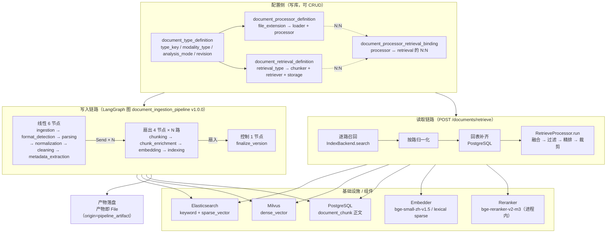
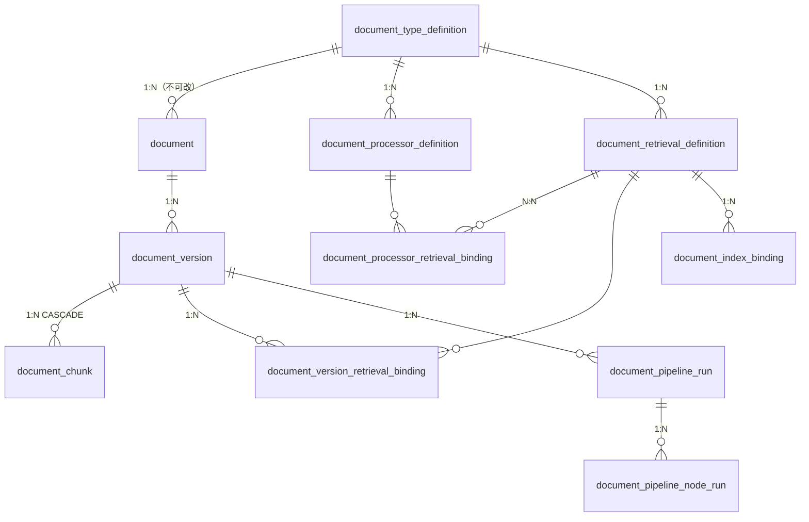

# Document 服务与 RAG 子系统

> 本文只描述 `app/services/document/` 这一个子系统（含它对外暴露的 HTTP API、它依赖的基础设施与常量）。
> 其余模块（Agent / Memory / Tool / Session / Task）不在范围内。

**阅读方式**：第 1–2 节给全貌，第 3–5 节是写入链路，第 6–7 节是读取（RAG）链路，第 8–10 节是模型、观测、评测，
第 11–13 节是 API / 配置 / 验证命令，**第 14 节「已知缺口与代码注释失真」建议优先读** —— 它列出当前**不能**工作的能力。

---

## 目录

- [1. 一句话定位](#1-一句话定位)
- [2. 全貌与阅读地图](#2-全貌与阅读地图)
- [3. 领域模型与表结构](#3-领域模型与表结构)
- [4. 配置侧：DTD → Processor / Retrieval → Binding](#4-配置侧dtd--processor--retrieval--binding)
- [5. 写入链路：文档摄入流水线](#5-写入链路文档摄入流水线)
- [6. 组件层：能力注册表与实现矩阵](#6-组件层能力注册表与实现矩阵)
- [7. 读取链路：RAG 检索](#7-读取链路rag-检索)
- [8. 模型身份与常量](#8-模型身份与常量)
- [9. 可观测性](#9-可观测性)
- [10. QA 数据集与评测](#10-qa-数据集与评测)
- [11. HTTP API 清单](#11-http-api-清单)
- [12. 配置项与环境变量](#12-配置项与环境变量)
- [13. 运行与验证](#13-运行与验证)
- [14. 已知缺口与代码注释失真](#14-已知缺口与代码注释失真)
- [15. 关键设计取舍](#15-关键设计取舍)
- [16. 文件索引](#16-文件索引)

---

## 1. 一句话定位

`document` 服务把**一个文件**变成**可被多路检索的索引**，并对外提供**一轮检索**的能力。

它做两件事，两条链路各自独立：

| 链路 | 方向 | 载体 | 入口 |
|---|---|---|---|
| **写入（ingestion）** | 文件 → 清洗文本 → chunk → 向量 → 索引 | LangGraph 状态图 | `DocumentService.create/update/reprocess` |
| **读取（retrieve / RAG）** | 查询文本 → 多路召回 → 融合 → 过滤 → 精排 → 裁剪 | 普通 async 服务方法 | `POST /documents/retrieve` |

两条链路**共用同一份「该用哪个 chunker / embedder / 容器名」的约定** —— 这是本子系统最容易出错的地方，
因为它出错时**不报错，只表现为"搜不到"或"排序没意义"**。

---

## 2. 全貌与阅读地图



### 阅读地图

| 我想知道… | 读这里 |
|---|---|
| 文档/版本怎么建模，字段有哪些 | `app/services/document/models/sqlalchemy/`、`domain/schemas/enum.py` |
| 一个 DTD 怎么决定"用哪个 chunker、写哪个索引" | `pipeline/selection.py`、`pipeline/nodes/metadata_extraction.py` |
| 流水线有哪几步、怎么扇出 | `pipeline/catalog.py`（节点表）、`pipeline/graph.py`（装配）、`pipeline/fanout.py`（扇出/收敛） |
| 每一步具体干了什么 | `pipeline/nodes/*.py` |
| 检索是怎么编排的 | `application/document_retrieve_service_impl.py`、`retrieve/processor.py` |
| 融合/精排/裁剪的默认值 | `domain/schemas/retrieve.py` |
| 用了哪些模型、路径在哪 | `const.py` |
| 一次运行留下了哪些记录 | `models/sqlalchemy/document_pipeline_run.py`、`document_pipeline_node_run.py` |

---

## 3. 领域模型与表结构

### 3.1 实体关系



两层结构要分清：

- **配置层**（DTD / processor / retrieval / processor↔retrieval binding）—— 由管理员 CRUD，决定"该怎么处理"。
- **执行层**（version / chunk / version↔retrieval binding / index binding / pipeline run）—— 由流水线写，记录"实际处理成什么样"。

### 3.2 核心表

**`document`** —— 业务上的逻辑文档，**不存源文件**。

| 列 | 说明 |
|---|---|
| `document_id` | PK |
| `document_type_definition_id` | FK → DTD；**创建后不可修改** |
| `current_document_version_id` | 当前生效版本指针。**故意不建 FK**（避免与 version 表循环依赖） |
| `document_key` | 业务侧稳定标识，可选，用于业务系统关联 |
| `tenant_id` / `title` / `metadata` / `created_by` | 常规属性 |
| `status` | `active` / `deleted` |
| `created_at` / `updated_at` / `deleted_at` | 删除是**逻辑删除** |

**`document_version`** —— 一个版本对应一个 File。

| 列 | 说明 |
|---|---|
| `document_version_id` | PK |
| `document_id` | FK `CASCADE` |
| `version_number` | 从 1 开始；唯一约束 `(document_id, version_number)` |
| `file_id` | FK `RESTRICT` → `file` 表 |
| `document_processor_definition_id` | 可空：本次用的后缀处理器定义 |
| `version_status` | `pending` / `active` / `superseded` / `failed` / `deleted` |
| `processing_status` | `pending` / `processing` / `completed` / `failed` —— 由 `finalize_version` **聚合** version↔retrieval binding 得出 |
| `meta_data` | 内含 `pipeline_config`（**当次执行的参数快照**，见 3.4） |

**`document_type_definition`（DTD）** —— 一种"文档类型"的完整处理与检索约定。

| 列 | 说明 |
|---|---|
| `type_key` | 自然键，**唯一**，创建后不可改 |
| `modality_type` | `text` / `image` / `audio` / `video`；**创建后不可改** |
| `analysis_mode` | `none` / `default` / `config` —— 决定扇出哪些 retrieval（见 5.2） |
| `revision` | **乐观锁**：每次成功更新 +1；更新请求必须回传，不匹配返回 409 |
| `allow_update` / `version_mode` | 版本控制策略（`versioned` / `immutable`） |
| `fusion_strategy` / `fusion_config` | 融合配置（DTD 级） |
| `rerank_strategy` / `rerank_config` | 精排配置（DTD 级） |
| `status` / `tenant_id` | `active` / `deleted` |

> ⚠️ DTD 表里**只有 fusion / rerank 两段配置列**。Filter 与 Cutter 没有对应列，基线值硬编码在
> `retrieve/processor.py` 的类属性 `default_filter` / `default_cutter` 上 —— 改默认值改那里，不要给 DTD 加列。

**`document_processor_definition`** —— 按后缀绑定 loader + processor。

| 列 | 说明 |
|---|---|
| `file_extension` | 自然键的一部分；唯一约束 `(document_type_definition_id, file_extension)` |
| `mime_types` | jsonb |
| `loader_name` / `loader_config` | 阶段 2 的解析器（本系统是**通用的 `CommonTxtDocumentParser`**） |
| `processor_name` / `processor_config` | 可空；阶段 3–5 的归一化/清洗等 |

**`document_retrieval_definition`** —— 一路检索的完整约定。唯一约束 `(document_type_definition_id, retrieval_type)`。

| 列 | 说明 |
|---|---|
| `retrieval_type` | `document` / `keyword` / `sparse_vector` / `dense_vector` / `graph` |
| `chunker_name` / `chunker_config` | 切分（jsonb 配置参与 chunker 身份摘要） |
| `retriever_name` / `retriever_config` | 召回参数；**写入期与查询期同源** |
| `storage_backend` | `postgresql` / `elasticsearch` / `milvus` / `neo4j` |
| `storage_config` | jsonb |

**两张 Binding**

| 表 | 语义 | 唯一约束 |
|---|---|---|
| `document_processor_retrieval_binding` | **配置层** N:N：哪些 processor 能喂给哪些 retrieval（即 `analysis_mode=config` 时允许的连线） | `(processor_definition_id, retrieval_definition_id)` |
| `document_version_retrieval_binding` | **执行层**：某版本在某一路 retrieval 上处理成什么样（`processing_status` / `error_message` / `document_index_binding_id`） | `(document_version_id, retrieval_definition_id)` |

**`document_index_binding`** —— 把"用哪个物理 collection / index 名"从配置中分离出来，唯一约束 `(retrieval_definition_id, backend_type, index_identifier)`。

**`document_chunk`** —— chunk 正文**在这里**，向量**不在这里**。

| 列 | 说明 |
|---|---|
| `document_chunk_id` | PK |
| `document_version_id` | FK `CASCADE` |
| `chunker_key` / `chunker_config` | 切分身份；`chunker_config` 是**归一化后**的配置，因此可入唯一约束 |
| `document_processor_definition_id` | 可空 |
| `chunk_index` / `start_index` / `end_index` | 位置 |
| `content` / `content_hash` / `token_count` / `char_count` | 正文与统计 |
| `locator` / `metadata` | jsonb；`metadata` 由 chunk_enrichment 继承文档级元数据 |

唯一约束：`(document_version_id, chunker_key, chunker_config, chunk_index)`。
**向量只存在于外部索引**（ES / Milvus），由 CanonicalChunk 在写入期投影，不落到 PG。

> ⚠️ chunk 与 retrieval 之间**没有外键**。归属靠推导：把 retrieval 定义的 `(chunker_name, chunker_config)`
> 归一化后与 chunk 的 `(chunker_key, chunker_config)` 比较。这也是"共用同一 chunker 与配置的多路检索只切一次"的实现基础。

### 3.3 枚举清单

| 枚举 | 取值 |
|---|---|
| `DocumentStatus` / `DefinitionStatus` | `ACTIVE`、`DELETED` |
| `VersionStatus` | `PENDING`、`ACTIVE`、`SUPERSEDED`、`FAILED`、`DELETED` |
| `ProcessingStatus` | `PENDING`、`PROCESSING`、`COMPLETED`、`FAILED` |
| `ModalityType` | `TEXT`、`IMAGE`、`AUDIO`、`VIDEO` |
| `AnalysisMode` | `NONE`、`DEFAULT`、`CONFIG` |
| `VersionMode` | `VERSIONED`、`IMMUTABLE` |
| `RetrievalType` | `DOCUMENT`、`KEYWORD`、`SPARSE_VECTOR`、`DENSE_VECTOR`、`GRAPH` |
| `StorageBackend` | `POSTGRESQL`、`ELASTICSEARCH`、`MILVUS`、`NEO4J` |
| `ProcessorRole` | `LOADER`、`NORMALIZE`、`CLEAN`、`ENRICH_METADATA`、`CHUNK`、`CHUNK_ENRICH`、`EMBED` |
| `EmbeddingOutput` | `DENSE`、`SPARSE`、`GRAPH`（仅标记，GRAPH 非向量） |
| `FusionerType` | `RRF`、`WEIGHTED_SUM` |
| `RerankerType` | `CROSS_ENCODER`、`LLM`、`CUSTOM` |
| **运行状态** `RunStatus` | `pending`、`running`、`completed`、`failed`、`partial`、`cancelled` |
| **节点状态** `NodeRunStatus` | `pending`、`running`、`completed`、`failed`、`skipped` |

- **终止态** = `completed` / `failed` / `partial` / `cancelled`。
- `partial` = 至少一路成功且至少一路失败（例如 ES 挂了但 Milvus 成功）。映射到业务状态时算 `failed`。

### 3.4 版本管理规则

1. `POST /documents` 创建 Document 时**自动创建 version_number = 1**（`version_status=ACTIVE`，`processing_status=PENDING`）。
2. `PUT /documents/{id}` 有三种互斥的操作：
   - 只传 `title` / `metadata` → 改 Document 本身，**不创建版本**；
   - 传 `file_id` → **追加新版本**（`version_number = max + 1`）；
   - 传 `current_document_version_id` → **只切指针**，不创建版本。
   - `file_id` 与 `current_document_version_id` **不能同时提供**。
3. `allow_update=False` 时拒绝传 `file_id`。
4. **`current_document_version_id` 在 create 请求内不回填**（代码里被注释掉了），
   而是由流水线的 `finalize_version` 节点在**处理结束后**回填。因此"刚创建完立刻 GET 文档"可能看到指针为 `null`。
5. `meta_data.pipeline_config` 是**当次执行用的参数快照**（`PipelineConfigSnapshot`：modality / loader / processor / retrievals / index_bindings），
   属于 **provenance**，不是业务 metadata。它的用途是"按历史配置重跑"与"按最新配置重跑"。

---

## 4. 配置侧：DTD → Processor / Retrieval → Binding

### 4.1 `analysis_mode` 与扇出的选取

| 模式 | 语义 |
|---|---|
| `none` | 不做任何检索侧处理（扇出为空） |
| `default` | **单一 `.*` Analyzer 自动连全部 retrieval**（只发 retrievals） |
| `config` | 由 `document_processor_retrieval_binding` 的连线精确决定跑哪几路 |

选取逻辑是纯函数 `pipeline/selection.py::select_retrievals`：

- 若版本绑定了 `document_processor_definition_id` → 取该 processor 绑定的 retrieval（默认取并集，reprocess 时用请求里的 `document_processor_definition_ids` **求交收窄**）；
- 否则 → 取该 DTD 下**全部 active** 的 retrieval。

### 4.2 能力目录 ≠ 配置资源（重要区别）

| | `GET /document-processors` | `GET /document-processor-capabilities` |
|---|---|---|
| 内容 | **数据库配置资源**（DTD 下当前配了什么） | **代码能力目录**（代码里实现了什么能力） |
| 来源 | `document_processor_definition` 表 | 反射发现（`PipelineRegistry`） |
| 是否可写 | 随 DTD 一起 CRUD | **只读** |
| 契约 | `document_type_definition.yaml` | `processor_capability.yaml` |

能力目录返回 `processor_key` / `role` / `modality_type` / `selector`(仅 loader：`support_suffix`、`is_default`) / `config_schema`。
其中 `config_schema` 是 pydantic `model_json_schema()` 的**原生输出**，前端据此**动态生成表单** —— 因此新增一个能力实现，
前端不用改代码。

---

## 5. 写入链路：文档摄入流水线

**图名 `document_ingestion_pipeline`，版本 `1.0.0`**。任何拓扑变更（增删节点、改边、改 sequence）都必须 bump 版本号。

### 5.1 图结构

```mermaid
flowchart LR
    S([__start__]) --> ingestion
    ingestion --> format_detection
    format_detection --> parsing
    parsing --> normalization
    normalization --> cleaning
    cleaning --> metadata_extraction
    metadata_extraction -->|"Send × N（按 chunker 身份收敛）"| chunking
    chunking --> B1[屏障] --> chunk_enrichment
    chunk_enrichment --> B2[屏障] --> embedding
    embedding --> B3[屏障] --> indexing
    indexing --> finalize_version
    metadata_extraction -.->|"分支为空时直接发 Send(finalize)"| finalize_version
    finalize_version --> E([__end__])
```



实际运行输出（`python -m app.agent.pipeline_smoke topology`）：

```
图名        document_ingestion_pipeline
版本        1.0.0
指纹        b0ba5b9f174c9a403c9f001c9c618b57a59705b6623912555cce228f26d3727d
线性节点    ['cleaning', 'format_detection', 'ingestion', 'metadata_extraction', 'normalization', 'parsing']
扇出节点    ['chunk_enrichment', 'chunking', 'embedding', 'indexing']
控制节点    ['finalize_version']
编译后节点  16（含 __start__/__end__ 与 3 个路由屏障）
```

编译后是 16 个节点而非 11 个，多出来的 3 个是**路由屏障**（`_after_chunking` / `_after_chunk_enrichment` / `_after_embedding`）——
它们是纯路由节点，不在 `NODE_SPECS` 里、**不埋点**。存在的原因是 LangGraph 的 `Send` payload **取代**父 state 且只作用于
单个节点，因此每个扇出阶段之间必须"等齐再发下一批"。

### 5.2 节点职责表

| # | 节点 | 类型 | 职责 | 输入 → 输出 | 失败处理 |
|---|---|---|---|---|---|
| 0 | `ingestion` | linear | 解析 File 实体，取源文件引用 | `file_id` → `source_ref` | 直接引用源 File，**不复制** |
| 1 | `format_detection` | linear | 按 suffix / MIME 选 parser | `source_ref` → `detected_format` | 目前是**占位**（未真正选 parser） |
| 2 | `parsing` | linear | loader/reader：文件 → 文本 | `source_ref` → `parse_ref` | `registry.find_default_parser` / `find_parser_by_key` |
| 3 | `normalization` | linear | 编码 / 换行 / 空白归一 | `parse_ref` → `normalize_ref` | 按 `role=NORMALIZE` 取；无实现则透传 |
| 4 | `cleaning` | linear | 去页眉页脚 / 水印等噪声 | `normalize_ref` → `clean_ref` | 按 `role=CLEAN` 取 |
| 5 | `metadata_extraction` | linear | 抽文档级元数据，**并决定扇出计划** | `clean_ref` → `extract_ref` + `branches[]` | 阶段 6 的 processor **无实现**，走透传 |
| 6 | `chunking` | **fanout** | 按 retrieval 的 chunker 切分 | `clean_ref` → `chunk_refs{chunker_digest: ref}` | 落 `document_chunk` 表 |
| 7 | `chunk_enrichment` | **fanout** | 补 chunk 的 metadata 与定位 | `upstream_ref` → `enrich_refs{rid: ref}` | 无实现则透传 |
| 8 | `embedding` | **fanout** | 按 retrieval 生成向量 | `upstream_ref` → `vector_refs{rid: ref}` | `registry.embedder_for(output_kind)` 按**向量形态**精确匹配 |
| 9 | `indexing` | **fanout** | 写入 index binding 指向的容器 | → `retrieval_results[]` | 单分支失败只失败该分支 → 运行变 `partial` |
| 10 | `finalize_version` | **control** | 扇入：写 version↔retrieval binding，聚合版本 `processing_status` | `retrieval_results` → `status` | 对无结果的分支补写 `failed` binding |

### 5.3 扇出与收敛语义（本子系统最精妙的部分）

**扇出维度**：每个 `DocumentRetrievalDefinition` 一路，计划在 `metadata_extraction` 阶段算好。

**`chunk_refs` 按 chunker 身份归集，不按 retrieval 归集**：

- 切分产物只取决于 `(正文, chunker, 配置)`，与 retrieval 无关；
- 键是 `branch["chunker_digest"]`（`chunker/identity.py` 算的 sha256）；
- 因此**共用同一 chunker 与配置的多路检索只切一次**。不收敛的后果很具体：各切一遍 → 落库撞
  `UNIQUE(version, chunker_key, chunker_config, chunk_index)` → 第二路直接失败。
- 其余三个通道（`enrich_refs` / `vector_refs`）仍按 `document_retrieval_definition_id` 归集 —— 它们确实是 per-retrieval 的。

**收敛机制**：分支产物通过 reducer（`merge_dicts`）写回父状态，下一个屏障按 key 取回并注入 `upstream_ref`。

**skipped / 空分支**：分支为空或上游无产物时，路由函数**显式发** `Send("finalize_version", {})`。
不这么做的话运行会"静默结束"、版本状态永远停在 `processing`。

### 5.4 State 结构

`DocumentPipelineState`（TypedDict，非 Pydantic）关键字段：

| 分组 | 字段 |
|---|---|
| 身份 | `document_id`、`version_id`、`type_definition_id`、`tenant_id`、`file_id`、`version_number` |
| 快照 | `pipeline_config`、`analysis_mode` |
| 阶段产物 | `source_ref`、`detected_format`、`parse_ref`、`normalize_ref`、`clean_ref`、`extract_ref` |
| 扇出计划 | `branches: list[RetrievalBranch]` |
| 归集通道 | `chunk_refs`、`enrich_refs`、`vector_refs`（reducer 合并） |
| 汇总 | `retrieval_results`（reducer `add`） |
| 控制 | `stage_errors`、`status` |

**两条约束**：

1. 未声明的键会被**丢弃**（TypedDict 之上还有一层裁剪）；
2. **正文禁止进 state** —— 所有产物都用 `ArtifactRef` 引用（含 `file_id` / `checksum` / `kind` / `mime_type` /
   `byte_size` / `char_count` / `token_count` / `preview≤512`），正文落到 File 模块。

`RetrievalBranch` 里有个容易被忽略但关键的字段 `chunker_digest`：它在**计划阶段**算好带下来，
因为扇出（决定切几次）与产物归集（`chunk_refs` 的键）都要用它，而下游路由函数**只拿得到 state，拿不到注册表** ——
身份要过各 chunker 实现的 `config_model`，没注册表算不出来。

### 5.5 运行记录与产物落盘

**`document_pipeline_run`**（每次运行一行）

| 分组 | 列 |
|---|---|
| 标识 | `pipeline_run_id`、`thread_id`、`langgraph_run_id` |
| 拓扑 | `graph_name`、`graph_version`、`topology_fingerprint`、`topology_snapshot`(JSONB) |
| 触发 | `trigger_source`、`triggered_by`、`parent_pipeline_run_id`、`root_pipeline_run_id` |
| 主体 | `document_id` / `document_version_id` 等 |
| 参数 | `run_config`（**不含密钥**） |
| 结果 | `status`、`started_at`、`finished_at`、`duration_ms`、`resumed_from_checkpoint_id` |
| 错误 | `error_*` |
| 统计 | `node_count`、`failed_node_count` |

**`topology_snapshot`** 是运行开始时冻结的 `{nodes:[{node_id,label,group,sequence}], edges:[[a,b]]}`，
前端**必须**依据它渲染历史运行，**不能**写死节点列表 —— 否则图一改，历史运行就渲染错了。
`topology_fingerprint` = sha256(node_id, sequence, edges)，可用于 CI 比对 golden。

**`document_pipeline_node_run`**（每个节点每次尝试一行）：节点身份在写入时**冻结**（`node_id`/`label`/`group`/`sequence`）、
`document_retrieval_definition_id` + `branch_key`（空串而非 NULL）、`attempt`、`input_summary`/`output_summary`/`metrics`(JSONB)、
`error_*`。幂等约束 `(pipeline_run_id, node_id, branch_key, attempt)`。

**产物即 File**：`FileArtifactStore` 把产物写成 File 模块的一条 File（`origin=pipeline_artifact`），
按 `(tenant, checksum)` 去重，因此 reprocess 同一文件不会重复落盘。

### 5.6 触发点与事务边界

三个触发源都会登记一次运行：`create_document`、`update_document`、`reprocess`。

**关键机制**：`_enqueue_pipeline` **不执行**任何东西，只把闭包塞进 `post_commit` 列表。
原因是它跑在请求级事务里，此刻 `DocumentVersion` 还没提交，后台任务立刻去读会查不到。
`post_commit` 钩子在 `async with session.begin()` 退出**之后**执行；若请求回滚，钩子被完全跳过 ——
因此不会出现"事务回滚了但任务已投出去"。

> 接真队列时的改造点：把这里换成"在本事务内写 outbox 行，由 worker 轮询" —— 那是唯一能跨网络跳保持原子的模式。
> 端口与调用方都不用动。

### 5.7 重试与失败处理

| 项 | 现状 |
|---|---|
| 重试白名单 | 仅 `ConnectionError` / `TimeoutError` / `OSError`（`pipeline/graph.py`） |
| 重试次数 | `RetryPolicy(max_attempts=3)` |
| 退避 | 使用 LangGraph 的默认退避，**未显式配置**（即目前不可配） |
| 不重试 | 配置/实现类错误（`KeyError` / `ValueError` / `NotImplementedError`）—— 重试也不会变好 |
| 分支隔离 | 某一路失败只失败该分支，其余分支照常，运行状态推导为 `partial` |
| 孤儿收敛 | 启动时 `reconcile_orphans`（默认开）把卡在 `running` 的 run 标记为 `failed` |
| 能力缺失 | 查表失败**显式抛错**，不静默跳过阶段（见 `registry.py` 的设计意图） |

---

## 6. 组件层：能力注册表与实现矩阵

`PipelineRegistry` 用**反射**发现各 role 的实现，反射根是 `CAPABILITY_PACKAGES`：

```
parser / cleaner / chunker / embedder / normalizer / enricher
```

> 新增一个 role：建一个同级包（role 基类 + 具体实现），把包名加进这个元组即可 ——
> 注册表、能力目录、目录接口都不用改。

**两套注册模型**要分清：

| | 注册键 | 存放 |
|---|---|---|
| Parser / Processor（含 chunker / embedder） | **名字**（字符串，来自配置的 `*_name` 字段） | `registry.processors`（dict）、`registry.parsers`（list） |
| IndexBackend | **`StorageBackend` 枚举** | `registry.index_backends`（dict），客户端由组合根注入 |

**实际枚举结果**（`PipelineRegistry()` 实测，2026-10-12）：

| role | 能力键 | 实现类 |
|---|---|---|
| LOADER | — | `CommonTxtDocumentParser`（唯一 parser，`support_types` = `.txt` / `.md`） |
| NORMALIZE | `TEXT_TXT_COMMON_NORMALIZER` | `TxtCommonNormalizer` |
| CLEAN | `TEXT_TXT_COMMON_CLEANER` | `TxtDocumentCleaner` |
| CHUNK | `TEXT_TXT_RECURSIVE_CHUNKER` | `TxtRecursiveChunker` |
| CHUNK | `TEXT_NO_CHUNK_CHUNKER` | `NoChunkChunker`（整篇 = 1 块） |
| CHUNK | `TEXT_TXT_GRAPH_CHUNKER` | `TxtGraphRagChunker` |
| CHUNK_ENRICH | `TEXT_COMMON_CHUNK_ENRICHMENT` | `TxtCommonChunkEnricher` |
| EMBED (dense) | `TEXT_BGE_SMALL_ZH_LOCAL_EMBEDDER` | `LocalBgeSmallZhEmbedder` |
| EMBED (sparse) | `TEXT_LEXICAL_SPARSE_EMBEDDER` | `LexicalSparseEmbedder` |
| EMBED (graph) | `TEXT_GRAPH_EMBEDDER` | `GraphExtractionEmbedder`（**未实现**） |
| — | （`registry.enrichers` 独立表为空） | — |
| IndexBackend | ELASTICSEARCH / MILVUS | `ElasticsearchIndexBackend` / `MilvusIndexBackend`，**仅在数据源可用时注册** |

**能力键冲突是硬错误**：两个实现撞键时直接抛 `ValueError`，而不是让后者静默覆盖前者（表现为"某能力凭空消失"）。
**同形态多个 embedder 也是硬错误**：`embedder_for(kind)` 发现同一 `output_kind` 有多个实现时抛错，
因为写入期与查询期都只按形态取，"返回第一个"等于按模块名排序静默二选一 —— 而不同模型的向量空间不可比，混用不报错、只让召回率下降。

### 6.1 各组件细节

**Parser**：抽象 `parse()` / `get_parser_key()` / `is_default()` / `supports(suffix)`。
`text.py` 是模板（`parse()` 算 sha256），`txt.py` 的 `CommonTxtDocumentParser` 直接返回原始文本。
**真正支持的扩展名只有 `.txt` 与 `.md`。**

**Normalizer**（幂等，13 步）：编码修正、去 BOM、换行统一、换页符转 LF、特殊空格、控制字符、NFC、缩进、
行内空白折叠、空行合并(3+ → 2)、全角字母数字转半角、中文标点旁空白、全角标点转半角（`fullwidth_punct` 默认 **False**）。

**Cleaner**（按行删噪声，**会删内容**）：`page_number` / `watermark` / `separator` / `table_separator` /
`ocr_garbage` / `repeated_boilerplate`（默认开），`line_number`（默认 **False**）。
与 normalizer 的边界严格区分：normalize 只做等价变换，clean 会丢内容。

**Chunker**：

| 实现 | 参数 | 默认值 |
|---|---|---|
| `TxtRecursiveChunker` | `chunk_size` / `chunk_overlap` / `length_function` / `separators` / `keep_separator` / `is_separator_regex` / `strip_whitespace` / `min_chunk_size` | `512` / `64` / `"char"`(可选 `token`/`model`) / 中文优先阶梯 / `true` / `false` / `true` / `0` |
| `TxtGraphRagChunker` | `size` / `overlap` / `encoding_model` / `sentence_boundary` / `strip_whitespace` | `1200` / `100` / `"cl100k_base"`(可选 `o200k_base`) / — / `true` |
| `NoChunkChunker` | — | 整篇一块 |

- 递归算法：按分隔符递归切 → `merge_spans` 贪心合并 → `_absorb_small` 并入过短的块。
- `length_function="token"` 时用 tiktoken `o200k_base` 分词计数，**惰性加载**（char 模式不付启动成本）。
  ⚠️ 首次调用会**联网下载 BPE 词表**；离线环境需预置 `TIKTOKEN_CACHE_DIR`。
- `TxtGraphRagChunker` 与 Neo4j **无关**，它只是"句界累积 + 超长句二分兜底"的切分器（overlap 是句级近似）。

**Chunker 身份（`chunker/identity.py`）**：`ChunkerIdentity(chunker_key, config, digest)`；
`digest = sha256(key, normalized_config)`。用途就是让"同 chunker + 同配置"的多路共用一份 chunk。

**Enricher**（`TxtCommonChunkEnricher`，真实实现）：把文档级元数据白名单（`title` / `company_code` / `company_name` /
`source` / `file_name` / `document_key`）继承进 `chunk.metadata`，并按后缀或内容嗅探补 `section` 定位
（plain / markdown / json / yaml / xml / html）。**不改 content 与 chunk_index**。`parent_chunk_id` 恒为 `None`（分层切分未做）。

### 6.2 检索类型 ↔ 后端 ↔ 物理容器

容器名是**契约**（写了索引就不能随便改，改了等于全量重建 + 数据迁移），定义在 `pipeline/containers.py`，
**写入期与查询期共用这一份** —— 一旦两边各存一份，漂移的表现是"写进去了但搜不到"，而不是报错。

| `retrieval_type` | 后端 | 物理容器 / 表 | 状态 |
|---|---|---|---|
| `keyword` | Elasticsearch | `document_instance_keyword` | ✅ 接通（BM25 + cjk 分析器） |
| `sparse_vector` | Elasticsearch | `document_instance_sparse_vector` | ✅ 接通（ES 内部维护倒排） |
| `dense_vector` | Milvus | `document_instance_dense_vector` | ✅ 接通（`COSINE` + `AUTOINDEX`） |
| `document` | PostgreSQL | `document_chunk` 表本身 | ⚠️ **召回未实现**（写入侧也没有 chunk 表召回路径） |
| `graph` | Neo4j | `document_instance_graph` | ❌ **未实现**（抽取与入库都没做） |

**为什么按 `retrieval_type` 隔离容器**（而非全挤一个）：

1. 索引设置不同 —— keyword 要中文分词 analyzer，sparse_vector 不需要分析；一个 index 只有一套 settings；
2. 可独立重建 —— 换 embedding 模型重建稀疏索引时不必碰关键词索引；
3. 清理与排查更直观。

**跨 DTD 共享是刻意的**：名字只由 `retrieval_type` 决定，所以类型 A 与类型 B 的 dense 都写进同一个 collection，
靠 `document_version_id` / `document_id` 字段过滤隔离业务。
⚠️ 对 Milvus 要留意：**一个 collection 只能有一种维度**，两个文档类型若用不同维度的 embedder 会在这里撞上 ——
这靠"一个系统只用一种 dense embedder"来管。

### 6.3 索引后端接口

`IndexBackend` 只负责 **upsert / delete / search / health_check** 四件事；
**不**负责 chunk、fusion、rerank、document type 路由。

| 后端 | 字段映射要点 |
|---|---|
| **ES** | `document_chunk_id` / `document_id` / `document_version_id` 为 keyword；`content` 用 `cjk` 分析器 + fvh `term_vector`（用于高亮）；`context_text` 可索引；`sparse_vector` 字段；`metadata` / `locator` 为 `enabled:false` |
| **Milvus** | `vector` 为 `FLOAT_VECTOR`，维度由 chunk 向量决定；`metric_type=COSINE`、`index_type=AUTOINDEX`；主键 `document_chunk_id` VARCHAR(64)；**output 字段不含 content**（正文回表取）；软删需 flush |
| **FAISS** | ❌ **空文件**（`index/fiass.py`，0 字节，文件名疑似笔误），无实现 |

---

## 7. 读取链路：RAG 检索

**入口**：`POST /api/v1/documents/retrieve` → `DocumentRetrieveServiceImpl.retrieve_documents`

### 7.1 七个阶段

1. **校验 DTD**：全部存在且 `ACTIVE`，否则整体 404。
2. **算生效版本集合**（`only_active=true` 时）。
3. **逐路内联召回** `_recall_one` → `IndexBackend.search`（不经独立的 Recaller 组件 —— 按契约 Recaller 是内部实现细节，不对外暴露）。
4. **按路归一化** `normalize_scores`（把各路不可比的分数尺度拉到可比，是融合的前提）。
5. **回表补齐** `_hydrate`：用 PostgreSQL 补 `content` 与归属信息（索引层不存正文）。
6. **`RetrieveProcessor.run`**：**融合 → 过滤 → 精排 → 裁剪**。
7. **回显实际生效的处理器**（`effective()`）。

**单 DTD vs 多 DTD**：1 个 DTD → 用该 DTD 的 `RetrieveProcessor`；>1 个 → 各 DTD 各自跑完，
再过 `COMMON_RETRIEVE_PROCESSOR_CHAIN`（无归属 DTD，基线是系统默认值）。

### 7.2 四段处理器

| 段 | 配置来源 | 关键参数与默认值 |
|---|---|---|
| **融合** `FusionerConfig` | DTD 的 `fusion_strategy` / `fusion_config` | `enabled=true`；`type=rrf`；`top_k=50`；`rrf_k=60`；`weights=None`（weighted_sum 时各路等权） |
| **过滤** `FilterConfig` | **硬编码类默认值** | `enabled=true`；`score_threshold=None`；`document_ids` / `document_version_ids` / `metadata` |
| **精排** `RerankerConfig` | DTD 的 `rerank_strategy` / `rerank_config` | `enabled=true`；`type=None`（沿用 DTD 的 `rerank_strategy`）；`top_n` = 送进精排的候选数 |
| **裁剪** `CutterConfig` | **硬编码类默认值** | `top_k=10`（最终返回条数）；`max_content_chars=None`（不截断） |

注意 `reranker.top_n` 与 `cutter.top_k` 的区别：**前者是送进精排的候选数，后者是精排之后最终返回的数**。

**覆盖优先级**：请求的 `retrieve_processor` > DTD 配置 > 类默认值。

> ⚠️ 本模块最容易写错的地方：pydantic 会把未传字段填上默认值，直接 `model_copy` 会把"继承"变成"重置"。
> 例如 DTD 配了 `top_k=100`，调用方只想改 `fusioner.type`，结果 `top_k` 被悄悄还原成 50。
> 因此合并时只看 `model_fields_set`（本次**显式传入**过的字段名）。

### 7.3 融合算法

| `type` | 算法 | 说明 |
|---|---|---|
| `rrf`（默认） | `score = Σ 1/(rrf_k + rank)` | **只用排名**。各路分数尺度不可比的问题由"先归一化 + 只用排名"共同解决 |
| `weighted_sum` | `Σ weight(retrieval_source) × score` | 权重键是 `retrieval_source`（即 `index_identifier`）；未给权重时等权 |

**只有一路时不融合**：融合是"把多路并成一路"的操作，对单路跑 RRF 会把原始分换成 `1/(k+rank)`，
白白丢掉"这条到底有多相关"的信息 —— 此时直接沿用已归一化的分数。

### 7.4 精排

`FlagEmbeddingReranker`：**真实的本地 cross-encoder，`BAAI/bge-reranker-v2-m3`**，
由 `FlagEmbedding.FlagReranker` 在**进程内**加载并预热（约 2.3 GB），`compute_score(normalize=True)` 过 sigmoid 落到 `[0,1]`。
候选上限 50、正文截 512 字。

**为什么不能走 Ollama**：bge-reranker-v2-m3 是 cross-encoder（序列分类）模型，而 Ollama 只服务生成模型与嵌入模型。
实测拿它打 `/api/chat` 与 `/api/embed` 会让 llama-server 直接崩（exit `0xc0000409`），且 Ollama 0.33.3 **没有** `/api/rerank` 端点。

`llm` / `custom` 两种类型目前由 `PassthroughReranker` 占位：**原序降级 + warning**。

### 7.5 `only_active` 必须下推到索引层

`only_active=true`（默认）时，过滤是**在索引层**用 `document_version_id` terms 做的，**不是**召回后回表再剔。
原因：索引里同时存着旧版本与新版本的 chunk（reprocess 只增不删），回表过滤会让 `top_k` 被陈旧版本吃掉，
表现为"返回条数少得莫名其妙"。

### 7.6 降级语义 `degraded_routes`

**任何一路拿不到结果都只影响那一路** —— 后端没启用、未接通、索引不存在、超时、连接断开，都是"这一路这次没有贡献"，
**不是整个查询失败**。失败原因写入响应的 `degraded_routes`。

这与写入期的立场一致：**ES 挂了但 Milvus 成了，文档在那部分索引里是真实可检索的**，
让整个查询连带失败没有道理。但**绝不静默** —— 必须记 warning 并放进 `degraded_routes`。

> **调用方应当检查 `degraded_routes`**：非空意味着 `results` 只来自剩余那几路，可能不全 —— 而不是"库里就这些"。

**语义上的一个精细区分**：

- `retrieval_types` 传了文档里没配的类型 → 被**筛掉**（交集语义），**不进** `degraded_routes` ——
  因为那是调用方自己要求的，不是"本该跑却没跑"。
- 后端故障 / 超时 / 未实现 → **进** `degraded_routes`。

### 7.7 请求与响应

**请求** `DocumentRetrieveRequest`

| 字段 | 约束与语义 |
|---|---|
| `document_type_definition_ids` | 1–50 个，不可重复（**拒绝**而非静默去重：重复 ID 几乎总是调用方 bug） |
| `input_text` | 1–10000 字符 |
| `only_active` | 默认 `true`；为 `false` 时会把历史版本（superseded / pending）的 chunk 也召回 |
| `retrieval_types` | `None` = 全部路；给值则**取交集**筛路。**空数组被拒绝**（422）—— `None` 已表达"全部"，`[]` 若也表达"全部"就有两种写法 |
| `retrieval_config` | 键是 `retrieval_type`，决定"跑起来多大"；拼错键直接 **422**（配置写错却静默不生效是最难查的那类问题） |
| `retrieve_processor` | 运行时覆盖四段配置，只影响本次调用，不改 DTD |

**响应** `DocumentRetrieveResponse`

| 字段 | 说明 |
|---|---|
| `retrieve_id` | 本次调用标识，用于日志与链路追踪对齐 |
| `retrieve_scope` / `retrieve_processor_mode` / `retrieve_processor` | 实际生效的路径与配置 |
| `results` | `DocumentRetrieveResult[]` |
| `degraded_routes` | 本轮没能参与的路；**为空表示全部正常** |

**刻意没有 `total` / 分页字段**：这是"一轮检索"而不是"可分页的资源集合"，返回条数由 `cutter.top_k` 决定。

**`DocumentRetrieveResult`**

| 字段 | 说明 |
|---|---|
| `rank` / `score` | 从 1 开始；`score` 是**当前阶段**下的分数 |
| `document_chunk_id` / `document_version_id` / `document_id` / `document_type_definition_id` | 归属 |
| `pipeline_keys` | **命中过这条的**全部检索方向（数组，不是单值） |
| `content` | 正文（回表补齐） |
| `metadata` | chunk 元数据（含 enrichment 继承的文档级字段） |
| `highlights` | **按路分组**的索引侧高亮片段：`{pipeline_key: [片段, ...]}` |

`pipeline_keys` 是数组而非单值是刻意的：**同一条 chunk 被多路同时命中是融合最有价值的产出** ——
各路的分数尺度不可比（BM25 是几十、余弦是 0..1），但"都被选中"是可比的。只报一路等于把这个信号丢掉。

`highlights` 按路分组同理：多路命中时各路的片段回答的是不同问题（"关键词命中在哪" vs "稠密召回借词面标出了什么"），
合并成一个扁平列表就再也分不出哪段是谁标的。

---

## 8. 模型身份与常量

**集中地**：`app/services/document/const.py`。设计意图是"**换模型只改这一个文件**" ——
原本模型名散在各实现里，"系统里到底用了哪些模型"没有单一答案，更麻烦的是它们之间有**隐含约束**。

| 常量 | 值 | 说明 |
|---|---|---|
| `OLLAMA_HOST` | `http://127.0.0.1:11434` | 部署事实 |
| `BGE_SMALL_ZH_LOCAL_MODEL` | `G:\models\bge-small-zh-v1.5` | **本地目录**；512 维；输入上限 512 token |
| `BGE_RERANKER_MODEL` | `G:\models\bge-reranker-v2-m3` | HF 模型名/本地目录；进程内 FlagEmbedding；约 2.3 GB |
| `QA_OUTPUT_DIR` | `G:\QA` | QA 数据集落盘目录 |

三条必须知道的约束：

1. **稠密模型写入期与查询期必须是同一个**。不一致时维度照样对得上、检索照常返回结果，**只是排序没有意义**。
   换它等于已有向量全部作废，必须重建索引。
2. **换模型时还要换 embedder 的 `name`（能力键）** —— 它会冻结进 `PipelineConfigSnapshot`。
   只改路径不改键，历史快照就会撒谎。
3. **服务器地址与模型路径刻意不做成配置项** —— 它们是**部署事实**，一旦进配置就会被冻结进快照，
   以后换地址时历史快照还指着旧地址。

> 还有一条容易踩的坑：bge 的 512 token 是**模型自己词表**的 token，与 chunker 用 tiktoken 量的 token 不是一回事。
> 实测中文下 bge 比 tiktoken 多吃 16%~33%，所以 tiktoken 口径的 1200 token 在模型看来远超 512，**尾部会被静默截断**。

---

## 9. 可观测性

| 层级 | 载体 | 内容 |
|---|---|---|
| 运行级 | `document_pipeline_run` | 状态、耗时、拓扑快照与指纹、触发源、错误、节点统计 |
| 节点级 | `document_pipeline_node_run` | 每节点每次尝试的 `input_summary` / `output_summary` / `metrics` / `error_*` |
| 产物级 | `FileArtifactStore` | 产物即 File，按 `(tenant, checksum)` 去重，`preview ≤ 512` 字符 |
| 日志 | 各模块 logger | 降级、跳过、超时、重试均记 warning（中文） |

**写入方**：`SqlAlchemyRunRecorder` —— 每个方法**独立短事务**，**观测失败不回滚业务**。
这个取舍很关键：记录观测数据出错不应该让已经成功的业务处理变成失败。

**Agent 侧**另有一条 `NodeLogRecorder`：只打日志、不落库（逐节点进度由 SSE 承担）。

---

## 10. QA 数据集与评测

### 10.1 生成流程（`qa/generator.py`）

1. 取 clean 正文 → `split_sections` 切成事件窗口；
2. 每个窗口调一次 LLM（结构化 `json_mode`，系统提示词内联在模块里）产出问答；
3. `locate_quotes` 把 `evidence_quotes` 在窗口内精确 / 空白折叠匹配**回字符区间**；
4. `chunks_overlapping` 在 clean 正文的**同一字符空间**内求交，算出答案命中的 chunk；
5. 组装为 `EvaluationCase` 形状（`user_input` / `reference` / `reference_spans` / `reference_chunk_ids`）。

原则：**单窗口失败隔离**（一个窗口挂了不影响其他窗口）、**编造引用丢弃**（定位不到的引用不作为证据）。

### 10.2 存放与接口

- **落盘**：`write_dataset` 原子写入 `G:\QA/<version>__<stamp>.json`，**不入库**。
  理由：数据集是给人看、给外部工具（ragas）读的，需要一个稳定可预期的文件名；
  而 File 模块的 artifact_store 是**内容寻址**的（按 checksum 去重、落在 `./data/files/<uuid>/source`），适合中间产物，不适合这种用法。
- **接口**：仅 `POST /api/v1/qa-datasets:generate` 一个端点，**手动触发、同步阻塞**，不挂管线、无 job / 轮询。
- **评测契约**：`app/services/evaluate/evaluation.yaml` 定义了 Datasets / Cases / Benchmarks / Metrics(native / ragas / custom，6 类) /
  Runs / Results 的 API 规格，`BenchmarkTarget.top_k` 默认 10。
  ⚠️ 该文件目前**只是规格**，后端实现未接线（见第 14 节）。

---

## 11. HTTP API 清单

全局前缀 **`/api/v1`**。所有文档相关路由挂在 `protected_router` 上（`dependencies=[Depends(current_user)]`），
即**全部需要 token**；`tests/api/test_auth_enforcement.py` 会遍历断言这一点。

### Document

| 方法 | 路径 | 职责 |
|---|---|---|
| POST | `/documents` | 用已上传 File 创建 Document + Version 1，并**登记**摄入流水线 |
| GET | `/documents` | 列表（按 tenant / DTD / status / keyword 过滤，分页 1–100） |
| GET | `/documents/{document_id}` | 详情（含版本列表与当前版本） |
| PUT | `/documents/{document_id}` | 更新（改标题 / 追加新版本 / 切当前版本） |
| DELETE | `/documents/{document_id}` | **逻辑**删除 |
| GET | `/documents/{document_id}/versions` | 版本列表 |
| GET | `/documents/{document_id}/versions/{document_version_id}` | 版本详情（含 `pipeline_config` 快照） |

### 版本产物视图

| 方法 | 路径 | 职责 |
|---|---|---|
| GET | `/document-versions/{vid}/retrievals` | 该版本各检索路的处理概览（tab 列表） |
| GET | `/document-versions/{vid}/retrievals/{rid}/chunks` | 该路产出的 chunk |
| POST | `/document-chunk-projections` | chunk 只读投影 |

### 定义（配置侧）

| 方法 | 路径 | 职责 |
|---|---|---|
| GET / POST | `/document-type-definitions` | DTD 列表 / 创建 |
| GET / PUT / DELETE | `/document-type-definitions/{id}` | DTD 详情 / 更新（**需带 `revision`**） / 删除 |
| GET | `/document-processors`、`/document-processors/{id}` | 配置侧 processor 资源（只读） |
| GET | `/document-retrievals`、`/document-retrievals/{id}` | 配置侧 retrieval 资源（只读） |
| GET | `/document-processor-capabilities`、`/document-processor-capabilities/{processor_key}` | **能力目录**（代码反射，只读） |
| GET | `/processors`、`/processors/{processor_key}` | Tool 域的 processor 目录（只读） |

### 流水线运行

| 方法 | 路径 | 职责 |
|---|---|---|
| POST | `/document-versions/{vid}/reprocess` | 重新处理某版本（202） |
| GET | `/documents/{id}/versions/{vid}/pipeline-runs` | 该版本的运行历史 |
| GET | `/pipeline-runs/{id}` | 运行详情 |
| GET | `/pipeline-runs/{id}/nodes` | 运行下的节点行 |
| GET | `/document-pipeline-nodes`、`/document-pipeline-nodes/{node_id}` | 节点查询 |

### 检索 / QA

| 方法 | 路径 | 职责 |
|---|---|---|
| POST | `/documents/retrieve` | **RAG 检索**（见第 7 节） |
| POST | `/qa-datasets:generate` | 生成 QA 评测数据集（手动、同步） |

> ⚠️ **路由注册顺序有硬约束**：`/documents/retrieve` 必须在 `documents_router` **之前**注册。
> 因为 `/documents/{document_id}` 把路径参数声明为 UUID，先注册的字面量路径才能先命中；
> 否则 `"retrieve"` 会被当成一个非法 UUID 拿去解析。同理 `/document-processors` 与
> `/document-processor-capabilities` 前缀相近，也必须先注册更具体的字面路径。
> 详见 `app/api/v1/router.py` 的逐条注释。

---

## 12. 配置项与环境变量

**流水线运行参数**（`PipelineSettings`，frozen dataclass，`from_env` 读环境变量，前缀 `PIPELINE_`）：

| 环境变量 | 默认 | 语义 |
|---|---|---|
| `PIPELINE_CHECKPOINT_LEVEL` | `node` | `node` = 每个 super-step 落盘（可续跑）；`run` = 仅结束时落盘。无效值回落默认 |
| `PIPELINE_ASSERT_STATE_SIZE` | `false` | 节点执行后断言 state 体积（开发期用） |
| `PIPELINE_RECONCILE_ORPHANS` | `true` | 启动时把卡在 `running` 的 run 标记为 `failed` |

单次运行可用 `payload["checkpoint_level"]` **按次覆盖**。

**数据源**：ES / Milvus 的数据源配置为 `required: false`（本地连不上只警告、不拦启动）。
拿不到客户端时该索引后端**不注册**，之后配置里用到它会在查表时**明确失败** ——
而不是让某个分支悄悄跳过写入。这个取向贯穿整个子系统：**能静态发现的问题不要留到运行期靠观察**。

**启动**：

```bash
python run_server.py                 # 默认 localhost:8080
python run_server.py --port 8081
python run_server.py --reload
```

`run_server.py` 只是命令行壳，真正的启动逻辑在 `app/serve.py`（那里解释了为什么不能直接用 uvicorn CLI，以及 Windows 上事件循环的坑）。

---

## 13. 运行与验证

以下命令均已在本机实际执行（2026-10-12）。

### 13.1 拓扑自检（不需要任何外部依赖）

```bash
.venv/Scripts/python.exe -m app.agent.pipeline_smoke topology
```

**实测输出**：

```
图名        document_ingestion_pipeline
版本        1.0.0
指纹        b0ba5b9f174c9a403c9f001c9c618b57a59705b6623912555cce228f26d3727d
线性节点    ['cleaning', 'format_detection', 'ingestion', 'metadata_extraction', 'normalization', 'parsing']
扇出节点    ['chunk_enrichment', 'chunking', 'embedding', 'indexing']
控制节点    ['finalize_version']
编译后节点  16（含 __start__/__end__ 与 3 个路由屏障）

拓扑自检通过：10 个阶段与阶段表 1:1，sequence 连续，全部节点已装配。
```

### 13.2 检索编排冒烟（不连 DB、不连 ES）

```bash
.venv/Scripts/python.exe -m app.agent.retrieve_smoke
```

用内存假实现跑通 `DocumentRetrieveServiceImpl.retrieve_documents` 的完整路径，覆盖单 DTD / 多 DTD 公共链 /
override 继承 / 过滤 / 裁剪 / 校验。**实测「全部通过」**，覆盖 9 组断言：

```
keyword 路 / 稠密向量召回 / 稀疏向量召回 / 缺 embedder / only_active /
后端故障降级 / 多路命中同一 chunk / 高亮 / 定向召回
```

**它验证的是编排，不是召回质量** —— 后者要连上 ES 与真实数据。

### 13.3 能力注册表自检

```bash
.venv/Scripts/python.exe -c "from app.services.document.pipeline.registry import PipelineRegistry; r=PipelineRegistry(); print(sorted(r.processors)); print([type(p).__name__ for p in r.parsers])"
```

**实测**输出 9 个 processor 能力（见 6 节表格）与 1 个 parser。**索引后端为空**，因为默认构造没有注入客户端。

### 13.4 单元测试

```bash
.venv/Scripts/python.exe -m pytest
```

配置见 `pytest.ini`：`asyncio_mode = auto`（本模块公开接口全是 async，逐个挂 `@pytest.mark.asyncio` 只是噪音），
`testpaths = tests`，断言信息用 `classic` 风格（本仓库报错全是中文）。

### 13.5 其它开发用冒烟工具

`app/agent/` 下还有一组：`storage_check.py`、`import_bisect.py`、`spec_check.py`、
`agent_smoke.py`、`tool_smoke.py`、`tool_processor_smoke.py`、`prompt_smoke.py`、`capability_tool_check.py`、`processor_shift_check.py`。

> 📌 这些冒烟工具**刻意**放在 `app/agent/` 而不是 `app/services/` 下，
> 目的是让 `pkgutil.walk_packages` **永远不 import 它** —— 它们只是命令行工具，不该被应用启动流程加载。

---

## 14. 已知缺口与代码注释失真

**这一节优先读。** 本子系统有若干处**代码注释描述了已被取代的旧状态**，照着注释理解会得出相反结论。

### 14.1 硬缺口（能力确实不可用）

| # | 缺口 | 证据 | 表现 |
|---|---|---|---|
| 1 | **graph 检索全链路未实现** | `embedder/graph.py` 的 `GraphExtractionEmbedder.embed()` 抛 `NotImplementedError`；`containers.py` 注明"图那一路的抽取与入库都还没做" | 配置了 graph retrieval 的版本会**明确失败**；查询侧命中已存在的 graph 数据时会进 `degraded_routes` |
| 2 | **`retrieval_type=document` 召回未实现** | `application/document_retrieve_service_impl.py`：`external_container("document")` 返回 `None`，"走它需要一条按 keyword 查 chunk 表的召回路径，目前没实现" | 该路只记 warning 并跳过 |
| 3 | **FAISS 后端不存在** | `index/fiass.py` 是 **0 字节空文件**（文件名疑似 `faiss` 笔误） | 无 `FaissIndexBackend` 类，反射发现不到 |
| 4 | **`ENRICH_METADATA` 阶段（阶段 6）无实现** | 无任何 `role=ENRICH_METADATA` 的实现者；`registry.processor_by_role` 返回 `None` | `metadata_extraction` 节点在元数据抽取上走**透传**（但它仍会算扇出计划，所以不是空转） |
| 5 | **`llm` / `custom` 精排未实现** | `retrieve/rerank.py` 的 `PassthroughReranker` | 原序降级 + warning，不报错 |
| 6 | **分层切分未做** | `parent_chunk_id` 恒为 `None` | 无父子 chunk 结构 |
| 7 | **`evaluation.yaml` 只有规格** | 该文件是 OpenAPI 契约，未见对应后端实现 | 评测集 / run / result 接口不可用 |
| 8 | **版本的 chunker 配置不回传** | `api/v1/document_versions.py` 注明 chunker 当前恒为 `null` | 前端拿不到"当时用的什么 chunker"，只能靠 `pipeline_config` 快照 |
| 9 | **逻辑删除不清理外部索引** | `document_service_impl.delete_document` 内有 `TODO`：逻辑删除后应通知 Cleanup Job 清理对象存储与各 Index | 删除 Document 后，ES / Milvus 里的 chunk 仍可被召回（若 `only_active=false` 或用历史版本过滤） |
| 10 | **产物与用户上传无字段区分** | `app/bootstrap/pipelines.py` 注明：产物会出现在 `GET /files` 列表里 | 文件列表被流水线中间产物污染，需加 `origin` 字段并默认过滤 |

### 14.2 注释失真（文档说的与代码做的不一致）

| # | 位置 | 注释说 | 实际 |
|---|---|---|---|
| 1 | `pipeline/registry.py` 模块 docstring | "现在全是空的 / `index/es.py`、`index/milvus.py`、`index/fiass.py` 目前是 0 字节 / `parser/`、`policy/` 下也没有任何具体实现" | **已过时**：ES（624 行）与 Milvus（648 行）均已实现；注册表实测有 9 个 processor 与 1 个 parser。只有 `fiass.py` 仍是 0 字节 |
| 2 | `api/v1/documents.py` 的 `create_document` docstring | "解析 / 切分 / 建索引**尚未接入**，创建成功后版本不做后续状态流转" | **已过时**：实现里确实调用了 `_enqueue_pipeline(trigger_source="create_document")`，创建后会登记并触发流水线 |
| 3 | `app/agent/pipeline_smoke.py` 模块 docstring | "真实节点全是 TODO / Parser / Chunker / IndexBackend 目前都还是空的" | **已过时**：parser / chunker / embedder / cleaner / normalizer / enricher 均有实现 |
| 4 | `retrieve/base.py` | 标注"融合 / 精排未实现、全项目无引用" | 该处是**退役的历史遗留**（`policy/base.py` 的 `FusionStrategy` / `RerankStrategy` 全项目无引用）；查询期的真实实现在 `retrieve/processor.py` + `retrieve/fusion.py` + `retrieve/rerank.py` |
| 5 | `document_service_impl.py` 创建流程 | `# 指向当前版本` 之后是被注释掉的赋值 | 指针由 `finalize.py` 在流水线结束时回填；create 请求内不回填，这是**刻意**的 |

### 14.3 一个真实可复现的缺陷：`pipeline_smoke stub-run` 已失效

```bash
.venv/Scripts/python.exe -m app.agent.pipeline_smoke stub-run
```

**实测失败**：

```
KeyError: 'chunker_digest'
  File "app/services/document/pipeline/fanout.py", line 127, in _chunking_plan
    seen.setdefault(branch["chunker_digest"], branch)
  During task with name 'metadata_extraction'

冒烟失败：
  - 运行状态应为 completed，实际 partial（错误：KeyError: 'chunker_digest'）
  - 节点行数应为 15，实际 6
  - chunking / chunk_enrichment / embedding / indexing 的分支数应为 2，实际 set()
```

**根因**：这是**冒烟脚本过期**，不是主链路缺陷。

- 主链路是对的：`metadata_extraction.py` 构造分支时**有**写入 `chunker_digest`；
- `state.py` 的 `RetrievalBranch` TypedDict 把 `chunker_digest` 声明为**必需字段**；
- 而 `pipeline_smoke.py` 的桩分支只写了 `document_retrieval_definition_id`，**漏了 `chunker_digest`** ——
  该字段是在后来引入"按 chunker 身份收敛切分"时加的，冒烟脚本没有同步。

**修法**：在 `pipeline_smoke.py` 的桩分支字典里补上 `"chunker_digest": <任意稳定字符串>`（桩场景不需要真实摘要，
只要保证同一 chunker 的多个分支拿到**相同**值，才能验证"只切一次"的收敛行为）。

### 14.4 边界的 `[待核实]` 项

| 项 | 为什么无法在当前代码中确认 | 核实方式 |
|---|---|---|
| `version_mode=IMMUTABLE` 是否有强制点 | update 路径只校验了 `allow_update`，未见对 `version_mode` 的显式校验 | 读 schema 层校验，或直接跑一次配 `IMMUTABLE` 的 DTD 传 `file_id` |
| `RetryPolicy` 的退避参数是否可配 | `graph.py` 只设了 `max_attempts`，未见 `backoff` / `initial_delay` | 读 LangGraph `RetryPolicy` 签名 + 确认是否有环境变量接线 |
| 检索是否有租户 / 权限过滤 | 请求 schema 中无 `tenant` / `workspace` / `org` 字段，仅有 `only_active` 与 `FilterConfig.document_ids` | 结合 Auth 层（`app/common/auth/`）与 `document_type_definition_ids` 的获取方式确认；**当前实现看起来没有独立的权限过滤层** |
| ES / Milvus 的索引创建时机 | 只读了客户端与字段映射，未确认索引是由本服务创建还是外部预建 | 读 `infra/datasource/*.py` + 实际 `GET _cat/indices` |

---

## 15. 关键设计取舍

这些取舍解释了"为什么代码长这样"，改代码前值得先读一遍。

### 15.1 一条贯穿全局的立场：**静默失败是最贵的失败**

本子系统反复在做同一个选择：宁可显式炸，也不要悄悄跳过。

| 场景 | 选择 | 理由 |
|---|---|---|
| 能力查表失败 | **抛 `CapabilityNotFound`**（继承 `LookupError`，不被当成 400） | 这是服务端配置 / 实现缺失，不是调用方的错 |
| 能力键冲突 | **抛 `ValueError`** | 字典推导会让后者静默覆盖前者，表现为"某能力凭空消失" |
| 同形态多 embedder | **抛 `ValueError`** | "返回第一个"等于按模块名排序静默二选一，而不同模型的向量空间不可比，混用**不报错**、只让召回率下降 |
| `retrieval_config` 键拼错 | **422** | 配置写错却静默不生效是最难查的那类问题 |
| 后端故障 | **不失败，但必须进 `degraded_routes`** | 不能让整个查询连带失败，但绝不能静默 |
| 未实现的检索路 | **不失败，但必须进 `degraded_routes`** | 这是已知缺口而非本次查询错误 |

反过来，**该宽松的地方也宽松**：`retrieval_types` 传了文档没配的类型只是被筛掉，因为那是"筛选"语义；
`document_type_definition_ids` 重复则**拒绝**，因为重复 ID 几乎总是调用方拼参的 bug，静默去重会把它藏起来。

### 15.2 正文与 state 分离

`ArtifactRef` 只带引用与统计（`file_id` / `checksum` / `char_count` / `token_count` / `preview≤512`），
正文落 File 模块。这样 checkpointer 落盘的 state 体积可控，续跑也不会把几 MB 文本塞进 checkpoint。

### 15.3 产物即 File，不另建存储

`FileArtifactStore` 复用 File 模块的存储与表，按 `(tenant, checksum)` 去重 —— 因此 reprocess 同一文件不会重复落盘。
代价是产物会混进 `GET /files`（见 14.1 第 10 项）。

### 15.4 观测写入与业务事务分离

`SqlAlchemyRunRecorder` 每个方法**独立短事务**。记录观测数据出错不应该让已经成功的业务处理变成失败 ——
可靠性让位于可观测性，但只在这个方向上。

### 15.5 事务边界：登记 ≠ 执行

流水线只在 `post_commit` 钩子里 dispatch。原因具体：请求事务里 `DocumentVersion` 还没提交，
后台任务立刻去读会查不到；而钩子在事务退出**之后**执行，请求回滚时钩子被完全跳过 ——
因此不会出现"事务回滚了但任务已投出去"。

### 15.6 容器名是契约，且只有一份

`pipeline/containers.py` 硬编码 `retrieval_type → 容器名`，写入期与查询期共用。
不允许每类型 / 每版本各配一个容器，因为查询期必须**一次查到全部文档**，否则要做跨 N 容器的 federation 再融合。
漂移的代价不是报错，而是"写进去了但搜不到"。

### 15.7 前端按 `topology_snapshot` 渲染

历史运行必须按**该次运行冻结的拓扑快照**渲染，不能写死节点列表。
`topology_fingerprint`（sha256(node_id, sequence, edges)）可供 CI 比对 golden。

---

## 16. 文件索引

```
app/
├── api/v1/
│   ├── documents.py                     # Document CRUD（+ 触发摄入流水线）
│   ├── document_versions.py             # 版本产物视图（retrievals / chunks / 投影）
│   ├── document_definitions.py          # DTD 与配置资源 CRUD
│   ├── document_retrieve.py             # POST /documents/retrieve
│   ├── pipeline_runs.py                 # reprocess + 运行 / 节点查询
│   ├── processors.py                    # Tool 域 processor 目录
│   ├── processor_capabilities.py        # 能力目录（代码反射）
│   ├── qa_datasets.py                   # POST /qa-datasets:generate
│   └── router.py                        # 两棵路由树 + 注册顺序约束（注释很值钱）
│
├── services/document/
│   ├── const.py                         # ⭐ 模型身份集中地
│   ├── containers.py                    # ⭐ retrieval_type → 容器名（读写共用）
│   ├── pipeline.yaml                    # 流水线 API 契约
│   ├── document.yaml                    # Document / DocumentVersion 契约
│   ├── document_version.yaml            # 版本产物视图契约
│   ├── document_type_definition.yaml    # DTD 与配置资源契约
│   ├── document_retrieve.yaml           # 检索契约
│   ├── processor_capability.yaml        # 能力目录接口契约
│   ├── dependencies.py                  # 服务装配 + pipeline state loader
│   │
│   ├── domain/
│   │   ├── entities/                    # 领域实体
│   │   └── schemas/                     # ⭐ enum.py（全部枚举）、retrieve.py（四段配置与默认值）
│   │
│   ├── models/sqlalchemy/               # ⭐ 表结构（含 pipeline_run / node_run）
│   ├── repository/                      # 仓储接口 + 实现
│   ├── application/                     # 服务实现（document / definition / retrieve / version_chunk / pipeline_query / qa_dataset / capability）
│   │
│   ├── parser/                          # LOADER：text / txt（唯一支持 .txt/.md）
│   ├── normalizer/                      # NORMALIZE：13 步幂等归一
│   ├── cleaner/                         # CLEAN：按行删噪声
│   ├── chunker/                         # CHUNK：identity / no_chunk / text / txt / graph
│   ├── enricher/                        # CHUNK_ENRICH：元数据继承 + section 定位
│   ├── embedder/                        # EMBED：bge_local(dense) / sparse / graph(未实现)
│   │
│   ├── index/                           # IndexBackend：base / es / milvus / fiass(空)
│   ├── retrieve/                        # ⭐ processor(四段编排) / fusion / filter / rerank / cut / base / registry
│   ├── policy/                          # 退役的 FusionStrategy / RerankStrategy（无引用）
│   │
│   ├── pipeline/                        # ⭐ catalog(节点表) / graph(装配) / fanout(扇出收敛) / state / registry / selection / settings / runtime / containers
│   │   ├── nodes/                       # 11 个节点实现 + _branch / _common / _processor 基座
│   │   └── observability/               # recorder_impl / artifacts
│   │
│   └── qa/                              # generator / locate / overlap / storage
│
└── agent/                               # 开发用冒烟工具（刻意放在这里，不被启动流程 import）
    ├── pipeline_smoke.py                # topology 可用 / stub-run 已失效（见 14.3）
    └── retrieve_smoke.py                # 检索编排冒烟（全部通过）
```

---

*本文依据仓库实际代码与实测输出整理（2026-10-12）。第 14 节的缺口与失真项会随代码演进变化，
引用前建议先按"核实方式"列复核。*
