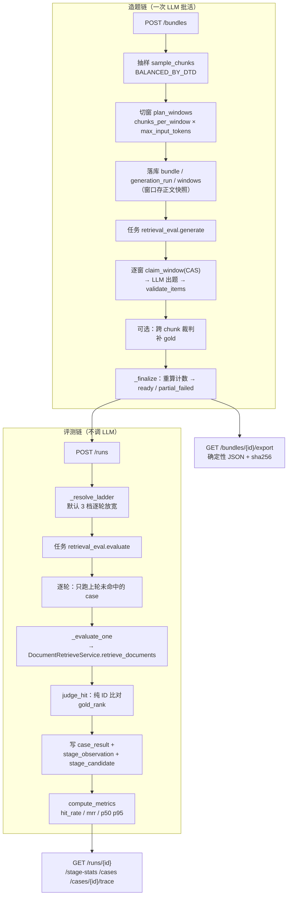

# EVAL_README.md — Retrieval Eval（检索评测）子系统

> YTraderHarness · 检索评测子系统事实手册
> 覆盖范围：`app/api/v1/retrieval_eval.py`、`app/services/document/{application,domain,models,repository}/retrieval_eval*`、`app/services/document/eval/`、`rag_eval_design/`。
> 本文只描述**代码里真实存在**的东西；注释与代码冲突处一律以代码为准并显式标注。

---

## 0. TL;DR

| 问题 | 一句话答案 |
|---|---|
| 这个子系统评什么？ | **只评召回**。给定一题，正确答案所在的 chunk 有没有被检索链路捞回来、排第几 |
| 评测阶段调 LLM 吗？ | **不调**。LLM 只用在**造题**（出题）与**跨 chunk 裁定**（补金标）两处 |
| 怎么算分？ | `gold_hit = gold_rank <= max_k`；指标有 `hit_rate_at_1/5/k`、`mrr_at_k`、`hit_rate_curve`、`p50/p95_latency_ms` |
| 为什么要"三轮"？ | 逐轮**放宽**检索参数（融合窗口 / 改写方式 / 是否开精排），只把上一轮**没命中**的题带入下一轮。三轮分开统计，所以是正当的 |
| 金标是"唯一答案"吗？ | **不是，是下界**。源 chunk 由构造天然是金标，再用跨 chunk 裁判补上"别的 chunk 也能独立回答"的块 |
| 最有用的一张表？ | `retrieval_eval_stage_observation` —— 它回答"金标**死在哪一段**"（召回没捞到 / 融合丢了 / 精排切了 / 裁剪砍了） |
| 数据集能改吗？ | 不能。**没有 update 端点**，`ready` 后不可变，改参数要新建 bundle |
| 有多少张表？ | **9 张**（冒烟实测建表 9/9） |
| 实现完整度？ | 12 个端点全部实现；2 个冒烟 + 68 个 pytest 全部通过 |

---

## 1. 先分清三个"评测"

仓库里有三处名字都像"评测"，但**只有第一个是已实现的检索评测**。读错会全程错位。

| # | 位置 | 是什么 | 状态 |
|---|---|---|---|
| 1 | `app/api/v1/retrieval_eval.py` + `app/services/document/*retrieval_eval*` + `app/services/document/eval/` | **检索评测（retrieval eval）**：本文件的主角。DTD 均衡抽样 → LLM 造题 → 固定数据集上跑真实检索 → 出指标 + 逐阶段丢因 | ✅ **已实现**（12 端点 / 9 表 / 2 冒烟 / 68 pytest） |
| 2 | `app/services/evaluate/evaluation.yaml`（1349 行） | **"RAG Evaluation API" 设计态契约**：datasets / cases / metric registry / benchmarks / runs / results，14 个 `/evaluation/*` 端点，提到 ragas 作为 metric provider | ❌ **只有 yaml，无任何实现**（`app/api/v1/` 下无 `evaluation.py`，`app/services/evaluate/` 下无 models/services 目录；无任何代码 import 或 `$ref` 它） |
| 3 | `app/services/document/qa/` + `app/api/v1/qa_datasets.py` | **QA 数据集生成**：另一套，产出对齐 `evaluation.yaml` 里 `EvaluationCase` 形状的数据，服务于 ragas 式**单文档**评测 | ✅ 已实现，但**与 retrieval eval 是两套东西** |

判断依据（不是猜）：

- 第 2 项的 14 个 path 全是 `/evaluation/*`（`evaluation.yaml:44-423`），与 `/retrieval-eval/*` **完全不重叠**；
- 检索评测的**契约权威**是 `rag_eval_design/retrieval_eval_openapi.yaml`（48239 字节），不是 `evaluation.yaml` —— 见 `app/api/v1/retrieval_eval.py:4` 与 `domain/schemas/retrieval_eval.py:4` 的模块头；
- `qa/` 与 `eval/` 的**唯一共享**是 `qa/locate.py` 的逐字定位原语（`eval/generator.py:50`、`eval/adjudication.py:51` 都 `from ..qa.locate import Span, locate_quotes`）；`qa/` **不 import `eval/`**。两目录无任何 `deprecated` / `replaced` / "将来" 字样。

> 📌 结论：**`evaluation.yaml` 是一份未被接线、也未被取代的广义设计**（含 LLM 判分 + ragas）。它与检索评测目标层不同，属并列关系。要写新评测功能前先读它，别当它不存在。

---

## 2. 阅读地图

```
rag_eval_design/                          ← 设计态权威（三份）
├── retrieval_eval_codegen_prompt.md      ← 设计说明：目标 / 非目标 / 关键决策 / 测试场景清单
├── retrieval_eval_openapi.yaml            ← 权威契约（11 path / 12 operation）
└── retrieval_eval_schema.sql              ← 权威 DDL（9 张表）

app/api/v1/retrieval_eval.py              ← HTTP 层（413 行）

app/services/document/
├── application/
│   ├── retrieval_eval_service.py         ← 服务接口（14 个方法）
│   ├── retrieval_eval_service_impl.py    ← 服务实现（2954 行，编排主体）
│   └── retrieval_eval_evaluation.py      ← 评测执行 + 指标（658 行）
├── domain/
│   ├── entities/retrieval_eval.py        ← 9 个领域实体（538 行）
│   ├── schemas/retrieval_eval.py         ← DTO + 默认常量（1207 行）
│   ├── schemas/enum.py                   ← 8 个 eval 枚举（:478-）
│   └── tasks.py                          ← 两个 handler 的参数结构
├── models/sqlalchemy/retrieval_eval.py   ← 9 个 ORM 模型（1625 行）
├── repository/retrieval_eval_{bundle,case,run}(+_impl).py
├── eval/                                 ← 造题算法层
│   ├── sampling.py                       ← 抽样（244 行）
│   ├── windowing.py                       ← 切窗（230 行）
│   ├── generator.py                      ← LLM 造题 + 校验（585 行）
│   ├── adjudication.py                   ← 跨 chunk 裁判（264 行）
│   └── output.py                          ← **模型输出解析**（233 行）⚠️ 不是"导出"
├── qa/                                   ← 另一套 QA 生成（与 eval 只共享 locate.py）
└── retrieve/                             ← 被评测的检索链路
    ├── trace.py                          ← stage_key / source_key / DEFAULT_TOP_N 的产生处
    └── processor.py                      ← 各阶段传 stage_key 的调用点

tests/services/document/test_retrieval_eval_{metrics,rounds,adjudication,repositories}.py
tests/api/test_retrieval_eval_routes.py
```

> ⚠️ `app/services/document/eval/output.py` 的名字有误导性：它是**模型输出解析层**（`parse_window_questions` / `parse_adjudication_verdict`），**不含** `canonical_json` / `dataset_sha256`。确定性导出在 `app/common/utils/digest.py` + `retrieval_eval_service_impl.py` + `retrieval_eval_case_impl.py`（见 §10）。

---

## 3. 全貌



**一句话架构**：**造题是一次昂贵的离线 LLM 批活，评测是一次便宜的可重复检索回放**。两段之间用"不可变的确定性数据集（bundle）"解耦 —— 所以评测能反复跑、能跨版本对比，而造题只需跑一次。

---

## 4. 契约与 API

### 4.1 挂载与鉴权

- 前缀：`/api/v1/retrieval-eval/`（挂 `protected_router`，`router.py:164`）。
- 鉴权：**需要 token**（`protected_router` 的 `Depends(current_user)`），但**没有 admin 门槛**——对比 `memory_query_router` 挂载时显式加了 `Depends(require_admin)`（`router.py:281-284`）。
- 注册顺序：`router.py:157-162` 注释明说 `/retrieval-eval/` 下全是**字面量**路径，无 `/{id}` 宽匹配抢先问题，"注册顺序不承载语义"。

### 4.2 端点全清单（12 个 operation / 11 个 path）

| 方法 | 路径 | 职责 | 请求模型 | 响应模型 | 码 |
|---|---|---|---|---|---|
| POST | `/bundles` | 建数据集并启动造题（异步） | `CreateEvalBundleRequest` | `CreateEvalBundleAcceptedResponse` | 202 |
| GET | `/bundles` | 列出数据集（分页） | — | `EvalBundleListResponse` | 200 |
| GET | `/bundles/{bundle_id}` | 数据集明细 | — | `EvalBundleDetail` | 200 |
| GET | `/bundles/{bundle_id}/cases` | 预览 QA（分页） | — | `EvalCaseListResponse` | 200 |
| GET | `/bundles/{bundle_id}/export` | 导出确定性 JSON（仅 `ready`） | — | `EvalBundleExport` | 200 |
| GET | `/generation-runs/{generation_run_id}` | 造题进度 | — | `GenerationRunDetail` | 200 |
| POST | `/generation-runs/{generation_run_id}/retry-failed-windows` | 重跑未成功窗口 | — | `GenerationRetryAcceptedResponse` | 202 |
| POST | `/runs` | 启动评测（异步） | `CreateEvalRunRequest` | `CreateEvalRunAcceptedResponse` | 202 |
| GET | `/runs/{eval_run_id}` | 评测状态与指标 | — | `EvalRunDetail` | 200 |
| GET | `/runs/{eval_run_id}/stage-stats` | 宏观丢因统计 | — | `StageStatsResponse` | 200 |
| GET | `/runs/{eval_run_id}/cases` | 单条 case 命中结果（分页） | — | `EvalRunCaseListResponse` | 200 |
| GET | `/runs/{eval_run_id}/cases/{eval_case_id}/trace` | 单条逐阶段痕迹 | — | `EvalCaseTraceResponse` | 200 |

**三个 202 的理由**：造题与评测都是**分钟级后台任务**，不能立刻给出结果。契约注释明说用 202 而非 201（`retrieval_eval_codegen_prompt.md:21`）。

**没有 PUT / PATCH / DELETE**。数据集建后**不可变**——改参数必须新建 bundle。这是"基准可比"的前提（§16.9）。

权威契约 `rag_eval_design/retrieval_eval_openapi.yaml` 与实现的 12 个 operation **一一对应，无多出、无缺失**。

### 4.3 关键请求字段

`CreateEvalBundleRequest`（`retrieval_eval.py:134`）：

| 字段 | 类型 / 约束 | 说明 |
|---|---|---|
| `name` | str, 1..255 | — |
| `description` | str \| None | — |
| `document_type_definition_ids` | list[UUID], 1..50, 禁重复 | **抽样范围**（数据集**没有** `scope` 字段） |
| `sampled_chunk_count` | int, 1..100000 | 抽多少个 chunk |
| `questions_per_chunk` | int = 3, 1..20 | 每 chunk 出几题 |
| `chunks_per_window` | int = 5, 1..50 | 一个 LLM 调用放几个 chunk |
| `max_input_tokens` | int = 12000, 1000..1000000 | 单次调用输入预算 |
| `enable_cross_chunk_judge` | bool = False | 是否跑跨 chunk 裁判补金标 |
| `sampling_strategy` | `EvalSamplingStrategy` = `balanced_by_dtd` | 抽样策略 |
| `seed` | int \| None | 不传则服务端生成 |

`CreateEvalRunRequest`（`retrieval_eval.py:723`）：

| 字段 | 默认 | 说明 |
|---|---|---|
| `bundle_id` | — | 必须在 `ready` 态 |
| `max_k` | 10（`DEFAULT_MAX_K`） | **命中判定截断位** |
| `include_stage_trace` | True | 关掉则不写观测/候选行（省库） |
| `top_candidates_per_stage` | 10 | 每阶段留几条候选（诊断用） |
| `query_processor_override` | None | 覆盖检索处理器配置 |
| `attempts` | None（→ 默认阶梯） | 最多 3 档 |

> `CreateEvalRunRequest` 的 docstring 明确写了一句话：**"这里没有任何'用不用 LLM'的开关 —— 这一层不用 LLM 判分，所以没有可关的东西。"**（`schemas/retrieval_eval.py:727-728`）

---

## 5. 枚举全表（`domain/schemas/enum.py`）

| 枚举 | 行号 | 全部取值 |
|---|---|---|
| `EvalBundleStatus` | `:478` | `draft` / `generating` / `ready` / `partial_failed` / `failed` / `archived` |
| `EvalJobStatus` | `:510` | `queued` / `running` / `completed` / `partial_failed` / `failed` / `cancelled`（造题与评测**共用**） |
| `EvalCaseValidationStatus` | `:527` | `pending` / `validated` / `rejected` |
| `EvalCaseResultStatus` | `:544` | `completed` / `failed` / `skipped` |
| `EvalSamplingStrategy` | `:552` | `balanced_by_dtd` / `uniform_all` |
| `EvalGoldValidationMethod` | `:568` | `source_chunk` / `llm_cross_chunk_judge` / `human_review` |
| `EvalScoreDirection` | `:591` | `higher_is_better` / `lower_is_better` / `not_comparable` |
| `EvalDropReason` | `:610` | 见下 |

`EvalDropReason` 是**受控词表**（12 个值）：`not_recalled` / `top_k_cutoff` / `score_threshold` / `metadata_filter` / `ownership_filter` / `rerank_cutoff` / `final_top_k_cutoff` / `deduplicated` / `permission_filter` / `processor_error` / `unknown` / `not_applicable`。

**没有**的东西（容易以为有）：

- **没有 stage 名枚举** —— `stage_key` / `source_key` 是**自由串**，取值由检索侧 trace 决定（§12.2）。词表未收敛是潜在鸿沟。
- **没有 case 来源枚举**（人工 / 生成）—— 题一律 LLM 逆向生成，最接近的概念是"金标校验方式" `EvalGoldValidationMethod`。
- **没有指标名枚举** —— 指标是**固定字段**（`hit_rate_at_1` 等），不是注册表。这一点与 `evaluation.yaml` 的 metric registry 设计**正相反**。

---

## 6. 数据模型（9 张表）

ORM：`models/sqlalchemy/retrieval_eval.py`；权威 DDL：`rag_eval_design/retrieval_eval_schema.sql`。**两者列/约束/索引/SQL 语义一致**，仅两处刻意偏差见 §6.4。

### 6.1 表结构

| 表 | 主键 | 关键列 | 作用 |
|---|---|---|---|
| `retrieval_eval_bundle` | `bundle_id` | `name`、`status`、`schema_version`(默认 `'1.0'`)、`selection_config` JSONB NOT NULL、`generation_config` JSONB NOT NULL、`dataset_sha256` VARCHAR(64) NULL、`source_chunk_count`、`case_count` | 数据集，**配置快照的唯一权威** |
| `retrieval_eval_generation_run` | `generation_run_id` | FK→bundle **RESTRICT**；`status`、`sample_seed`、`config_snapshot` JSONB、`model_role`、`model_name`、`total_chunks`/`total_windows`/`completed_windows`/`failed_windows`/`generated_cases`、`error_message` | 一次造题 |
| `retrieval_eval_generation_window` | `generation_window_id` | FK→run **CASCADE**；`window_index`、`status`、**`input_chunks` JSONB NOT NULL**、`input_token_estimate`、`request_sha256`、`raw_response` JSONB、`attempt_count`、`valid_case_count`、`error_code` | **重试单位** |
| `retrieval_eval_case` | `eval_case_id` | FK→bundle **RESTRICT**、FK→window **SET NULL**；`document_type_definition_id`、`source_chunk_id` NOT NULL、`source_content_hash`、`question`、`answer_original`、`answer_start_offset`/`end_offset`、`question_order`、`question_sha256`、`validation_status` | 一道题 |
| `retrieval_eval_case_gold_chunk` | `eval_case_gold_chunk_id` | FK→case **CASCADE**；`chunk_id`（**无 FK**）、`is_source_chunk`、`validation_method`、`evidence_excerpt`、`judgment` JSONB | 金标（**一对多**） |
| `retrieval_eval_run` | `eval_run_id` | FK→bundle **RESTRICT**；`status`、`max_k`、`query_processor_override` JSONB、**`effective_config_snapshot` JSONB**、`include_stage_trace`、`total_cases`/`completed_cases`/`failed_cases`、`metrics` JSONB | 一次评测 |
| `retrieval_eval_case_result` | `eval_case_result_id` | `attempt_no`（默认 1）、FK→run **CASCADE**、FK→case **RESTRICT**；`query_text`、`gold_hit` BOOL NULL、`gold_rank`、`retrieved_chunk_ids` JSONB、`degraded_routes` JSONB、`latency_ms`、`status` | 单题单轮结果 |
| `retrieval_eval_stage_observation` | `id` | FK→result **CASCADE**；`stage_key`、`source_key`、`executed`、`input_count`/`output_count`、`gold_present_before`/`after`、`gold_rank_before`/`after`、`gold_score_before`/`after`、`drop_reason`、`details` JSONB | **金标进出的逐阶段记录** |
| `retrieval_eval_stage_candidate` | `id` | FK→result **CASCADE**；`stage_key`、`source_key`、`chunk_id`、`rank_before`/`after`、`score_before`/`after`、`score_name_*`、`score_direction_*`、`selected`、`drop_reason`、`metadata` JSONB | 每阶段每候选一行（**只诊断单 case 用**） |

### 6.2 三个需要理解的设计点

**① `generation_window.input_chunks` 为什么存正文快照**

元素是 `{chunk_id, document_type_definition_id, document_version_id, content, content_hash, token_count}`（`retrieval_eval.py:419`）。

理由：**源 chunk 可能被重新切分**（id 与内容都会变）。只存 `chunk_id` 会让"重试一个失败窗口"悄悄用上不同的正文，却进入同一个数据集 —— 于是首轮产出与重试产出**不可比**，而这件事不会报错。存快照让窗口成为一个自包含的输入。

**② `case_gold_chunk` 是独立表且一对多**

一个 case 可以有**多个**金标：源 chunk 由构造天然是金标（`is_source_chunk=True`），跨 chunk 裁判通过的其他块也是金标。

> 这就是"**金标是下界，不是全集**"（`adjudication.py` 模块 docstring）在数据结构上的体现 —— 数据集不假装自己知道所有正确答案。

**③ `case_result.gold_hit` 是三值**

| 值 | 含义 |
|---|---|
| `TRUE` | 有任一金标命中 |
| `FALSE` | 跑了，但没命中 |
| `NULL` | **没跑成**（失败/故障），不是"没召回" |

把 `NULL` 与 `FALSE` 合并会让**检索故障伪装成召回率下降**（`retrieval_eval.py:1083` 注释明说）。指标计算的分母只取 `gold_hit is not None`（§8.3）。

### 6.3 唯一约束（幂等的实现基础）

| 约束 | 列组合 | 保证什么 |
|---|---|---|
| `uq_..._generation_window` | `(generation_run_id, window_index)` | 窗口确定性身份；重切同一次运行会撞上（**有意报错**） |
| `uq_..._case_order` | `(bundle_id, source_chunk_id, question_order)` | 同 chunk 同序号题不重复 |
| `uq_..._case_question` | `(bundle_id, source_chunk_id, question_sha256)` | 同 chunk 不出两道相同题 |
| `uq_..._case_gold_chunk` | `(eval_case_id, chunk_id)` | 每题每 chunk 一行金标 |
| `uq_..._case_result` | `(eval_run_id, eval_case_id, attempt_no)` | 每 case 每轮一行 |
| `uq_..._stage_observation` | `(eval_case_result_id, stage_key, source_key)` | 每阶段金标进出一行 |
| `uq_..._stage_candidate_chunk` | `(eval_case_result_id, stage_key, source_key, chunk_id)` | 每阶段每候选一行 |

### 6.4 外键与级联

| 关系 | 策略 |
|---|---|
| window → generation_run | **CASCADE** |
| case_gold_chunk → case | **CASCADE** |
| case_result → run | **CASCADE** |
| stage_observation / stage_candidate → case_result | **CASCADE** |
| generation_run → bundle | **RESTRICT** |
| case → bundle | **RESTRICT** |
| case_result → case | **RESTRICT**（有结果就禁止删 case） |
| case.generation_window_id → window | **SET NULL** |

> 📌 **删一个 bundle 不会级联删任何子行** —— 因为它的子表全部是 RESTRICT，直接 `DELETE` 会被数据库拒绝。要清必须先删 run（级联带走 result → observation/candidate）、再删 generation_run（级联带走 window）、再删 case（级联带走 gold_chunk）。

### 6.5 ORM 与 SQL 的刻意偏差（两处）

| 项 | SQL | ORM | 后果 |
|---|---|---|---|
| `status` 列长度 | `VARCHAR(24)` | `String(32)` | `create_all` 实际建 `VARCHAR(32)`。功能无碍，但 DDL 与运行库声明不一致 |
| `status` 的 `CHECK` 约束 | **有** `CHECK (status IN (...))` | **未镜像**（约束落在 Python 枚举上） | `create_all` 建的库**不含**这些 CHECK，仅应用层兜底 |

两条 intra-row CHECK（`ck_retrieval_eval_answer_offsets`、`ck_retrieval_eval_stage_candidate_has_rank`）双方都有。SQL 尾部还有给既有库补列的增量 `ALTER` 段（`:271-286`）——对**已有库** `create_all` 不会加列，需手动执行。

---

## 7. 造题链路

### 7.1 从 `POST /bundles` 到任务提交

`create_bundle`（`retrieval_eval_service_impl.py:247`）：

| # | 步骤 | 位置 |
|---|---|---|
| 1 | 校验 DTD 存在且 active（**先校验再抽样**，避免抽到一半才失败） | `:259-289` |
| 2 | `_new_seed()` 定种子 | `:2586` |
| 3 | `list_samplable_chunk_ids(...)` 取候选池 | `:298` |
| 4 | `sample_chunks(...)` 抽样 | `:325` |
| 5 | `_load_contents(...)` 分页（500）取正文 | `:333` |
| 6 | `plan_windows(...)` 切窗 | `:374` |
| 7 | `add_bundle` → `add_generation_run` → `add_windows` | `:437` / `:451` / `:453` |
| 8 | `_submit_generation(...)`（经 TaskService，挂 post_commit） | `:476` |

### 7.2 抽样（`eval/sampling.py`）

**候选池**（`document_chunk_impl.py:289-346`）的过滤条件是决定性的：

```
document_type_definition_id IN (...)      # 选定 DTD
AND Document.status = ACTIVE              # 活跃文档
AND DocumentVersion.version_status = ACTIVE
AND chunker_key IN (chunker_keys)         # 调用处只传 [TextDocumentChunker.name]
AND content != ''
ORDER BY document_chunk_id LIMIT max_pool # MAX_SAMPLE_POOL = 50000
```

即：**只抽活跃文档、活跃版本、由 `TextDocumentChunker` 产出的非空正文块**。换了 chunker 就等于换了池子 —— 这个耦合要记住。

**`BALANCED_BY_DTD`（最大余数法）**（`_allocate_quotas`，`:180-238`）：

```
exact[dtd] = total * size[dtd] / population
quotas[dtd] = min(int(exact[dtd]), size[dtd])
余下名额：在 quota < size 的组里，选 余数最大者；余数相同按 DTD 键名字典序
小 DTD 吃不下时名额退回再分配，保证总数恰好 == count（否则抛 RuntimeError）
```

**`UNIFORM_ALL`**（`:86-88`）就是 `random.Random(seed).sample(ordered, count)`，不做 DTD 分组。

**五道确定性保证**（这是"同 seed + 同 config + 同源集 ⇒ 同数据集"的实现）：

1. 进随机前按 `(dtd_id, chunk_id)` 排序（`:75-81`）；
2. 只用局部 `random.Random(seed)`，不碰全局随机；
3. 每个 DTD 用 `_derive_seed(seed, dtd_id)` **独立**派生种子 —— 用 `sha256(f"{seed}:{key}")[:8]`，不是 `seed + 序号`（这样新增一个 DTD 不会平移其余 DTD 的抽样）；
4. `_sample_from` 抽完再按 `chunk_id` 排序（`:158-161`）；
5. 返回前再按 `(dtd, chunk_id)` 排序（`:127-133`）。

注意第 4、5 条：**输出是稳定排序而不是重打乱** —— 因为 `plan_windows` 是贪心**按序**装填的，窗口身份依赖顺序。

### 7.3 切窗（`eval/windowing.py`）

`plan_windows`（`:118-230`）是**贪心按序装箱**，且**刻意不按长度排序**（`:132-135`）——保留文档内的相邻关系，便于裁判找候选。

```
available        = max_input_tokens - INSTRUCTION_RESERVE_TOKENS(2400)
per_chunk_output = 40 + questions_per_chunk * 120
cost             = content_tokens + per_chunk_output      # 输出 token 也计入！
换窗条件         = len(current) >= chunks_per_window  OR  current_tokens + cost > available
```

两个约束**取更紧者**，不存在"谁说了算"。`per_chunk_output` 计入 `cost` 是个细节：模型为每个 chunk 产出的题目也要占输出预算。

**超大单 chunk**：若 `cost > available`（**独自也装不下**）→ `flush()` 当前窗 + 记 `SkippedChunk(reason=...)`，**绝不截断**（`:197-216`）。

> 为什么不截断：截断可能正好删掉答案所在的那段，金标就**静默失真**了 —— 数据集里会出现"这题实际上答不了"但看起来正常的题。跳过是诚实的，截断是不诚实的。

**token 估算**用的是 `token_length(text, "o200k_base")`（tiktoken，`:60`、`:81-84`），**不是**上下文侧的 `HeuristicTokenCounter`。编码名必须与 `chunker/txt.py` 一致。

### 7.4 LLM 造题（`eval/generator.py`）

调用链：

```
build_model_request(...)            # :405-430 系统提示 node_prompt(EVAL_QA_GENERATION) + 可选 document_context
  → runtime.ainvoke(...)
  → parse_window_questions(...)     # eval/output.py
  → validate_items(...)             # :155-320
```

常量 `EVAL_AGENT_TYPE = "retrieval_eval_generate"`（`:328`）。

**模型要求的输出结构**（`eval/output.py`）：`{"items": [{"chunk_id", "question", "answer_original"}], "insufficient_fact_chunk_ids": [...]}`。

**`validate_items` 的六条规则**：

1. `chunk_id` 必须在本窗口内；
2. `question` 非空；
3. `answer` 非空；
4. 每块题数 ≤ `questions_per_chunk`（**服务端强制**，不信模型）；
5. 同块内按 `normalize_question` 的 sha256 指纹去重；
6. **`answer` 必须能在源正文里逐字定位**（`locate_quotes` 精确匹配，失败退化为空白折叠匹配）。

**`answer_original` 与 offset 的来源**（`:269-318`）：模型给的 `answer_original` **只用于定位**；代码取 `content[hit.span.start:hit.span.end]` 作为**真实逐字切片**落库，并写 `answer_start_offset` / `answer_end_offset` / `exact` / `occurrences`。

> 这一条是整个造题链最关键的防幻觉设计：**模型只负责"指出答案在哪"，不负责"抄得准"**。抄写由代码完成，所以 `answer_original` 一定是原文子串，评测的金标才可信。

**窗口级失败隔离**：`generate_for_window` **永不抛异常**。所有失败归入 `WindowOutcome.error_code`：`llm_error` / `parse_error` / `no_valid_case` / `empty_window` / `truncated`。`ok = error_code is None`。空事实窗口（模型回 `insufficient_fact`）**不算失败**。

解析失败时先看 `finish_reason == "length"` → `error_code="truncated"`，否则 `parse_error`（可重试）。

### 7.5 跨 chunk 裁判（`eval/adjudication.py`）

常量：`ADJUDICATE_AGENT_TYPE = "retrieval_eval_adjudicate"`，`ModelRole.EVAL_CROSS_CHUNK_JUDGE`。

流程（`:137-264`）：

```
adjudicate_question(question, answer_original, candidates, runtime)
  → build_model_request
  → parse_adjudication_verdict(...)     # answerable_chunk_ids[] + evidence_excerpts{id: 原文}
  → 逐条校验：必须在候选内 → 必须有 evidence_excerpt
  → locate_quotes([excerpt], content)   # 逐字校验；定位不到即作废
  → 存 content[span] 切片 + judgment
```

**候选池** = 本 bundle 已抽样的 chunk **排除源 chunk**。模块 docstring 明确：金标是**下界**，不是全集。

**`evidence_excerpt` 的逐字校验是硬门槛**：模型说"这个 chunk 能答"还不够，必须给出一段**该 chunk 正文里真实存在的原话**；定位不到就作废这次判定，理由注释写的是"判定未落到原文"。

**这道裁判只影响金标集合，不改题目/答案本身。**

---

## 8. 评测链路

### 8.1 从 `POST /runs` 到任务提交

`create_eval_run`（`:932`）：

| # | 步骤 | 位置 |
|---|---|---|
| 1 | 校验 bundle 处于 `READY` | `:944` |
| 2 | `_resolve_ladder(...)` 定逐轮阶梯（请求没传则用默认档） | `:1007` |
| 3 | `cutter.top_k = min(cutter.top_k, max_k)` | `:984` |
| 4 | `add_run(...)`（把阶梯写进 `effective_config_snapshot["attempts"]`） | `:1053` |
| 5 | `_submit_evaluation(...)` | `:1055` |

### 8.2 `evaluate` 主体（`:1407`）

```
取 run / bundle / list_all_validated_cases / list_gold_chunks
→ 置 RUNNING（单独提交一次）
→ 跳过已有结果（list_case_results + done_ids）      # :1476 ← 租约回收后接着跑
→ for attempt_no, spec in enumerate(ladder):        # :1541
      _precompute_rewrites(...)                     # 批量改写本轮 query
      每 BATCH_COMMIT_EVERY=10 条提交一批           # :1597
      _evaluate_one(...)                            # :1605
→ 下一轮输入 = 本轮 gold_hit=False 的 case
```

**`_evaluate_one`（`:1967`）复用真实检索服务** —— `DocumentRetrieveService.retrieve_documents`（`:2005`），不是桩，**不调 LLM**。

**`_evaluate_one` 也不抛异常**（`:1980`）：失败落 `status=failed` + `gold_hit=NULL`（超时与异常两个分支分别是 `:2023` / `:2058`）。

### 8.3 默认三档阶梯（`DEFAULT_ATTEMPT_LADDER`，`schemas/retrieval_eval.py:674-720`）

| 轮 | `recall_top_k` | `fusioner.top_k` | `cutter.top_k` | `query_rewriter` | `reranker` |
|---|---|---|---|---|---|
| `round1` | 200 | 100 | 10 | `COMMON`（规则式） | — |
| `round2` | 400 | 100 | 20 | `LLM` | — |
| `round3` | 500 | 200 | 30 | （继承上轮） | `API`，`qwen3.7-text-rerank`，`top_n=50` |

- `QWEN_RERANK_MODEL = "qwen3.7-text-rerank"`（`schemas/retrieval_eval.py:671`）—— 模型标识写在 schema 常量里而不是硬编码在实现里，**换模型不改代码**。
- 阶梯的注释解释了每一档为什么这么设：例如 round1 的融合窗口取 100 而不是 200，因为"另外两条更深的排在 151/155，250 以内都捞不回来，那是第 2/3 轮该管的事 —— 第 1 轮就开到 200 会把阶梯的'逐轮放宽'抹平"。
- round3 才开精排，注释写的是"贵，只让最难那批付"。

### 8.4 命中判定（`retrieval_eval_evaluation.py:223`）

```python
judge_hit(response, gold_chunk_ids, max_k) -> (hit: bool, rank: int | None)
```

**纯 ID 比对，无 LLM**。在 `response.results` **全集**（不截断到 `max_k`）里找 `gold_chunk_ids`：

- `gold_hit` = `rank <= max_k`（`k = run.max_k`，默认 10）；
- 多金标取**最好**名次；
- `gold_rank` = 金标在全部返回里的 1-based 名次；未返回则 `None`。

**在全集里找、再和 max_k 比**，而不是先把结果截到 max_k —— 这样 `gold_rank` 能报出真实名次（例如第 37 名），而不只是"没进前 10"。

### 8.5 指标（`compute_metrics`，`:507`）

| 指标 | 公式 |
|---|---|
| `hit_rate_at_1` / `_at_5` / `_at_k` | `命中数 / judged`，其中 `judged = 已判定（COMPLETED 且 gold_hit is not None）` |
| `mrr_at_k` | `mean(1 / rank)`，**仅命中者**参与 |
| `hit_rate_curve` | 对 `HIT_RATE_CURVE_KS = (1, 5, 10, 20, 50)` 各算一次（`:75`） |
| `p50_latency_ms` / `p95_latency_ms` | `percentile`，**最近秩法、不插值**（`:627`/`:633`） |

**`at_5` 在 `max_k < 5` 时返回 `NULL`**（`:587-598`）—— 因为"这个位次上没有意义"必须与"命中率 = 0"分开。若返回 0，会被读成"top5 一个都没中"，那是完全不同的结论。

### 8.6 阶段观测（`build_stage_rows`，`:270`）

遍历 `response.trace.stages`，为每个 `(stage_key, source_key)` 写一行观测 + 若干候选行。

**归因规则**（`:342-348`）：只有当金标"**进这一阶段前还在、出这一阶段后没了**"时，才把 `drop_reason` 记在这一段。

> 这条规则的价值：**不把上游的账算到下游**。如果金标在召回阶段就没捞到，那么融合/精排/裁剪三段都会被记成 `not_applicable`，而不是各自"丢了一次"。

---

## 9. 宏观丢因统计（`GET /runs/{id}/stage-stats`）

`aggregate_stage_stats` 在 SQL 里 `group by`，输出每个阶段的：

| 字段 | 含义 |
|---|---|
| `avg before -> after` | 平均进出条数 |
| `drop` | 该段丢掉的次数 |
| `pass` | 通过率 |

实测输出（`retrieval_eval_evaluate_smoke`）：

```
cutter                   avg 100.0->10.0   drop=0  pass=1.0
filter                   avg 100.0->100.0  drop=0  pass=1.0
fusioner                 avg 400.0->100.0  drop=0  pass=1.0
recall.dense_vector      avg 200.0->200.0  drop=0  pass=1.0
recall.keyword           avg 200.0->200.0  drop=0  pass=1.0
reranker                 avg 100.0->100.0  drop=0  pass=1.0
```

这 6 个阶段是**检索侧 trace 真实收集**的 `(stage_key, source_key)` 对，评测侧不硬编码（§12.2）。

---

## 10. 确定性导出（`GET /bundles/{id}/export`）

`export_bundle`（`:612`）：

```
payload = {
  schema_version, bundle_id, bundle_name,
  generation_config, document_type_definition_ids, items
}
items[i] = {
  chunk_id, gold_chunk_ids, document_type_definition_id,
  document_version_id, document_id, document_title, document_key,
  question, answer_original
}
dataset_sha256 = sha256_text(canonical_json(payload))     # :676
```

**"确定性"是怎么做到的**：

1. `canonical_json`（`app/common/utils/digest.py:46-71`）：`json.dumps(value, sort_keys=True, separators=(",", ":"), ensure_ascii=False)` —— `sort_keys` 固定**键序**；
2. **列表顺序由调用方保证**：case 按 `(document_type_definition_id, source_chunk_id, question_order)` 排（`retrieval_eval_case_impl.py:44-48`）；gold 按 `(eval_case_id, is_source_chunk DESC, chunk_id)` 排（`:294-302`）。

`schema_version` 是 `EvalBundle.schema_version`（默认 `"1.0"`），**配置值、非计算值**。

有了这套，"同一个数据集的指纹"就可以跨机器、跨时间比对 —— 前提是没人改列表顺序（这是最脆弱的一环，改排序键就等于换指纹）。

---

## 11. 模型绑定（两个 `ModelRole`）

`app/config/model.yaml:520-541`：

| agent_type | model_role | profile | 理由（yaml 注释原文要点） |
|---|---|---|---|
| `retrieval_eval_generate` | `eval.qa_generation` | `reasoning_default` | 输出**直接落库成为 ground truth**，回读时没有人在中间纠正；核心要求是"不许推断"，是照着禁止清单逐条自查的活 —— 指令遵循优先于"答得漂亮" |
| `retrieval_eval_adjudicate` | `eval.cross_chunk.judge` | `reasoning_default` | 判据是"这段正文**自己**有没有明说"，而模型的默认倾向是"相关就算能答"（宽松）。压住这个倾向靠推理，不靠文采 |

**为什么分成两个 `ModelRole` 而不是一个**（`types.py:170-172`）：两者取舍不同 —— 出题要"读得细、问得准"，裁定要"判得保守"（宁漏勿滥，因为**错误地多标一个金标会让召回率虚高，且虚高的部分无法察觉**）。挤在一个 role 里就没法只调其中一个的模型。

> 📌 `ModelRole` 的值取**动作名**（`eval.qa_generation`）而不是任务名（`retrieval_eval.generate`），与 memory 那几条同一口径：一个任务里可能有别的模型调用，role 描述的是"**这一次调用**干什么"。

另注：改写（`query_rewriter`）用的 model_role **不带 `eval.` 前缀** —— 因为改写是**线上检索路径**也在用的能力（`DocumentRetrieveRequest.query_rewriter`），不是评测专属。

---

## 12. 与检索侧的耦合契约

评测不是自闭环，它依赖检索侧提供的一组符号。**改这些会直接弄坏评测**。

### 12.1 依赖清单

| 依赖 | 位置 | 值 / 形状 | 坏了会怎样 |
|---|---|---|---|
| `DocumentRetrieveService.retrieve_documents` | 检索服务 | 评测的执行入口 | 整条评测链不可用 |
| `response.trace.stages[]` | 检索响应 | 每项含 `stage_key` / `source_key` / before / after 候选 | 阶段观测写不出来 → 丢因统计空 |
| `DEFAULT_TOP_N` | `retrieve/trace.py:51` | **10** | 与评测侧 `DEFAULT_TOP_CANDIDATES_PER_STAGE` 必须同步 |
| `stage_key` 取值 | `retrieve/trace.py:132` + `retrieve/processor.py:282/306/318/346/382` | `recall.{route}` / `recall` / `fusioner` / `filter` / `reranker` / `cutter` | 阶段名漂移 → 历史数据与新数据不可比 |
| `source_key` 取值 | 同上 | 召回路的 route（如 `dense_vector` / `keyword`）或 `""` | 同上 |
| `TextDocumentChunker.name` | chunker | 抽样的 `chunker_key` 过滤条件 | 换 chunker → 候选池空 → 抽不到题 |
| `QueryRewriterKind` / `QueryRewriterConfig` | `domain/schemas/retrieve.py` | 阶梯的改写配置 | 阶梯构造失败 |

### 12.2 `stage_key` / `source_key` 的真实产生处

- **召回段**由 `trace.py` 的 `observe_recall` **自己生成**：`stage_key = f"recall.{route}"`（`:132`）或 `"recall"`；`source_key` = route 或 `""`。route 来自候选的 `pipeline_key` / `retrieval_type`（如 `dense_vector`、`keyword`）。
- **其余四段**由 `observe_stage(stage_key=...)` 的**调用方传入**：`processor.py` 的 `RetrieveProcessor.run` 给出 `"fusioner"`（`:282`）、`"filter"`（`:306`/`:318`）、`"reranker"`（`:346`）、`"cutter"`（`:382`）；这些调用**未传 `source_key`**，故为默认 `""`。

### 12.3 ⚠️ 必须同步的一对常量

```
app/services/document/retrieve/trace.py:51        DEFAULT_TOP_N = 10
app/services/document/domain/schemas/retrieval_eval.py:126  DEFAULT_TOP_CANDIDATES_PER_STAGE = 10
```

**这两个是同一个量**，而它们**曾经不一致**（一边 5、一边 10）。后果是：trace 产出 21 条候选行，而 DTO 侧卡在 5 条，真跑一轮才炸 `List should have at most 5 items`。`schemas/retrieval_eval.py:122-125` 把这段历史写在注释里，并明确"改一处必须改另一处（或者干脆只留一处）"。

---

## 13. 任务基建、状态机与失败处理

### 13.1 任务

| 项 | 值 |
|---|---|
| handler 名 | `retrieval_eval.generate` / `retrieval_eval.evaluate` |
| 幂等键 | `f"{handler}:{run_id}"` + `reusable_key=True`（`:2708` / `:2755`） |
| 幂等语义 | **允许重复提交，但靠唯一约束 + `claim_window` CAS 去重落库**（不是"拒绝重复提交"） |
| 重试 | `RetryPolicy`：`base_delay=5s`、`multiplier=2`、`max_delay=300s`、`jitter=0.1`；`max_attempts` 默认 **3** |
| 不重试 | `TaskPermanentError` / `NotFoundError` 等 —— 所以"运行不存在"显式抛 `TaskPermanentError`（`:790` / `:1416`），否则会被无意义重试 3 次 |
| 任务基建不可用 | `_submit_*` 捕获 `RuntimeError`（未跑 lifespan）只 `debug` 日志；bundle 停在 `GENERATING`、run 停在 `QUEUED`，可用重试端点补跑（`:2689-2695`、`:2738-2743`） |

> `reusable_key=True` 是刻意的：任务是**至少一次**投递语义。所以所有写入路径都必须在重跑时**不产生重复**（§13.4）。

### 13.2 状态机

```
Bundle:  create → GENERATING
         _finalize（:1928-1941）:
           completed && !failed  → READY
           completed &&  failed  → PARTIAL_FAILED
           !completed            → FAILED

Run:     QUEUED → RUNNING → COMPLETED / PARTIAL_FAILED / FAILED
```

### 13.3 失败隔离（三层，都不上抛）

| 层 | 行为 | 位置 |
|---|---|---|
| 窗口 | `_run_window` **不抛异常**，失败记进窗口行；`_window_status`（`:2606`）：有产出 = `completed`、无错但无产出 = `partial_failed`、有错 = `failed` | `:1741` |
| 单 case | `_evaluate_one` **不抛**，失败落 `status=failed` + `gold_hit=NULL` | `:1980` |
| 整批 | bundle 部分窗口失败 → `PARTIAL_FAILED`；run 部分 case 失败 → `PARTIAL_FAILED` | `:1933` / `:1707` |

`partial_failed` 的语义是"**数据集/轮次不完整**"——而不是"全废了"。所以指标计算的分母只取 `judged`，不会被失败行稀释。

### 13.4 幂等与重跑

| 操作 | 实现 |
|---|---|
| `ON CONFLICT DO NOTHING` | `add_cases`（`case_impl.py:139`）、`add_gold_chunks`（`:171`）、`add_case_results`（`run_impl.py:220`）、`add_stage_observations`（`:410`）、`add_stage_candidates`（`:453`） |
| `claim_window` CAS | `UPDATE ... SET status='running', attempt_count=attempt_count+1 WHERE generation_window_id=:id AND status IN ('queued','failed','partial_failed')`，按 `rowcount` 判输赢（`bundle_impl.py:460-487`）。行锁下原子求值 → 先到者改成 running，后到者 `rowcount=0` → 返回 False。**杜绝两个 worker 重复调模型** |
| 窗口重跑 | `list_unfinished_windows`（含 `queued`）→ 再 `_submit_generation`。上限 `MAX_WINDOWS_PER_TASK_RUN = 20`（`:151`），跑不完的留在 `queued`，再调一次继续。**旧数据不删** |
| 计数 | `_finalize` **重算**而非累加：`counts = count_windows_by_status(run_id)` 从窗口行重新聚合（`:1879-1914`）。注释明说"任务是至少一次投递，累加在重跑时算重" |
| `add_windows` | **不用 DO NOTHING**（用 `add_all` + flush）—— 重切同一次运行会抛 `IntegrityError`。这是**有意的**：双切同一个 run 不该发生 |

---

## 14. 验证

### 14.1 快速验证（无需真模型 key）

```bash
cd C:/Users/尹文彬/PycharmProjects/YTraderHarness
./.venv/Scripts/python.exe -B -m app.services.document.retrieval_eval_smoke
./.venv/Scripts/python.exe -B -m app.services.document.retrieval_eval_evaluate_smoke
```

实测结果（两个都通过）：

**`retrieval_eval_smoke`**

```
[OK ] 建表：9/9 张
[OK ] 提示词 eval.qa_generation：4205 字
[OK ] 提示词 eval.cross_chunk.judge：935 字
[OK ] 造题 handler 注册：['memory.l0.extract', 'memory.l1.extract',
      'memory.l2.extract', 'memory.l3.extract',
      'retrieval_eval.evaluate', 'retrieval_eval.generate']
[OK ] runtime retrieval_eval_generate
[OK ] runtime retrieval_eval_adjudicate
[OK ] 服务装配 + 真查库：RetrievalEvalServiceImpl, total=4
```

**`retrieval_eval_evaluate_smoke`** —— 单条结果 `gold_hit=True`、`gold_rank=5`、`latency=9679ms`；6 阶段宏观丢因表；逐阶段痕迹；探针数据已清除。

### 14.2 回归测试

```bash
./.venv/Scripts/python.exe -m pytest \
  tests/services/document/test_retrieval_eval_metrics.py \
  tests/services/document/test_retrieval_eval_rounds.py \
  tests/services/document/test_retrieval_eval_adjudication.py \
  tests/services/document/test_retrieval_eval_repositories.py \
  tests/api/test_retrieval_eval_routes.py -q
```

实测：**`68 passed in 6.61s`**。

| 测试文件 | 行数 | 覆盖 |
|---|---|---|
| `test_retrieval_eval_metrics.py` | 775 | 指标公式与边界（分母为 0、`max_k < 5` 时 `at_5` 为 NULL 等） |
| `test_retrieval_eval_repositories.py` | 946 | 幂等 / 并发语义（`claim_window` CAS、`ON CONFLICT DO NOTHING`） |
| `test_retrieval_eval_routes.py` | 711 | 12 个端点的响应形状与错误码 |
| `test_retrieval_eval_rounds.py` | 584 | 逐轮阶梯行为（只跑上轮未命中、每轮分母不同） |
| `test_retrieval_eval_adjudication.py` | 427 | 裁判边界（`evidence_excerpt` 逐字校验失败等） |

### 14.3 量化指标口径

| 指标 | 来源 | 说明 |
|---|---|---|
| `hit_rate_at_1/5/k` | `compute_metrics` | 分母 = `judged`（已判定），不是总 case 数 |
| `mrr_at_k` | 同上 | 仅命中者参与 |
| `p50/p95_latency_ms` | 同上 | 单 case 检索延迟，最近秩法 |
| 生成完整性 | `generation_run` 的 `completed_windows` / `failed_windows` / `generated_cases` | 从窗口行**重算** |
| 阶段丢因 | `stage-stats` | 每阶段 `drop` / `pass` / `avg before->after` |

---

## 15. 设计目标与非目标（摘自 `rag_eval_design/retrieval_eval_codegen_prompt.md`）

### 15.1 目标

1. 建离线 QA 数据集 bundle；**LLM 仅用于造题**，评测阶段不调 LLM。
2. 做**确定性、只评检索**的基准：按 gold `chunk_id` 是否被召回算 Hit / MRR。
3. 造题走既有后台任务，接口返回 **202** 而非 201。
4. 数据集 `ready` 后**不可变**；改参数须新建 bundle / run。
5. **逐阶段 trace**，定位金标"死在召回还是死在裁剪"。
6. 跨块备选金标发现，但**限定在已采样 chunk 池内**。
7. 复用既有 DTD / ModelRegistry / 任务系统，不另起架构。

### 15.2 非目标（明确不做）

1. **不做 Ragas 式 LLM 评判**，不判相关性。
2. **不生成最终回答**；评测不调 response-generation / judge LLM。
3. 不做跨 DTD 的 agentic 路由。
4. **不做多跳 / 跨块合成** —— 只出单块显式事实题。
5. 不做全文档服务级 trace UI。
6. 客户端不可自选 DTD；评测保持单 DTD 调用。
7. **不静默把未完成的 bundle 标 `ready`**。

> ⚠️ **验收标准**：设计文档中**未见量化验收标准**（无指标目标值、无"必须通过 X%"之类数字阈值）。有一份**定性**的"必须覆盖的测试场景清单"（种子复现、单 DTD、预算拆分、verbatim 校验、trace 只读、归因转换、聚合统计对拍等），属测试覆盖要求而非通过线。**这一点需要注意**：本子系统目前没有"召回率达到多少算合格"的门槛定义。

---

## 16. 已知缺口与注释失真

### 16.1 真实缺口

| # | 项 | 说明 |
|---|---|---|
| 1 | **`evaluation.yaml` 整体未实现** | 1349 行的 "RAG Evaluation API"（含 ragas metric provider、benchmark、metric registry）无任何代码落地。属死设计或未来 spec |
| 2 | **`dataset_sha256` 生产路径从不写入** | bundle 的列存在（`sqlalchemy:193`）、实体有（`entities:95`）、summary 暴露（`_to_summary:2922`）、SQLA docstring 称"冻结在同一行上"；但 `create_bundle` 从不写它，`export_bundle` 只**在响应里实时算**、不回写。**后果：生产环境 summary 的 `dataset_sha256` 恒为 `None`**（只有冒烟的 `"0"*64` 造过值）。属"字段已暴露但未持久化" |
| 3 | **`max_k` 与返回条数口径可能错位** | `cutter.top_k = min(cutter.top_k, max_k)` **不保证二者相等**。默认阶梯 round1/round2 的 `cutter.top_k` 是 10/20，若 `max_k=50`，则标签写 `at_50` 实际只量到 `at_10`，**且不报错**。`retrieval_eval_service_impl.py:959-972` 自陈为已知限制 |
| 4 | **过期注释** | `app/api/v1/retrieval_eval.py:257-259` 写"评测执行（尚未实现）"，但 `/runs` 等端点已注册、handler `retrieval_eval.evaluate` 已注册、冒烟全过。**实测确认该注释与代码不一致，建议删除** |
| 5 | **`error_code="truncated"` 不在受控词表里** | `generator.py:72-81` 的 `ERROR_CODES` 元组只有 `llm_error` / `parse_error` / `no_valid_case` / `empty_window`，但 `:499-503` 会返回 `"truncated"`。词表不完整 |
| 6 | **`status` 的 CHECK 约束 ORM 未镜像** | SQL 有 `CHECK (status IN (...))`，ORM 没有 → `create_all` 建的库不含这些 CHECK，仅应用层枚举兜底（§6.5） |
| 7 | **`EvalScoreDirection` 实际只用 `higher_is_better`** | 其余两个值为将来"下推索引层原始分"预留。`score_name_*` / `score_direction_*` 列当前**几乎不携带信息** |
| 8 | **无 `stage_key` / `source_key` 枚举** | 自由串，词表未收敛。阶段名一旦漂移，历史数据与新数据不可比 |
| 9 | **`list_bundles` 按 DTD 筛 + 分页被明确拒绝** | 内存后置过滤会少返回行（`retrieval_eval_service_impl.py:517`）。设计取舍，非 bug |
| 10 | **身份字段留空** | `created_by` / `tenant_id` 暂为 NULL，等 Casdoor subject → UUID 映射方案（`retrieval_eval.py:27-36`） |
| 11 | **`add_windows` 非幂等** | 与其余写入路径的 `DO NOTHING` 风格不一致，但属有意为之（双切同 run 不该发生） |
| 12 | `eval/output.py` 与 `memory/domain/schemas/_model_output.py` **有意重复** | output.py 的 docstring 自陈"解析四步一致"，解法应是提到 `app/common/`。属未偿还的技术债 |
| 13 | `generator.py` **不设 `response_format`** | `:448-453` 称 adapters 行为不一致，属有意 |

### 16.2 未确认

| 项 | 为什么没确认 |
|---|---|
| `rag_eval_design/retrieval_eval_openapi.yaml` 的 `info.description` 全文 | 只读了 paths 与结构 |
| `root` 上 `evaluation.yaml` 的 metric registry 字段级细节 | 只判断了"未实现"这一结论 |
| `aggregate_stage_stats` 的 SQL 聚合细节 | 未逐行读该函数体 |

---

## 17. 设计取舍（读代码时的"为什么"）

1. **评测不用 LLM**。代价是"相关性"这种主观指标测不了；收益是**确定性、可复现、零推理成本**。所以检索评测能当回归基准反复跑，而 ragas 式评测不能。
2. **金标是下界，不是全集**。承认"数据集不可能枚举所有正确答案"，因此用跨 chunk 裁判补金标，且候选池限定在已采样池内（有界、可复现）。代价是召回率的上界不可知。
3. **逐轮放宽 + 每轮分开统计**。用 gold 驱动重试看起来像作弊，但**每轮分母分开**之后它是正当的：得到的是"1 次找到 37% / 3 次找到 52%"，两个数都真实。只有把三轮混成一个数才算作弊（`schemas/retrieval_eval.py:572-580` 明说这一条）。
4. **窗口存正文快照**。源 chunk 会被重新切分；只存 id 会让重试用上不同正文却进入同一数据集，**且不报错**。
5. **超大 chunk 跳过而不截断**。截断可能删掉答案 → 金标静默失真。宁可少一道题，不可多一道假题。
6. **模型只负责"指出答案在哪"**。`answer_original` 由代码在正文里逐字切片，模型给的原文只用于定位。这是造题链的防幻觉基石。
7. **计数重算不累加**。任务是至少一次投递语义，累加在重跑时必然算重。
8. **`gold_hit` 用三值**。`NULL`（故障）与 `FALSE`（没命中）必须分开，否则检索故障会伪装成召回率下降。
9. **`ready` 后不可变 + 确定性导出 + sha256**。没有不变性就没有可比性；没有确定性就没有指纹。
10. **`at_5` 在 `max_k < 5` 返 `NULL`**。"这个位次没意义" ≠ "命中率为 0"。返回 0 会被读成一个更强的结论。
11. **trace 是纯观察者，只读不改**（`trace.py:12-18`）。否则评测数字与线上不一致 —— 一个会改变被观测对象的观测器是没有价值的。
12. **只记 top-N ∪ 被盯住的 chunk**，不记全部候选（`trace.py:23-29`）。省空间，且聚焦在"落榜的那几条"上。
13. **归因只在"进在出不在"时记账**。避免把上游的账算到下游。
14. **两个 `ModelRole` 分开**。出题要"读得细"，裁定要"判得保守"。挤在一起就没法只调其中之一。
15. **`stage_key` 由检索侧产生，评测侧不硬编码**。评测是检索的消费者，阶段划分的所有权属于检索侧。

---

## 18. 文件索引

| 关注点 | 先读 |
|---|---|
| 设计意图 / 目标与非目标 | `rag_eval_design/retrieval_eval_codegen_prompt.md` |
| 权威契约 | `rag_eval_design/retrieval_eval_openapi.yaml` |
| 权威 DDL | `rag_eval_design/retrieval_eval_schema.sql` |
| HTTP 层 | `app/api/v1/retrieval_eval.py` |
| 服务接口 | `app/services/document/application/retrieval_eval_service.py` |
| 编排主体 | `app/services/document/application/retrieval_eval_service_impl.py` |
| 评测执行 + 指标 | `app/services/document/application/retrieval_eval_evaluation.py` |
| DTO + 默认常量 | `app/services/document/domain/schemas/retrieval_eval.py` |
| 枚举 | `app/services/document/domain/schemas/enum.py`（`:478-`） |
| 领域实体 | `app/services/document/domain/entities/retrieval_eval.py` |
| ORM | `app/services/document/models/sqlalchemy/retrieval_eval.py` |
| 仓储 | `app/services/document/repository/retrieval_eval_{bundle,case,run}(+_impl).py` |
| 抽样 | `app/services/document/eval/sampling.py` |
| 切窗 | `app/services/document/eval/windowing.py` |
| LLM 造题 | `app/services/document/eval/generator.py` |
| 跨 chunk 裁判 | `app/services/document/eval/adjudication.py` |
| 模型输出解析 | `app/services/document/eval/output.py` |
| 规范 JSON | `app/common/utils/digest.py:46` |
| 被评测的检索链路 | `app/services/document/retrieve/{trace,processor,rewrite}.py` |
| 模型绑定 | `app/config/model.yaml:520-541`；`app/agent/model/types.py:163,170` |
| 验证 | `app/services/document/retrieval_eval_smoke.py`、`retrieval_eval_evaluate_smoke.py` |
| 回归测试 | `tests/services/document/test_retrieval_eval_*.py`、`tests/api/test_retrieval_eval_routes.py` |
