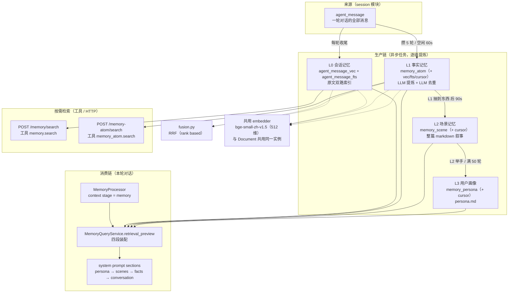
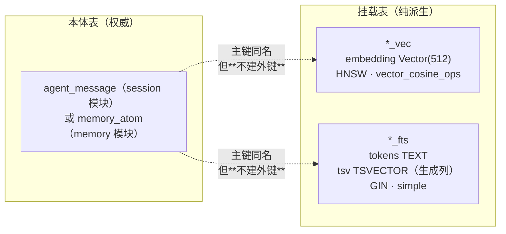
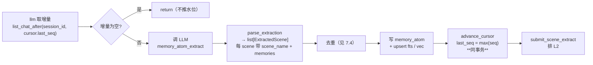
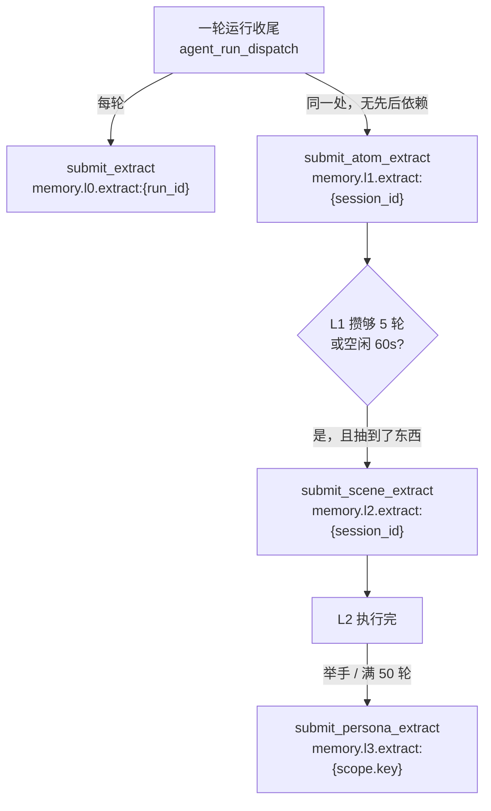

# Memory 子系统（四层记忆）

> 本文只描述记忆子系统：`app/services/memory/`（约 2 万行）、它的三个 API 模块、它在 Agent 上下文里的消费侧，
> 以及它与 Session / Task / Document 三个模块的边界。其余模块不在范围内。

**阅读方式**：第 1–4 节给全貌与表结构，第 6–9 节逐层展开（L0→L3），第 10–14 节是触发、注入、检索、API、契约，
第 15 节是实测验证命令，**第 16 节「已知缺口与注释失真」建议优先读** —— 它列出当前**不能**工作的能力。

本文的结论一律以**代码与实测为准**（方法见第 15 节）。早期那批 TypeScript 版参考设计稿（`memory_l*.md` 等）已移出仓库，不再作为对照基准。

---

## 目录

- [1. 一句话定位](#1-一句话定位)
- [2. 全貌与阅读地图](#2-全貌与阅读地图)
- [3. 四层对照总表](#3-四层对照总表)
- [4. 表结构总览](#4-表结构总览)
- [5. 全系统共用的约定](#5-全系统共用的约定)
- [6. L0 会话记忆](#6-l0-会话记忆)
- [7. L1 事实记忆](#7-l1-事实记忆)
- [8. L2 场景记忆](#8-l2-场景记忆)
- [9. L3 用户画像](#9-l3-用户画像)
- [10. 触发编排](#10-触发编排)
- [11. 消费侧：注入主模型上下文](#11-消费侧注入主模型上下文)
- [12. 检索与检索编排接口](#12-检索与检索编排接口)
- [13. HTTP API 全清单](#13-http-api-全清单)
- [14. 契约文件分工](#14-契约文件分工)
- [15. 运行与验证](#15-运行与验证)
- [16. 已知缺口与注释失真](#16-已知缺口与注释失真)
- [17. 关键设计取舍](#17-关键设计取舍)
- [18. 文件索引](#18-文件索引)

---

## 1. 一句话定位

记忆子系统把"对话"层层**提炼**成越来越稳定的知识，并且**只有一条边是可重建的**。

四层不是"四种记忆"，而是**同一条提炼链的四个阶段**：

```
原始对话  ──提炼──▶  结构化事实  ──归并──▶  叙事场景  ──抽象──▶  用户画像
  L0                  L1                  L2                L3
不可变             权威、增量          可重建?            可重建?
```

**核心区分**（决定了每一层能不能重建、仓储要不要独立）：

| 层 | 数据性质 | 丢了会怎样 |
|---|---|---|
| L0 | **原始事实**，纯派生 | 可从 `agent_message` 重建（幂等全量重写） |
| L1 | **LLM 提炼的结论**，原地 merge/version | **不可安全重建** —— 它是权威数据 |
| L2 / L3 | 由 L1 二次抽象 | 理论上可重建，但需要重跑且有损 |

这条区分是理解整个子系统的钥匙：**L0 是索引，L1 才是数据。**

---

## 2. 全貌与阅读地图



### 阅读地图

| 我想知道… | 读这里 |
|---|---|
| 四层分别存什么、怎么触发 | `application/trigger.py`（时间常量与提交函数都在这里） |
| 两张挂载表为什么长这样 | `models/sqlalchemy/_scope.py`（抽出的 scope 列）+ `_upsert.py` |
| L0 检索怎么拼 SQL | `repository/memory_impl.py`（`_conditions` 是唯一条件来源） |
| L1 提取与去重 | `application/memory_atom_service_impl.py`（最长的文件） |
| 提示词长什么样 | `app/agent/prompt/prompts/memory_*.py` |
| 记忆怎么进 system prompt | `app/agent/context/processor/processors/memory.py` |
| 管理端怎么查水位与溯源 | `api/v1/memory_query.py` + `application/memory_query_service_impl.py` |

---

## 3. 四层对照总表

| | **L0 会话记忆** | **L1 事实记忆** | **L2 场景记忆** | **L3 用户画像** |
|---|---|---|---|---|
| **存什么** | 对话原文（含 user / assistant 的自然语言） | 跳出对话仍成立的结构化事实陈述 | 一整篇场景叙事文档（markdown） | 一整篇 `persona.md` |
| **行 = 什么** | 一条消息 | 一条记忆 | 一个场景（约十几个） | 一篇画像（一个 scope 一篇） |
| **scope** | `session` / `user` | `session` / `user`（主检索场是 user） | `agent_id` + ( `user_id` \| `org_id` ) | 同 L2 |
| **粒度** | 会话 | **跨会话的单用户** | **跨会话聚合**（个人 / 团队二选一） | 同 L2 |
| **产物表** | `agent_message_vec`<br/>`agent_message_fts` | `memory_atom`<br/>+ `_vec` / `_fts` / `_cursor` | `memory_scene`<br/>+ `_cursor` | `memory_persona`<br/>+ `_cursor` |
| **检索方式** | 向量 + 关键词（hybrid） | 向量 + 关键词（hybrid） | **无语义检索**，只列举索引（filename + summary + heat） | 取单篇全文 |
| **可重建** | ✅ 幂等全量重写 | ❌ **不可安全重建** | 有损 | 有损 |
| **谁来写** | 后台任务 `memory.l0.extract` | 后台任务 `memory.l1.extract` | 后台任务 `memory.l2.extract` | 后台任务 `memory.l3.extract` |
| **更新方式** | 按 run 幂等重写 | 原地 merge / `version = max+1` | 整篇重写 + `[DELETED]` 标记 | 整篇重写或 `no_change` |
| **是否注入主模型** | ⚠️ 仅按需（默认关） | ⚠️ 仅按需（默认关） | ❌ **代码里未开启** | ❌ **代码里未开启** |

> L2 / L3 的"未注入"与"默认关"是两件不同的事，见第 11 节 —— 这是当前最容易被误解的一处。

---

## 4. 表结构总览

10 张表，全部定义在 `models.sql`（36449 字节，与 ORM 须逐字同步；ORM 侧走 `Base.metadata.create_all`）。

| 层 | 表 | 角色 |
|---|---|---|
| L0 | `agent_message_vec` | 向量挂载（512 维，HNSW，cosine） |
| L0 | `agent_message_fts` | 全文挂载（`tsvector` + GIN，`simple` 配置） |
| L1 | `memory_atom` | **本体表**（记忆身份与内容） |
| L1 | `memory_atom_vec` / `memory_atom_fts` | 双路检索挂载 |
| L1 | `memory_atom_cursor` | 提取水位（**会话级**，一会话一行） |
| L2 | `memory_scene` | 场景本体（整篇 markdown 内联） |
| L2 | `memory_scene_cursor` | 归并水位（会话级） |
| L3 | `memory_persona` | 画像本体（结构与 L2 逐字相同） |
| L3 | `memory_persona_cursor` | 提取水位（**scope 级**） |
| — | （本体 `agent_message` 在 **session 模块**） | L0 只挂索引，不复制正文 |

### 4.1 挂载表的统一模式

L0 与 L1 的索引表遵循同一套形状（由 `models/sqlalchemy/_scope.py` 抽出）：



**关键事实**：

- 挂载表**冗余 denormalize** 了过滤键（`session_id` / `user_id` / `org_id` / `business_agent_id` / `role` / `seq` / `created_at`）——
  目的是让检索**只查索引表**，不回表 join。代价是删除要手动同步。
- 挂载表与本体**没有外键、没有级联删除**。这是刻意取舍，风险见第 16 节。
- `tsv` 是**生成列**（`to_tsvector('simple', tokens)`, persisted），`tokens` 存的是**应用侧分词后的串**、
  `original` 存原文（展示用）—— 因为 Postgres 实例没有中文分词器，中文分词必须在应用侧完成。
- 唯一约束/检查：`seq > 0`、`role IN (user, assistant)`、`tokens <> ''`。
- 向量索引为 HNSW（默认 `m=16` / `ef=64`），距离算子 `<=>`（cosine）。

### 4.2 为什么两路检索必须"同一套分词器与同一套模型"

`tsquery_text()` 与 `index_text()` 必须来自同一份实现，`embed_query()` 与 `embed()` 必须来自同一个模型。
否则两路**在回答不同的问题**，而表现不是报错，是"召回质量莫名下降"。

---

## 5. 全系统共用的约定

### 5.1 scope 模型

| 维度 | 列 | 语义 |
|---|---|---|
| 会话 | `session_id` | 当前聊天窗口（≈ LangGraph `thread_id`） |
| 用户 | `user_id` | 用户级隔离边界 |
| 组织 | `org_id` | 团队 / 租户边界 |
| Agent | `business_agent_id` | 稳定 Agent 角色的命名空间 |
| 运行 | `run_id` | 一次执行（L0 用它做幂等重写与清理） |
| 任务 | `task_id` | ⚠️ **恒为 NULL**（为 work_* 记忆预留，未实现） |

**`user_id OR IS NULL` 防御规则**：所有检索的归属过滤统一写成 `user_id = :caller OR user_id IS NULL`
（`repository/_tsquery.py` 与各 `_conditions`）。含义是：**没有身份的行是"公共"的，可被任何身份读到；
有身份的行只归本人**。这样即使某条写入路径漏填 `user_id`，也不会变成越权读取路径。

`org_id` 在 L0 / L1 **只作元数据、不参与过滤** —— 所以**团队 scope 下 L0/L1 召不回来**（见第 16 节）。

**身份从运行时注入，绝不进请求体**：`user_id` 由 HTTP token 或工具运行时给出。模型能决定"要不要跨会话"
（`scope=user`），**不能决定"跨谁的"**。

### 5.2 scope=user 是真的放宽，但不等于"搜全部"

`MemorySearchScope.USER` 放开的**只是会话维度**，`agent` / `team` 始终钉死在调用者身上。
子系统的注释把这层意思写得很直白：否则它就是一条越权读别人数据的路径。

### 5.3 融合：RRF，按名次而非分数

`fusion.py::fuse_by_rank` 是全系统唯一的融合实现，L0 与 L1 共用：

- `score = Σ 1 / (RRF_K + rank)`，`RRF_K = 60`；
- **只吃名次，不吃原始分** —— 因为两路分数量纲不可比（`ts_rank` 约 0.06，cosine 在 0–1）；
- 同分以 `str(identity)` 作次键定序（保证结果稳定可复现）。

⚠️ **融合分未归一化到 0–1**，是 RRF 原始累加，因此**跨响应不可比**（契约里已声明）。

### 5.4 共用 embedder：bge-small-zh-v1.5（512 维）

L0 / L1 的向量都来自 document 模块的能力注册表：
`PipelineRegistry.embedder_for(EmbeddingOutput.DENSE)` → `LocalBgeSmallZhEmbedder`
（能力键 `TEXT_BGE_SMALL_ZH_LOCAL_EMBEDDER`，本地目录 `G:\models\bge-small-zh-v1.5`）。

- **记忆与文档共用同一个进程级预热实例** —— 不重复加载模型。
- 写入用 `embed()`（无前缀），查询用 `embed_query()`（带指令前缀"为这个句子生成表示以用于检索相关文章："）。
- ⚠️ 这是**中文模型**，英文 content 的向量召回会退化（已知取舍）。

### 5.5 检索深度与阈值（真实值）

| 常量 | 值 | 位置 | 含义 |
|---|---|---|---|
| `RECALL_MULTIPLIER` | `4` | L0 / L1 各一份 | `recall_limit = max(limit × 4, 20)` |
| `MIN_RECALL_LIMIT` | `20` | 同上 | 上述下限 |
| `VECTOR_MIN_SIMILARITY` | `0.35` | `memory_atom_service_impl.py:156` | 向量候选相似度下限，**在 Python 侧过滤**（不是 SQL WHERE，避免 HNSW 失效） |
| `DEFAULT_CONFLICT_TOP_K` | `5` | `memory_atom_service_impl.py:128` | 去重时每条新记忆取几个候选 |

⚠️ `VECTOR_MIN_SIMILARITY = 0.35` 的代码注释自述**"不是实测值，待校准"**。

---

## 6. L0 会话记忆

### 6.1 定位与过滤规则

L0 把 `agent_message` 做成关键词 + 向量双路可检索索引，**不提炼、不聚合**。

**只有 `kind=chat` 且正文非空的自然语言消息进索引**。这直接决定了多轮工具链的取舍：

| 一轮里的消息 | 是否进索引 |
|---|---|
| 1 条 user 消息 | ✅ 保留 |
| N 条 `tool_result` | ❌ role 不符，全丢 |
| N 条纯工具调用的 assistant（content 为空） | ❌ 丢 |
| N 条带自然语言文本的 assistant | ✅ 保留 |

### 6.2 写入是异步的，且可能静默不发生

- `agent_message` 由 session 模块在**业务事务**内写入；
- 两张索引表由后台任务 `memory.l0.extract` **异步**写入，触发点在运行收尾；
- **任务基建不可用时静默跳过**（只留 debug 日志）→ 表现是"消息在库里但搜不到"。这是设计取舍（记忆是旁路，不阻断主流程），
  但意味着**索引缺失不是异常信号**，没有告警。

### 6.3 检索

`POST /memory/search`（工具：`memory.search`）。请求字段：`query`（必填）、`scope`（默认 session）、
`mode`（默认 hybrid）、`limit`（1–50，默认 10）、`roles`、`time_from` / `time_to`。

响应：`results[]` + `degraded_routes[]`；命中的 `text` **截断到 400 字**（这是片段，不是全文）。

- 关键词路：`tsv @@ tsquery` + `ORDER BY ts_rank DESC`；
- 向量路：`ORDER BY embedding <=> q`，距离在 Python 侧转 `score = 1 - 距离`；
- 两路共用**同一份** `_conditions`（`repository/memory_impl.py`）—— scope 过滤的唯一来源。

**清理**：`delete_by_run(run_id)` 手动删，因为挂载表**没有级联**。

---

## 7. L1 事实记忆

### 7.1 本体表 `memory_atom`

| 列 | 说明 |
|---|---|
| `record_id` | PK，合并时**存活行保留**自己的 id |
| `content` | 完整陈述（L1 检索**不截断**，与 L0 相反） |
| `type` | 类型，**无 CHECK 约束**（词表会长） |
| `priority` | 0–100，`-1` = 全局死命令；⚠️ **不参与排序与过滤** |
| `scene_name` | LLM 自由文本情境名，无枚举 |
| `version` | 单调递增（update / merge 时 `max + 1`） |
| `timestamp_str` / `_start` / `_end` | 活动时间，**LLM 推出的 TEXT**，不是数据库时间 |
| `updated_time` | **增量水位**（游标靠它做增量） |
| `source_message_ids` | JSONB，上游 `message_id` 数组 —— 跨层溯源的唯一真边 |
| `meta` | JSONB（episodic 的活动时间等） |
| scope 列 | `session_id` / `user_id` / `org_id` / `business_agent_id` / `task_id`(恒 NULL) |

### 7.2 类型词表 vs 实际产出

`MEMORY_TYPES`（`domain/schemas/memory_atom.py:94`）声明了 7 类：

```
persona · episodic · instruction · work_fact · work_task · work_method · work_artifact
```

**但抽取提示词只产前 3 类**。`work_*` 四类需要另一套提示词，且依赖 `task_id` 识别 work 状态 ——
所以 `task_id` 列恒为 NULL、`work_*` 从不产生。去重提示词里虽列出了 `work_*`，但抽取侧不产生，等于空转。

**没有 `promptMode`（chat / work）概念** —— 全代码库搜不到该字段，记忆不分 chat / work 模式。

### 7.3 提取流程



- 模型调用：`ModelRole.MEMORY_ATOM_EXTRACT`，**不关思考链**（代码注释注明 2026-10-10 撤回了关闭）。
- 输出解析在 `_model_output.py`：去围栏 → JSON → 逐项校验，失败抛 `ExtractionParseError`（可重试）。
- **单条失败隔离**：空 content 跳过；`source_message_ids` 只保留本批已知且能解析成 UUID 的。
- **游标与写库同事务**，成功后才推 —— 所以不会出现"水位推了但没写进去"。
- 情境（`scene_name`）会在相邻批次间继承（`_next_scene`），避免每条记忆自成情境。

### 7.4 去重：LLM 判断，不是精确匹配

这是 L1 最贵也最关键的环节。提示词 `memory_atom_dedup.py`，一次调用**批量**比对"本批新记忆 + 统一候选池"，
输出 `list[ConflictDecision]`，动作为 `store` / `skip` / `update` / `merge`。

**候选池怎么来**（每条新记忆各召回一次，再合成并集）：

1. `tsquery_text`（FTS）+ `embed_query`（向量）两路召回；
2. 经 `fuse_by_rank`（RRF）融合；
3. 取前 `DEFAULT_CONFLICT_TOP_K = 5`（`recall_top_k = 5 + len(atoms)`）；
4. 向量候选在 Python 侧过 `score >= 0.35`。

**落库**：先 `delete_batch` 被吃掉的，再 `upsert_atoms` + `upsert_fts` + `upsert_vec`（同一事务）。
合并时取 `target_ids[0]` 为存活者，`version = max + 1`。

⚠️ **跨会话的同一事实不会被合并** —— 候选池按会话收窄。代码注释把这视为设计后果而非 bug：
代价是同一事实可能在库里重复 5 条。

### 7.5 检索

`POST /memory-atom/search`（工具：`memory_atom.search`）。请求：`query` / `scope`（默认 session）/
`mode`（默认 hybrid）/ `limit`（1–50，默认 10）。响应原样返回 `content`（**不截断**）+ `type` / `priority` /
`scene_name` / `score` / `matched_by` + `degraded_routes`。

`scope=session` 必带 `session_id` 且校验归属；`scope=user` 不带 `session_id`。
⚠️ 与 L0 的差别：**L1 的记忆是跨会话的用户事实，调用方多数时候该传 `scope=user`**。

---

## 8. L2 场景记忆

### 8.1 定位：不是清单，是叙事文档

一个"场景" = **一整篇 markdown**（一行一列），来自 L1 增量的归并。粒度是 `SceneScope = agent_id + (user_id | org_id)`，
**跨会话聚合**，一个 scope 下约十几篇。

团队 / 个人由 `org_id` vs `user_id` **恰一为空**来区分（有 CHECK 约束 `(user_id IS NULL) <> (org_id IS NULL)`）。

### 8.2 表结构

| 表 | 列 |
|---|---|
| `memory_scene` | `id`(PK, `scene:v1:` + sha256(scope_key \0 filename))、`filename`、`content`（**整篇内联**）、`content_md5`、`agent_id`、`user_id`/`org_id`、`version`、`created_at` / `updated_at` |
| `memory_scene_cursor` | `session_id`(PK) + `last_atom_updated_time`、`last_atom_ids`(JSONB)、`last_l2_at`、`user_id`、`updated_at` |

**`content_md5` 是写短路**：内容不变就跳过写入，且**不推 version** —— 避免"每次归并都涨版本"。

**`id` 是内容派生的**：`scene:v1:` + sha256(scope_key + \0 + filename)。

**没有向量 / FTS 挂载表** —— 代码里明写"没有虚表，也没有召回路径"。L2 只能列举，不能语义检索。

### 8.3 归并（consolidate）

提示词 `memory_scene_consolidate.py` 的角色定义是"记忆整合架构师"，明确要求
**"不是清单，是连贯的叙事文档"**、**禁止简单追加列表**。工程侧的 `_apply` 做三件事的翻译：

1. **读**：把整个 scope 的场景全文内联进提示词；
2. **写**：模型给的是"清单"（create / integrate / rewrite）；
3. **删**：模型**没有删除权** —— 它只能输出 `[DELETED]` 标记，**真删由工程侧最后执行**。

| 常量 | 值 | 语义 |
|---|---|---|
| `DEFAULT_MAX_SCENES` | `12` | 超过**只告警不截断**（三级预警） |
| `DEFAULT_CONSOLIDATE_BATCH` | `200` | 一次最多消费多少 L1；超额**升序分轮追上，不丢数据** |

游标边界：`updated_time > t OR (updated_time = t AND id NOT IN last_atom_ids)` —— 处理同时间戳的批次边界。
**游标不强制单调**（允许回退），所以机制上支持全量重跑，但**未见显式入口**（见第 16 节）。

---

## 9. L3 用户画像

### 9.1 定位

画像 = 一整篇 `persona.md`（含 Archetype / 基本信息 / Chapter 1-4 等章节），由 **L2 场景二次抽象**得到。
粒度：**一个 scope 一篇**。

### 9.2 表结构：与 L2 逐字相同

`memory_persona` 的列集与 `memory_scene` **完全相同**（同一组 `MemoryFileColumns`，`id` 前缀换成 `persona:v1:`）。
**没有独立的 TEAM 列** —— `is_team` 是**属性**（由 `org_id` 是否为空推导），不是列。

`memory_persona_cursor` 主键是 `agent_id` + `scope_key`（**scope 级**，注意与 L2 的会话级不同），
水位字段 `last_scene_updated_time` / `last_scene_ids` / `last_l3_at`。

### 9.3 提取

提示词 `memory_persona_extract.py`：一次回复给 `no_change` 或整篇 content；`is_team` 分派两套系统提示词。

| 常量 | 值 | 语义 |
|---|---|---|
| `PERSONA_TRIGGER_TURNS` | `50` | `force` 阈值，**跨会话**数该 scope 的用户轮次（`since = last_l3_at`） |
| `PERSONA_MAX_CHARS` | `2000` | **告警阈值，不截断**（超了 warning，下次生成压回） |
| `TEAM_MAX_CHARS` | `1200` | 同上，团队画像用 |

**`no_change` 也推水位** —— 注释称之为"消费即消费"，否则会死循环。

---

## 10. 触发编排

### 10.1 链路总览



**串联方式**：L0 与 L1 **平行**挂在运行收尾（各自独立、无先后依赖）；L1 在其 handler 末尾排 L2；
L2 在其 handler 末尾排 L3。`causation_id` 一路指向上游，可溯源。

### 10.2 时间与节流参数（全部真实值）

| 常量 | 值 | 位置 | 语义 |
|---|---|---|---|
| `ATOM_TRIGGER_TURNS` | `5` | `trigger.py:232` | L1 阈值：距上次水位攒够 **5 条用户轮次**（增量口径，不是总数取模） |
| `ATOM_IDLE_DELAY_SECONDS` | `60.0` | `trigger.py:237` | L1 空闲兜底：还没攒够时 `execute_at = now + 60s` |
| `SCENE_AFTER_L1_DELAY_SECONDS` | `90.0` | `trigger.py:515` | **触发 A 的一部分**：L1 完成后至少等 90s 再排 L2 |
| `SCENE_MIN_INTERVAL_SECONDS` | `900.0` | `trigger.py:523` | **触发 A 的一部分**：同一会话两次 L2 之间至少 900s（**成本闸门**） |
| `PERSONA_TRIGGER_TURNS` | `50` | `trigger.py:783` | L3 强制触发阈值（跨会话计数） |
| — | `execute_at = None` | `trigger.py:977` | L3 **不延迟**，立即执行 |

**L2 排期是纯函数** `_scene_execute_at`：`T = max(now + 90s, lastL2 + 900s)`。
抽成纯函数是为了可测（那两个数是"待校准的起点"，校准方式就是断言这里算出的时间）。

两个数各挡一件事：

- `90s` 挡"用户还在说" —— 立刻整合会让 90 秒后的那批记忆再触发一次，两次调用做同一件事；
- `900s` 挡成本 —— L2 要读该 scope 全部场景全文再写回，比 L1 贵一个量级；没有它，聊得快的会话会连续排 L2。

### 10.3 防抖：同一个键反复 reschedule

L1 / L2 / L3 都用**会话级 / scope 级可复用键**（`reusable_key=True`）：

- 每来一句话就 `_task_by_key` 查活任务；
- 达标 → 改成 `execute_at = None`（立刻投递）；
- 未达标 → 往后推；
- **L2 只允许提前，不允许推迟**（`_task_by_key` 里有专门的日志与判断）。

幂等键在任务进终态时**释放** —— 否则第二次触发会拿回已终结的那条任务。

### 10.4 任务基础设施的用法

memory 任务统一走 `app/services/task/` 的任务基建（不另建一套）：

| 项 | 值 / 行为 |
|---|---|
| 租约 | `lease_seconds = 900`（15 分钟） |
| 并发 | `concurrency = 4` |
| 扫描 / 中继 | `sweep_interval = 15s`，`relay_interval = 10s` |
| 投递 | `submit` 走 `post_commit` 钩子立即 dispatch；子任务用 `ScopedTaskSubmitter`（靠 outbox relay） |
| 重试 | 指数退避 `base 5s × 2`，封顶 `max_delay = 300s`，`jitter = 0.1`（**只下抖**） |
| 不重试 | `_FATAL` 集合：`UnknownHandler` / `TaskParams` / `TaskState` / `ValidationError` / `CancelledError` |
| 终止 | `TaskPermanentError` 显式终止；`attempt >= max_attempts` 不再试 |
| 失败落库 | error 截断 2000 字 |
| ⚠️ 语义 | **不续约** → 超租约会被 Sweeper 收回、可能重复执行（**至少一次**） |
| ⚠️ 降级 | 任务基建不可用时**静默跳过**（debug 日志 + `return None`），不阻断主流程 |

**L1 + L2 的抽取与去重在同一 handler 内先后执行**，不拆成两条任务（见 `domain/tasks.py` 的说明）。

---

## 11. 消费侧：注入主模型上下文

### 11.1 MemoryProcessor

`app/agent/context/processor/processors/memory.py`，spec 名 `memory`，`order = 50`，
`stage = MEMORY_RETRIEVER`，由 `context_policy.include_memory` 控制。

**它的真实行为**：

| 阶段 | 行为 |
|---|---|
| INITIAL | 调 `MemoryQueryService.retrieval_preview(request)` → `render_blocks` 渲染 → `context.add_section(name="memory")` |
| CONTINUATION | **不碰服务**，从 `state["memory"]` 读回并 `_replay` 重注入 |
| 失败 | `optional=True`；层内失败由 `retrieval_preview` 自己收进 `degraded`，**不抛**；服务整个拿不到才记 FAILED + warning 继续 |

**为什么 CONTINUATION 要 replay**：system prompt 每轮重建，不 replay 的话第 2 次迭代记忆就掉了。

**关键点**：

- ⚠️ **它不走 `deps.memory_source` 端口** —— 那个端口全仓没有实现，代码注释里明确说该分支已删除。
  记忆注入走的是**直接调服务**（与 `POST /memory/retrieval` 同一条路径），所以它是**活的**。
- ⚠️ **它只开 L0 与 L1**（`l0=..., l1=...`），**L2 / L3 没有开启**。
- 每层 `_LIMIT = 5`（比管理端默认 10 小）。
- **不传 `session_id` → 跨会话召回**（这是刻意的：分类提示词里"我之前说过"的线索常发生在别的会话里）。

### 11.2 四段注入顺序

`retrieval_preview` 产出的 `MemoryRetrievalPrompt` 里，四段顺序**就是 prompt 顺序**：

```
persona (L3)  →  scenes (L2)  →  facts (L1)  →  conversation (L0)
```

**默认携带策略**：L2 场景索引 + L3 画像**恒带**（便宜：只给索引 / 单篇全文）；
L0 / L1 **默认关**，按需真召回（贵）。

### 11.3 与记忆无关的三个兄弟 stage

| stage | order | 作用 | 现状 |
|---|---|---|---|
| `profile.py` → `user_profile` | 20 | 注入**用户档案**（label "用户档案"，注意与 L3 的"用户画像"不是一个东西） | `profile_source` 端口**无实现** → 这段恒空 |
| `profile.py` → `memory_profile` | 45 | 注入 **L3 画像 + L2 场景索引**（`retrieval_preview` 的 `l2/l3`，L2、L3 分键缓存） | **活的**，直接调服务，不经端口 |
| `summary.py` | 30 | 只注入**既有**摘要（不生成） | — |
| `history.py` | 40 | 纯窗口选择器 | 已删除 `ConversationSource` / `HistoryRetriever`，更早内容归 L0 |
| `knowledge.py` | 60 | 注入知识库检索结果（RAG 在 document 模块） | `knowledge_source` 端口**无实现** |
| `compaction.py` | 95 | 达阈值才触发摘要压缩 | `memory_budget` 已计入 `TokenBudget` |

> ⚠️ **`ProfileSource` / `KnowledgeSource` / `MemorySource` 三个端口只有 Protocol 定义、全仓没有任何实现**，
> 且 ReAct 循环构造 `ContextDependencies` 时只填了端口之外的那几项（`model_registry` / `tool_source` / `skill_source` / `capability_resolver`）。
> 因此：**用户档案注入与知识库 RAG 注入当前是空的**（走 state 兜底路径或直接跳过）。
> 这一点很容易被"处理器存在"误导 —— 但记忆画像不同，它走的是直接调服务，是活的。

---

## 12. 检索与检索编排接口

### 12.1 `POST /memory/retrieval`（管理端预览 + 消费侧取数）

契约文件 `memory_retrieval.yaml`（47631 字节）。请求 `MemoryRetrievalRequest`：

| 字段 | 说明 |
|---|---|
| `target` | `user_id` 或 `team_id` **二选一**，加 `agent_id` |
| `input` | 查询串 |
| `retrieve` | `{l0, l1, l2, l3}` 各层开关 |
| `limits` | `{l0, l1, l2, l3}` 各层条数 |
| `session_id` | 可选，**只用来收窄 L0 / L1** |

**不调模型**，只返回装配好的 `MemoryRetrievalPrompt` —— 所以它是"上下文预览"。

**分层降级**：单层失败进 `degraded`；层内某路失败进该 section 的 `degraded_routes`。
**部分降级不是整单失败**（例如团队 scope 下 L0/L1 查不了，L2/L3 照常给）。

### 12.2 各层检索语义

| 层 | 语义 | 代价 |
|---|---|---|
| L0 | 原始消息 hybrid 召回 | 最贵，命中是**片段** |
| L1 | 原子记忆 hybrid 召回 | 正文**整条**返回 |
| L2 | 列举（**无语义检索**，只给 `filename + summary + heat`） | 便宜 |
| L3 | 取单篇画像全文 | 便宜 |

⚠️ L2 的"按热度排序"**未实现**（当前默认 `updated_at` 倒序）；L2 超出上限时**截断**，但提示词里的计数写的是**总数**
（实测断言：给 12 篇、总数写 30、`truncated=true`）。

### 12.3 契约里存在但未接线的端点

`memory_retrieval.yaml` 定义了 `POST /memory/retrieval/l0|l1|l2|l3` 四个单层端点，
但 `api/v1/memory_query.py` 里**只有汇总的 `/memory/retrieval`**，四个单层端点**未实现**（文档先行）。

---

## 13. HTTP API 全清单

全局前缀 `/api/v1`，**全部需要 token**（挂在 `protected_router`）。

| 方法 | 路径 | 门槛 | 职责 |
|---|---|---|---|
| POST | `/memory/search` | 登录 | **L0 检索**（工具 `memory.search` 共用同一服务方法） |
| POST | `/memory-atom/search` | 登录 | **L1 检索**（工具 `memory_atom.search`） |
| POST | `/memory/retrieval` | **admin** | 四段上下文预览（不调模型） |
| POST | `/memory/extraction/l1` | **admin** | L1 提取水位（`last_seq` / `last_scene_name`） |
| POST | `/memory/extraction/l2` | **admin** | L2 归并水位（`last_atom_updated_time` / `last_atom_ids` / `last_l2_at`） |
| POST | `/memory/extraction/l3` | **admin** | L3 提取水位（`last_scene_updated_time` / `last_scene_ids` / `last_l3_at`） |
| POST | `/memory/query/l0` | **admin** | 浏览原始消息（不召回） |
| POST | `/memory/query/l1` | **admin** | 浏览原子记忆 |
| POST | `/memory/query/l2` | **admin** | 浏览场景索引 |
| POST | `/memory/query/l2/detail` | **admin** | 读某个场景全文 |
| POST | `/memory/query/l3` | **admin** | 读某个 scope 的画像 |
| POST | `/memory/query/l1/sources` | **admin** | **跨层溯源 L1→L0**（读 `source_message_ids`，含 `missing_message_ids`） |
| POST | `/memory/query/l0/atoms` | **admin** | **反查 L0→L1**（必须给 `session_id`） |

**admin 门槛加在 `router.py` 的 include 那一行**（`dependencies=[Depends(require_admin)]`），不是在端点签名里 ——
理由与 `/users/search`、`/documents/...` 一致："接口注册在哪棵树上就是什么待遇"。

**水位接口原样返回、不做派生**（不返回"还剩几轮"这种推导值）。

⚠️ **跨层溯源只有 L1→L0 一条真边落库**：L2→L1、L3→L2 没有存储映射，契约明确**不提供近似接口**
（宁可空着也不给一个"看起来能用但只是猜"的接口）。

---

## 14. 契约文件分工

| 文件 | 大小 | 定义什么 |
|---|---|---|
| `memory.yaml` | 14 KB | L0 检索（`/memory/search`）。明确声明 extract 是后台任务、两张索引表不在 API 面、身份键不进请求体 |
| `memory_atom.yaml` | 12 KB | L1 检索（`/memory-atom/search`） |
| `memory_retrieval.yaml` | 48 KB | 检索编排：四段汇总 + （未实现的）四个单层端点 |
| `memory_api_v2.yaml` | 51 KB | **管理端全集**（version `2.1.0`）：retrieval + query + extraction + l1-sources + l0-atoms，与 `memory_query.py` 端点一一对应 |

`memory_api_v2.yaml` 与 `memory_query.py` 是当前**对齐**的一对；`memory_retrieval.yaml` 定义的"单层检索视图"尚未接线。

---

## 15. 运行与验证

以下命令均已在本机实际执行（2026-10-12），**全部通过**。四个冒烟都自带假实现，**不需要数据库、不需要 ES、不需要模型**。

```bash
.venv/Scripts/python.exe -B -m app.services.memory.memory_smoke            # L0
.venv/Scripts/python.exe -B -m app.services.memory.memory_retrieval_smoke  # 检索编排
.venv/Scripts/python.exe -B -m app.services.memory.memory_scene_smoke      # L2 + 触发
.venv/Scripts/python.exe -B -m app.services.memory.memory_persona_smoke    # L3 + 触发
```

> `-B` 是为了不写 `.pyc`；在别人的仓库里跑探查脚本时建议都加上。

### 15.1 各冒烟覆盖的断言（实测摘录）

**L0（`memory_smoke`）—— 4 组 + 清理**：

```
[4] 越权与降级
  ✓ 别人的会话被拒（NotFoundError）
  ✓ scope=user 只铺开自己的会话（B 搜不到 A 的行）
  ✓ 纯标点查询：关键词路降级并如实汇报
  ✓ scope=session 缺 session_id -> 报错
  ✓ scope=user 却给了 session_id -> 报错
  ✓ 没有身份（scope=session）-> 拒绝
  ✓ 没有身份（scope=user）-> 拒绝
  ✓ 仓储兜底：user_id=None 时搜不到有归属的行（不越权）
[5] 清理   ✓ 索引行已清干净
ALL PASS
```

**检索编排（`memory_retrieval_smoke`）**：

```
[OK] 会话 id 如实传给了 L0 那条路
[OK] L1 **仍然**跨会话（scope=user）
[OK] L1 **连参数都不带** session_id（带了就是把它削成本轮对话）
[4] 团队 target
  [OK] 团队 scope 下两层召回都没跑 / 两层进 degraded 并说明原因
  [OK] L2/L3 照常给（部分降级，不是整单失败）
[5] L2 截断
  [OK] 给了 12 篇 / 总数写 30（不是 12）/ truncated 为真
全部通过。
```

**L2（`memory_scene_smoke`）**：

```
[OK] H3 handler 是 memory.l2.extract
[OK] H4 幂等键按会话
[OK] H5 键声明可反复用（终态会释放）
[OK] H6 首次整合排在 L1 之后那 90s
[OK] H7 算出的时间更早就**提前**它
[OK] H8 算出的时间更晚时**不动它**（不允许推迟）
[OK] H9 刚整合过时，900s 底线不会把已有的更早定时推迟
[OK] H10 默认延迟常量就是文档里那两个数
全部通过。
```

**L3（`memory_persona_smoke`）**：

```
[OK] D12 有举手 -> 排        [OK] D13 那一条也是立刻执行
[OK] D14 两个个人会话加起来 49 轮（还差 1）-> force=False
       （同时验了兜底链与 org 排除：只按触发会话数是 30，不排除团队会话是 149）
[OK] D15 跨会话攒够 50 轮 -> 排
[OK] D16 幂等键也是按 scope   [OK] D16b force=True（满 50 轮，强制触发）
[OK] D17 理由原文**进了任务参数**（不是压成 bool 就丢掉）
```

### 15.2 测试目录情况

`tests/` 下只有 `agent` / `api` / `infra` / `conftest.py`，**没有 memory 目录** ——
记忆子系统的回归验证**完全依赖上面四个 in-service 冒烟脚本**。

### 15.3 没有"端到端"验证

四个冒烟都用假实现（假仓储、假任务、假模型），验证的是**编排与边界**，不验证：

- 真实提示词的抽取质量；
- 真实向量召回质量（要连 ES / pgvector 与真实数据）；
- 真实任务基建下的调度时序。

---

## 16. 已知缺口与注释失真

**这一节优先读。** 以下每条都对着代码核过，不是推测。

### 16.1 触发 B / 触发 C **确实未实现**（纠正一处误读）

L2 的原规格列了三条触发路径（设计稿 `memory_l2.md` 已移出仓库，此处只保留结论）：

| 触发 | 原规格 | 当前实现状态 |
|---|---|---|
| **A** delay-after-L1 | `T = max(now + 90s, lastL2 + 900s)`，只允许提前 | ✅ **已实现**（`_scene_execute_at`） |
| **B** max-interval 保底 | L2 完成后 `T = now + 3600s`，保证活跃会话至少每小时轮询一次 | ❌ **未实现** |
| **C** 关闭 flush | `destroy()` 时把 pending 的 L2 冲掉 | ❌ **未实现** |

**核实方式与结论**：

- `grep -rn "3600" app/services/memory/` 只命中一处，且是 `memory_scene_smoke.py:1002` 的**测试阈值**
  （`pulled_offset < 3600`，用来断言"时间被提前了"），**不是实现**。
- 收尾处只有 `submit_extract`(L0) 与 `submit_atom_extract`(L1)，**没有会话关闭钩子**去触发 L2（正是触发 C 缺的那一环）。
- ⚠️ **容易误读的点**：`SCENE_MIN_INTERVAL_SECONDS = 900.0` **不是触发 B**。
  代码注释自己写明它对应原规格 `T = max(now + 90s, lastL2 + 900s)` 里的 **`lastL2 + 900s`**，
  即**触发 A 内部的成本闸门**（限制两次 L2 的最小间隔），而触发 B 是"L2 完成后**主动 arm** 一小时后的轮询"。

**后果**：一个会话只要不再产生新的 L1，就**不会再排 L2** —— 触发 B 缺位导致"活跃会话保底轮询"这件事不存在。

### 16.2 三个 context 端口无实现 → 知识库 RAG 与用户档案**未注入**

| 端口 | 定义 | 实现 |
|---|---|---|
| `ProfileSource` | `sources.py:59` | ❌ 全仓无实现 |
| `MemorySource` | `sources.py:71` | ❌ 全仓无实现（`memory.py` 已删除该分支） |
| `KnowledgeSource` | `sources.py:90` | ❌ 全仓无实现 |

且 ReAct 循环构造依赖时**只传了两个字段**：

```python
ContextDependencies(
    model_registry=context.model_registry,
    tool_source=context.tool_source,      # agent_node.py
)
```

**后果**：`knowledge.py`（RAG 知识注入）与 `profile.py`（用户档案注入）这两个 stage
**当前拿不到数据**，只能走 state 兜底路径或直接跳过 —— 而"processor 存在"很容易让人以为它们是活的。

**记忆注入不受影响**：`MemoryProcessor` 直接调 `retrieval_preview`，不经端口。

### 16.3 其它硬缺口

| # | 缺口 | 证据 | 表现 |
|---|---|---|---|
| 1 | **`work_*` 四类记忆未接** | 抽取提示词只产 `persona` / `episodic` / `instruction`；`task_id` 列恒 NULL | 词表里有、去重提示词里也列了，但**永不产生** |
| 2 | **背景对话未接** | `memory_atom_extract.py` 注释明写"刻意没有【背景对话】块" | 只喂增量 → 系统提示词里"结合背景"那句**无对象**；指代（他 / 上次那个）没有先行词，模型要么漏抽要么猜，**两类都不报错** |
| 3 | **`/memory/retrieval/l0..l3` 四个单层端点** | 契约有定义，`memory_query.py` 无实现 | 404 |
| 4 | **团队 scope 下 L0/L1 无法召回** | `agent_message` 无 `org_id` 列；`memory_atom.org_id` 不参与过滤 | 400 或进 `degraded`（实测断言已覆盖） |
| 5 | **跨层溯源只有 L1→L0** | L2→L1、L3→L2 无存储映射 | 契约明确不提供近似接口 |
| 6 | **L2 无向量/FTS** | 代码明写"没有虚表，也没有召回路径" | L2 只能列举，不能语义检索 |
| 7 | **L2 按热度排序未做** | 默认 `updated_at` 倒序 | — |
| 8 | **全量重跑无入口** | `models.sql` 注释：L0 按 run_id 逐轮索引，全量重建暂无入口 | 换模型 / 换分词器时只能手工 |
| 9 | **挂载表无外键、无级联** | 两张索引表建表语句均无 FK | 删除靠 `delete_by_run`；绕过即**悬空行** |
| 10 | **`L3` 提示词 `SYSTEM_PROMPT` 是空串** | `prompts/memory_retrieval.py:84`（管理端预览呈现 `prompt.system: null`） | — |
| 11 | **`tests/` 无 memory 测试** | 目录里只有 agent/api/infra | 回归全靠 4 个冒烟 |
| 12 | **应用未配置 logging** | 多处用 `print` 代替 `logger.info`（注释自述） | 可观测性差 |

### 16.4 待校准的常量（代码自述"不是实测值"）

| 常量 | 现值 | 症状 |
|---|---|---|
| `VECTOR_MIN_SIMILARITY` | `0.35` | 调高 → 漏召回；调低 → 噪声进候选 |
| `DEFAULT_MAX_SCENES` | `12` | 场景数上限（超了只告警） |
| `DEFAULT_CONSOLIDATE_BATCH` | `200` | 单轮消费的 L1 条数 |
| `PERSONA_TRIGGER_TURNS` | `50` | 调大 → 画像更新慢；调小 → 频繁重写 |
| `SCENE_AFTER_L1_DELAY_SECONDS` / `SCENE_MIN_INTERVAL_SECONDS` | `90` / `900` | L2 的时效 vs 成本 |

---

## 17. 关键设计取舍

### 17.1 不可重建的那一层才需要独立仓储

L0 是"一次运行的原始消息、幂等全量重写、纯派生（删了可重建）"；
L1 是"LLM 提炼的结论、增量抽取、原地 merge/version、**权威数据**"。
所以 L1 的仓储独立于 L0，而 L0 可以随时重建。**这条区分决定了两层能用完全不同的更新策略。**

### 17.2 只喂增量（`list_chat_after`）换来幂等与低成本

L1 的水位是"已抽最大 `agent_message.seq`"，抽取与写库**同事务**、成功后才推。
好处是重跑安全；代价是**跨批次的指代没有先行词**（见 16.5 第 2 项）—— 这是一个**已知的、有意的**权衡。

### 17.3 挂载表冗余过滤键，换取"只查索引不回表"

`session_id` / `user_id` / `role` / `seq` / `created_at` 全部复制到索引表，
于是检索可以**只查索引表**并在索引层完成过滤（`only_active` / scope / 时间窗）。
代价：删除要手动同步、写入要保证两份一致。

### 17.4 中文分词放在应用侧

Postgres 实例没有中文分词器，所以 `tokenization.py` 自己实现 CJK 分词（NFKC + 小写 + CJK 连续串做窗口-2 bigram +
非 CJK 按词切），**刻意复刻 ES `cjk` 分析器的词元语义** —— 好处是记忆侧与文档侧的词元集合一致（分数不可比，但词元一致）。

### 17.5 候选池按会话收窄，代价是跨会话重复

去重的候选池用会话收窄（因为水位是会话级的）。代价：**同一事实在跨会话时不会被合并**，
库里可能出现多条近似记忆。代码把这视为设计后果而非缺陷。

### 17.6 模型没有删除权

L2 归并里模型只能输出 `[DELETED]` 标记，**真删由工程侧最后执行**。
把"删数据"的权限留在工程侧，模型只表达意图。

### 17.7 降级不静默，但也不失败

L0/L1 检索里"某一路没跑成"会进 `degraded_routes`（而不是被并进 `mode` 字段）——
**"请求了 hybrid 但只有关键词在答"必须看得见**。
同理，团队 scope 下 L0/L1 查不了会进 `degraded`，而**不是整单失败**（L2/L3 照常给）。

### 17.8 凭据与身份不进请求体

`user_id` / `org_id` 由运行时（HTTP token / 工具运行时）注入。
模型能决定"要不要跨会话"（`scope=user`），**不能决定"跨谁的"**。

### 17.9 枚举不复制

`role` / `kind` 直接引用 session 模块的 `MessageRole` / `MessageKind`，不在 memory 里另抄一份。
理由写在 `enum.py` 的模块 docstring 里：两份定义会漂，而漂的方式是**静默的** ——
一边加了新 kind，另一边漏加，于是 memory 检索悄悄过滤掉那一类，**没有任何报错**。

---

## 18. 文件索引

```
app/
├── services/memory/
│   ├── models.sql                              # ⭐ 10 张表的 DDL（须与 ORM 逐字同步）
│   ├── memory.yaml                             # L0 检索契约
│   ├── memory_atom.yaml                        # L1 检索契约
│   ├── memory_retrieval.yaml                   # 检索编排契约（四段 + 未接线的单层端点）
│   ├── memory_api_v2.yaml                      # 管理端全集契约（与 memory_query.py 对齐）
│   ├── tokenization.py                         # ⭐ 应用侧 CJK 分词（复刻 ES cjk）
│   ├── fusion.py                               # ⭐ RRF 融合（L0 / L1 共用）
│   │
│   ├── domain/
│   │   ├── schemas/enum.py                     # scope / mode / route 三个枚举
│   │   ├── schemas/{memory,memory_atom,atom,scene,persona,query,_model_output}.py
│   │   ├── entities/{memory,atom,scene,persona}.py
│   │   └── tasks.py                            # 各层任务参数结构
│   │
│   ├── models/sqlalchemy/
│   │   ├── _scope.py                           # ⭐ 挂载表共用的 scope 列与规则
│   │   ├── agent_message_{vec,fts}.py          # L0 挂载
│   │   ├── memory_atom{,_vec,_fts,_cursor}.py  # L1
│   │   ├── memory_scene{,_cursor}.py           # L2
│   │   └── memory_persona{,_cursor}.py         # L3
│   │
│   ├── repository/
│   │   ├── _tsquery.py                         # ⭐ FTS 查询串构造 + 归属过滤条件
│   │   ├── _upsert.py                          # ON CONFLICT 去重（保留最后一条）
│   │   ├── memory_impl.py / atom_impl.py       # L0 / L1 检索与写入
│   │   └── scene_impl.py / persona_impl.py     # L2 / L3
│   │
│   ├── application/
│   │   ├── trigger.py                          # ⭐ 所有触发与时间常量
│   │   ├── memory_service_impl.py              # L0
│   │   ├── memory_atom_service_impl.py         # L1（最长文件：提取 + 去重）
│   │   ├── memory_scene_service_impl.py        # L2
│   │   ├── memory_persona_service_impl.py      # L3
│   │   └── memory_query_service_impl.py        # 管理端 + retrieval_preview
│   │
│   └── *_smoke.py                              # ⭐ 4 个冒烟（唯一的回归验证手段）
│       memory_smoke.py / memory_retrieval_smoke.py
│       memory_scene_smoke.py / memory_persona_smoke.py
│
├── api/v1/
│   ├── memory.py                               # POST /memory/search
│   ├── memory_atom.py                          # POST /memory-atom/search
│   └── memory_query.py                         # 管理端 11 个端点（admin 门槛在 router.py 那行）
│
├── agent/
│   ├── context/processor/
│   │   ├── sources.py                          # ⚠️ 三个 Protocol（均无实现）
│   │   ├── dependencies.py                     # ContextDependencies
│   │   └── processors/
│   │       ├── memory.py                       # ⭐ 记忆注入（直调服务，只开 l0/l1）
│   │       ├── profile.py                      # memory_profile 直调服务注入 L2/L3（用户档案段仍空）
│   │       ├── knowledge.py                    # ⚠️ 端口无实现，当前拿不到数据
│   │       └── summary.py / history.py / compaction.py
│   └── prompt/prompts/
│       ├── memory_atom_extract.py / memory_atom_dedup.py
│       ├── memory_scene_consolidate.py / memory_persona_extract.py
│       └── memory_retrieval.py                 # ⚠️ SYSTEM_PROMPT 是空串
│
└── bootstrap/task.py                           # 4 个 memory.* handler 的注册处
```

---

*本文依据仓库实际代码与实测输出整理（2026-10-12）。第 16 节的缺口与失真项会随代码演进变化，
引用前建议先按"证据"列复核；四个冒烟脚本可直接重跑验证编排行为。*
