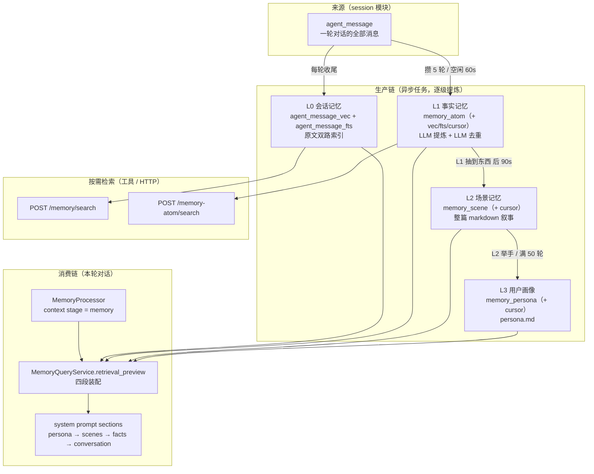

# Memory · 四层记忆

> 记忆子系统把「对话」层层**提炼**成越来越稳定的知识，并且**只有一条边是可重建的**。
>
> 四层不是「四种记忆」，而是**同一条提炼链的四个阶段**。这条区分是理解整个子系统的钥匙：
> **L0 是索引，L1 才是数据。**

`4 层` · `10 张表` · `RRF 融合` · `共用 bge-small-zh-v1.5(512)` · `只有 L1 不可重建`

---

## 📚 本文结构

- 🎯 **一句话定位** —— 四层怎么来的
- 🏗️ **全貌**
- 🧭 **四层对照总表**
- ⏱️ **触发编排** —— 什么时候提炼
- 💉 **消费侧：怎么进 system prompt**
- 📡 **HTTP 清单**
- 📖 返回 **[主手册](README.md)** · ⚠️ 缺口见 **[todolist](todolist)**

---

## 🎯 一句话定位

```
原始对话  ──提炼──▶  结构化事实  ──归并──▶  叙事场景  ──抽象──▶  用户画像
  L0                  L1                  L2                L3
不可变              权威、增量           可重建?           可重建?
```

| 层 | 数据性质 | 丢了会怎样 |
|---|---|---|
| **L0** | **原始事实**，纯派生 | 可从 `agent_message` 重建（幂等全量重写） |
| **L1** | **LLM 提炼的结论**，原地 merge / version | **不可安全重建** —— 它是权威数据 |
| **L2 / L3** | 由 L1 二次抽象 | 理论上可重建，但需要重跑且有损 |

> 这条区分决定了每一层**能不能重建**、仓储要不要独立、备份优先级排第几。

---

## 🏗️ 全貌



### 阅读地图

| 我想知道… | 读这里 |
|---|---|
| 四层分别存什么、怎么触发 | `application/trigger.py`（时间常量与提交函数都在这里） |
| 两张挂载表为什么长这样 | `models/sqlalchemy/_scope.py`（抽出的 scope 列）+ `_upsert.py` |
| L0 检索怎么拼 SQL | `repository/memory_impl.py`（`_conditions` 是唯一条件来源） |
| L1 提取与去重 | `application/memory_atom_service_impl.py`（最长的文件） |
| 提示词长什么样 | `app/agent/prompt/prompts/memory_*.py` |
| 记忆怎么进 system prompt | `app/agent/context/processor/processors/memory.py` |
| 管理端怎么查水位与溯源 | `api/v1/memory_query.py` + `application/memory_query_service_impl.py` |

---

## 🧭 四层对照总表

| | L0 会话 | L1 事实 | L2 场景 | L3 画像 |
|---|---|---|---|---|
| **表** | `agent_message_vec` + `agent_message_fts` | `memory_atom`（+ `_vec` / `_fts` / `_cursor`） | `memory_scene`（+ `_cursor`） | `memory_persona`（+ `_cursor`） |
| **形态** | 原文切片 | 结构化条目（`persona` / `episodic` / `instruction`） | 整篇 markdown 叙事 | `persona.md` |
| **检索** | 双路（向量 + FTS） | 双路（向量 + FTS） | ❌ 只能列举 | ❌ 只能列举 |
| **可重建** | ✅ 幂等全量重写 | ❌ **权威数据** | ⚠️ 有损重建 | ⚠️ 有损重建 |
| **去重** | 不需要 | **LLM 判断**（store/skip/update/merge），不是精确匹配 | 归并（consolidate） | 重写 |

### 10 张表

`agent_message_vec` · `agent_message_fts` · `memory_atom` · `memory_atom_vec` · `memory_atom_fts` ·
`memory_atom_cursor` · `memory_scene` · `memory_scene_cursor` · `memory_persona` · `memory_persona_cursor`

> `agent_message` 本体在 **session** 模块 —— 记忆只挂索引，不复制原文。

### 全系统共用的约定

| 约定 | 说明 |
|---|---|
| **scope** | 决定检索范围。`scope=user` 是真的放宽，但**不等于「搜全部」** |
| **融合** | RRF，**按名次而非分数** —— 两路分数不可比，按分数加权会被某一路主导 |
| **共用 embedder** | `bge-small-zh-v1.5`（512 维），与 Document **共用同一实例** |
| **阈值** | `VECTOR_MIN_SIMILARITY = 0.35`（调高漏召回，调低进噪声） |
| **中文分词** | 放在**应用侧**，不依赖数据库的全文检索分词器 |

> ⚠️ **两路检索必须用同一套分词器与同一套模型**。换模型只换一半，症状是「检索精度莫名下降」，
> 不会报错 —— 这才是最难查的那类问题（同 [`README_DOCUMENT.md`](README_DOCUMENT.md) 里那道
> `ValueError` 要防的是同一件事）。

---

## ⏱️ 触发编排

```
每轮对话收尾  →  submit_extract        (L0)
攒满 5 轮 / 空闲 60s  →  submit_atom_extract  (L1)
L1 真的抽到东西后 90s  →  L2 场景整合
L2 主动举手 / 满 50 轮  →  L3 画像重写
```

| 参数 | 现值 | 含义 |
|---|---|---|
| L1 触发 | 5 轮 / 60s | 攒够或闲置够就提炼 |
| `SCENE_AFTER_L1_DELAY_SECONDS` | `90` | L1 之后多久排 L2 |
| `SCENE_MIN_INTERVAL_SECONDS` | `900` | 两次 L2 的**最小间隔**（成本闸门） |
| `PERSONA_TRIGGER_TURNS` | `50` | L3 触发轮数 |
| `DEFAULT_MAX_SCENES` | `12` | 场景数上限（超了只告警） |
| `DEFAULT_CONSOLIDATE_BATCH` | `200` | 单轮消费的 L1 条数 |

**防抖**：同一个键反复 reschedule 不会叠加任务 —— 走任务基础设施的幂等 upsert。

> ⚠️ **`SCENE_MIN_INTERVAL_SECONDS = 900` 不是「每小时保底轮询」**。
> 它是「两次 L2 至少隔 15 分钟」的成本闸门。原规格里的「L2 完成后 arm 一小时后的轮询」（触发 B）
> **未实现** —— 所以一个会话只要不再产生新的 L1，就**不会再排 L2**。见 [`todolist`](todolist)。

---

## 💉 消费侧：怎么进 system prompt

`MemoryProcessor` 挂在 context 的 `MEMORY_RETRIEVER` 阶段（13 段中的第 7 段），
经 `MemoryQueryService.retrieval_preview` 四段装配后注入：

```
## 用户画像      ← from L3
## 相关场景      ← from L2
## 已知事实      ← from L1
## 相关对话      ← from L0
```

> 注入顺序是**从抽象到具体**。倒过来的话，模型会先看到一堆原文细节再看到结论，容易复述细节而忽略结论。

> ⚠️ 记忆注入**不经过 `MemorySource` 端口**（该端口全仓零实现），而是直接调服务 —— 这是本子系统
> 与 CONTEXT 侧架构最不一致的一处，影响可测试性。见 [`todolist`](todolist)。

---

## 📡 HTTP 清单

| 端点 | 用途 |
|---|---|
| `POST /memory/search` | L0 会话记忆检索（也是工具 `memory.search` 的后端） |
| `POST /memory-atom/search` | L1 事实检索（工具 `memory_atom.search`） |
| `POST /memory/retrieval` | **四段装配预览**（管理端 + 消费侧共用） |
| `/api/v1/memory/query/*` | 水位、溯源、管理端查询 |
| `/memory/retrieval/l0..l3` | 📌 契约有定义，**未实现**（404） |

> **跨层溯源只有 L1 → L0**。L2 → L1、L3 → L2 没有存储映射 —— 契约里明确不提供近似接口，
> 而不是「以后再说」。

---

## 🚀 验证

```bash
.venv/Scripts/python.exe -m app.services.memory.memory_smoke           # L0–L3 主链
.venv/Scripts/python.exe -m app.services.memory.memory_retrieval_smoke # 检索与融合
.venv/Scripts/python.exe -m app.services.memory.memory_scene_smoke     # L2 场景与触发时序
.venv/Scripts/python.exe -m app.services.memory.memory_persona_smoke   # L3 画像
```

> ⚠️ `tests/` 目录下**没有 memory 测试** —— 回归全靠这四个冒烟。

---

## 🤝 相关

| 想深入看 | 去哪 |
|---|---|
| 记忆段怎么被注入上下文 | [`README_CONTEXT.md`](README_CONTEXT.md) |
| 共用 embedder 的定义与检索后端 | [`README_DOCUMENT.md`](README_DOCUMENT.md) |
| 触发用的任务基础设施 | `app/infra/task/` |
| 总览 | [`README.md`](README.md) |
