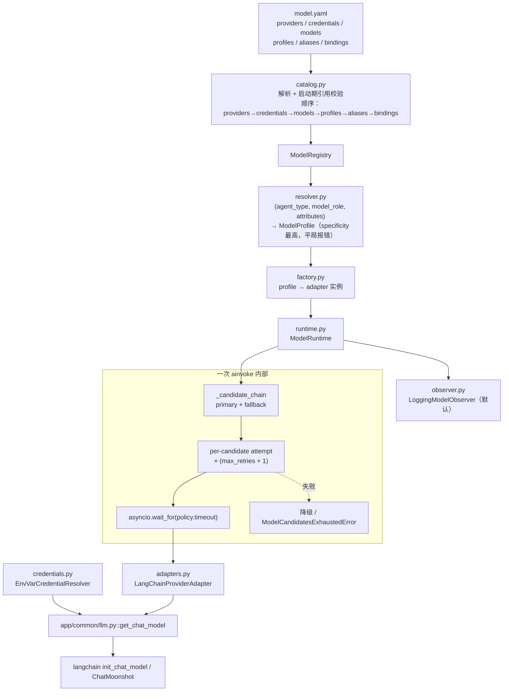

# MODEL_README.MD — Model 子系统

> YTraderAgent · Model 子系统事实手册
> 覆盖范围：`app/agent/model/`（目录 / 路由 / 适配 / 运行 / 类型 / 错误 / 凭证 / 观测）、`app/common/llm.py` + `app/common/llm.yaml`（客户端构造）。
> **本文所有模型名、上下文长度、profile 参数均照抄 `model.yaml` 的真实值，不补充常识、不臆造价格。**

---

## 0. TL;DR

| 问题 | 一句话答案 |
|---|---|
| 模型从哪配？ | `app/agent/model/model.yaml`：把 provider / 凭证引用 / 模型 / 参数档（profile）/ 别名 / 绑定分六段声明 |
| 怎么选模型？ | 按 `(agent_type, model_role, attributes)` 等值匹配 bindings，通配 `*` 参与，取 specificity 最高者，**平局直接报错**、**无兜底** |
| 谁能被调到？ | 只有 bindings 里声明过的组合。9 条绑定，`*` 兜底**刻意不存在** |
| 一次 `ainvoke` 是几次 provider 调用？ | **不一定是一次** —— 候选链上每个候选可重试 `max_retries` 次，还可能有 fallback |
| 重试/超时数值在哪？ | profile 的 `max_retries` / `timeout` / `total_timeout` / `retry_backoff` / `max_retry_backoff` |
| 结构化输出能流式吗？ | **不能**。`_can_stream` 要求 `response_format is None`，结构化输出一律退回 `ainvoke` |
| 成本能估吗？ | **不能**。`model.yaml` 的 `pricing` 段全部被注释 → `estimated_cost` 恒为 `None` |
| 指标落哪？ | 默认 observer **只打标准库 logging，不落库**；落库靠 LLM Node 把 `ModelResponse.metadata` 写进既有 node_span |
| 最凶的坑？ | deepseek 思考模式把工具调用写成 `<|DSML|…|>` 标记当正文发给用户（不报错） |

---

## 1. 阅读地图

```
app/agent/model/
├── catalog.py        ← model.yaml 六段解析 + 启动期引用校验（约 1020 行）
├── registry.py       ← ModelRegistry（按 id / alias / profile 检索）
├── resolver.py       ← (agent_type, model_role, attributes) → ModelProfile
├── factory.py        ← 由 profile 实例化 adapter（剔除非 SDK 参数）
├── provider.py       ← ProviderAdapter 抽象（create_client / ainvoke / aclose）
├── adapters.py       ← LangChainProviderAdapter（约 1070 行）
├── runtime.py        ← ModelRuntime：候选链 / 重试 / 超时 / fallback / 观测（约 1140 行）
├── types.py          ← DTO + ModelRole 常量 + 校验（约 1250 行）
├── errors.py         ← 异常树 + ErrorDisposition + HTTP 启发式
├── credentials.py    ← 凭证解析（env / literal / null）
├── redaction.py      ← 日志脱敏
├── leaked_tool_call.py ← DSML 泄漏闸
├── observer.py       ← ModelCallObserver（默认只打日志）
├── streaming_smoke.py
└── v3_reroute_smoke.py

app/common/llm.py     ← get_chat_model（真正建客户端）
app/common/llm.yaml   ← 客户端配置（⚠️ 在 .gitignore 里，本机存在）
```

---

## 2. 全貌



**一句话架构**：`model.yaml` 声明「有哪些模型、怎么组档、什么场景用哪档」；`resolver` 把这个声明翻译成一个 `ModelProfile`；`runtime` 拿 profile 生成**候选链**并逐个尝试；`adapters` 只负责把 langchain 客户端包一层，不认识 profile。

---

## 3. `model.yaml` 目录（约 494 行）

### 3.1 providers 与 credentials

| provider | adapter | 凭证引用（`model.yaml:65-69`） | 说明 |
|---|---|---|---|
| `deepseek` | `langchain` | `deepseek-production` → `DEEPSEEK_API_KEY` | `model.yaml:32-47` |
| `kimi` | `langchain` | `kimi-production` → `KIMI_API_KEY` | 同上 |
| `qwen` | `langchain` | `qwen-production` → `QWEN_API_KEY` | 同上 |

凭证段**只有引用名，没有密钥**（密钥经环境变量展开，见 §10）。

**装配顺序是硬约束**（`catalog.py:261`）：`providers → credentials → models → profiles → aliases → bindings`。引用不到就在**启动期**报错，而不是第一次调用时。

### 3.2 models（照抄 `model.yaml` 真实值）

| id | provider | context_window | tool_calling | structured_output | streaming | vision | reasoning | max_tokens | alias | 备注 |
|---|---|---|---|---|---|---|---|---|---|---|
| `deepseek:deepseek-v4-flash` | deepseek | 65536 | ✅ | ✅ | ✅ | ❌ | ❌ | 8192 | `flash` | `structured_output_extra_body = {thinking: {type: disabled}}` |
| `kimi:kimi-k2.7-code` | kimi | 131072 | ✅ | ✅ | ✅ | ❌ | ❌ | 4096 | `kimi-code` | — |
| `deepseek:deepseek-reasoner` | deepseek | 65536 | ❌ | ✅ | ✅ | ❌ | ✅ | 8192 | `reasoner` | **不支持工具调用** |
| `qwen:qwen3.7-flash` | qwen | 32768 | ✅ | ✅ | ✅ | ❌ | ❌ | 4096 | `qwen-flash` | `structured_output_extra_body = {enable_thinking: false}` |

三条必须记住的事实：

1. **`pricing` 段全部被注释**（`model.yaml:186-189`）→ `ModelPricing` 存在但永不填值，`estimated_cost` **恒为 `None`**（不是 0，是"无法估算"）。消费这个字段的代码必须处理 `None`。
2. **没有任何模型声明 `vision`** → 因此也**刻意没有 `vision_default` 别名**。加上去只会得到一个"永远解析失败"的别名。
3. `context_window` 只作**预算依据**（`ContextPolicy.default_context_window` 的兜底来源），它不代表"能不能跑"。模型能否被激活由 bindings 决定。

### 3.3 profiles（参数档，`model.yaml:313-379`）

| profile | primary → fallback | timeout(s) | max_retries | total_timeout(s) | retry_backoff | max_retry_backoff |
|---|---|---|---|---|---|---|
| `reasoning_default` | `flash` → `kimi-code` | 90 | 2 | 240 | 0.5 | 8 |
| `fast_default` | `flash` → `kimi-code` | 30 | 1 | 60 | 0.2 | （未写） |
| `evaluation_default` | `reasoner` → `kimi-code` | 180 | 1 | 420 | （未写） | （未写） |
| `classification_default` | `qwen-flash` → `[flash, kimi-code]` | 30 | 1 | 60 | 0.2 | （未写） |

- 总尝试次数 = `max_retries + 1`（`types.py:690`、`runtime.py:497`）。
- `retry_backoff` 缺省为 `0` → **不退避**（`runtime.py:1117-1134`）。
- `classification_default` 的 fallback 是**列表**，允许两个后手。

### 3.4 aliases 与 bindings

`aliases`（`model.yaml:395`）：`cheap_default → fast_default`。

`bindings`（`model.yaml:418-494`）共 **9 条**：

| agent_type | model_role | → profile |
|---|---|---|
| `react` | `reasoning` | `reasoning_default` |
| `react` | `summarization` | `fast_default` |
| `react` | `classification` | `classification_default` |
| `planner` | `reasoning` | `reasoning_default` |
| `evaluator` | `reasoning` | `evaluation_default` |
| `memory_atom_extract` | `memory.atom.extract` | `reasoning_default` |
| `memory_atom_dedup` | `memory.atom.dedup` | `reasoning_default` |
| `memory_scene_consolidate` | `memory.scene.consolidate` | `reasoning_default` |
| `memory_persona_extract` | `memory.persona.extract` | `reasoning_default` |

> ⚠️ **`*` 兜底刻意不存在**。解析不出来 → **直接报错**（`resolver.py:241-250`），而不是悄悄退到某个默认档。这是"宁可显式失败也不静默用错模型"的取舍。`planner` / `evaluator` 的绑定是**预备**（对应图未实现，见 §13）。

---

## 4. `ModelRole` 全部取值

定义在 `types.py:64-148`。**注意：它是类常量集合，不是 `Enum`**（这点影响 `set()` 比较与序列化写法）。

| 常量 | 字面值 | 用途 | 现状 |
|---|---|---|---|
| `REASONING` | `reasoning` | 主循环 / 推理调用 | 在用 |
| `SUMMARIZATION` | `summarization` | 对话摘要 / 上下文压缩 | 在用 |
| `CLASSIFICATION` | `classification` | 路由 / 分类 | 在用 |
| `MEMORY_ATOM_EXTRACT` | `memory.atom.extract` | L1 记忆抽取（后台任务） | 在用 |
| `MEMORY_ATOM_DEDUP` | `memory.atom.dedup` | L1 记忆去重（后台任务） | 在用 |
| `MEMORY_SCENE_CONSOLIDATE` | `memory.scene.consolidate` | L2 场景整合（后台任务） | 在用 |
| `MEMORY_PERSONA_EXTRACT` | `memory.persona.extract` | L3 画像生成（后台任务） | 在用 |
| `MEMORY_RETRIEVAL` | `memory.retrieval` | 记忆注入上下文的占位角色 | **占位**：不发起调用、无绑定 |
| `EVALUATION` | `evaluation` | 评估打分 | **预留**：有绑定，无对应图 |
| `VISION` | `vision` | 多模态 | **预留**：无模型支持、无绑定 |
| `FAST` | `fast` | 快速档 | **预留**：无绑定使用此 role |

> 提示词目录 `found_prompts()` 的键恰好与 `ModelRole` 值集**同构**（`classification` / `summarization` / 5 个 `memory.*`）——但提示词目录是**另一个注册表**（`app/agent/prompt/`），不是这里定义的。

---

## 5. 解析优先级（`resolver.py`）

`ModelResolveContext` 的真实字段（`types.py:1146-1173`）：

```python
required_capabilities   # 能力门禁（缺了候选就不相容）
credential_ref          # 强制指定凭证引用
attributes              # 参与 specificity 计算的附加维度
```

`CatalogModelResolver.resolve` 的算法：

1. 按 `(agent_type, model_role, attributes)` 做**等值匹配**，通配符是 `"*"`（常量 `WILDCARD`）。
2. 在命中的多条里取 **`specificity` 最高**者：
   - `agent_type` 非通配：+1
   - `model_role` 非通配：+1
   - `attributes` 每命中一项：+1
3. **平局 → 直接抛错**，**不按书写顺序取第一条**。

第 3 条是刻意的：靠书写顺序决胜负会让"改一下 yaml 里两行的位置"静默改变生产行为。

---

## 6. 适配层（`adapters.py`）

### 6.1 只有一个适配器

`LangChainProviderAdapter`（`name = "langchain"`，`adapters.py:75-89`），委托 `app/common/llm.py::get_chat_model` 建客户端。

为什么一个就够：`langchain` 的 `init_chat_model` 支持多家 provider，一个 adapter 覆盖它们；只有出现"非 langchain 客户端"时才需要第二个（`adapters.py:14-29`）。

**本模块顶层刻意不 import langchain**，全部走 `getattr` 运行时探测 —— 这样"没装 langchain"只影响真正要用到的那条路，而不是让整个模块 import 失败。

抽象方法（`provider.py:132-195`）：`create_client`（同步、不阻塞）、`ainvoke`、`aclose`。

### 6.2 真实依赖版本（实测 `pip list`）

| 包 | 实测版本 | 在 requirements 里？ |
|---|---|---|
| `langgraph` | 1.2.11 | ✅ `requirements.txt:118` |
| `langchain-core` | 1.6.4 | ❌（经 `langgraph` 传递拉到，`requirements.txt:110` 注释提到 1.6.3） |
| `langchain` | 1.4.2 | ❌ **未声明** |
| `langchain-deepseek` | 1.1.1 | ❌ **未声明** |
| `langchain-moonshot` | 0.1.0 | ❌ **未声明** |
| `langchain-openai` | 1.6.4 | ❌ **未声明** |
| `langchain-protocol` | 0.0.19 | ❌ **未声明** |
| `openai` | 3.19.0 | ❌ **未声明** |
| `langchain-ollama` | 1.1.0 | ✅ `requirements.txt:152` |

> 🐛 **实测发现的真实缺口**：`app/common/llm.py:343` 局部 `from langchain.chat_models import init_chat_model`，且它自己的报错文案写着「请 pip install langchain（**见 requirements.txt**）」——但 `requirements.txt` 与 `requirements-dev.txt` 里**都没有 `langchain`**（全仓 grep 只命中注释）。同类未声明的还有 `langchain-deepseek`（deepseek 走 `init_chat_model` 分派时需要）、`langchain-moonshot`（kimi 走 `_DIRECT_PROVIDERS`，`llm.py:89`）。
> **后果**：按 `requirements.txt` 自述的"精确 pin 让环境可复现"承诺，新建一个干净环境**装完之后模型层直接 import 失败**（`ImportError`）。
> **修法**：把这几个包按实测版本写进 `requirements.txt`（或 `requirements-dev.txt`），并同步 llm.py 的报错文案。这是本次阅读中发现的**最高优先级**项。

### 6.3 流式 vs 非流式（`_can_stream`，`adapters.py:305-330`）

```
走原生流 ⇔ request.response_format is None  AND  capabilities.streaming 为真
```

- **结构化输出一律退回 `ainvoke`** —— 因为流式与结构化输出的协议无法同时满足。
- 非流式路径**仍然通过 `on_delta` 一次性回调整段正文**，所以消费端不必区分两条路。
- 流式累积靠 `AIMessageChunk.__add__` 把 `tool_call_chunks` 拼成 `tool_calls`（`:343-347`）—— **不拼就会让 `route_after_agent` 读不到工具调用**，图会判定"模型没要求工具"。

### 6.4 工具调用映射

```python
bind_tools(list(tools), **extra)                  # adapters.py:511-512
with_structured_output(response_format, **extra)  # adapters.py:514-523
```

工具调用的**中间表示直接复用 langchain 原生 `tool_calls`**（`list[dict{name, args, id}]`）与 `tool_call_chunks`，本模块**不另定义结构**（`:343`）。这是刻意的：另造一层意味着每个 provider 都要写一遍转换。

### 6.5 provider 特有坑（6 条，逐条是真实踩过的）

| # | 坑 | 表现 | 处理 | 位置 |
|---|---|---|---|---|
| 1 | deepseek 思考模式 + 结构化输出 | 400 `Thinking mode does not support this tool_choice` | 用 `structured_output_extra_body` 关思考 | `model.yaml:108-129` |
| 2 | deepseek 思考模式 + 带工具 | 把工具调用写成 `<|DSML|…|>` 标记，被当正文**发给用户**（**不报错**） | `LeakGate` + `strip_leaked_tool_calls`（见 §10.3） | `adapters.py:481-538`、`:121-129` |
| 3 | 两家关思考的参数名不同 | qwen 是 `enable_thinking: false`；deepseek 是 `thinking: {type: disabled}` | 各自写在模型级 `structured_output_extra_body` | `model.yaml:286-289` |
| 4 | langchain 的 `response_metadata` 字符串**会拼接** | `model_name` → `'deepseek-v4deepseek-v4deepseek-v4'`；`finish_reason` → `'stopstop'` | 手动"取最后一个非空值" + `_provider_metadata` 白名单 | `adapters.py:365-382` |
| 5 | `timeout` 参数**不能**传给 `ainvoke` | 传了会 400 | `timeout` 只用于 metadata + `asyncio.wait_for` | `adapters.py:168-174`、`:714-725` |
| 6 | `bind_tools` + `with_structured_output` **同时调** | tools 会丢 | 二选一，结构化输出优先 | `adapters.py:487-496` |

另有一条 langchain 1.x 的兼容坑：`_chunk_text` 里 `.text` 是 `str` 的**子类且可调用**，必须先 `isinstance(attr, str)` 再判断（`adapters.py:829-846`）——否则会把一个方法当字符串用。

---

## 7. 运行层（`runtime.py`）

`ModelRuntime` 负责：候选链构建、超时、有限重试、fallback、能力门禁、异常归一化、usage / latency / cost 观测。

> **重要认知**：一次 `ainvoke` **不等于**一次 provider 调用（`runtime.py:32-42`）。它是「候选链 × 每候选尝试次数」的二维展开。

| 机制 | 真实值 / 规则 | 位置 |
|---|---|---|
| 重试次数 | 每候选 `max_retries` 次，总尝试 = `max_retries + 1` | `types.py:690`、`runtime.py:497` |
| 退避 | `retry_backoff * 2**(n-1)`，封顶 `max_retry_backoff` | `runtime.py:1117-1134` |
| 退避默认 | `retry_backoff = 0` → **不退避** | 同上 |
| 单次尝试超时 | `policy.timeout`，由 `asyncio.wait_for` + 客户端构造超时**双保险** | `runtime.py:675-725` |
| 整链总预算 | `total_timeout` | `runtime.py:390-394`、`:501-526` |
| 限流 | **无独立令牌桶**；退避是唯一机制；429 → `ModelRateLimitError`(RETRY) | — |
| 取消 | `CancelledError` / `KeyboardInterrupt` / `SystemExit` **原样 re-raise**，不当可重试 | `runtime.py:538-542`、`adapters.py:216-225` |
| commit 规则 | **`deltas_emitted > 0` 之后不再重试/降级** | `runtime.py:575-595` |

**commit 规则为什么重要**：流式已经推了一部分正文给消费端，此时再重试或降级会把**两份正文**推给用户。宁可这一轮失败，也不推重复内容。

### 7.1 降级路径（`_candidate_chain`，`runtime.py:818-901`）

| 情形 | 行为 |
|---|---|
| primary **不相容** | `ModelCapabilityError` —— **抛错，不静默降级**（能力不满足是配置错误，不是运行时故障） |
| fallback 不相容 | **剔除 + 记警告**（观测可见），继续下一个 |
| 整链耗尽 | `ModelCandidatesExhaustedError`（是 `ModelUnavailableError` 子类，`runtime.py:291-311`） |

primary 与 fallback 的处理方式**不对称**，这是刻意的：primary 配置错应该立刻炸（否则你会以为系统在用 A 其实在用 B），fallback 配置错只该被记录。

---

## 8. `types.py` 核心 DTO

| DTO | 关键字段 |
|---|---|
| `ModelRequest` | `messages` / `tools` / `response_format` / `metadata` / `required_capabilities` / `disable_thinking` |
| `ModelResponse` | `message` / `provider` / `model` / `usage` / `latency_ms` / `attempts` / `degraded` / `metadata` |
| `ModelAttempt` | 单次尝试的记录 |
| `ModelCallSummary` | 整次调用的汇总 |
| `ModelDefinition` | 模型身份 + `capabilities` |
| `ModelProfile` | 参数档（含 fallback 链与策略） |
| `ModelRuntimePolicy` | `timeout` / `total_timeout` / `max_retries` / `retry_backoff` / `max_retry_backoff` |
| `ModelCapabilities` | `tool_calling` / `structured_output` / `streaming` / `vision` / `reasoning` |
| `ModelUsage` | token 用量 |
| `ModelPricing` | **存在但永不填值**（pricing 段被注释） |
| `ProviderResult` | 适配器返回值 + 白名单元信息 |
| `ModelResolveContext` | `required_capabilities` / `credential_ref` / `attributes` |

消息即 **langchain `BaseMessage`**（`ModelRequest.messages` 类型标注为 `Any`，`types.py:878`）。用量由 `usage_metadata` / `response_metadata.token_usage` 读成 `ModelUsage`（`adapters.py:855-892`）。provider 元信息经**白名单**进 `ProviderResult.metadata`（`:1036-1062`）。

**没有独立的 OpenAI ↔ langchain 转换函数** —— 依赖 langchain 自己处理。这降低了维护面，代价是绑定 langchain 的版本行为（见坑 #4）。

---

## 9. 错误分类（`errors.py`）

```
ModelError                                    (基类)
├── ModelConfigurationError                   FAIL
├── ModelResolutionError                      FAIL
├── ModelCapabilityError                      FAIL
├── ModelInvocationError                      FAIL
│   ├── ModelTimeoutError                     RETRY
│   ├── ModelRateLimitError                   RETRY
│   ├── ModelUnavailableError                 RETRY
│   ├── ModelProviderError                    RETRY
│   ├── ModelAuthenticationError              FALLBACK
│   └── ModelInvalidRequestError              FAIL
├── ModelCandidateFailure                     FAIL
└── ModelCandidatesExhaustedError             FAIL（继承 Unavailable）
```

`ErrorDisposition` 三态：`RETRY` / `FALLBACK` / `FAIL`。

**默认可重试码** = `(timeout, rate_limit, unavailable, provider_error)`（`errors.py:364-369`）。import 期有 `_assert_retryable_codes_consistent` 自检（`:372-415`）防止新增异常被顺手标成可重试。

**HTTP 状态码启发式**（**仅用于分类，不产出 HTTP**，`errors.py:423-427`）：

| 码 | 归类 |
|---|---|
| 408 / 409 / 425 / 429 / 500 / 502 / 503 / 504 / 529 | 暂时性 → 可重试 |
| 401 / 403 | auth |
| 400 / 404 / 405 / 413 / 415 / 422 | invalid |
| 429 | rate_limit |

> 📌 **模型模块不主动映射业务 HTTP 状态码**。这些码只喂给 Runtime 做决策，向上暴露用的是通用错误兜底。

---

## 10. 凭证 / 脱敏 / 泄漏

### 10.1 `credentials.py`

| 实现 | 用途 |
|---|---|
| `EnvVarCredentialResolver` | 生产。refs 来自 `model.yaml` 的 `credentials:`；未声明时把 ref **归一化成环境变量名**（`deepseek-production` → `DEEPSEEK_PRODUCTION`） |
| `LiteralCredentialResolver` | **仅供测试**；`__repr__` 遮值 |
| `NullCredentialResolver` | Registry 默认（没有就是没有，不编） |

找不到时**返回 `None`**（回落 `llm.yaml` 的默认 key），除非 `required=True` 则抛错。

### 10.2 `redaction.py`

| 函数 | 抹什么 |
|---|---|
| `redact_text` | `sk-…` / `Bearer …` / `key=…` 等形态 |
| `redact_mapping` | 敏感键 `api_key` / `token` / `secret` / `credential…` → `***` |

**边界敏感**：`credential_ref` 与 `input_tokens` **不被误伤** —— 注释明说子串匹配会把成本数据一起毁掉（`credential_ref` 里含 "credential"、`input_tokens` 里含 "token"）。

### 10.3 `leaked_tool_call.py`（DSML 泄漏）

**现象**：deepseek 思考模式下，模型把工具调用写成 `<|DSML|…|>` 标记，被当成正文**直接发给用户**，且**全程无报错**（实测 run `51b31758`）。

**工具**：

| 组件 | 适用 |
|---|---|
| `LeakGate` | 字符流**有状态闸**，流式逐块用（因为标记可能跨块） |
| `strip_leaked_tool_calls` | 整段用（非流式 / 思维链） |

**兜底**：整条回复只剩标记时 → 抛 `ModelProviderError`（转成重试或降级），不把空回复当成成功。

**根因修法**：`thinking_off_extra_body` 在"带工具 / 结构化输出"的调用上关思考（两家参数不同，见 §6.5 坑 #3）。模型级 `disable_thinking` 开关**当前无人开启** —— 因为 flash 在 2026-10-13 被撤掉了该开关，要把思维链保留给用户。

---

## 11. 观测（`observer.py`）

`ModelCallObserver` Protocol 两个回调：`on_attempt`（每次尝试）/ `on_call`（整次调用）。

默认实现 `LoggingModelObserver`：

| 事件 | 级别 |
|---|---|
| attempt-ok | DEBUG |
| attempt-fail | WARNING |
| call-ok | INFO |
| degraded | WARNING |
| call-fail | ERROR |

**三条重要性质**：

1. **不打正文**。
2. **不落库表**。
3. 回调异常被**吞掉**（不连累业务结果）。

**落库路径**：靠 LLM Node 把 `ModelResponse.metadata` 写进**既有的 node_span metrics**（`observer.py:11-18`）——不是模型层自己写。

---

## 12. 冒烟脚本

| 脚本 | 验证什么 | 需要真实 key？ | 实测 |
|---|---|---|---|
| `streaming_smoke.py` | 7 段：顺序回调、`tool_call_chunks` 拼成 `tool_calls`、思维链不漏、非流式退化回调、中途失败不重复、空流抛错、provider 元信息不拼接 | **不需要**（`FakeRunnable` 注入假 chunk） | ✅ 全部通过 |
| `v3_reroute_smoke.py` | 切 langgraph `version="v3"` 不破坏模型调用，**尤其结构化输出**（v3 强制走 `_should_use_protocol_streaming` 事件聚合，会绕过 `_can_stream` 对结构化输出的非流式保护） | 按代码需要真实模型；**本机实测通过**（含阳性对照：v3 必命中改道且返回 `True`；阴性对照：`ainvoke` 基线不走改道） | ✅ 全部通过 |

**"v3 reroute" 是什么**：langgraph 的 `version="v3"` 走另一套流式聚合路径。因为这条路会绕过 `_can_stream` 的保护，**结构化输出在 v3 下会不会坏**必须专门测——这就是这个脚本存在的理由，而不是泛泛地"再测一遍模型调用"。

`streaming_smoke` 里最有价值的两条断言：

- **空流抛错**（而不是返回空消息）—— 空消息会以 `completed` 收尾，是最难查的故障形态。
- **provider 元信息不被拼接** —— 直接对着 §6.5 坑 #4 做的回归。

---

## 13. 缺口、桩、注释失真

### 13.1 真实缺口

| 项 | 说明 |
|---|---|
| **`langchain` 等包未声明** | 见 §6.2。**最高优先级** |
| `pricing` 全注释 | `estimated_cost` 恒 `None`，成本无法估算 |
| `disable_thinking` 模型级开关**全关** | `ModelDefinition.__post_init__` 仍强制"开启必须有 extra_body"（`types.py:539-589`），但无人开启 |
| `adapters.py:193`、`:214` 残留 `print(...)` | 调试打印残留在生产代码路径（不是密钥泄漏，但是噪声，建议清理） |
| `max_retries` 不进 `model.yaml` 的 config | adapter 构造时**主动剔除**（`adapters.py:125-129`）；只有 config 显式写时才由 `factory._config_max_retries` 恢复 |

### 13.2 预留（不是 bug）

| 项 | 说明 |
|---|---|
| `ModelRole.VISION` / `FAST` / `EVALUATION` | 无绑定使用 |
| `ModelRole.MEMORY_RETRIEVAL` | 仅**占位**，不发起调用（`types.py:131-148` 注释） |
| `vision_default` 别名 | 刻意省略（无模型支持 vision） |
| `planner` / `evaluator` 图 | 未实现，bindings 是**预备绑定**（`model.yaml:415` 注明） |

---

## 14. 设计取舍（读代码时的"为什么"）

1. **`model.yaml` 与 `llm.yaml` 分家**。`model.yaml` 是**领域目录**（有哪些模型、什么场景用哪档），可进版本库、可 review；`llm.yaml` 是**环境配置**（端点、密钥展开），在 `.gitignore` 里。分家的好处是目录可以公开讨论，环境不必。
2. **无 `*` 兜底**。宁可启动/解析期炸，也不要"某个 role 悄悄用了错误模型"。静默降级到默认模型的故障是"回答质量下降"，几乎不可能被归因。
3. **primary 与 fallback 处理不对称**。见 §7.1：primary 是承诺，fallback 是保险。
4. **结构化输出不走流式**。与其维护两套协议的交集，不如在需要结构化时退回非流式 + 一次性 `on_delta`。消费端无感。
5. **`pricing` 留空而不是填 0**。`None` 表示"不知道"，`0` 会表示"免费"——后者会污染成本报表。
6. **adapter 不 import langchain**。用 `getattr` 运行时探测，让"没装 langchain"只影响用到的那条路。
7. **commit 之后不重试**。宁可失败也不推重复正文。
8. **`ModelRole` 用类常量而不是 `Enum`**。代价是与字符串比较时要小心（`ModelRole.REASONING == "reasoning"` 成立，但 `set` 里混用会出意外）；收益是序列化零成本。理解这一点能解释为什么 `prompt_smoke` 里的集合比较写得那么直接。

---

## 15. 文件索引

| 关注点 | 先读 |
|---|---|
| 模型目录与绑定 | `app/agent/model/model.yaml` |
| 目录解析与校验 | `app/agent/model/catalog.py` |
| 选档 | `app/agent/model/resolver.py`、`registry.py`、`factory.py` |
| 适配与坑 | `app/agent/model/adapters.py`、`provider.py` |
| 客户端构造 | `app/common/llm.py`、`app/common/llm.yaml` |
| 重试/超时/降级 | `app/agent/model/runtime.py` |
| DTO / ModelRole | `app/agent/model/types.py` |
| 错误 | `app/agent/model/errors.py` |
| 凭证 / 脱敏 / 泄漏 | `app/agent/model/{credentials,redaction,leaked_tool_call}.py` |
| 观测 | `app/agent/model/observer.py` |
| 验证 | `app/agent/model/{streaming_smoke,v3_reroute_smoke}.py` |
| 依赖版本 | `requirements.txt`（⚠️ 缺 langchain 系，见 §6.2） |
