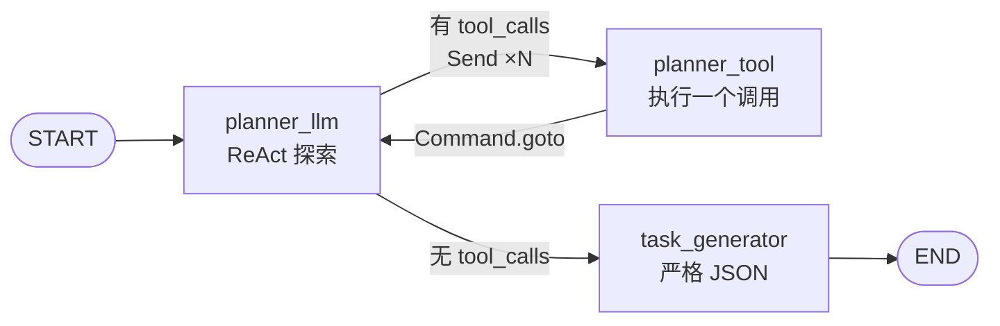
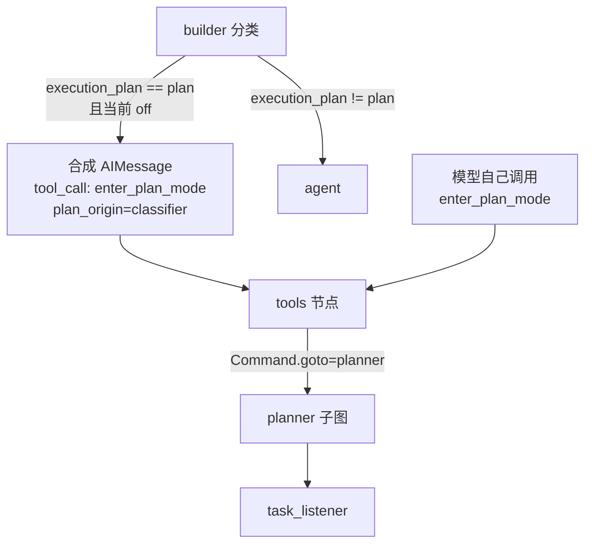

# README_PLAN.md — Planner 任务模式（计划模式）子系统

> YTraderHarness · Planner 事实手册
> 覆盖范围：`app/agent/graph/planner/`、`app/agent/plan/`、`app/agent/tools/plan_tool.py`、`app/agent/tools/task_tool.py`、`app/agent/prompt/prompts/planner*.py`、`app/agent/context/builder/planner.py`。
> 本文只描述**代码里真实存在**的东西；注释与代码冲突处一律以代码为准并显式标注。

---

## 0. TL;DR

| 问题 | 一句话答案 |
|---|---|
| 计划模式是什么？ | 一个 `plan_status="plan"` 的运行态；先把请求拆成 **DAG 任务**，再逐条执行 |
| planner 是节点还是子图？ | **子图**。编译后作为父图节点 `planner` 挂载（`graph/react/graph.py:147`） |
| 为什么要拆子图？ | 规划要做工具循环，中间推理**不能**进主对话 `messages`（会污染用户回复、被落库、被前端渲染） |
| 计划怎么变成任务？ | 模型输出 `PlanDraft` JSON → `validate_plan()` 校验 DAG → `to_a2a_tasks()` 转 A2A Task |
| planner 会写任务板吗？ | **不写**。它只发 `plan.published` 事件 + 写父图 state；发布任务板在 `create_team` 工具里 |
| 谁决定进入计划模式？ | 两条入口，同一条执行路径：**分类器合成** `enter_plan_mode` 调用 / **模型自己**调用 |
| 计划存在哪？ | `ReactState.plan`（快照）+ `ReactState.tasks`（A2A canonical dict 列表，拓扑序） |
| 有没有 HTTP 端点？ | **没有**。计划任务只活在 graph state / Redis 任务板 / 事件流里 |
| 一个任务能跑多大？ | `message` 与 `metadata` 各 **≤ 64 KiB**，超出直接拒绝，不静默截断 |
| 实现完整度 | 3 个节点全实现；33 个 planner pytest 通过（1.39s） |

---

## 1. 先分清五个"计划"

名字都像"计划"，读错会全程错位。

| # | 位置 | 是什么 | 状态 |
|---|---|---|---|
| 1 | `app/agent/graph/planner/` | **planner 子图**：本文件主角。ReAct 探索 → 生成 TaskDraft | ✅ 已实现 |
| 2 | `app/agent/plan/` | **计划层**：契约校验 / A2A 转换 / 任务板 / claim。不碰 graph state、不调模型 | ✅ 已实现 |
| 3 | `ReactState.plan` | **计划快照**：`plan_id` / `revision` / `goal` / `tasks[{id,local_id,status}]` / `notes` | ✅ 运行态 |
| 4 | `design_planner/task.md` | **设计文档**（含 `planner_prompt.md`、两份 sample json） | 📄 设计态，非代码 |
| 5 | `app/api/v1/tasks.py` | **异步作业**（`TaskService`）的查询/干预接口 | ⚠️ **与计划任务无关**，名字撞车 |

第 5 项特别容易误判：`/tasks` 那套是后台作业（handler / lease / lineage），与本文的 A2A 计划任务**没有任何代码耦合**。计划任务没有 HTTP 面。

---

## 2. 阅读地图

```
app/agent/graph/planner/          1,255 行 —— 子图本体
├── catalog.py        142  图名/版本/节点目录/边/排除工具/模型路由键
├── state.py           97  PlannerInput / PlannerOutput / PlannerState / ToolPayload
├── nodes.py          838  planner_llm / planner_tool / task_generator
├── routing.py         74  route_after_planner_llm（Send 扇出）
└── graph.py           82  装配（input_schema / output_schema 在这里定）

app/agent/plan/                   2,476 行 —— 计划层（不含 LangGraph 依赖）
├── contracts.py      453  TaskDraft / PlanDraft / normalize_payload / validate_plan
├── a2a.py            196  TaskDraft -> A2A Task -> canonical dict
├── listener.py       722  claim 规则 + State/Redis 两种数据源 + Lua CAS
├── publish.py        391  Redis 任务板 + publish_plan（degraded 语义）
├── checks.py         191  纯函数：pending / ready / 并行判据 / 找环
└── task_prompt.py    448  任务指令文本的**唯一**渲染入口

app/agent/graph/react/            —— 父图接入点
├── graph.py                    planner 子图挂载 + 边
├── routing.py                  _route_for_plan / route_after_planner
├── plan_state.py               plan_needs_replan（重规划的**唯一**判据）
├── task_listener_node.py       顺序执行 + 团队决策 + 汇总回合
└── agent_builder_node.py       分类器合成 enter_plan_mode 调用

app/agent/tools/plan_tool.py      enter_plan_mode / exit_plan_mode
app/agent/tools/task_tool.py      create_team（真正发布任务板）+ 4 个占位工具
app/agent/prompt/prompts/planner.py         task_generator 的提示词
app/agent/prompt/prompts/planner_react.py   ReAct 探索段的提示词
app/agent/context/builder/planner.py        ContextBuilderType.PLANNER
```

---

## 3. 为什么是子图（而不是一个节点）

把它当普通节点跑，工具调用与中间推理只能写进主对话 `messages`，后果是三重的：

| 后果 | 机制 |
|---|---|
| 污染用户可见回复 | `RunEventProjector` 把 `message_nodes` 的逐 token 正文当答复推给前端 |
| 被落库 | `message_recorder` 会把 assistant 消息写进会话历史 |
| 上下文越来越重 | planner 的 transcript 全进父图 checkpoint |

所以 `graph.py:56-61` 用三个 schema 把边界钉死：

```python
StateGraph(
    PlannerState,                       # 子图自己的完整 state
    input_schema=PlannerInput,          # 只进来：messages / conversation_id / user_id / summary / plan
    output_schema=PlannerOutput,        # 只出去：plan / tasks / current_task / team_decision
    context_schema=ReactContext,
)
```

**输入隔离**：父图的 `context_policy` / `current_task` / `tasks` / `team_decision` 进不来 —— 主 agent 的职责提示词与工具集不会泄漏进规划阶段。
**输出隔离**：`PlannerOutput` 刻意**不含** `messages` / `context_result`，规划过程留在子图 namespace。

> ⚠️ `checkpoint` 是父 thread 的嵌套 namespace，`interrupt` 由父 Pregel 循环管理（冒泡 / resume）。子图 `compile()` **不带 checkpointer**，会继承父图的（`graph.py:144-146` 注释）。

---

## 4. 图拓扑



| 节点 | group | 职责 | 输入 | 输出 | 失败处理 |
|---|---|---|---|---|---|
| `planner_llm` | linear | 一次 ReAct 规划回合：查能力/技能/文档，或澄清 | `PlannerState` | `messages` + `context_policy` + `planner_notes` | 异常 → 降级成一条 AIMessage，让下游直接生成 |
| `planner_tool` | fanout | 执行**一个**工具调用 | `PlannerToolPayload`（Send 全量取代 state） | `Command(goto="planner_llm")` | 返回父图 Command → 拦截并转成错误 ToolMessage |
| `task_generator` | linear | 不接工具，输出 `PlanDraft` → 校验 → A2A → 事件 | `PlannerState` | `plan` / `tasks` / `current_task={}` / `team_decision=""` | 整体异常 → 返回 `{}`，**保留旧计划** |

### 扇出的三条硬规则

1. **只看最后一条 AIMessage**（`routing.py:44-52`）。遍历全部历史会让"上一轮调过工具"变成"这一轮也要调"，图永远在循环里。
2. **绝不能返回空列表**。LangGraph 对空 destinations 不报错，而是让整次运行**静默结束**。本函数形状天然保证非空。
3. **`add_conditional_edges` 第三参仍要写 `TOOL_NODE`**。`Send` 绕过 path_map，但裸字符串分支（`task_generator`）必须能映射到；漏写会在运行期报 `Unknown branch`（装配期看不出来）。

---

## 5. State 契约

### PlannerInput（父 → 子）

```python
messages: list[AnyMessage]      # 父对话作为规划阶段的初始历史
conversation_id: str            # 记忆 / 知识 / 工具源的 scope
user_id: str
summary: dict                   # 已有摘要（可选）
plan: dict                      # 旧计划快照（重规划时用 plan_id / revision）
```

### PlannerOutput（子 → 父）

```python
plan: dict            # 计划快照
tasks: list[dict]     # A2A canonical dict，**拓扑序**
current_task: dict    # 恒为 {} —— 真实 claim 由父图 task_listener 做
team_decision: str    # 恒为 "" —— 决策属于父图
```

### PlannerState（子图内部）

除上述之外还有几个**只属于 planner** 的通道：

| 字段 | 作用 |
|---|---|
| `context_policy` | planner 自己的策略，**不从父图输入** |
| `exposed_tools` / `context_result` | 上下文构建的中间产物 |
| `planner_tools_resolved` | 首次模型调用前解析一次默认能力，之后只复用 `context_policy.tool_keys` |
| `planner_notes` | 工具解析 / 探索失败的降级说明，最终并入 `plan.notes` |

### PlannerToolPayload（Send payload）

> ⚠️ **Send 的 payload 取代 state**：分支看不到子图任何字段。所以 payload 必须列全分支真正需要的东西：`call` / `tool_keys` / `call_scope` / `return_to` / `is_controller`。

> ⚠️ **未声明的键会被 LangGraph 静默丢弃**（不报错、不写入）。这是三张图（ReactState / SubAgentState / PlannerState）共同的一条，不是 planner 特有。

---

## 6. 三个节点

### 6.1 `planner_llm` —— ReAct 探索（nodes.py:105）

```
第 1 次进入：解析默认能力 -> tool_keys  （只做一次，写 planner_tools_resolved）
第 N 次进入：复用 state.context_policy.tool_keys
-> run_agent_turn(spec, builder=planner_builder, agent_type="planner", model_role=REASONING)
-> state_update_keys=()，tag_task_result=False  # 规划不是任务成果
```

**ContextPolicy 的取舍**（`_planner_policy`，nodes.py:185）：

| 开关 | 值 | 理由 |
|---|---|---|
| `include_history` | `True` | 规划必须看到用户原话 |
| `include_capabilities` | `True` | 探索段要看工具 |
| `include_user_profile` | `False` | 画像对拆任务没有增量，只会推高 token |
| `include_memory` | `False` | 同上 |
| `include_retrieved_context` | `False` | 知识检索属于执行阶段 |
| `allow_compaction` | `False` | 规划是多轮短循环，压缩收益为负 |
| `enforce_token_budget` | `True` | 预算仍然生效 |

**工具解析链**（`_planner_tool_keys`）：

```
DEFAULT_CAPABILITIES["planner"] -> 默认能力子树
MODEL_CAPABILITIES["planner"]   -> 全局能力
ServiceCapabilityResolver       -> capability code -> tool_key
     ↓ 过滤
PLANNER_EXCLUDED_TOOL_KEYS      -> create_team / enter_plan_mode / exit_plan_mode
```

**为什么排除这三个**（`catalog.py:73-86`）：它们的控制面属于父图，返回的是 `Command(goto="subagent_dispatch" | "planner" | "agent")`。在子图里 goto 不到父节点 —— 与其让模型看到必然失败的工具，不如不给。

**失败处理**：`GraphBubbleUp`（interrupt / 父图跳转）必须冒泡，不能被降级吞掉；其余异常降级成一条 `AIMessage("规划探索阶段失败，请基于当前对话直接生成计划。")`，并往 `planner_notes` 记一条。

### 6.2 `planner_tool` —— 工具执行与 Command 守门（nodes.py:290）

执行本体复用主图的 `execute_tool_branch`（校验允许集、驱动审批/脱敏/缓存/鉴权处理器链、记观测），本节点只做三件事：

1. **非控制器分支只写消息** —— 一个 super-step 只能有一个 `Command`。
2. **控制器分支**：无 Command → `Command(goto=return_to)`；有 Command 且目标在本图内（`PLANNER_NODE_IDS`）→ 原样透传。
3. **跨图 Command 拦截**（nodes.py:328-336）：

```python
logger.warning("planner 工具返回了子图外的 Command，已拦截：goto=%r graph=%r", ...)
return Command(
    goto=return_to,
    update={"messages": [_rejected_command_message(result.message)]},
)
```

被拒的结果会变成一条**模型可读的错误 ToolMessage**（"该工具返回了父图控制指令，在 planner 子图内不可执行。请改用不跨图跳转的工具，或直接总结探索结论。"），让模型换做法继续规划，而不是整轮失败。

> 判据是 `_command_is_local()`：`graph is not None`（含 `Command.PARENT`）或任一 `goto` 不在白名单里，都算跨图。

### 6.3 `task_generator` —— 严格 JSON（nodes.py:376）

```
读技能目录（ACTIVE，limit 100） + 能力目录（ACTIVE，limit 100）   # 失败只记 note，不阻断
-> 渲染 planner 提示词（注入两本目录 + 旧计划快照）
-> messages = 规划 transcript + 一条临时 HumanMessage
             （"只输出最终的 PlanDraft JSON；不要调用工具"）
             ⚠️ 临时消息不写回 state，避免重跑时堆叠
-> ContextBuildRequest(builder_type=PLANNER, agent_type=planner)
-> replace(model_request, disable_thinking=True)   # 严格 JSON 与思考模式互斥
-> _parse_payload()   # 认 str / list[content block] / BaseModel；会剥 ``` 围栏
-> PlanDraft.model_validate(normalize_payload(payload))
-> validate_plan(...)    # DAG 校验 + Kahn 拓扑排序
-> to_a2a_tasks(...)     # TaskDraft -> A2A Task
-> find_dependency_cycle(task_dicts)   # 防御性二次查环（A2A id 视角）
-> 拼 plan 快照 + publish_plan_published() 事件
```

**快照形状**（nodes.py:559）：

```json
{
  "plan_id": "uuid",
  "revision": 1,
  "goal": "一句话目标",
  "tasks": [{"id": "<plan_id>:t1", "local_id": "t1", "status": "pending"}],
  "open_questions": ["..."],
  "notes": ["契约 warning", "目录不可用", "探索降级说明"]
}
```

`notes` 是**有序去重合并**的四个来源：模型自写 notes → `validate_plan` warnings → 技能/能力目录不可用 → `planner_notes`。

**失败处理**：整体异常 → `return {}`（`nodes.py:408-418`），span 标 `degraded=True`。空 dict 意味着父图**保留旧 plan/tasks**，不炸整轮。

**`plan_id` / `revision` 的语义**（nodes.py:773-783）：

| 情形 | `plan_id` | `revision` |
|---|---|---|
| 首次规划 | 新 uuid4 | `1` |
| 重规划（state 里有旧 plan） | **沿用旧 `plan_id`** | `旧 revision + 1` |

重规划沿用 `plan_id` 是刻意的：任务 id 形如 `<plan_id>:t1`，沿用它才能让"同名任务"在任务板上被识别为同一个逻辑任务而不是新任务。

---

## 7. 进入 / 退出计划模式

状态在 `ReactState`（`plan_status` / `plan_origin` / `plan`），**切换发生在 `tools` 节点**，不在路由里。

### 两条入口，一条路径



分类器**只提议**，不写 `plan_status`。它合成的消息与模型自己的调用走**完全相同**的 `tools` 执行路径 —— 否则"清空旧 plan / 记 plan_origin / 路由去 planner"这三件事早晚会漂移。

### `enter_plan_mode` 的幂等矩阵（plan_tool.py:96）

| 当前 `plan_status` | 计划任务状态 | `goto` | 行为 |
|---|---|---|---|
| `off` | — | `planner` | 写 `plan={}`、`plan_status="plan"`、清 `tasks`/`current_task`/`team_decision`/`subagent_mode` |
| `plan` | 有未完成任务 | `agent` | **不重置**现有计划 |
| `plan` | 全部完成 | `planner` | 重新规划（`plan_needs_replan` 判据） |

进入时会**一并清掉** `subagent_mode` / `subagent_workers`（plan_tool.py:149-151）：否则新计划第一轮会继续按 Redis 任务板 claim 旧任务。

### `exit_plan_mode`

| 当前 | `goto` | 行为 |
|---|---|---|
| `plan` | `agent` | `plan_status="off"`，清 `team_decision` / `subagent_mode` |
| 其他 | `agent` | 幂等空操作，只回一句"当前不在计划模式" |

**没有审批**：退出是直接生效的（进入才需要走工具链审批策略）。

### 重规划的**唯一**判据

```python
# plan_state.py:86
def plan_needs_replan(plan) -> bool:
    tasks = _tasks(plan)
    if not tasks: return True                       # 首次 / 旧计划被清空
    return all(task.status in {"done","completed"} for task in tasks)  # 全完成
```

任何任务未完成（pending / running / failed）都返回 `False` —— 计划模式里的正常流程是**继续执行**，不是每轮重新规划。

> 认不出的 status 一律算**未完成**：宁可多跑一轮 planner，也不把没做完的当成做完。
> `DONE_TASK_STATUSES` 同时收 `done` 与 `completed` 两种别名（任务状态形状尚未定死）。

---

## 8. 输出契约：`PlanDraft` / `TaskDraft`

模型**只写它真正知道的东西**，执行态字段一律不写。

### JSON 形状

```json
{
  "revision": 1,
  "goal": "给出一份可执行的竞品分析",
  "tasks": [
    {
      "id": "t1",
      "message": {
        "description": "自包含的执行说明：目标、输入、约束、预期产出、验收标准",
        "params": {"market": "A股", "top_k": 10}
      },
      "metadata": {
        "skill_key": "research",
        "blocked_by": [],
        "block_policy": "all_succeeded",
        "capabilities": []
      }
    }
  ],
  "open_questions": [],
  "notes": []
}
```

### 字段归属

| 字段 | 谁写 | 说明 |
|---|---|---|
| `id` | **模型** | 计划内 local id，`^[A-Za-z0-9_-]{1,64}$` |
| `message` | **模型** | 非空 object，原样进 `history[0].parts[0].data` |
| `metadata.skill_key` | **模型** | 缺省回落 `general` 并记 warning |
| `metadata.blocked_by` | **模型** | 只能引用同计划内的 local id |
| `metadata.block_policy` | **模型** | 第一版只支持 `all_succeeded` |
| `metadata.capabilities` | **模型** | 未知 code 会被丢弃并记 warning |
| `status` / `timestamp` | 转换器 | 创建时写 `TASK_STATE_SUBMITTED` |
| `blocked` | 转换器 | 从 `blocked_by` 反推 |
| `claim` | 运行期 | planner 只允许空 |

> `metadata` 允许**额外键**：契约只校验自己认识的键，其余原样带到 A2A metadata。这样"加一个调度字段"不需要同时改模型输出与转换器两处。

### `normalize_payload` 的兼容层（contracts.py:151）

这三条是**兼容旧提示词 / 模型手滑**，不是新契约：

| 模型可能写 | 归一化为 |
|---|---|
| `instruction: "..."` | `message.description` |
| `message: "一段字符串"` | `message.description` |
| `depends_on` | `metadata.blocked_by` |
| 顶层 `skill_key` / `blocked_by` / `block_policy` / `capabilities` / `claim` / `blocked` | 搬进 `metadata` |

### `validate_plan` 校验项（contracts.py:244）

**拒绝（`PlanValidationError`，整份计划作废）**

| 校验 | 规则 |
|---|---|
| `tasks` 非空 | 空数组直接拒 |
| `id` 格式 | 不匹配 `^[A-Za-z0-9_-]{1,64}$` |
| `id` 唯一 | 重复即拒 |
| `message` | 必须是非空 JSON object，且 ≤ 64 KiB |
| `metadata` | 必须是合法 JSON object，且 ≤ 64 KiB |
| 自依赖 | `blocked_by` 含自己 |
| 悬空依赖 | `blocked_by` 引用计划里不存在的 id |
| 依赖环 | Kahn 排序后节点数不足 → `blocked_by 存在环` |
| `block_policy` | 不在 `{all_succeeded}` 里 |

**降级（进 `warnings` → `plan.notes`）**

| 情形 | 处理 |
|---|---|
| 无 `skill_key` | 回落 `general` |
| `skill_key` 不在技能目录 | 记 warning，**不拒绝** |
| `capabilities` 有未知 code | 丢弃该 code 并记 warning（目录可用时） |

> `known_skill_keys=None` 表示"本轮没目录可查"，只做形状校验；传空集合表示"目录存在但为空"，此时所有值都会被记 warning。两者刻意分开。

---

## 9. `TaskDraft` → A2A Task

`a2a.py:37` 只做**结构补齐**，不改写模型写的内容：

| 转换 | 规则 |
|---|---|
| id | `f"{plan_id}:{local_id}"` |
| message | `Message(role=ROLE_USER, parts=[data_part(message, application/json)])` |
| `blocked_by` | local id → A2A task id |
| `blocked` | 由 `blocked_by` **反向**生成（入边 → 出边） |
| status | `TASK_STATE_SUBMITTED` + `timestamp` |
| `claim` | 恒 `{}`（planner 写什么都覆盖掉） |

`metadata` 补齐后包含：

```json
{
  "skill_key": "research",
  "plan_id": "...",
  "plan_revision": 1,
  "plan_task_id": "t1",
  "blocked_by": ["<plan_id>:t0"],
  "blocked": ["<plan_id>:t2"],
  "block_policy": "all_succeeded",
  "capabilities": [],
  "claim": {},
  "source_run_id": "..."
}
```

大整数会被 `normalize_large_integers_to_strings` 转成字符串（proto JSON 语义），创建后 `validate_proto_required_fields` 兜一次必填校验。

### 为什么还要二次查环

`find_dependency_cycle(task_dicts)`（`checks.py:94`）校验的是**转换后的 A2A canonical dict**（id 形如 `<plan_id>:t1`），而 `validate_plan` 校验的是 **TaskDraft**（local id）。两者时机与形状都不同；用同一算法跑两份输入，比"相信 draft 的校验结果"更可靠 —— 任务可能在 state 里被后续节点改过。

---

## 10. 计划落地与执行衔接

### planner 之后

```python
# routing.py:149
route_after_planner -> END          # 仅当 YTRADER_PLAN_STOP_AFTER_PLANNER=1
                    -> task_listener # 默认
```

> 默认**不能**是 `END`：planner 已经不发布任务板，停在 END 会得到一次「completed 但没有任何 assistant 回复」的运行 —— 前端看起来像卡死。
> 继续时也**不能**直接进 `agent`：`task_listener` 负责 claim 第一个 ready task 并把任务指令写进 `messages`，这一步不能省。

### `task_listener` 的四种结局

| 条件 | 行为 |
|---|---|
| `current_task` 是 WORKING | 落 `COMPLETED`，写 artifact + `result_summary`，清 `current_task` |
| 全部终态，且 `plan_key` 不在 `hist_synthesis_keys` | **汇总回合**：`synthesis_pending=True`，清空 `tool_keys`，交回 agent 生成最终答复 |
| 全部终态，已汇总过 | `publish_plan_cleared` + 清空 `tasks` + `subagent_mode="off"` |
| 还有未完成，但 `>=2` 个 ready 且 `create_team` 已暴露 | **不 claim**，写 `team_decision="pending"`，回 agent 做一次「要不要开团队」的决策 |

`team_decision` 是**一次性**询问：agent 那一轮结束后若仍是 `pending`（没调 `create_team`），listener 写 `declined` 并继续顺序 claim —— 否则 `listener → agent → listener` 会无限空转。

### 汇总回合的两个闩

| 字段 | 作用 |
|---|---|
| `hist_synthesis_keys` | 已汇总过的 `f"{plan_id}:{revision}"` 列表，防止 resume 重复汇总 |
| `synthesis_pending` | 本次运行正在汇总；listener 重入时保持结果不清空 |

### 顺序执行 vs 并行执行

| 模式 | 谁 claim | 谁执行 | 触发 |
|---|---|---|---|
| 顺序 | 主图 `task_listener`（owner=`{run_id}:main`） | 主 `agent` 节点 | 默认；或没有任务板 |
| 并行 | 父图 `subagent_dispatch` 预 claim | `subagent_worker` 子图 | `create_team` 审批通过 |

`create_team` 是任务板的**唯一发布入口**：它检查待完成任务、依赖环、`plan_id`，然后 `publish_plan()`，最后返回
`Command(goto="subagent_dispatch", update={"subagent_mode":"on","subagent_workers":min(worker_num, 待完成数)})`。

> 派发不在工具里做，因为在**审批通过后**工具体才执行，而预 claim 必须看到最新任务板。工具只负责切模式 + 指定并发上限。

---

## 11. 降级矩阵

| 故障 | 处置 | 可见性 |
|---|---|---|
| 能力目录不可用 | `tool_keys=[]`，探索段无工具 | `planner_notes` → `plan.notes` |
| 技能 / 能力目录不可用 | 提示词渲染"（无）"，`validate_plan` 跳过目录一致性检查 | `plan.notes` |
| `planner_llm` 抛异常 | 降级成一条 AIMessage，`task_generator` 直接生成 | `plan.notes` 有"planner 探索失败：…" |
| `task_generator` 抛异常 | `return {}`，保留旧 plan/tasks | span `degraded=True` |
| 模型输出非 JSON / 缺字段 | `PlanValidationError` → 被 `task_generator` 捕获 → 保留旧计划 | 日志 warning |
| 工具返回父图 Command | 拦下，改成错误 ToolMessage | 日志 warning + 模型可见错误 |
| 任务板未装配 | `publish_plan` 返回 `degraded=True`，`create_team` 返回 `ok=false` | 工具结果 `reason="task_board_unavailable"` |
| `hist_synthesis_keys` 已含本计划 | 不重复汇总，走"清理"分支 | `publish_plan_cleared` |

> `publish.py:44-49` 明确记了一条：**当前阶段（只有发布、没有派发）发布失败不影响本轮结束**；接上 worker 之后任务板是调度权威，这一步必须改成 fail-closed。

---

## 12. 观测

### 事件（custom stream）

| 事件 | 发射点 | 载荷要点 |
|---|---|---|
| `plan.published` | `task_generator`（`nodes.py:581`） | `plan_id` / `revision` / `goal` / `tasks` / `task_count` / `publish_id=f"{plan_id}:{revision}"` |
| `task.updated` | 主图 `task_listener` | `task` / `current_task_id` |
| `plan.cleared` | 主图 `task_listener` | `reason`：`completed` / `empty` / `no_ready_task` / `subagent_waiting` |

> `plan.published` 的 `current_task_id` **必须为 None**：此时还没有任何任务被 claim，指到第一个任务会让前端把"排队中"画成"正在执行"。
> `publish_id` 是给订阅方的**去重键**：计划在子图里发布，而 checkpoint 在 super-step 之后提交，崩溃/恢复时同一份计划可能被重发。

### Span

`task_generator` 用 `node_span` 包一层，输出摘要固定三项：

```json
{"plan_id": "...", "revision": 1, "task_count": 5, "degraded": false}
```

降级时变成 `{"degraded": true, "error": "TypeError: ..."}`。`planner_llm` 与 `planner_tool` 走 `run_agent_turn` / `execute_tool_branch` 的通用埋点。

---

## 13. 配置

| 项 | 值 | 位置 |
|---|---|---|
| 图名 | `agent_planner` | `catalog.py:48` |
| 拓扑版本 | `0.1.0` | `catalog.py:50` |
| 模型路由键 | `agent_type="planner"` + `model_role=REASONING` | `catalog.py:90-92` |
| Context Builder | `ContextBuilderType.PLANNER` | `catalog.py:96` |
| Builder 注入 | `ReactContext.planner_builder` | `react/runtime.py:201` |
| 目录条数上限 | `_CATALOG_LIMIT = 100` | `nodes.py:97` |
| 单任务体积上限 | 64 KiB（message / metadata 各一） | `contracts.py:56` |
| 只出计划开关 | `YTRADER_PLAN_STOP_AFTER_PLANNER=1` | `routing.py:141` |
| 旧开关名 | `YTRADER_PLAN_STOP_AFTER_PUBLISH`（仍兼容） | `routing.py:144` |

> `planner_builder` **缺失即报错**（`nodes.py:114-118`），不回落主图 builder —— 回落会让规划阶段看到主 agent 的职责提示词，等于子图白拆。

---

## 14. 验证

```bash

./.venv/Scripts/python.exe -B -m pytest \
  tests/agent/graph/test_planner_graph.py \
  tests/agent/graph/test_planner_a2a.py \
  tests/agent/plan/test_checks.py \
  tests/agent/plan/test_publish.py \
  -q --no-header -p no:cacheprovider
```

**实测结果（Python 3.14.5 / pytest 9.1.1）**

```
33 passed in 1.39s
```

> 若把子代理那两个文件（`test_subagent_graph.py` / `test_subagent_dispatch.py`）一起跑，合计 **55 passed in 1.67s**。

### 测试覆盖对照

| 断言 | 测试用例 |
|---|---|
| 三节点 + 预期边 | `test_graph_has_three_nodes_and_expected_edges` |
| 三节点函数都注册 | `test_graph_module_registers_all_three_functions` |
| 父 `context_policy` **进不来** | `test_input_schema_does_not_accept_parent_context_policy` |
| `messages` **出不去** | `test_output_schema_does_not_leak_messages` |
| 无 tool_calls → task_generator | `test_route_goes_to_task_generator_without_tool_calls` |
| 一调用一 Send | `test_route_sends_one_branch_per_tool_call` |
| 子图内 Command 放行 | `test_local_commands_are_allowed` |
| 父图 / 未知 Command 拦截 | `test_parent_and_unknown_commands_are_rejected` |
| 只输出 plan 通道 | `test_subgraph_runs_and_only_outputs_plan_channels` |
| 真节点产出计划 + 策略隔离 | `test_real_nodes_emit_plan_and_keep_policy_isolated` |
| 父图合并 plan 但不合并 planner messages | `test_parent_graph_merges_plan_but_not_planner_messages` |
| 拓扑序 + 反向边 | `test_topological_order_and_reverse_edges` |
| message 原样进 data part | `test_message_is_preserved_as_data_part` |
| 环被拒 | `test_cycle_is_rejected` |
| 未知 capability 丢弃 + warning | `test_unknown_capability_is_dropped_with_warning` |
| 计划不预写 current_task | `test_planner_plan_sets_tasks_without_current_task` |
| 默认继续 / 开关可停 / 旧开关兼容 | `test_route_after_planner_*` |
| 找环返回真实路径 | `test_find_dependency_cycle_returns_the_cycle_path` |

---

## 15. 已知边界（读代码确认，不是猜测）

| 边界 | 事实 |
|---|---|
| **4 个任务工具是占位** | `create_task` / `claim_task` / `update_task` / `complete_task` 全部返回 `not_implemented=true`，不写任何 state 或 Redis（`task_tool.py:65-78`）。只有 `create_team` 接了真实副作用 |
| **没有 HTTP 端点** | 计划任务只存在于 graph state、Redis 任务板、事件流。`app/api/v1/tasks.py` 是另一套异步作业 |
| **`block_policy` 只有一种** | `_SUPPORTED_BLOCK_POLICIES = {"all_succeeded"}`，其他值直接拒绝 |
| **`DEFAULT_SKILL_KEY="general"` 不代表可执行** | 它只是让链路能跑；没有对应 skill 时 task 依然会被派发出去。调用方应把它写进 notes（`contracts.py:45-48` 注释已声明） |
| **目录只取前 100 条** | 技能与能力目录都截断到 `_CATALOG_LIMIT`，超出部分模型看不到 |
| **planner 不发布任务板** | 发布在 `create_team`。若 `create_team` 从未被调用，`tasks` 只在 state 里，Redis 上什么都没有 |
| **`task_generator` 失败保留旧计划** | 首次规划时"旧计划"就是空 —— 结果是本轮无计划，父图按无任务继续 |
| **`STOP_AFTER_PLANNER` 是开发开关** | `routing.py:139-140` 明确写：接上 team_decision / worker 派发后应当删掉 |
| **跨图 Command 只有运行时兜底** | `PLANNER_EXCLUDED_TOOL_KEYS` 是"提前不给"，`planner_tool` 的拦截是"给了也拦住"。新增返回父图 Command 的工具时，两处都该看 |

---

## 16. 常见坑

1. **在 `route_after_planner_llm` 里过滤 tool_calls** —— 一旦过滤后列表为空，LangGraph 不报错，整次运行**静默结束**。要过滤就在上游做。
2. **往 `PlannerState` 加字段但不声明** —— LangGraph 静默丢弃，表现为"节点算了但下游读不到"。
3. **用 `add_edge(planner_tool, planner_llm)`** —— 不需要也没用：`planner_tool` 没有静态出边，下一跳由 `Command.goto` 决定。
4. **在 `planner` 节点上挂 `retry_policy`** —— 主图刻意不挂（`react/graph.py:108-125`）：模型重试由 Model Runtime 负责，节点级重试会与之叠乘并重跑整个节点（含上下文重建）。
5. **以为 planner 会 claim 任务** —— 它输出的 `current_task` 恒为 `{}`，`team_decision` 恒为 `""`。claim 是父图 `task_listener` 的事。
6. **在 planner 里调 `create_team`** —— 已被 `PLANNER_EXCLUDED_TOOL_KEYS` 排除；即使模型硬编出来，`planner_tool` 也会拦成错误消息。
7. **把 `plan.published` 当任务板发布** —— 前者是 UI 事件（600 秒事件流），后者是 7 天 TTL 的 Redis 任务板。两者完全独立。
8. **改 `EDGES` 以为会改拓扑** —— `planner/catalog.py` 的 `EDGES` 是给指纹与前端画图用的**文档**，真装配在 `graph.py`。两处必须一起改。
