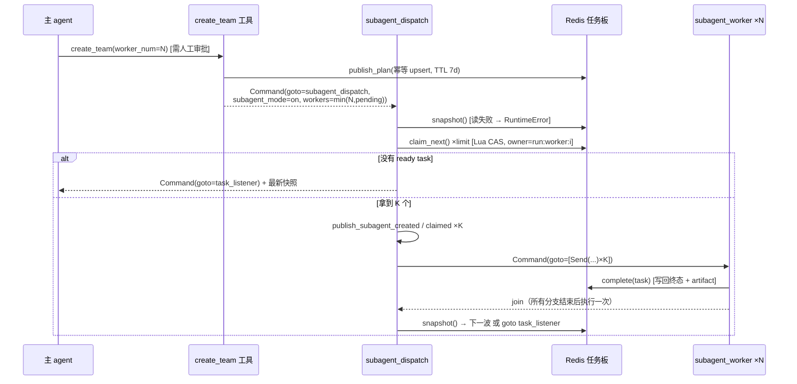
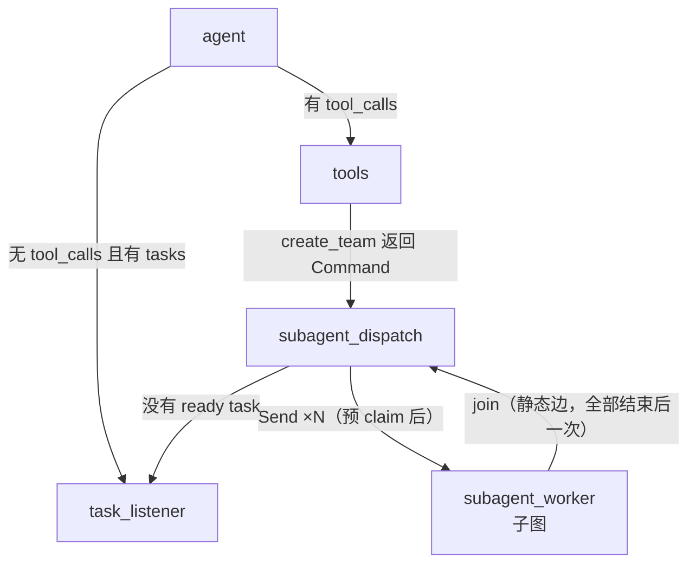
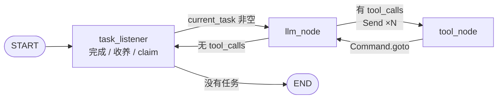
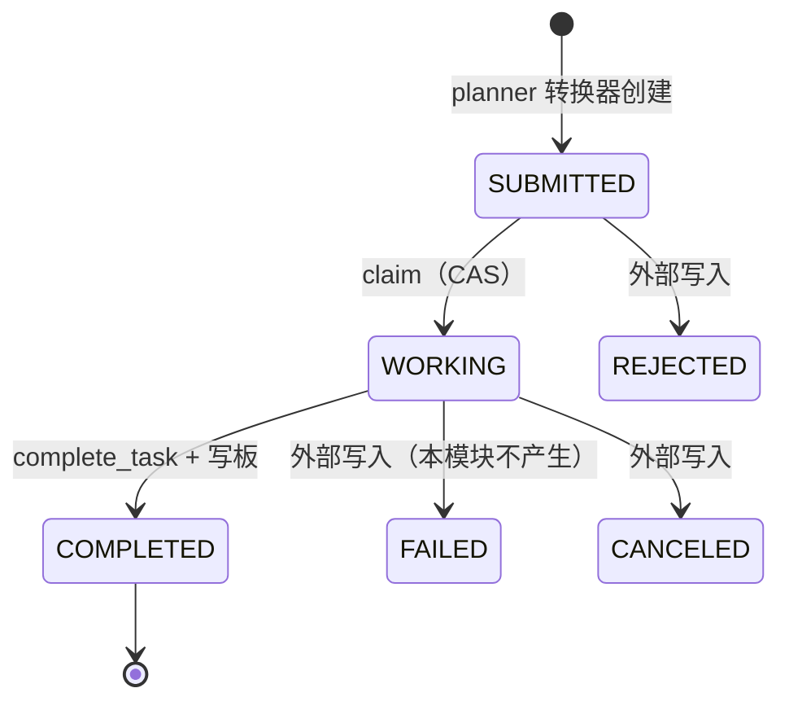
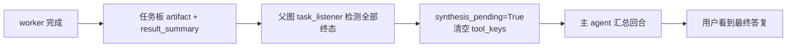

# README_SUB_AGENT.md — Sub-Agent 子代理模式

> YTraderHarness · 子代理（worker）事实手册
> 覆盖范围：`app/agent/graph/subagent/`、`app/agent/graph/react/subagent_dispatch_node.py`、`app/agent/plan/`、`app/agent/tools/task_tool.py`、`app/agent/context/builder/subagent.py`、`app/agent/event/subagent_events.py`。
> 本文只描述**代码里真实存在**的东西；注释与代码冲突处一律以代码为准并显式标注。

---

## 0. TL;DR

| 问题 | 一句话答案 |
|---|---|
| 子代理是什么？ | 一个 **worker 子图**：`task_listener → llm_node ↔ tool_node`，一次执行**一个**已 claim 的任务 |
| 怎么被拉起？ | `create_team` 审批通过 → `subagent_dispatch` 预 claim N 个任务 → `Command(goto=[Send(...)])` 扇出 N 个分支 |
| 一个分支跑几个任务？ | **一个**。`single_task=True`，完成即退出；下一波由 dispatch 重新扇出 |
| 谁 claim 任务？ | **父图** dispatch 预 claim（`owner={run_id}:worker:{i}`），worker 只"收养"，不再抢 |
| 为什么要预 claim？ | ① 两个 worker 同时抢板会互相踩 ② `Send` 的 payload **取代 state**，worker 看不到父图 `tasks` |
| 任务板是必须的吗？ | **是**。没有 Redis 任务板 → `subagent_dispatch` 退回主 agent 顺序执行（fail-closed） |
| 任务板读不到怎么办？ | **抛 `RuntimeError`**，整轮 failed。不假装"没有 ready task"，也不假装"派发成功" |
| worker 的结果去哪？ | Redis 任务板的 `artifacts` + `metadata.result_summary`；**不进**主对话 `messages` |
| 主对话怎么看到结果？ | 全部任务终态后，父图 `task_listener` 起一次**汇总回合**，把结果渲染成 HumanMessage 交给主 agent |
| 实现完整度 | 3 个节点全实现；42 个相关 pytest 通过（1.50s） |

---

## 1. 先分清三个"任务"

| # | 概念 | 载体 | 生命周期 | 谁写 |
|---|---|---|---|---|
| 1 | **A2A 计划任务** | `ReactState.tasks` / Redis `agent_task:*` | 7 天（跟计划） | planner 生成 → `create_team` 发布 → dispatch/worker 改状态 |
| 2 | **异步作业 TaskService** | `app/services/task/` + `/tasks` 路由 | 跟作业 | 业务代码 `TaskService.submit()` |
| 3 | **worker** | 一个 `Send` 分支 + 一个子图实例 | 一次任务 | `subagent_dispatch` 创建 |

第 2 项与本文**没有任何代码耦合** —— `/tasks` 那套是后台作业（handler / lease / lineage），名字撞车而已。

另一个容易混的点：**worker 不是独立进程**。它是同一进程内 LangGraph 的一个 `Send` 分支。所谓"并发"是 Pregel 的 super-step 内并发，不是多机调度。

---

## 2. 阅读地图

```
app/agent/graph/subagent/         1,056 行 —— worker 子图
├── catalog.py        124  图名/版本/节点目录/边/模型路由键
├── state.py          156  SubAgentState / SubAgentOutput（空）/ ToolPayload
├── nodes.py          574  task_listener / llm_node / tool_node
├── routing.py         83  route_after_listener / route_after_llm
└── graph.py           93  装配（output_schema 为空 schema，关键）

app/agent/graph/react/
├── subagent_dispatch_node.py   507   预 claim + Send 扇出 + 事件补发
├── graph.py                    worker 子图挂载 + join 静态边
└── task_listener_node.py       顺序执行 / 团队决策 / 汇总回合

app/agent/plan/
├── listener.py    722  claim 规则 / State+Redis 两种源 / Lua CAS / complete_task
├── publish.py     391  Redis 任务板（幂等 upsert / TTL / complete）
├── checks.py      191  pending / ready / has_parallel_ready / find_dependency_cycle
└── task_prompt.py 448  任务指令与结果渲染的**唯一**入口

app/agent/event/subagent_events.py   4 个生命周期事件
app/agent/context/builder/subagent.py  ContextBuilderType.SUB_AGENT（同一套 13 阶段）
app/agent/tools/task_tool.py          create_team（唯一真实派发入口）
```

---

## 3. 端到端时序



### 关键顺序（错了就出事故）

| 顺序 | 规则 | 反了会怎样 |
|---|---|---|
| 先写板，再 claim 下一个 | `nodes.py:212-215` | claim 成功后崩溃、完成态没写回 → 同一任务被另一个 worker 重跑 |
| 先发完成事件，再发新 claim 事件 | `task_listener_node.py:448-462` | 前端看到"新任务开始"早于"旧任务完成" |
| dispatch 每波重新读板 | 不缓存上一波 | 上一波 worker 刚写完的完成态看不到，会重复派发已完成的依赖下游 |

---

## 4. 拓扑

### 4.1 父图接入



装配在 `graph/react/graph.py`：

```python
graph.add_node(
    SUBAGENT_WORKER_NODE,
    build_subagent_graph().compile(),     # 编译后作为节点
)
graph.add_edge(SUBAGENT_WORKER_NODE, SUBAGENT_DISPATCH_NODE)   # join
```

> `subagent_dispatch` **没有静态出边**：有任务 → `Command(goto=[Send...])`；没有 → `Command(goto="task_listener")`。与 `tools` 的 handoff 约定一致。

> join 的实测语义（`graph.py:219-222` 注释）：**多个 Send 分支共用一个静态出边时，目标节点在全部分支结束后执行一次**，不是每分支一次。这是"下一波"能成立的前提。

### 4.2 worker 子图



| 节点 | group | 职责 | 失败处理 |
|---|---|---|---|
| `task_listener` | linear | 完成上一任务（写板）→ 收养 `pending_task` 或 claim 下一个 | Redis 写回失败只记日志、不抛 |
| `llm_node` | linear | 用子任务自己的上下文调模型（`run_agent_turn`） | **缺 `current_task` 或 builder 即报错**，不降级 |
| `tool_node` | fanout | 执行一个工具调用（`execute_tool_branch`） | 保留工具返回的 `graph`（可能是 `Command.PARENT`） |

> 节点 id 与主图同名的那个：`task_listener` 在两张图里**同名但是两个节点**（`catalog.py:18-21`）。节点 id 是**每张图**的契约键，不是全局键。

---

## 5. State 契约

### 5.1 `SubAgentState`（三组字段）

| 组 | 字段 |
|---|---|
| 对话 | `messages`（子任务自己的 transcript，`add_messages` 归约） |
| 任务 | `pending_task` / `current_task` / `single_task` / `tasks` / `plan` / `task_id` / `attempt` / `skill_key` / `worker_id` |
| 上下文 | `conversation_id` / `user_id` / `context_policy` / `summary` / `memory` / `retrieved_context` / `exposed_tools` / `context_result` / `task_tool_keys` |

第三组与主图**同名同形** —— 同一批 Context Processor 直接按这些路径绑定，不需要为子图再写一套处理器。

### 5.2 `SubAgentOutput` 是**空 schema**（`state.py:33`）

这是整个子代理模式最反直觉、也最关键的一处设计：

```python
class SubAgentOutput(TypedDict):
    """刻意是空的。"""
```

子图作为父图节点运行时，输出会按**同名 channel** 合并回父 state。任何在这里声明的键都会出问题：

| 如果声明了 | 后果 |
|---|---|
| `messages` | worker 的 transcript 追加进**主对话** |
| `tasks` / `plan` | 多个 worker 并发写同一 channel → 最后写者赢，或 `InvalidUpdateError` |

所以"子图状态不泄漏到父图"这条隔离的**正式落点就是这个空 schema**。结果只走任务板。

> 注释里有一句很直白："不要去加 `messages`，哪怕只为了调试。"

### 5.3 `SubAgentToolPayload`

```python
call / tool_keys / call_scope / return_to / is_controller
```

刻意**不带** `plan` / `tasks` / `plan_status`：计划控制工具不暴露给 worker。

---

## 6. 三个节点

### 6.1 `task_listener` —— 三态分支（nodes.py:107）

```
读 current / tasks / messages / pending
│
├── pending 非空  → ①【收养】父图预 claim 的任务
│                     清 transcript + 写 task_instruction_message
│                     返回 current_task / task_id / attempt / skill_key
│                     ❌ 不 claim、❌ 不完成
│
├── current 是 WORKING → ②【完成】complete_task(summary=最后一条 AI 正文[:4000],
│                                              result_text=全文)
│                              → _write_board_completion() 写 Redis
│                              → single_task 为真则直接退出（不 claim 下一个）
│
└── 其他 → ③【领取】claim_next(owner)；没有 → current_task={} → route 走 END
```

**① 为什么是"收养"而不是 claim**（`nodes.py:144-148`）：task 是 dispatch 预 claim 好的。若在这里走"完成"分支，任务会在**执行前**就被标成 `COMPLETED`。

**② 一任务一 worker**：`single_task` 由 dispatch 写死为 `True`（`subagent_dispatch_node.py:446`）。理由是一个 worker 吞掉整批任务会让其他 worker 空转。需要队列排空时置 `False`（listener 会继续 claim）。

**③ 清 transcript 的时机**：只在"完成上一任务并领到新任务"时清（`nodes.py:273-277`）。第二个任务不能看到第一个任务的工具结果与中间推理 —— 否则上下文污染、预算被吃。

```python
def _clear_messages(messages):
    """只对有 id 的消息发墓碑。"""
    return [RemoveMessage(id=m.id) for m in messages if getattr(m, "id", None)]
```

> 没有 id 的消息本来就不在 `add_messages` 的归约里（绕过 reducer 写入的消息不会进 state），发墓碑也没意义。

**写板失败语义**（`_write_board_completion`，nodes.py:525）：**只记日志、不抛**。理由：worker 成果已经在 `complete_task` 里成形，这里抛会让一次已完成的工作变成 failed，而任务板上的 lease 本来会到期重试。但**不能静默** —— 写失败意味着父图看不到这次完成，必须留痕。`task_board is None` 是合法状态（本地冒烟），此时不假装写成功。

### 6.2 `llm_node` —— 两个硬守卫（nodes.py:312）

```python
task = _current_task(state)
if not isinstance(task, Mapping) or not task:
    raise RuntimeError("llm_node 没有 current_task：...")

builder = getattr(context, "subagent_builder", None)
if builder is None:
    raise RuntimeError("ReactContext.subagent_builder 未注入：...")
```

**为什么缺 `current_task` 要报错而不是降级**：缺它时 `ContextBuilder` 的 `task_mode=False`，`TASK_RESOLVER` / `SKILL_LOADER` 会**静默跳过**，worker 带着默认策略跑 —— 症状是"模型答得很泛"，没有任何报错。这比当场失败难查得多。

**为什么没有 `subagent_builder` 也要报错**：回落到主图 builder 会让 worker 看到父对话、沿用父职责提示词 —— 等于"子代理"只是换了个节点名。

调用本体是主图的 `run_agent_turn`，只换四个参数：

```python
run_agent_turn(
    state, runtime,
    spec=_SPEC_LLM,
    builder=builder,                  # SUB_AGENT builder
    builder_type=ContextBuilderType.SUB_AGENT,
    agent_type="subagent",
    model_role=ModelRole.REASONING,
    state_update_keys=("summary", "memory", "task_tool_keys"),  # 写回**子图** state
    tag_task_result=True,             # 结果带任务标记
)
```

> `_STATE_UPDATE_KEYS` 与主图**同形但不同目标**：主图写 `ReactState`，这里写 `SubAgentState`。**不要**把这些键写回父图。

### 6.3 `tool_node` —— 控制器规则（nodes.py:367）

```python
result = await execute_tool_branch(state, runtime, config,
                                  spec=_SPEC_TOOL,
                                  scope_namespace=SUBAGENT_TOOL_SCOPE_NAMESPACE)
update = {"messages": [result.message]}
if result.command is not None:
    update.update(command_update(result.command))

if not state.get("is_controller", True):
    return update                     # 非控制器只写消息

if result.command is not None and result.command.goto:
    return Command(graph=result.command.graph,   # 原样保留（可能是 Command.PARENT）
                   goto=result.command.goto,
                   update=update)

return Command(goto=str(state.get("return_to") or LLM_NODE), update=update)
```

三个要点：

1. **一个 super-step 只能有一个 `Command`** —— 所以只有本批第一个调用（`is_controller`）决定跳转。
2. **必须保留 `graph`**：工具可能返回 `Command.PARENT`（往父图跳）。与 planner 子图相反 —— planner **拦截**跨图 Command，worker **透传**。差别在于：planner 是"只规划、不该控制父图"，worker 是"执行型工具可能合法地要求结束 / 跳父图"。
3. **第三个参数 `config` 是 langgraph 注入的**：`ToolRuntime` 要它拿 `configurable.thread_id`，审批账本按 thread/run 归档。

执行本体完全复用主图：

| 复用项 | 位置 |
|---|---|
| 允许集校验（`select_specs`） | `infra/agent/tool_executor.py` |
| 处理器链（审批 / 脱敏 / 缓存 / 鉴权） | 同上 |
| 观测（tool span / branch_key） | 同上 + `SUBAGENT_TOOL_SCOPE_NAMESPACE` |

> `SUBAGENT_TOOL_SCOPE_NAMESPACE` 与主图的 `REACT_TOOL_SCOPE_NAMESPACE` **必须分开**：否则共享 `call_scope` 时可能算出同一个 `branch_key`，观测行会合并成一行（`catalog.py:77-84`）。

---

## 7. 并发正确性

### 7.1 为什么父图预 claim（`subagent_dispatch_node.py:21-25`）

| 问题 | 不预 claim 的后果 |
|---|---|
| 两个 worker 同时抢板 | 各自看到同一批 ready，重复执行 |
| `Send` payload 取代 state | worker 根本看不到父图的 `tasks` |
| 谁跑哪个不确定 | 观测 / 排查时无法回答"这个任务是谁跑的" |

父图先 CAS 好、再把**已 claim 的任务**放进 payload，谁跑哪个任务是确定的。

### 7.2 Redis Lua CAS

```lua
local raw = redis.call('HGET', KEYS[1], 'task')
if not raw then return nil end
local task = cjson.decode(raw)
local state = task['status']['state']
if state ~= 'TASK_STATE_SUBMITTED' and state ~= 'submitted' then return nil end
task['status']['state'] = 'TASK_STATE_WORKING'
task['metadata']['claim'] = claim   -- attempt 在此递增
redis.call('HSET', KEYS[1], 'task', cjson.encode(task), 'state', 'TASK_STATE_WORKING')
return cjson.encode(task)
```

**抢输的处理**（`listener.py:527-558`）：该任务从本地快照移除，重选下一个。`while True` 是**有界**的 —— 每轮要么 claim 成功、要么候选集少一个，最终 `select_ready` 返回 None 退出。不是无界循环。

### 7.3 claim 内容

```json
{
  "owner": "{pipeline_run_id}:worker:{i}",
  "token": "uuid4",
  "claimed_at": "2026-10-12T07:00:00Z",
  "lease_expires_at": "2026-10-12T07:05:00Z",
  "attempt": 1
}
```

| 字段 | 用途 |
|---|---|
| `owner` | 判断"这个任务是不是我领的"。dispatch 按 worker 编号生成，稳定且唯一 |
| `token` | 幂等 / 防误释放的挂点（当前代码只写不校验） |
| `lease_expires_at` | `claimed_at + DEFAULT_LEASE_SECONDS(300)` |
| `attempt` | 每次 claim 递增；写进任务的 `metadata.claim.attempt`，进观测 |

> ⚠️ **lease 只写不续租**。代码里没有任何续租 / 过期回收实现：`is_ready` 只认 `SUBMITTED + claim 为空`，不检查 lease 是否过期。所以一个 lease 过期但状态仍是 WORKING 的任务**不会被本代码自动收回**。详见 §15。

---

## 8. 任务状态机



### `is_ready` 的三个条件（listener.py:179）

```python
status_state(task) in SUBMITTED          # ① 状态可领
and not (isinstance(claim, Mapping) and claim)   # ② 未被认领（空 dict / None 才算）
and all(status_state(by_id[dep]) in COMPLETED    # ③ 依赖全部完成，且依赖存在
        for dep in blocked_by(task))
```

第三个条件里的 `by_id.get(dep) is None → return False` 是**悬空依赖**：依赖指向计划外的 id，该任务永远不 ready。

### 状态集合

| 集合 | 成员 |
|---|---|
| `SUBMITTED` | `TASK_STATE_SUBMITTED`, `submitted` |
| `WORKING` | `TASK_STATE_WORKING`, `working` |
| `COMPLETED` | `TASK_STATE_COMPLETED`, `completed` |
| `TERMINAL` | COMPLETED / FAILED / CANCELED / REJECTED（各含 snake 别名） |

> 兼容 snake 与大写两种写法是为老数据与手写 task 留的口子；A2A `MessageToDict` 产出的永远是大写。

### 死锁与空转

| 情形 | 判定 | 处理 |
|---|---|---|
| 无 ready，有 WORKING | 波次没走完 / 外部 worker | 记 note，结束本轮（`publish_plan_cleared(reason="subagent_waiting")`） |
| 无 ready，无 WORKING | **依赖死锁** | 记 note，清空 tasks，结束本轮 → 下一轮重规划 |
| 还有未完成但无 ready，顺序模式 | 同上 | `reason="no_ready_task"` |

两种情况都**不 spin**（不在节点里等），也不清掉任务板（板才是权威）。

### `complete_task` 写什么（listener.py:248）

| A2A 字段 | 内容 |
|---|---|
| `status.state` | `TASK_STATE_COMPLETED` + timestamp |
| `metadata.claim` | `{}`（释放） |
| `metadata.result_summary` | 最后一条 AI 正文的前 4000 字 |
| `artifacts[]` | `artifactId="{task_id}:result:1"`，`name="task_result"`，parts = data part（可选）+ text part（全文） |
| `history[]` | 只追加一条状态消息（摘要 + 指向 artifact），**不重复放全文** |

分工与 A2A 语义一致：`history` 是理解任务的指令，`artifacts` 是最终交付物，`metadata` 是调度元信息。

> 重试时同一 `artifactId` 会被**替换**而不是堆多份（`listener.py:334-340`）。

---

## 9. 任务板

### 9.1 键结构（publish.py:15-30）

| 键 | 类型 | 内容 |
|---|---|---|
| `agent_task:{task_id}` | HASH | `task`（canonical JSON）/ `state` / `context_id` / `plan_id` / `revision` / `claim` / `updated_at` |
| `agent_tasks:{context_id}` | SET | 按会话枚举 task_id |
| `agent_plan:{plan_id}:{revision}` | HASH | `ready=1` / `context_id` / `task_count` / `updated_at` |
| `agent_plan_tasks:{plan_id}:{revision}` | SET | 按计划枚举 task_id |

TTL = `DEFAULT_TTL_SECONDS = 7 * 24 * 3600`（**跟计划走，不跟 run 走**）。

> ⚠️ `agent_run:{run_id}` 是实时 UI 事件流（600 秒、有 maxlen），**不能当任务板**。任务要跨 run 存活。

### 9.2 三条语义

| 语义 | 实现 | 代价 |
|---|---|---|
| **幂等：已存在不覆盖** | `hexists(key,"task")` 为真则 `skipped += 1`，不重写 task/state/claim | "同一 id 内容变更"不生效 —— 重规划必须产生新 revision |
| **发布失败不掩盖** | `RedisTaskBoard.publish` 让异常上抛；`publish_plan` 收成 `degraded=True, reason=...` | 上层必须显式处理 `degraded` |
| **complete 不建行** | 行不存在 → `return False`（不是"完成成功"） | 调用方必须把 `False` 当失败 |

`complete` **不刷新也不缩短 TTL** —— 生命周期跟计划走。凭空补一行会让父图同步看到一个从未发布过的任务。

### 9.3 `publish_plan` 的返回

```python
PublishResult(published=K, skipped=M, degraded=False, reason="")
```

`degraded=True` 只有两种来源：
1. `board is None`（Redis 未装配）→ `reason="Redis 任务板未装配（redis.yaml 未启用或连接不可用）。"`
2. `board.publish` 抛异常 → `reason=f"{type(exc).__name__}: {exc}"`

`create_team` 收到 `degraded` 后返回 `ok=false, reason="task_board_unavailable"`，**不**返回 Command → 不切模式、不派发。

---

## 10. Fail-closed 矩阵

| 故障点 | 处置 | 是否 fail-closed |
|---|---|---|
| Redis 未装配（dispatch） | 检测到 `StateTaskSubscriber` → `subagent_mode="off"`，`goto="task_listener"`，退回顺序执行 | ✅ 不派发 |
| 读任务板失败（dispatch `snapshot()`） | `raise RuntimeError("subagent_dispatch：读取任务板失败，拒绝派发 worker。")` | ✅ 整轮 failed |
| `snapshot()` 返回 `None` | `raise RuntimeError("...任务板返回空快照，拒绝派发 worker。")` | ✅ 整轮 failed |
| claim 时 Redis 异常（subscriber） | 记 warning，`return None`（本轮不领取任务） | ⚠️ 视为"暂时没活"，不失败 |
| worker 写回完成态失败 | 记 `logger.exception`，不抛（成果已在 state 里成形） | ⚠️ 靠 lease 兜底（但无续租，见 §15） |
| `llm_node` 缺 `current_task` | `RuntimeError` | ✅ 整轮 failed |
| `llm_node` 缺 `subagent_builder` | `RuntimeError` | ✅ 整轮 failed |
| Redis 读板在 listener 里失败 | `返回 None` → 当作"没有可领的任务" | ⚠️ 见 `listener.py:519` 注释 |

设计取舍很明确（`subagent_dispatch_node.py:27-37`）：**state 源没有跨分支的权威 claim**，两个 worker 各拿一份副本必然重复执行。所以宁可退回慢一点但正确的顺序执行，也不假装并行。

---

## 11. 上下文隔离

### 11.1 worker 的基线策略（`_WORKER_POLICY`，dispatch 节点）

| 开关 | 值 | 理由 |
|---|---|---|
| `include_history` | `True` | 任务指令就是历史里的 HumanMessage |
| `include_summary` | `True` | 长对话的压缩摘要 |
| `include_capabilities` | `True` | 任务要靠能力工具执行 |
| `include_user_profile` | `False` | MVP 不接画像 |
| `include_memory` | `False` | MVP 不接记忆 |
| `include_retrieved_context` | `False` | MVP 不接知识检索 |
| `allow_compaction` | `True` | worker 可能是长工具循环 |

**从父策略只继承 4 个键**（`_INHERITED_POLICY_KEYS`）：

```
max_recent_turns / min_recent_turns / max_history_tokens / max_input_tokens
```

**刻意不继承** `system_prompt` 与 `tool_keys` —— 那会把主对话的职责提示词与主 agent 的工具带进子任务。`TASK_RESOLVER` / `SKILL_LOADER` 会在子图里按任务重算这两项。

### 11.2 context 构建

`ContextBuilderType.SUB_AGENT` → `SubAgentProcessorContextBuilder`：

- 声明**全部 13 阶段**，但跑不跑由 Processor 的 `when` gate 与 `context_policy` 决定（不在类里硬砍阶段）。这样以后给子任务开画像 / 记忆 / 知识时不用改这个类。
- `required_stages` 只有 `CONTEXT_RESOLVER` + `PROMPT_ASSEMBLER`。`TASK_RESOLVER` / `SKILL_LOADER` 带 gate，声明成 required 会让流水线在构造期报"required 阶段上的 Processor 必须 `when=None`"。
- 回写子图 state 的键：`summary` / `memory` / `task_tool_keys`。

### 11.3 隔离的四个理由（state.py:3-12）

| 目的 | 说明 |
|---|---|
| 隔离 | 子任务看不到主对话全文，避免越权回答与预算浪费 |
| 并发 | 多个 worker 并发写同一 channel 会互相覆盖 |
| 恢复 | 子图是父图的**节点**，状态存父 thread 的嵌套 namespace；不再是 `{parent}:subagent:{task}:attempt` 独立 child thread |
| 体积 | transcript 留在子图 namespace，不并回父 `messages` |

---

## 12. 观测

### 12.1 四个事件

| 事件 | 发射点 | 作用 |
|---|---|---|
| `subagent.created` | dispatch（每个预 claim 的 worker） | 开泳道 |
| `subagent.claimed` | dispatch | 往泳道放任务（带 task 快照 + `worker_id`） |
| `subagent.task.updated` | dispatch（**下一波读板后补发**） | 状态变化 |
| `subagent.completed` | dispatch | 终态，泳道收口 |

### 12.2 为什么由**父图**补发

worker 是独立 `ainvoke` 的子图，它的 custom writer **不是**父运行那条流。worker 完成时只写任务板与子图 checkpoint；父图在这一波 join 之后才看得到终态。所以对比"上一轮 state 快照"与"任务板最新快照"，由 dispatch 统一发事件 —— 单一来源，而不是"收不到就各处补"。

### 12.3 两条刻意不发的规则

| 规则 | 理由 |
|---|---|
| `SUBMITTED → WORKING` **不发** `subagent.task.updated` | 那是 claim 的语义，`publish_subagent_claimed` 已发一条更完整的事件。两处都发会让前端收到重复的"任务开始" |
| `worker_id` 从**上一轮**的 claim 里取 | 完成时 `claim` 已被清空，只能从 `before` 快照里读 |

### 12.4 worker 不发 plan 事件

worker 不碰 `task_events`：计划面板属于父图，worker 只写任务板（`nodes.py:31-35`）。

---

## 13. 结果怎么回到主对话



### 三条硬约束

1. **worker 的 `messages` 永不进父 `messages`** —— `SubAgentOutput` 是空 schema（§5.2）。
2. **结果只从任务板读**：`_result_text()` 优先 `metadata.result_summary`，否则取 `artifacts[].parts[].text`（`task_prompt.py:395`）。
3. **汇总回合不再暴露工具**：`_synthesis_policy` 把 `tool_keys` 清空、`include_capabilities=False`，逼模型直接作答而不是继续调工具。

汇总回合的 HumanMessage 由 `task_results_message()` 渲染：

```
## 任务结果
### <plan_id>:t1（skill=research，status=TASK_STATE_COMPLETED）
<结果正文或"（该任务没有产出结果）">

## 计划中的待确认项
- ...

请基于以上结果直接回答用户……不要重新发布任务，不要声称结果稍后给出。
若有任务失败或被取消，请说明失败项与原因。
```

---

## 14. 配置

| 项 | 值 | 位置 |
|---|---|---|
| 图名 | `agent_subagent` | `catalog.py:48` |
| 拓扑版本 | `0.1.0` | `catalog.py:51` |
| 模型路由键 | `agent_type="subagent"` + `model_role=REASONING` | `catalog.py:68-71` |
| Context Builder | `ContextBuilderType.SUB_AGENT` | `catalog.py:74` |
| Builder 注入 | `ReactContext.subagent_builder` | `react/runtime.py:208` |
| 工具 scope 命名空间 | `SUBAGENT_TOOL_SCOPE_NAMESPACE` | `catalog.py:82` |
| lease | `DEFAULT_LEASE_SECONDS = 300` | `listener.py:82` |
| 任务板 TTL | `7 天` | `publish.py:83` |
| 摘要截断 | `_SUMMARY_LIMIT = 4000` | `nodes.py:88` |
| 汇总里单任务结果截断 | `_RESULT_LIMIT = 4000` | `task_prompt.py:383` |
| worker 上限 | `min(worker_num, 待完成任务数)` | `task_tool.py:293` |
| 派发上限读取 | `max(1, int(subagent_workers or 1))` | `subagent_dispatch_node.py:467` |

### `subagent_mode` 的取值

| 值 | 写入点 | 含义 |
|---|---|---|
| `"on"` | `create_team` / `subagent_dispatch` | 任务板优先，可派发 |
| `"off"` | `enter_plan_mode` / `exit_plan_mode` / dispatch 退回 / `task_listener` 收尾 | 顺序执行 |

> ⚠️ `ReactState.subagent_mode` 的注释列了四个取值（`off` / `pending` / `on` / `denied`），但**代码实际只写 `on` / `off`**。`pending` / `denied` 目前只是文档预留。团队决策那一次询问用的是**另一个字段** `team_decision`（取 `""` / `pending` / `declined`），别把两者搞混。

### `worker_num` 校验（task_tool.py:214）

```python
if isinstance(worker_num, bool) or not isinstance(worker_num, int) or worker_num < 1:
    return _tool_error("create_team", reason="invalid_worker_num", ...)
```

`isinstance(True, int)` 在 Python 里为真，所以必须**先**排除 `bool`。

---

## 15. 验证

```bash

./.venv/Scripts/python.exe -B -m pytest \
  tests/agent/graph/test_subagent_graph.py \
  tests/agent/graph/test_subagent_dispatch.py \
  tests/agent/graph/test_task_listener.py \
  -q --no-header -p no:cacheprovider
```

**实测结果（Python 3.14.5 / pytest 9.1.1）**

```
42 passed in 1.50s
```

### 测试覆盖对照

| 断言 | 测试用例 |
|---|---|
| 三节点 + 预期边 | `test_graph_has_three_nodes_and_expected_edges` |
| **输出 schema 为空** | `test_subagent_output_schema_is_empty` |
| 三节点函数都注册 | `test_graph_module_registers_all_three_functions` |
| 领到任务 → llm_node | `test_route_after_listener_goes_to_llm_when_claimed` |
| 没任务 → END | `test_route_after_listener_ends_without_task` |
| 一调用一 Send | `test_route_after_llm_sends_one_tool_branch_per_call` |
| 无 tool_calls → 回 listener | `test_route_after_llm_returns_to_listener_without_tool_calls` |
| 领第一个 ready | `test_listener_claims_first_ready_task` |
| 完成上一任务 + 清 transcript | `test_listener_completes_previous_and_clears_transcript` |
| **收养预 claim 的 pending_task** | `test_listener_adopts_preclaimed_pending_task` |
| `single_task` 完成后退出 | `test_listener_single_task_exits_after_completion` |
| 没有 ready → END | `test_listener_ends_when_no_ready_task` |
| 三节点循环跑通并结束 | `test_graph_runs_three_node_loop_and_ends` |
| **缺 current_task 必须报错** | `test_llm_node_requires_current_task` |
| SUB_AGENT builder 能被发现 | `test_subagent_builder_is_discovered` |
| **预 claim + 扇出** | `test_dispatch_preclaims_and_fans_out` |
| 下一波领剩下的 | `test_dispatch_next_wave_claims_remaining` |
| 没有 ready → 回 listener | `test_dispatch_routes_to_listener_when_nothing_ready` |
| **无任务板 → 退回顺序** | `test_dispatch_without_board_falls_back_to_sequential` |
| 父图把 worker 接成子图节点 | `test_parent_graph_wires_worker_as_subgraph` |
| **worker messages 不并回父图** | `test_subgraph_node_does_not_merge_worker_messages` |
| 端到端：dispatch + worker + 子图 | `test_end_to_end_dispatch_worker_and_subgraph` |
| 发布写行 / 索引 / ready 标记 | `test_publish_writes_task_rows_indexes_and_ready_marker` |
| 幂等且保留运行态 | `test_publish_is_idempotent_and_keeps_runtime_state` |
| 无板时 `degraded` | `test_publish_degrades_when_board_is_missing` |
| 只有 1 个 ready 不算并行 | `test_single_ready_task_is_not_parallel` |
| WORKING 不算 ready | `test_working_tasks_are_not_ready` |
| 依赖完成才解锁并行 | `test_completed_blockers_unlock_parallel_tasks` |

---

## 16. 已知边界（读代码确认，不是猜测）

| 边界 | 事实 | 影响 |
|---|---|---|
| **lease 只写不续租** | `claim` 里写了 `lease_expires_at`，但 `app/agent/plan/` 下**没有任何续租或过期回收代码**；`is_ready` 也不检查 lease | 一个 worker 崩溃后，任务会永久停在 WORKING，不会被本代码自动收回 |
| **worker 不是独立进程** | `Send` 分支，同进程内 Pregraph 并发 | 不能跨机横向扩容；也共享同一个事件循环 |
| **一任务一 worker** | dispatch 写死 `single_task=True` | 单个 worker 不会连续吃任务；任务多时靠多波扇出 |
| **`subagent_mode` 只写 on/off** | `pending` / `denied` 仅存在于 state 注释 | 不要按四个取值写消费代码 |
| **没有 HTTP 端点** | 计划任务无 REST 面；`app/api/v1/tasks.py` 是异步作业 | 外部系统看不到 worker 进度，只能看事件流 |
| **4 个任务工具是占位** | `create_task` / `claim_task` / `update_task` / `complete_task` 全返回 `not_implemented=true` | worker 无法在工具里自建子任务或手动完成任务 |
| **`_worker_limit` 无硬上限** | `max(1, int(subagent_workers or 1))`，只受 ready 数约束 | `create_team(worker_num=100)` 且 ready 有 100 个时就会开 100 个分支 |
| **Redis claim 异常被吞** | `RedisTaskSubscriber._cas_claim` 记 warning 后 `return None` | 与"真的没有任务"不可区分；dispatch 侧靠 `snapshot()` 的 fail-closed 兜一层 |
| **依赖 `create_team` 审批** | 工具体只在审批通过后执行 | 审批拒绝 → 不切模式、不起 worker（这是正确行为，但意味着无人审批时并行永远不会发生） |
| **worker 完成后 claim 被清空** | `complete_task` 把 `metadata.claim` 置 `{}` | 事后追溯"谁跑的"只能靠事件流或 `result_summary`，任务行上没有 owner |

---

## 17. 常见坑

1. **给 `SubAgentOutput` 加字段** —— 会按同名 channel 合并回父 state：`messages` 直接污染主对话，`tasks`/`plan` 并发写会 `InvalidUpdateError`。**不要加，哪怕只为了调试。**
2. **在 `task_listener` 里对 `pending_task` 走"完成"分支** —— 任务会在执行前就被标 `COMPLETED`。它必须走"收养"。
3. **先 claim 下一个再写完成态** —— 写完 claim 崩溃会让同一任务被另一个 worker 重跑。顺序必须是"先写板，再 claim"。
4. **让 worker 自己抢板** —— `Send` payload 取代 state，worker 看不到父图 `tasks`；多 worker 并发必然重复认领。
5. **在 `llm_node` 里把缺 `current_task` 降级成空 dict** —— `TASK_RESOLVER` / `SKILL_LOADER` 会静默跳过，症状是"答得很泛"，极难查。
6. **回落到主图 builder** —— worker 会看到父对话、沿用父职责提示词，子代理等于没拆。
7. **在 `tool_node` 里丢掉 `result.command.graph`** —— 工具可能返回 `Command.PARENT`，丢掉 graph 就跳不到父图。
8. **让 worker 发 plan 事件** —— 计划面板属于父图，worker 发会让面板状态错乱。
9. **把 `agent_run:{run_id}` 当任务板** —— 那是 600 秒的事件流，任务跨 run 就丢了。
10. **以为 `complete()` 返回 True 就一定成功** —— 它只表示"行存在且已更新"；返回 `False` 是"任务板里没这行"，必须当失败处理。
11. **在 dispatch 里缓存上一波快照** —— worker 完成态是下一波读板才可见的，缓存会重复派发已完成的依赖下游。
12. **给 `subagent_worker` 加 `retry_policy`** —— 与主图同一条理由：模型重试归 Model Runtime，节点重试会重跑整个节点并重放工具副作用。
