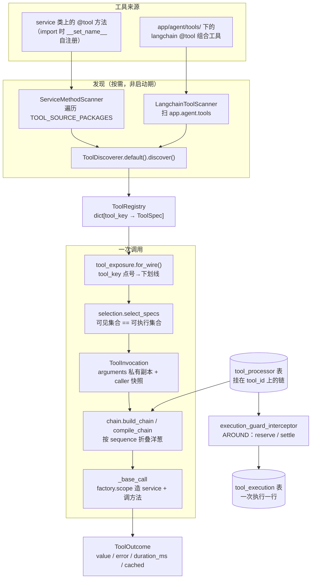
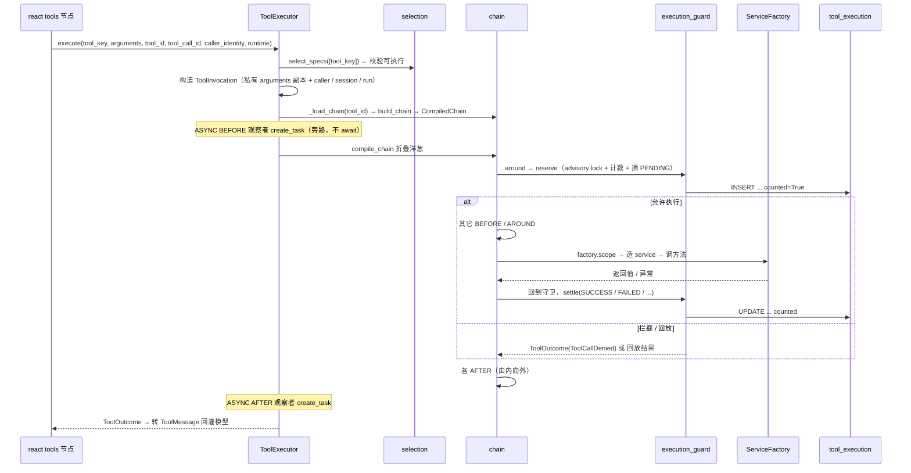

# TOOL_README.MD — Tool 子系统

> YTraderHarness · Tool 子系统事实手册
> 覆盖范围：`app/services/tool/`（定义 / 注册 / 发现 / 管理）、`app/agent/tools/processor/`（处理器链 / 拦截）、`app/infra/agent/`（执行器 / 暴露）、`app/api/v1/{tools,tool_processors,processors,capabilities}.py`。
> 本文只描述**代码里真实存在**的东西；注释与代码冲突处一律以代码为准并显式标注。

---

## 0. TL;DR

| 问题 | 一句话答案 |
|---|---|
| 工具怎么定义？ | 把方法挂在一个 service 类上，加 `@tool` 装饰器；装饰器同时生成 langchain 工具与注册表描述符 |
| 工具从哪来？ | 三路扫描：`@tool` 自注册（import 时）+ `ServiceMethodScanner` 遍历 `TOOL_SOURCE_PACKAGES` 触发未 import 模块 + `MCPToolScanner` 按 `mcp.yaml` 连外部 server 取 `tools/list` |
| 模型看到的函数名是什么？ | `tool_key` 的点号会被换成下划线（`capability.list` → `capability_list`），因为 OpenAI 函数名不允许点号 |
| 一次工具调用会经过什么？ | 处理器链：`select_specs` 鉴权 → 构造 `ToolInvocation` → 加载 `tool_processor` 表里的链 → 折叠洋葱 → `_base_call` 真正调 service 方法 |
| 危险工具谁来管？ | `approval_interceptor`（HITL）：挂 `BEFORE`，调 langgraph `interrupt()` 挂起图，等 `POST /runs/{id}/resume`；批准账本落 PostgresStore，重启不重复问 |
| 重复调用怎么管？ | 处理器链上的 `execution_guard_interceptor`（AROUND）：按 scope（SESSION / RUN / USER / GLOBAL）× execution（METHOD / INVOKE）计数，一次执行一行；success / error / unknown 三种状态各自独立配额，超限按各自的 action 拦截 |
| 有工具级超时/重试吗？ | **没有**，且是刻意不设（重试在模型运行层与图节点层） |

---

## 1. 阅读地图

```
app/services/tool/                    ← 定义 / 注册 / 发现 / 管理
├── registry/
│   ├── decorator.py      ← @tool 装饰器、ToolDescriptor、source_ref/tool_key 推导
│   ├── scanner.py        ← 两个扫描器（service 方法 / langchain 工具）
│   ├── discoverer.py     ← 装配两个扫描器、合并清单、冲突检测
│   ├── registry.py       ← ToolRegistry（按 tool_key 索引）+ TOOL_SOURCE_PACKAGES
│   ├── spec.py           ← ToolSpec / ToolDescriptor 数据与推导规则常量
│   ├── schema.py         ← 函数签名 → JSON Schema
│   ├── docstring.py      ← docstring → 参数/返回值说明
│   ├── selection.py      ← select_specs（可见=可执行）+ wire_name / tool_key_of
│   └── processor_registry.py ← 处理器注册表
├── application/          ← 查询 / 发现同步 / 文档 / 处理器 / 分类 服务
├── models/sqlalchemy/    ← 6 张表
├── repository/           ← 接口 + *_impl 实现
└── domain/schemas/       ← DTO / 枚举

app/agent/tools/
├── time_tool.py          ← 最简工具示例（刻意不写 TOOL_SOURCE_REF）
├── catalog_tool.py       ← 组合工具示例（写了 TOOL_SOURCE_REF）
└── processor/
    ├── base.py           ← BaseToolProcessor + 三类子类
    ├── context.py        ← ToolInvocation / ToolOutcome / ToolCallDenied
    ├── interceptor/      ← approval.py（HITL）/ auth.py / cache.py
    ├── transformer/      ← privacy.py
    ├── observer/         ← events.py / metrics.py
    └── runtime/          ← events.py / cache.py / metrics.py

app/infra/agent/
├── tool_executor.py      ← 执行入口（ToolExecutor.execute）
├── tool_exposure.py      ← 暴露给模型（RegistryToolExposureSource）
└── chain.py              ← 链编译与洋葱折叠（build_chain / compile_chain）
```

---

## 2. 全貌



**一句话架构**：工具是「注册表里的描述符 + 表里挂的处理器链 + 执行器里的洋葱折叠」三件套。模型只看到 `wire_name`，执行只认 `tool_key`，两者是**同一集合**的两个投影。

---

## 3. 工具如何定义

### 3.1 装饰器

```python
tool(func=None, *, key=None, name=None, description=None)
```

定义在 `app/services/tool/registry/decorator.py:270`。返回 `ToolDescriptor(StructuredTool)` —— **同时是 langchain 工具（模型侧）与描述符（调用点侧）**。

生命周期：

| 时机 | 行为 | 位置 |
|---|---|---|
| 类体执行 `__set_name__` | 从 `owner` 推 `source_ref`，写进注册表 | `decorator.py:146` |
| 实例访问 `__get__` | 返回绑定方法 | `decorator.py:190` |
| 类访问 `__get__` | 返回工具本体 | `decorator.py:190` |

约束：

- `owner` 必须存在（方法必须挂在类上，不能是模块级函数）—— `spec.py:144` 校验。
- 同步/异步皆可，按 `iscoroutinefunction` 落到 `func` / `coroutine` 字段 —— `decorator.py:319`。
- 参数推荐**单一 pydantic 请求模型**；否则回退到按签名合成 schema —— `schema.py:44` `resolve_request_model`。
- `description` 声明优先，否则回退 docstring —— `decorator.py:334`。

### 3.2 最小真实示例（`app/agent/tools/time_tool.py:54`）

```python
@tool
async def current_time(timezone: str = DEFAULT_TIMEZONE) -> dict:
    """
    查询当前的日期与时间。用于回答"今天几号""现在几点""今天星期几"。
    ...
    """
    zone = _resolve_timezone(timezone)
    now = datetime.now(zone)
    return {...}
```

组合工具（langchain 原生 `@tool`，跨 service）见 `app/agent/tools/catalog_tool.py:32` 的 `describe_platform`。

外部 HTTP API 工具见 `app/agent/tools/web_tool.py` 的 `search` /
`fetch`（tool_key `web.search` / `web.fetch`，DeepSeek Search &
Fetch API）。配置模板是 `app/config/web.yaml.template`；未配置时从
`llm.yaml` 的 deepseek provider 取 key 与站点根，最后回落
`DEEPSEEK_API_KEY`。

### 3.3 四个身份的推导规则

| 字段 | service 方法 | langchain 工具 | 规则出处 |
|---|---|---|---|
| `source_type` | `LOCAL_METHOD`（硬编码） | `LOCAL_METHOD`（硬编码） | `scanner.py:82`、`:161` |
| `source_ref` | `derive_source_ref(owner.__module__)` | 模块级 `TOOL_SOURCE_REF`，缺省则同样推导 | `decorator.py:165`、`scanner.py:213`、`registry.py:203` |
| `entrypoint` | `owner.__module__:owner.__qualname__.method` | 底层函数 `__module__:__qualname__` | `spec.py:268`、`spec.py:251` |
| `tool_key` | `f"{source_ref}.{name}"`（显式 `key` 优先） | `f"{source_ref}.{name}"` | `decorator.py:168`、`scanner.py:224` |

`source_ref` 的分组规则（`spec.py:39`）：

```
app.x                    → x
app.services.<模块>      → <模块>            （取第三段）
其它                     → 取最后一段
```

**`TOOL_SOURCE_REF` 的优先级**：模块属性为非空 `str` 时采用，否则推导 —— `scanner.py:213-219`。变量名常量 `SOURCE_REF_VARIABLE = "TOOL_SOURCE_REF"` 在 `spec.py:36`。

> ⚠️ `time_tool.py` **刻意不写** `TOOL_SOURCE_REF` —— 它的 docstring 明说：写了就等于给它单开一个"来源"。因此 `agent.current_time` 的 `source_ref` 是推导出来的 `agent`，而不是某个自定义分组。这条设计直接导致了 `tool_smoke` 的一条断言过期（见 §14）。

### 3.4 `SourceType` 枚举

`enum.py:41` 定义了 `LOCAL_METHOD` / `MCP` / `OPENAPI`。

| 取值 | 扫描器 | 状态 |
|---|---|---|
| `LOCAL_METHOD` | `ServiceMethodScanner` / `LangchainToolScanner` | 已实现 |
| `MCP` | `MCPToolScanner`（`registry/mcp_scanner.py`） | 已实现，按 `mcp.yaml` |
| `OPENAPI` | 无 | 仍属预留 |

---

## 4. 发现机制

### 4.1 扫描的包

`TOOL_SOURCE_PACKAGES`（`registry.py:53`）：

```python
app.services.document.application
app.services.file.application
app.services.memory.application
app.services.tool.application
app.agent.tools
```

### 4.2 时机与装配

- **按需，非启动期预热**。`ToolDiscoverer.default()` 装配三个扫描器（`discoverer.py`），`discover()` **每次重扫、无状态**。
- `@tool` 方法在 import 时已自注册；`ServiceMethodScanner.scan()` 额外遍历包，触发**尚未 import 的模块**完成登记（`scanner.py:87`、`registry.py:143`）——这是 `TOOL_SOURCE_PACKAGES` 存在的理由：否则一个没被任何人 import 的模块里的工具永远不会出现。
- `MCPToolScanner` 不走包遍历，只按 `app/config/mcp.yaml` 连 provider 并取 `tools/list`；失败只跳过该 provider（见 §4.4）。

### 4.3 MCP（外部工具来源）

**设计立场**：本地的工具是代码里的编译期对象，所以需要扫描；MCP 的工具是外部 server 的运行时事实，我们不声明实现，只配置连接。

| 层 | 负责什么 | 位置 |
|---|---|---|
| 配置 | provider 连接（command / args / env / 超时）与工具过滤（allowlist） | `app/common/mcp_config.py`、`app/config/mcp.yaml(.template)` |
| 协议 | 工具清单、参数 schema、描述（**从 `tools/list` 取，不在仓库里声明**） | `app/infra/agent/mcp_client.py` |
| 发现 | `MCPToolScanner` → `ToolManifestData(source_type=mcp, source_ref=<provider>, entrypoint=mcp:<provider>:<tool>)` | `app/services/tool/registry/mcp_scanner.py` |
| 执行 | 常驻 `ClientSession` + langchain `StructuredTool`，注册进 `ToolRegistry` | `app/infra/agent/mcp_client.py`、`app/bootstrap/mcp.py` |
| 快照 | `POST /tools/discovery/sync` 写 `tool_definition` | 既有同步逻辑，不改 |
| 查询 | `GET /mcp/providers` + `GET /tools?source_ref=<provider>` | §15 |

关键约束：

- **工具名**：`tool_key = <provider>.<tool>`，`source_ref = <provider>`，`wire_name` 照旧把点号换成下划线。provider 名因此是工具命名空间，不要用带点号的名字。
- **默认 allowlist**：`MCPToolFilter` 的默认 mode 是 `allowlist`，空 allow 表示一个都不放行。server 升级多出来的工具（例如 `execute_trade`）**不会**自动可执行。`deny` 在任何 mode 下都先判。
- **两条连接路径**：执行用启动期建立的常驻会话（单 provider 串行锁）；扫描用独立线程里的一次性会话 —— `ToolScanner.scan()` 是同步协议，在 FastAPI 的请求循环里直接 `asyncio.run` 会报 loop already running。
- **启动失败不阻断应用**：provider 连不上只记 ERROR（`app/bootstrap/mcp.py`），本地工具照常可用。没配 `mcp.yaml` 时整体关闭。
- **外部描述是不可信输入**：description 会进模型上下文；需要改写时用既有的 `tool_documentation` 覆盖层，不要改 server。
- **依赖版本**：`mcp` 必须留在 1.x（tdx-link-mcp 0.22.0 仍用 `Server.list_tools()`，2.x 上启动即崩），见 `requirements.txt` 的 MCP 段。

**接入一个新 provider 的完整顺序**：

1. 安装 server（例如 `.venv/Scripts/pip install tdx-link-mcp`）。
2. `cp app/config/mcp.yaml.template app/config/mcp.yaml`，填 `command`、`tools.allow`。
3. 重启进程 —— 连接在启动期建立（`app/bootstrap/mcp.py`）。
4. `POST /tools/discovery/sync`（可带 `{"source_types":["mcp"]}` 只同步 MCP；对账会自动收窄，不会误伤本地工具）。
5. `PUT /tools/{tool_id}/classifications` 把工具挂进能力树 —— **这一步决定模型看不看得到**。
6. `GET /mcp/providers` 核对 `connected` / `exposed_tool_count` / `active_tool_count`。
7. 有副作用的工具再挂处理器链（`approval` / `execution_guard` / `timeout`）。

### 4.4 失败处理

| 情形 | 行为 | 位置 |
|---|---|---|
| 包不存在 | `logger.warning` 跳过 | `registry.py:263` |
| 包内某模块 import 崩 | **异常上抛，不吞** | `registry.py:255` |
| 未安装 langchain | 跳过 langchain 扫描 | `scanner.py:_import_base_tool` |
| 未安装 mcp SDK / 未配置 `mcp.yaml` | 跳过 MCP 扫描（后者整体关闭） | `infra/agent/mcp_client.py`、`common/mcp_config.py` |
| 某个 MCP provider 连不上 | warning + 跳过该 provider，其它继续 | `mcp_scanner.py` |
| 两个来源抢同一 `tool_key` | 直接 `ValueError` | `discoverer.py:115`、`scanner.py:185` |

---

## 5. 从函数签名生成 JSON Schema

`schema.py` + `docstring.py`。

| 事项 | 规则 | 位置 |
|---|---|---|
| 类型映射 | `str/int/float/bool/list/dict` → `string/integer/number/boolean/array/object` | `schema.py:34` `_JSON_TYPES` |
| 嵌套 pydantic 模型 | 用其 `model_json_schema()`，`$defs` 提到根并改名防冲突 | `_hoist_defs`，`schema.py:167` |
| 认不出的类型 | 回退 `"string"` | `schema.py` |
| **顶层 `Enum`** | 不在映射表里 → 会被降级成 `string`（局限） | 同表 |
| 必填 | 无默认值的参数进 `required` | `schema.py:145-148` |
| 默认值 | `schema["default"] = parameter.default` | `schema.py:146` |
| 参数描述 | 取自 pydantic 字段 `description`，按 JSON Pointer 抽取 | `extract_parameter_descriptions`，`schema.py:300` |
| docstring 解析 | 只认**顶格 Google 风格** `Args` / `Returns` | `docstring.py:58` |
| 返回值说明 | DTO（输出模型 docstring）优先，否则 docstring 的 `Returns` | `resolve_returns`，`docstring.py:135` |

### 5.1 `tool_parameter_documentation` 是覆盖，不是替换

它按 `parameter_path`（JSON Pointer，如 `/timezone`）存 `description_override`，生效值 = `override or source`（`_assembly.py:134-144`、模型 `tool_parameter_documentation.py:29`）。

**`input_schema` 的所有权仍在代码**——覆盖只改"说明文字"，改不了类型、必填、默认值。这是刻意的边界：schema 是代码契约，文案是运营资产。

---

## 6. 注册表与工具选择

### 6.1 `ToolRegistry`

- 结构：`_specs: dict[str, ToolSpec]`，**按 `tool_key` 索引**（`registry.py:75`），进程级单例 `get_tool_registry()`。
- 重复登记（`registry.py:98-111`）：

| 情形 | 行为 |
|---|---|
| 同 `key` + 同 `entrypoint` | 覆盖（热重载场景） |
| 同 `key` + 不同 `entrypoint` | `ValueError` |

### 6.2 `selection.py` —— 「可见 == 可执行」的唯一判据

`select_specs(tool_keys)`（`selection.py:4`）是**"哪些工具可用"的唯一定义**，被"暴露给模型"与"实际执行允许集"两处共用——这是保证「模型看得到的一定能执行、模型看不到的一定不能执行」的机制基础。

规则：

- 按传入顺序**去重保序**；
- 不在注册表、或没有 `ToolDescriptor` 的 key → **跳过 + WARNING**（`selection.py:169`）。

### 6.3 `wire_name` / `tool_key_of`

`selection.py:69-118`：

- `wire_name("capability.list")` → `"capability_list"`（点号 → 下划线）。原因是 OpenAI 的函数名必须匹配 `^[a-zA-Z0-9_-]+$`，点号非法。
- 反向 `tool_key_of()` **只在本次暴露集合内**查找；多对一时返回 `None` 并报 WARNING（不猜）。

---

## 7. 数据模型（6 张表）

### 7.1 `tool_definition`

| 列 | 含义 |
|---|---|
| `id` | PK |
| `tool_key` | **业务唯一键** |
| `name` / `source_type` / `source_ref` / `entrypoint` | 身份四件套 |
| `input_schema` / `output_schema` / `source_docstring` (JSONB) | **schema 快照** |
| `manifest_hash` | sha256 摘要，用于判漂移 |
| `source_state` | `ACTIVE` / `MISSING` |
| `discovered_at` / `last_synced_at` | 时间戳 |

约束：`UNIQUE(tool_key)`，索引 `source_type` / `source_state`。

> **注意：没有版本号列**。版本漂移靠 `manifest_hash` 判定——同一 `tool_key` 的 schema 变了，hash 就变。

### 7.2 其余五张表

| 表 | 关键列 | 约束 |
|---|---|---|
| `tool_documentation` | `tool_id`(PK, FK CASCADE), `description_override`, `return_description_override`, `updated_by` | 与工具一对一 |
| `tool_parameter_documentation` | `id`, `tool_id`(FK), `parameter_path`(JSON Pointer), `description_override` | `UNIQUE(tool_id, parameter_path)` |
| `tool_definition_classification` | `tool_id`(PK, FK CASCADE), `classification_id`(PK, FK→`capability.id` CASCADE) | 双列主键（`models.sql:96` 建表，ORM 见 `tool_classification.py`） |
| `tool_execution` | `id`, `session_id`, `run_id`, `user_id`, `tool_key`, `scope_type`/`scope_key`, `execution_type`/`param_hash`, `match_key`, `status`, `counted`, `tool_call_id`, `result`, `error` | 一次执行一行（append-only）；`UNIQUE(run_id, tool_call_id)` 部分索引做 replay/resume 去重；`(match_key, created_at) WHERE counted` 做守卫计数；**`run_id` 刻意无 FK**。⚠️ 沿用旧表名，旧唯一约束由手工迁移脚本删除 |
| `tool_processor` | `id`, `tool_id`(FK CASCADE), `processor_key`, `sequence`, `execution_mode`, `hook`, `config`(JSONB), `enabled` | `UNIQUE(tool_id, sequence)`；`CHECK(sequence >= 1)`、`CHECK(AROUND ⇒ SYNC)` |

两张 SQL 脚本 vs ORM 的差异：`tool_processor.sql` 带 `updated_at` 触发器，但 ORM **故意不镜像**（统一用 `onupdate`，`tool_processor.py:57`）——改这两处的人要知道它们本来就不打算一致。

---

## 8. 工具 ↔ 能力树（capability）

**关联字段**：`tool_definition_classification.classification_id` → `capability.id`。

**挂载方式**：`PUT /tools/{tool_id}/classifications`（`tools.py:251`）→ `replace_tool_classifications`：先校验 `classification_ids` 在 capability 表里存在（否则 `NotFoundError`），再 **delete + reinsert** 整体替换（`tool_classification_service_impl.py:61`、`tool_classification_impl.py:77`）。

**DELETE 引用检查**在 capability 侧（`capability_service_impl.py:195`）：

| 情形 | 行为 |
|---|---|
| 有子节点 | **永远拒绝**（409，`force` 也解不开） |
| 被工具引用且 `force=false` | 409，错误里给出引用数（`"正被 N 个工具引用"`） |
| `force=true` | 放行，关联随 `ON DELETE CASCADE` 消失 |

改 `parent_id` 时 `_assert_no_cycle` 拒绝成环，**步数上限 64** 防死循环（`capability_service_impl.py:264`）。

> 📌 **能力树本体在 `app/services/capability/`**，不在 `app/services/tool/`。Tool 这边只持有多对多关联表。理解这一点能避免在错误目录里找 capability 的 CRUD。

---

## 9. 处理器链

### 9.1 阶段（hook）与执行方式

| 枚举 | 取值 | 位置 |
|---|---|---|
| hook | `BEFORE` / `AFTER` / `AROUND` | `enum.py:122-124` |
| execution_mode | `SYNC`（参与结果）/ `ASYNC`（旁路不等） | `enum.py:140-141` |

**硬约束**：`AROUND ⇒ SYNC`、`TRANSFORMER ⇒ SYNC`。两层校验：类定义期（`base.py:176-201`）+ DB `CHECK`（`ck_tool_processor_around_sync`）。

### 9.2 顺序与洋葱折叠

- 链 = `tool_processor` 表里 `tool_id` 对应的行，按 **`sequence` 升序**（`schemas/processor.py:176`，从 1 连续）。
- 折叠从**链尾向前**，每层的 `next_call` 包住其下游（`chain.py:278-336`）。
- **`AROUND` 在链上是两条记录**（`chain.py:87` `_AROUND_RECORDS = 2`）：第一次出现 = 进入包裹其后全部；第二次 = 执行期 **no-op**（`chain.py:307-313`）。这就是"AROUND 为什么占两行"。
- `validate_onion`（`tool_processor_service_impl.py:55-128`）保证 AROUND 区间**洋葱嵌套、不得交叉**。

### 9.3 处理器基类

`BaseToolProcessor`（`base.py:86`）**没有抽象方法**，靠注册表结构区分类型。三类子类（`base.py:435-483`）：

| 类别 | 能做什么 |
|---|---|
| `ToolInterceptor` | 改**控制流**（放行 / 短路 / 拒绝） |
| `ToolTransformer` | 只改**数据** |
| `ToolObserver` | **只读旁路**（`processor_type` 由继承定死，不可声明） |

身份与参数：

- `name` —— 注册键，落 `processor_key`，**永不复用**（`base.py:127`，改名的纪律）；
- `display_name` / `description`；
- `config_model` —— pydantic 模型，转成 JSON Schema 作为配置契约；
- `supported_hooks` / `supported_execution_modes`；
- `get_config_schema()`（`base.py:212`）。

三个语义方法（`base.py:336-403`）：

| 方法 | 返回 | 说明 |
|---|---|---|
| `before()` | `ToolInvocation`（放行）或 `ToolOutcome`（短路，不调工具） | 可改参数 |
| `after()` | 改写后的 `ToolOutcome`（无 `next_call`） | 可改结果 |
| `around()` | 包整次调用，可 0 / 多次 `next_call()` | 可重试 / 计时 / 缓存 |

未实现的方法默认抛 `NotImplementedError`（`_unsupported`）。

### 9.4 处理器上下文（`context.py`）

| 对象 | 字段 |
|---|---|
| `ToolInvocation` | frozen；`arguments`（**可变私有副本**）、`tool_id`、`context`（共享区）、`CALLER_CONTEXT_KEY = "caller"` |
| `ToolOutcome` | `value` / `error` / `duration_ms` / `cached` |
| `ToolCallDenied` | 拒绝信号 |
| `AsyncToolCall` | ASYNC 观察者句柄 |

> ⚠️ `runtime` 经**参数注入**，**禁止存 `self.runtime`**（`base.py:106`）。原因是处理器实例在进程内共享/复用，把请求级 runtime 挂到 self 上会造成串台。

---

## 10. HITL 审批（`interceptor/approval.py`）

### 10.1 触发与决策

- 挂 **`BEFORE`**（`approval.py:623`）。
- **哪些工具需要审批**：该工具的链上是否挂了 `approval_interceptor` **且配了 `prompt`**。规则即数据，不在代码里写死白名单。
- `ApprovalDecision`（`approval.py:247`）：`approve` / `reject` / `always`。
  - `always` 需要 `ApprovalConfig.always_allowed = True`，否则**降级为「仅这次」**。

### 10.2 账本

| 项 | 值 |
|---|---|
| 协议 | `ApprovalLedger` |
| 生产实现 | `StoreApprovalLedger`，走 `runtime.store`（即 `AsyncPostgresStore`），`approval.py:358` |
| 兜底实现 | `InMemoryApprovalLedger`（**不跨重启**，会打 warning） |
| 命名空间 | `("tool_approval", run_id)`（`approval.py:225`） |
| 键 | `tool_key:suffix`；`TOOL_WIDE_KEY = "*"` 表示"本次运行内该工具永放行"（`:222,:231`） |

### 10.3 幂等键（关键）

幂等键 = `runtime.tool_call_id`（模型给的稳定 id）+ `run_id`。`run_id` 取自 `runtime.context.pipeline_run_id`，**不是 thread**（`approval.py:914-954`）。

> 🐛 历史修正：审批命名空间**曾误用 `thread_id`**，后果是"始终允许"会**泄漏到同会话的后续运行**。已改为 `run_id`（`approval.py:192-203`）。这类 bug 不报错、只在安全审计时暴露，是 HITL 最典型的坑。

### 10.4 挂起与恢复

1. `before()` 调 langgraph `interrupt()`（`approval.py:684`）→ 图停，产出 `waiting_input`。
2. 恢复走 `POST /runs/{run_id}/resume`（`api/v1/sessions.py`）。
3. **两者必须同上线**——只上一边会出现"停了没人能恢复"。

### 10.5 重启会不会重复问？

**不会**（前提成立时）。批准记录落在持久 store（与 checkpointer 同连接池的 `AsyncPostgresStore`）。重跑时账本命中 → 直接放行、**不再调 `interrupt()`**（`approval.py:662-679`）。

前提：**一个工具一个分支 `Send` 扇出**——否则同一 run 内多个分支的 `tool_call_id` 语义会打架。

### 10.6 超时与 TTL（两个容易误读的点）

| 配置 | 默认 | 真相 |
|---|---|---|
| `wait_seconds` | `300`（`approval.py:551`） | **只下发给前端显示，服务端不判**。真超时属运行生命周期清理任务 |
| `on_timeout` | `DENY` | **只在拿不到 runtime（无 interrupt 能力）时生效**，不是真超时分支（`approval.py:567`） |
| `always_ttl_seconds` | `3600` | store 接口收**分钟**，故传给 store 前 `/60`（`approval.py:385-396`）；忘了除会让有效期长 60 倍 |

---

## 11. 另外六个内置处理器

### 11.1 `auth`（`interceptor/auth.py`）

- 挂 `BEFORE`；依据 `invocation.context["caller"]` 的 `roles` / `groups`（运行建立时的 claim 快照）。
- `AuthConfig.require_roles`（任一命中即可）/ `require_group`（精确匹配，**不做 owner 宽松**）/ `on_missing = "deny"`（**fail-closed**）。
- 拒绝 → `ToolCallDenied`，**文案刻意含糊**（不告诉调用方差哪个角色）。
- 空配置仍挂载 → 挂载期 `ValidationError`（400，`auth.py:98-129`）。

### 11.2 `cache`（`interceptor/cache.py`）

| 项 | 值 |
|---|---|
| 挂载 | **`AROUND` + `SYNC`**：执行前查、成功后回填；一条记录，不再拆 `BEFORE + AFTER` |
| `ttl_seconds` | **Redis TTL**，默认 `300`；**`0` = 不缓存** |
| 判重 | 固定为「**方法名 + 全部参数的 sha256**」，由处理器自己算，**不开放配置** |
| 缓存键 | `tool_key:param_hash`；Redis 里再加固定前缀 `tool_cache:` |
| 只缓存 | **成功**结果（失败 / 已缓存不回填） |
| 后端 | 生产 `RedisToolCache`（跨实例共享，`SET ... EX`）；拿不到 Redis 数据源时退回 `InProcessToolCache`（LRU + `monotonic` TTL，进程内、重启清零） |
| 失败处理 | **fail-open**：Redis 读写 / 序列化 / 配置错误只打 warning，按未命中 / 未写入处理，不影响工具调用 |

> ⚠️ 缓存键**不含** session / run / user：调用者身份在
> `invocation.context`，不在 `arguments` 里。结果依赖
> `current_tool_caller()` 的工具**不能挂缓存** —— 参数相同会命中
> 同一条缓存，A 用户可能拿到 B 用户的结果。这类工具要么别挂缓存，
> 要么让业务参数里带一个能区分租户 / 用户的字段。

⚠️ 旧版 `BEFORE + AFTER` 的缓存挂载需要**手工执行**
`app/services/tool/cache_processor_migration.sql`：它把每个 Tool 的
旧缓存两行重写成一对最外层的 `AROUND`（sequence 1、2），其余行后移
两位；配置只保留 `ttl_seconds`，旧的 `key_fields` 会被丢弃。

### 11.3 `privacy`（`transformer/privacy.py`）

- 挂 `BEFORE` 抹**参数**、`AFTER` 抹**结果**（均 `SYNC`）。
- `PrivacyTarget`：`PHONE` / `EMAIL` / `ID_CARD` / `BANK_CARD`。**长模式先跑**，防短模式先匹配造成二次误抹。
- **默认不含银行卡** —— 因为卡号正则容易误伤金额与订单号。
- **是正则，不是 NER**：属最佳努力，不保证召回。`keep_length`（是否保长度）、`max_depth`（递归深度）可配。

### 11.4 `execution_guard`（`interceptor/execution_guard.py`）

执行守卫替代了旧版在 `graph/react/tools.py` 里手写的 `tool_execution`
账本。挂 **`AROUND` + `SYNC`**，在工具执行前预占一次额度、执行后落终态。

| 配置 | 默认 | 说明 |
|---|---|---|
| `scope` | `SESSION` | `SESSION` / `RUN` / `USER` / `GLOBAL`；`USER` / `GLOBAL` 可以不设窗口（即永久） |
| `execution` | `METHOD` | `METHOD`（只看工具）/ `INVOKE`（工具 + 相同参数） |
| `window_seconds` | `None` | 计数窗口；`None` = 整个 scope 生命周期。⚠️ 对 `USER` / `GLOBAL` 就是永久 |
| `success_limit` / `success_action` | `3` / `BLOCK` | SUCCESS 的独立配额。`limit=1` = 成功一次后禁止再次提交 |
| `error_limit` / `error_action` | `3` / `BLOCK` | FAILED 的独立配额。`limit=3` = 允许 3 次失败，第 4 次开始拦 |
| `unknown_limit` / `unknown_action` | `1` / `BLOCK` | UNKNOWN 的独立配额。默认 fail-closed |

三种状态**独立计数、独立配额、独立动作**，不是三选一。判定顺序是
`success -> unknown -> error`：某个状态达到上限且动作是 `BLOCK` 就停；
`ALLOW` 只是“这一条不拦”，继续看下一个。

⚠️ 配置字段必须保持**扁平**：管理面前端直接按
`config_schema.properties` 生成控件，嵌套 pydantic 模型会输出
`$defs` + `$ref`，当前前端解析不了（表现为控件置空）。因此用
`success_limit` / `success_action`，不要改成 `success: {limit, action}`。

⚠️ 已经挂载过旧配置的库需要**手工执行**
`app/services/tool/execution_guard_config_migration.sql`：它把
`limit / on_exceeded / on_unknown / on_error` 映射成新的
`success_* / error_* / unknown_*` 扁平键，所有 action 设为 `BLOCK`。
代码里的默认值已经是 BLOCK，但 `tool_processor.config` 是挂载时
落库的，旧行不会自动跟随代码默认值。

计数口径：`SUCCESS` / `FAILED` / `UNKNOWN` 占额度；`REJECTED` /
`INTERRUPT` / `CANCELLED` / `BLOCKED` / 缓存命中不占。同一次
`(run_id, tool_call_id)` 在重放 / resume 时复用同一行；已成功的直接
回放结果，不再执行。

⚠️ `success` 的计数包含 `PENDING` / `RUNNING`：在途尝试先占一个成功
名额，否则 `success_limit=1` 时两个并发分支会同时看到“还没有成功”
而都执行。落终态后名额随状态转移到 SUCCESS / FAILED / UNKNOWN。

**submit 工具（退款 / 下单）的推荐配置**：

```json
{
  "scope": "USER",
  "execution": "INVOKE",
  "window_seconds": null,
  "success_limit": 1,
  "success_action": "BLOCK",
  "error_limit": 3,
  "error_action": "BLOCK",
  "unknown_limit": 1,
  "unknown_action": "BLOCK"
}
```

含义：同一个用户、同一组参数**成功过一次就永久禁止再次提交**；
失败最多允许 3 次（第 4 次拦）；unknown 一次就 fail-closed。
想无限重试失败，把 `error_limit` 设为 `null`。

⚠️ **上线前提**：守卫是处理器链上的一条记录。没有挂它的工具**不会**
产生执行记录，也不会被计数拦截。需要保护的工具要挂两条 `AROUND`
记录（先进 + 后出，`SYNC`），建议放在链的最外层。

### 11.5 `timeout`（`interceptor/timeout.py`）

| 项 | 值 |
|---|---|
| 挂载 | **`AROUND` + `SYNC`** |
| `timeout_seconds` | 单次调用最多等待的秒数，默认 `30`，必须 `> 0` |
| 超时结果 | `ToolOutcome(error=ToolTimeout(...))` |
| 能取消什么 | `await` 中的协程（HTTP / DB / `asyncio.sleep`）；阻塞 I/O 与 CPU 密集代码取消不了 |
| 副作用 | 超时**不代表**没有副作用；执行守卫按 `tool.started` 把它归成 `UNKNOWN`（已开始）或 `FAILED, counted=false`（未开始） |

与 retry 的顺序：`retry` 外层、`timeout` 内层 = 每次尝试独立超时；
反过来 = 整个重试组共享总预算。

### 11.6 `retry`（`interceptor/retry.py`）

| 项 | 值 |
|---|---|
| 挂载 | **`AROUND` + `SYNC`** |
| `max_attempts` | 总尝试次数（含第一次），默认 `3`；`1` = 不重试 |
| `retry_on_error` | 布尔开关。`false`（默认）= 只重试超时（`ToolTimeout` / `TimeoutError`）；`true` = 重试所有 `outcome.error` |
| `backoff_seconds` / `backoff_multiplier` / `max_backoff_seconds` | 默认 `0.5` / `2.0` / `30` |
| 永不重试 | `ToolCallDenied` / `GraphInterrupt` / `CancelledError` |

⚠️ 旧配置的 `retry_on` 多选白名单已经移除。已有配置需要手工执行
`app/services/tool/retry_processor_migration.sql`：旧的超时白名单映射为
`retry_on_error=false`，包含其它异常名的映射为 `true`，并删除 `retry_on`。

⚠️ 每次尝试都会重新走一遍内层链。数据库事务会回滚，但**外部副作用
不会** —— 退款、下单这类工具默认不要挂 retry；只读 / 幂等工具才适合。

推荐嵌套：

```text
retry -> guard -> timeout -> cache -> ... -> 工具本体
```

`retry` 在外层，每次尝试都走一次守卫（失败 / 成功分别计数）；
`timeout` 在守卫内层，守卫能拿到 `ToolTimeout` 并归成 `UNKNOWN`。

⚠️ **超时后重试与 unknown_limit 的冲突**：如果超时发生在工具开始之后，
守卫把它记成 `UNKNOWN`；默认 `unknown_limit=1` 会让**第二次尝试**
直接被执行守卫拦住。要给「超时后重试」的工具把 `unknown_limit` 调到
`>= max_attempts`（或 `null`），或者把 `guard` 放到 `retry` 外层
（一次逻辑调用只占一次额度，重试对守卫不可见）。

---

## 12. 观测：两套 events + metrics

### 12.1 events

`ToolEventObserver`（ASYNC，BEFORE + AFTER）向进程内 `ToolEventBus` 发布：

| 阶段 | 事件 |
|---|---|
| BEFORE | `STARTED` |
| AFTER | `SUCCEEDED` / `FAILED` / `DENIED` |

**`DENIED` 与 `FAILED` 严格区分**：`DENIED` = 工具**根本没跑**（被 auth/审批拦下），`FAILED` = 跑了但出错（`events.py:159-190`）。

其它性质：

- `ToolEvent` 默认 **`include_arguments = False`** —— 参数可能含业务数据，默认不带走。
- `to_payload()` 保证 JSON 可序列化（SSE 要用）。
- 订阅用 `async with bus.subscribe()`，退出即退订；队列满**丢最旧**并按 2 的幂告警（`runtime/events.py:127-265`）。

### 12.2 metrics

`ToolMetricsObserver`（ASYNC）记：`calls` / `errors` / `denied` / `errors_by_type`（按异常类型分桶）/ 耗时。

- **`denied` 单列，不算 failure**。
- `error_rate = errors / calls`（`runtime/metrics.py:80-101`）。
- 前后两半靠 `invocation.context["metrics.started_at"]` 传开始时刻，AFTER 用完即 `pop`（`observer/metrics.py:58,:133`）——**这正是 BEFORE 临时键必须被清理的原因**。

### 12.3 落库与否

两套 observer **都只活在进程内，重启清零**。没有 Prometheus 导出，也没有把事件写进 DB。

---

## 13. 执行链路（按调用顺序）



逐步：

1. react 图的 tools 节点（`graph/react/tools.py`）→ `get_tool_executor().execute(...)`（`tool_executor.py`）。
2. `select_specs([tool_key])` 校验可执行。
3. 构造 `ToolInvocation`（私有 arguments 副本、caller 快照、session / run 身份）。
4. `_load_chain(tool_id)` → `build_chain`（跳过已删实现、未 `enabled` 的行）→ `CompiledChain`。
5. `compile_chain` 折叠洋葱。若链上挂了 `execution_guard_interceptor`，守卫先 `reserve`（事务级 advisory lock + 计数 + 插一行 PENDING），被拦下就直接短路。
6. 其余 BEFORE / AROUND 执行；最里层 `_base_call` 造 service + 调方法（经 `factory.scope`）。
7. 守卫回到调用点，按结果 `settle`：成功 / 失败 / 拒绝 / 中断 / 取消各自落到对应状态，并修正 `counted`。
8. 同步链执行完，ASYNC AFTER 观察者起掉；结果 `ToolOutcome` 回灌模型。

### 13.1 工具如何"暴露"给模型

- `RegistryToolExposureSource.resolve`（`tool_exposure.py`）调 `select_specs` —— 保证「**可见 == 可执行**」是同一集合。
- `for_wire()` 把 `tool_key` 经 `wire_name()`（`selection.py:69`）转下划线：`capability.list_capabilities` → `capability_list_capabilities`，原因是 OpenAI 函数名须匹配 `^[a-zA-Z0-9_-]+$`。
- 反向 `tool_key_of()` **只在本次暴露集合内**找（`selection.py:84`）。
- **副本不污染注册表描述符**：`for_wire` 用 `model_copy`，改的是副本。

---

## 14. 错误分类与执行守卫

### 14.1 执行状态机

`ToolExecutionStatus`（`enum.py`）：

```
PENDING / RUNNING / SUCCESS / FAILED / UNKNOWN / BLOCKED / CANCELLED / REJECTED / INTERRUPT
```

`RETRYABLE_EXECUTION_STATUSES = {FAILED, BLOCKED, CANCELLED, REJECTED, INTERRUPT}`（**fail-closed**：不在集合里的一律不重试）。⚠️ 新守卫**不用**这个集合做判定，它用每行上的 `counted` 加上 success / error / unknown 三种独立配额；集合保留给旧调用方与测试。

| 状态 | 谁写 | 含义 |
|---|---|---|
| `PENDING` | 守卫预占 | 已占额度、工具还没跑 |
| `SUCCESS` | 守卫 | 执行成功，结果已落库 |
| `FAILED` | 守卫 | 工具明确报错；**不承诺**没有副作用 |
| `UNKNOWN` | 守卫 | 执行开始后被取消、审批后中断、崩溃遗留 |
| `BLOCKED` | 守卫 | 被策略拦下，工具未执行 |
| `REJECTED` | 守卫 | 被 auth / 审批 / 参数拒绝，工具未执行 |
| `INTERRUPT` | 守卫 | HITL 中断，**工具未开始** |
| `CANCELLED` | 守卫 | 执行前取消，确认无副作用 |
| `RUNNING` | （暂无写入方） | 保留的「执行中」语义 |

### 14.2 异常 → `ToolOutcome`

工具异常被 `_base_call` 收进 `outcome.error`（`tool_executor.py:373`），**不向上抛**。唯一例外：`asyncio.CancelledError` 上抛（`:369`）。

### 14.3 超时

**本子系统没有工具级超时**。executor 未用 `wait_for`；`ApprovalConfig.wait_seconds` 只用于显示。超时在**模型运行层**（`ModelRuntimePolicy.timeout`）与**图节点层**处理。

### 14.4 执行守卫（替代旧的幂等 claim）

`execution_guard_interceptor` 在 `ToolExecutionService.reserve` 里完成一次
「加锁 + 读取 + 判定 + 预占」：

```sql
-- 事务级 advisory lock，按 match_key 串行化
SELECT pg_advisory_xact_lock(hashtextextended(:match_key, 0));
-- 窗口内 counted 的记录按状态分组
SELECT status, count(*) FROM tool_execution
 WHERE match_key = :match_key AND counted
   AND created_at >= :window_start
 GROUP BY status;
-- 允许 -> INSERT ... status=PENDING, counted=true
-- 拦截 -> INSERT ... status=BLOCKED, counted=false（审计）
```

- **并发**：`Send` 扇出的两个分支会按 `match_key` 排队；后一个看到前一个的 `PENDING`，它占一个 success 名额，所以 `success_limit=1` 时不会两个都执行。
- **去重**：`(run_id, tool_call_id)` 部分唯一索引挡住 LangGraph 重放 / HITL resume 的重复执行；已成功的直接回放结果。
- **幂等的近似**：`execution=INVOKE` + `scope=RUN` + `success_limit=1` 等价于「同一次运行内同参只成功执行一次」。
- **submit 工具**：`scope=USER`（或 `GLOBAL`）+ `execution=INVOKE` + `window_seconds=null` + `success_limit=1, success_action=BLOCK` + `error_limit` 按需要设 = 「同一用户同参成功一次后永久禁止再次提交；失败按配额重试」。
- **表结构**：沿用 `tool_execution`；已有库需要**手工执行** `app/services/tool/tool_execution_migration.sql`（删旧唯一约束、加新列、旧行 `counted=false`）。`create_all` 不会改已存在的表。

---

## 15. HTTP API 全清单

全部挂在 `protected_router`（前缀 `/api/v1`，统一 `Depends(current_user)`）。

### 15.1 `tools.py`（`tool.yaml`）

| 方法 | 路径 | 职责 |
|---|---|---|
| POST | `/tools/discovery/sync` | 扫描并把发现结果同步进 `tool_definition` |
| GET | `/tools` | 列出工具（分页；`source_type` / `source_ref` 可过滤） |
| GET | `/tools/{tool_id}` | 工具详情（含 manifest） |
| GET | `/tools/{tool_id}/documentation` | 取文档（生效值） |
| PUT | `/tools/{tool_id}/documentation` | 覆盖文档 |
| GET | `/tools/{tool_id}/classifications` | 取能力关联 |
| PUT | `/tools/{tool_id}/classifications` | 整体替换能力关联 |

### 15.1.1 `mcp_providers.py`（`mcp_provider.yaml`）

| 方法 | 路径 | 职责 |
|---|---|---|
| GET | `/mcp/providers` | 列出配置里的 provider：配置状态、运行连接状态、已同步工具计数 |

只读。增删改 provider 要改 `mcp.yaml` 并重启（连接在启动期建立），所以刻意不做写接口。前端拿 `name` 作为 `GET /tools?source_ref=<name>` 的过滤值；`source_type=mcp` 可再收窄一层。

### 15.2 `tool_processors.py` + `processors.py`（`tool_processor.yaml`）

| 方法 | 路径 | 职责 |
|---|---|---|
| GET | `/processors` | 列出**代码实现**的处理器 |
| GET | `/processors/{processor_key}` | 取处理器定义（含 config schema） |
| GET | `/tools/{tool_id}/processors` | 取该工具挂的链 |
| POST | `/tools/{tool_id}/processors` | 追加一条 |
| PATCH | `/tools/{tool_id}/processors/{processor_id}` | 改一条 |
| DELETE | `/tools/{tool_id}/processors/{processor_id}` | 删一条 |
| PUT | `/tools/{tool_id}/processors` | **整体替换**链 |
| PUT | `/tools/{tool_id}/processors/order` | 重排（`sequence`） |

错误码：未注册 404 / hook·mode 不兼容或链过期 409 / config 不合法 400。

### 15.3 `capabilities.py`

`GET|POST /capabilities`、`GET|PATCH|PUT|DELETE /capabilities/{capability_id}`。

### 15.4 注册顺序约束（不满足会静默匹配错）

| 约束 | 位置 |
|---|---|
| `/tools/discovery/sync` 必须注册在 `/tools/{tool_id}` **之前** | `tools.py:15`（文件内实际顺序 `:66` vs `:143`） |
| `/tools/{tool_id}/processors/order` 必须注册在 `/tools/{tool_id}/processors` **之前** | `tool_processors.py`（实际 `:58` vs `:85`） |
| `tools_router` 先于 `tool_processors_router` | `router.py` |
| `processor_capabilities_router` 先于 `document_definitions_router` | `router.py` |
| `capabilities_router` 最后 | `router.py` |

---

## 16. 已知缺口、桩、注释失真

### 16.1 刻意预留（不是 bug）

| 项 | 说明 |
|---|---|
| `SourceType.OPENAPI` | 枚举存在，**无扫描器**（`enum.py:41`）；`MCP` 已实现（§4.3） |
| `ToolExecutionStatus.RUNNING` | 暂无写入方，保留「执行中」语义 |
| 重试 / 超时拦截器 | **存在但不默认挂**：图节点级已有重试与超时，工具级只给确实需要的工具显式挂（`timeout_interceptor` / `retry_interceptor`） |
| 无 reaper | 没有把崩溃遗留的 `PENDING` / `RUNNING` 归为 `UNKNOWN` 的任务；守卫把它们当作「执行中」fail-closed |
| 未挂守卫的工具没有执行记录 | 守卫是处理器链上的 AROUND；链不存在时它不会跑。上线前需要给需要保护的工具挂两条 AROUND 记录 |

### 16.2 契约与实现的不一致

| 项 | 说明 |
|---|---|
| `tool.yaml` 的 `Classification` schema 是 `Capability` 的**手工复制** | `tool.yaml:457` 自注 `"Kept in sync by hand"`，无跨文件 `$ref` → 字段易漂移 |
| `tool_processor.sql` 的 `updated_at` 触发器 vs ORM | ORM **故意不镜像**，统一用 `onupdate`（`tool_processor.py:57`） |

### 16.3 未确认

- 守卫的**清理 / 保留策略**未实现：`tool_execution` 是 append-only，`window_seconds` 只影响查询，不删除旧行；长期运行需要单独的清理任务。
- 工具级「是否有副作用」的声明还没有。守卫只能按 error / unknown 的独立配额决定重试语义；把 `FAILED` 当「已确认无副作用」是不安全的默认假设。

### 16.4 实测发现的过期断言（**1 条**）

| 脚本 | 失败断言 | 根因 | 是否链路缺陷 |
|---|---|---|---|
| `app.agent.prompt_smoke` | `两个 model_role 都登记了` | 断言 `keys == {CLASSIFICATION, SUMMARIZATION}`，但 `found_prompts()` 返回的键已远超这两个（`prompts/` 下已有十余份提示词，含 `eval_*` / `planner*` / `retrieve_rerank` 等） | **否**，目录正常增长 |

`app.agent.tool_smoke` 那条 `source_ref == "agent.platform"` 的过期断言已修：现在断言"模块路径推导，只有显式声明 `TOOL_SOURCE_REF` 的才是自定义分组"。

修法（留给维护者）：`prompt_smoke` 改成断言"含 `CLASSIFICATION` / `SUMMARIZATION` 且 `REASONING` 不在其中"，而不是精确集合相等。

---

## 17. 实测验证

全部用 `./.venv/Scripts/python.exe -B -m <module>`（`-B` 阻止写 `.pyc`）。

| 脚本 | 结果 | 覆盖 |
|---|---|---|
| `app.agent.tool_smoke` | ✅ 全部通过 | 工具定义/发现/文档覆盖/能力树 CRUD/关联/成环拒绝/引用检查 |
| `app.agent.tool_processor_smoke` | ✅ 全部通过 | cache 短路成 `ToolOutcome` 并标 `cached`、底层只执行一次、`ttl=0` 不缓存、指标记次数与失败率、错误按类型分桶、BEFORE 临时键被清理、BEFORE 发 STARTED / AFTER 发 SUCCEEDED、事件默认不带参数且可 JSON 序列化、退出订阅上下文自动退订 |
| `app.infra.agent.chain_smoke` | ✅ 全部通过 | 半条 AROUND 被 `enabled` 关掉、同一个键占多个 hook 位置、AROUND+ASYNC 被兜住、三条 AROUND 记录报错、实现已删的行跳过并留痕、空链时 base 直接被调用 |
| `app.infra.agent.tool_execution_smoke` | ✅ 全部通过 | 真处理器（cache 第一次未命中/第二次命中）、ASYNC 观察者被起掉且返回值不被等待 |

**量化指标口径**（由 `ToolMetricsObserver` 给出）：`calls`、`errors`、`denied`、`error_rate`、`errors_by_type`、耗时。**注意这些是进程内计数，重启清零，不落库** —— 要做长期观测必须在外部接一层。

---

## 18. 设计取舍（读代码时的"为什么"）

1. **`TOOL_SOURCE_PACKAGES` 而不是全仓扫描**。显式列出 5 个包，好处是"工具从哪来"可枚举、可审查，代价是新增来源要改常量。全仓扫描会让任何被 import 的模块里的 `@tool` 都能悄悄进注册表——那是供应链风险。
2. **`source_ref` 由模块路径推导**。让分组（`agent.platform`、`memory`…）与代码结构对齐，改目录就改分组。代价是需要显式声明自定义分组时得写 `TOOL_SOURCE_REF`（且写了就得接受它成为独立分组）。
3. **`select_specs` 是唯一判据**。把"能看见"与"能执行"绑到同一函数，消灭"模型看到但执行时 403"这类不一致。
4. **AROUND 占两条记录**。用同一个数据结构表达洋葱进出，避免引入第二种链式描述格式。代价是 `_AROUND_RECORDS = 2` 这个隐式约定必须靠 `validate_onion` 守住。
5. **没有工具级重试/超时**。重试要在**知道副作用是否发生**的层级做。工具层不知道，模型运行层和图节点层知道。在工具层加会得到"重试了但有副作用"的最坏组合。
6. **状态与重试策略分离**。旧模型用 `FAILED` / `UNKNOWN` 直接表达「能不能重跑」，于是「工具明确报错」与「不知道跑没跑」只能二选一。守卫把两者拆开：状态只描述发生了什么，error / unknown 各自的独立配额决定下一次是否放行。代价是配置方必须自己判断工具的副作用属性。
7. **审批命名空间用 `run_id` 而不是 `thread_id`**。HITL 的授权粒度必须是"这一次运行"，不是"这个会话"。用 thread 会让一次"始终允许"永久污染整个会话。
8. **`DENIED` 单列不进 failure**。被拦下不是故障，把它算进错误率会让"安全策略生效"看起来像"系统不稳定"。
9. **参数文档是覆盖层，schema 是代码**。让运营能改文案，但改不了类型契约。

---

## 19. 文件索引

| 关注点 | 先读 |
|---|---|
| 工具定义 | `app/services/tool/registry/decorator.py`、`app/agent/tools/time_tool.py`、`app/agent/tools/catalog_tool.py` |
| 外部 API 工具 | `app/agent/tools/web_tool.py`（`web.search` / `web.fetch`，DeepSeek Search & Fetch API） |
| 实验工具 | `app/agent/tools/test_tool.py`（`agent.sleep_for`，默认睡 30 秒，用来验证 timeout / retry） |
| 发现 | `app/services/tool/registry/{discoverer,scanner,mcp_scanner,registry}.py` |
| MCP | `app/common/mcp_config.py`、`app/infra/agent/mcp_client.py`、`app/bootstrap/mcp.py`、`app/config/mcp.yaml.template` |
| Schema | `app/services/tool/registry/{schema,docstring}.py` |
| 选择/命名 | `app/services/tool/registry/selection.py` |
| 表结构 | `app/services/tool/models/sqlalchemy/`、`models.sql`、`tool_processor.sql` |
| 能力树 | `app/services/capability/`、`app/api/v1/capabilities.py` |
| 处理器契约 | `app/agent/tools/processor/{base,context}.py` |
| 执行守卫 | `app/agent/tools/processor/interceptor/execution_guard.py`、`app/services/tool/application/{tool_execution_service_impl,_execution}.py` |
| 执行记录表 | `app/services/tool/models/sqlalchemy/tool_execution.py` |
| HITL | `app/agent/tools/processor/interceptor/approval.py` |
| 链编译 | `app/infra/agent/chain.py` |
| 执行入口 | `app/infra/agent/tool_executor.py` |
| 暴露给模型 | `app/infra/agent/tool_exposure.py` |
| 观测 | `app/agent/tools/processor/{observer,runtime}/` |
| 验证 | `app/agent/tool_smoke.py`、`app/agent/tool_processor_smoke.py`、`app/infra/agent/{chain_smoke,tool_execution_smoke}.py` |
